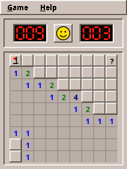

# 0. Setting Up

Before the first game, your machine needs four things: a Java Development Kit, Git, an editor and the source code. This chapter installs them, builds the finished Mines game and runs it. At the end you know that everything works, and you know where things are.

## What you need

| Tool | Why | Version |
|---|---|---|
| **JDK** (Java Development Kit) | compiles and runs the games | 25 |
| **Git** | fetches the source code, keeps your changes | any recent |
| **An IDE** | editing, running, debugging | IntelliJ IDEA, VS Code with the Java extensions, or Eclipse |
| Gradle | builds the projects | nothing to install: each project brings its own *Gradle wrapper* |

The games are developed on Linux and run on the amadeOS desktop, but everything in this book also works on any other Linux, on Windows and on macOS.

## Installing the JDK and Git

=== "amadeOS, Debian, Ubuntu"

    ```bash
    sudo apt install openjdk-25-jdk git
    ```

=== "Windows"

    Install the **Temurin JDK 25** from [adoptium.net](https://adoptium.net) (tick *Set JAVA_HOME* in the installer) and **Git for Windows** from [git-scm.com](https://git-scm.com).

=== "macOS"

    ```bash
    brew install --cask temurin@25
    brew install git
    ```

Check the result in a new terminal:

```console
$ java -version
openjdk version "25.0.4.1" 2026-08-18
$ git --version
git version 2.53.0
```

The exact numbers differ; the Java version must start with 25.

!!! info "Behind the scenes: toolchains"
    The build files ask Gradle for a Java 25 *toolchain*. If your default `java` is older, Gradle looks for an installed JDK 25 and uses it for compiling, testing and running. You only need one JDK 25 somewhere on the machine.

## Getting the source code

The engine, the shared amadeOS library and every game live in their own Git repositories. Clone them **next to each other** into one directory:

```bash
mkdir -p ~/projects/amade && cd ~/projects/amade
git clone https://github.com/amadeos-eu/amade-commons.git
git clone https://github.com/amadeos-eu/amade-game-engine.git
git clone https://github.com/amadeos-eu/amade-mines-game.git
```

```text
~/projects/amade/
├── amade-commons/        shared library of all amadeOS programs: theme, start-up, texts
├── amade-game-engine/    the game engine, and this book in docs/handbook
└── amade-mines-game/     the first game
```

Why next to each other? A game declares the engine as a normal dependency, which Gradle would download from [JitPack](https://jitpack.io). But each game's `settings.gradle` also says: *if the engine is checked out next to me, build that instead.*

```groovy title="amade-mines-game · settings.gradle"
--8<-- "amade-mines-game/settings.gradle"
```

Gradle calls this a **composite build**. When you change the engine, the game sees the change at once, without publishing anything. The engine does the same with `amade-commons`.

## Building and running Mines

```bash
cd amade-mines-game
./gradlew run
```

The first run takes a while: the wrapper downloads Gradle itself, then the libraries. Later runs start in seconds. A window opens:



Play a round. Left click opens a cell, right click puts a flag on it. Close the window when you are done.

Now run the tests:

```bash
./gradlew test
```

```console
BUILD SUCCESSFUL in 9s
```

A few tests open real windows. On a machine without a screen (a server, a CI build) run them inside a virtual X server:

```bash
xvfb-run --auto-servernum ./gradlew test
```

The test report is in `build/reports/tests/test/index.html`: open it in a browser to see every test and its result.

!!! tip "Tip"
    `./gradlew tasks` lists everything the build can do. The ones you will use most: `run`, `test`, `jar` (a single runnable jar in `build/libs/`) and `deb` (a Debian package).

## Opening the project in an IDE

Open the folder `amade-mines-game` in your IDE and let it **import it as a Gradle project**. The IDE then reads `build.gradle`, finds the engine and amade-commons next door and knows every class.

=== "IntelliJ IDEA"

    *File → Open*, choose the folder. IntelliJ recognises `build.gradle` and imports it. Set *Settings → Build Tools → Gradle → Gradle JVM* to Java 25 if it is not chosen.

=== "VS Code"

    Install the *Extension Pack for Java* and the *Gradle for Java* extension, then *File → Open Folder*.

=== "Eclipse"

    *File → Import → Gradle → Existing Gradle Project*.

To start the game from the IDE, run the class `eu.amadeos.games.mines.bootstrap.AmadeMinesApplication`.

!!! warning "Pitfall: \"non-project file\""
    If your editor marks every import red and calls the file a *non-project file*, the folder was opened as plain files, not imported as a Gradle project. Import it as shown above; the errors disappear. They never meant that the code is wrong: `./gradlew build` compiles it fine.

## Where a game keeps its files

amadeOS programs follow the [XDG Base Directory specification](https://specifications.freedesktop.org/basedir-spec/latest/). Two environment variables decide where files go, with defaults when they are not set, which is the usual case:

| What | Variable | Default | Mines uses |
|---|---|---|---|
| Settings | `$XDG_CONFIG_HOME` | `~/.config` | `~/.config/amadeos/mines/mines.properties` |
| Data | `$XDG_DATA_HOME` | `~/.local/share` | `~/.local/share/amadeos/games/mines/*.scores` |

All of them are plain text files. Open one in an editor: you will see exactly what the game saved.

## Installing a game on amadeOS

On amadeOS and other Debian systems a game is installed as a Debian package:

```bash
./gradlew deb
sudo apt install ./build/distributions/amade-mines-game_0.0.0~dev.0_all.deb
```

A build on your own machine has the version `0.0.0-dev.0` (`0.0.0~dev.0` in the package name). CI computes the real version from the commits, and the released packages are on each game's GitHub Releases page; see "Versions and Releases" in the Application Developer's Handbook.

The game then appears in the desktop's menu under *Games*, and `amade-mines-game` starts it from a terminal. `sudo apt remove amade-mines-game` removes it again.

## When something goes wrong

| Symptom | Cause and fix |
|---|---|
| `Cannot find a Java installation ... matching languageVersion=25` | No JDK 25 installed. Install it as above. |
| `Could not resolve com.github.amadeos-eu:amade-game-engine` | The engine is not checked out next to the game and JitPack cannot be reached. Clone `amade-game-engine` next to the game. |
| Window tests fail with odd screen sizes | An old virtual X server is still running on that display. Find it with `pgrep -a Xvfb` and end it. |
| Everything is tiny on a high-resolution screen | Start with `-Dsun.java2d.uiScale=2`, e.g. `JAVA_TOOL_OPTIONS=-Dsun.java2d.uiScale=2 ./gradlew run`. |
| The game starts in the wrong language | amadeOS programs follow the desktop's language, else `LANG`. Try `LANG=en_US.UTF-8 ./gradlew run`. |

Everything works? Then the next chapter explains why these games have their own engine at all, instead of using one of the existing Java game libraries.
