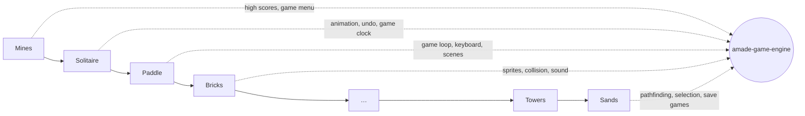

# 1. Why Our Own Engine

Java has several game libraries, some of them mature and widely used. So why does amadeOS write its own? This chapter compares the options honestly, explains the decision, and says what it costs. If you ever start a game where another library fits better, you will know which one to pick.

## What a game engine does

Strip any game down and the same jobs appear:

- **A loop** that runs many times a second: read input, update the world, draw it.
- **Drawing**: images (*sprites*), shapes and text, fast enough for 60 frames per second.
- **Input**: keyboard, mouse, gamepad, turned into actions like "jump" or "select".
- **Sound**: effects and music, several at once.
- **Collision**: which objects touch.
- **Assets**: loading images, sounds, maps and fonts.
- **Worlds larger than the screen**: tile maps and a camera.
- **Plumbing**: menus, settings, high scores, saving.

An engine is a library that does these jobs, so that a game only describes *its* rules and content. The question is not whether you need these parts, but whether you take them from someone else or build them.

## The candidates

| Library | What it is | Strong at | Why not for amadeOS |
|---|---|---|---|
| **Engine Alpha** | Teaching engine from German schools | Very gentle start, German documentation | Made for first steps; little support for large games like strategy games. |
| **FXGL** | Game library on JavaFX | Productive for small and medium 2D games: entities, animation, collision built in | JavaFX is a second UI toolkit next to the Swing desktop, with its own look, and an extra dependency (OpenJFX is not part of the JDK). |
| **LibGDX** | The largest Java game framework, OpenGL through LWJGL | Performance, tile maps, cameras, asset management, large community; desktop, Android, iOS and web | Needs OpenGL and native libraries per platform; its own windowing, so no amadeOS look; much infrastructure to learn before the first game. |
| **LITIENGINE** | 2D engine on Java2D, with a map editor | Pure Java like ours, Tiled maps, editor | A complete framework with its own window, loop and global game object: you learn *it*, not how engines work, and its windows do not follow the desktop theme. |
| **jMonkeyEngine** | Full 3D engine on LWJGL | 3D scenes, physics, terrain, lighting | Far more than classic 2D games need. |
| **LWJGL** | Bindings to OpenGL, Vulkan, OpenAL, GLFW | Maximum control and speed | Not an engine: everything above the graphics card is left to you. |

Each of them is a good choice for someone. For example, if you want to publish a fast-paced game on Android, LibGDX is hard to beat.

## Why amadeOS builds its own

### 1. The goal is to understand engines, not just to use one

This book is about **learning how games and engines work**. With a finished framework you learn its API: which class to extend and which method to override. Why there is a fixed time step, how a tile map is drawn quickly, or how units find their way, stays hidden inside it.

When you build the engine yourself, game by game, every part has a reason you saw with your own eyes. The game loop arrives in the chapter on Paddle, because Paddle is the first game whose world keeps moving while you do nothing. Pathfinding arrives with Maze, because ghosts must find the player. Nothing is there "because engines have it".

### 2. The same toolkit as the whole desktop

The amadeOS desktop, its applications and tools are written with **Swing** and **Java2D**, the user-interface toolkit that is part of every JDK. They share a library, `amade-commons`, which provides the CDE look, the colour themes and the languages.

A game built on the same toolkit gets all of that for free. Its menus and dialogs look like the rest of the desktop. Its colours change when the user picks another theme in the Style Manager. Its texts follow the desktop's language. With LibGDX or FXGL, a game would be a foreign body on the desktop with its own window and widgets.

### 3. No graphics drivers, no native libraries

Java2D runs wherever Java runs. It needs no OpenGL context, no native libraries per operating system and no particular graphics card. It works in a virtual machine without 3D acceleration, over a remote X connection and on old hardware.

For amadeOS this matters because the system is often tried out in QEMU. For you it means fewer things can go wrong.

### 4. Java2D is fast enough for these games

The games in this book are classic 2D games. *Dune II* ran at 320 × 200 pixels on a 1992 PC. *Pharaoh* ran at 640 × 480 on a computer with less power than a phone today. Java2D draws thousands of images per frame on current hardware if you follow a few rules: draw into a small back buffer and scale it once, cache tile layers as images, and avoid creating objects in the loop. The book teaches these rules when a game needs them.

### 5. Small and lasting

A game in this book depends on the JDK, amade-commons and the engine, and that is all. It packages into one jar, one Debian package and one Windows installer. Frameworks come and go. Slick2D, popular around 2010, is abandoned today. Swing and Java2D have been part of the JDK since 1998 and still are.

## What it costs

Honesty demands the other side too:

- **More work.** Everything a framework gives you, we write. That is the point of the book, but it takes time.
- **A performance ceiling.** Java2D will never draw as much per frame as OpenGL. For hundreds of animated units in a large map we must be smarter, not stronger.
- **No visual editor**, no ready-made physics engine, no Android or browser version.
- **A small community.** Answers to your questions are in this book and the source code, not on many forums.

If a future game hits one of these walls, the design keeps the door open. As you will see in the next chapter, the **rules of every game are plain Java without any Swing**. Only drawing, input and sound touch the toolkit. Moving a game to LibGDX would mean rewriting those parts, but not the game itself.

## The path in short

Each game takes what the engine already has and adds what it was missing. In the next chapter we look at how a game is organised inside, so that this growth stays tidy.
