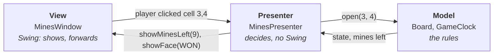

# 2. How a Game Is Built

A small game fits into one class: a window that paints the field, listens to the mouse and keeps the rules in a few fields. Many first games are written that way, and EuroMines, the ancestor of our Mines, was too. It works until you want to test the rules, change the look, add a second window or find a bug in a 900-line class.

The amadeOS programs share one structure that avoids this. This chapter explains it with Mines as the example. You will meet the same packages in every game of this book and in every amadeOS application.

## The repositories

| Repository | Contains | Depends on |
|---|---|---|
| `amade-commons` | The shared library of all amadeOS programs: theme and CDE look, start-up, texts in five languages, XDG directories | the JDK, Guice |
| `amade-game-engine` | What games share: high scores and game menus now; game loop, drawing, input and sound later | `amade-commons` |
| `amade-<name>-game` | One game each: `amade-mines-game`, `amade-solitaire-game`, … | `amade-game-engine` |

Dependencies point one way only: a game uses the engine, the engine uses amade-commons. The engine never knows a particular game. That is what makes it an engine.

!!! info "Behind the scenes: amadeOS applications"
    The non-game programs of amadeOS (text editor, mail, fractals, …) are built the same way, in repositories called `amade-<app>` with packages `eu.amadeos.apps.<app>`. Everything in this chapter applies to them too, except that they depend on amade-commons directly.

## The packages of a game

All game code is under `eu.amadeos.games.mines`:

| Package | Job | Classes in Mines |
|---|---|---|
| `bootstrap` | Start-up and wiring | `AmadeMinesApplication`, `MinesModule` |
| `domain` | The rules, no user interface | `Board`, `Difficulty`, `Look`, `GameClock` |
| `repository` | Files on disk | `MinesSettings` |
| `ui.main` | The window and its presenter | `MinesPresenter`, `MinesView`, `MinesWindow` |
| `ui.view` | Components that draw themselves | `BoardView`, `Counter`, `FaceIcon`, `Face` |

Larger programs add a `service` package for work that is neither rules nor storage, for example the calculation threads of the fractal explorer. Each package has one job:

### `domain`: the rules

This is the heart of a game: the field, the pieces, what a move does, when the game is won. **The domain knows nothing about windows, mice or pixels.** It does not import `java.awt` or `javax.swing`. It answers questions ("what does cell 3,4 show?") and accepts commands ("open cell 3,4").

Because of that, the rules can be tested with plain JUnit tests that run in milliseconds and need no screen:

```java title="amade-mines-game · domain/BoardTest.java"
--8<-- "amade-mines-game/src/test/java/eu/amadeos/games/mines/domain/BoardTest.java:empty-area"
```

This rule never changes, whatever kind of game it is.

### `repository`: files

Settings, high scores and saved games are read and written here, and nowhere else. If the file format changes, only this package changes. Mines has one class, `MinesSettings`, which keeps the chosen field size in `~/.config/amadeos/mines/mines.properties`.

### `ui`: what the player sees

Everything with Swing lives under `ui`. In `ui.view` are components that draw themselves: the field, the counters, the face. In `ui.main` the window is assembled, and the **presenter** decides what to show. That is the next topic.

### `bootstrap`: putting it together

The `main` method and the wiring of all parts. More on that [below](#wiring-it-together-guice).

## Model-View-Presenter

How do the rules and the window talk to each other? Mines uses **Model-View-Presenter** (MVP), like all amadeOS applications:



- The **model** is the domain: `Board` with its rules, `GameClock` for the time.
- The **view** is the window. It shows what it is told and reports what the player does. It decides nothing.
- The **presenter** sits between them. It receives the player's actions, changes the model and tells the view what to show. It is plain Java, **without Swing**.

The key is that the presenter does not know the window class. It only knows an interface, which lists exactly what the presenter needs from a view:

```java title="amade-mines-game · ui/main/MinesView.java"
--8<-- "amade-mines-game/src/main/java/eu/amadeos/games/mines/ui/main/MinesView.java:view"
```

The window implements this interface. When the player clicks on the field, the window passes the click to the presenter, and the presenter plays the move:

```java title="amade-mines-game · ui/main/MinesPresenter.java"
--8<-- "amade-mines-game/src/main/java/eu/amadeos/games/mines/ui/main/MinesPresenter.java:moves"
```

After every move, the presenter brings the view up to date, and it is the presenter that notices a won game and records the time:

```java title="amade-mines-game · ui/main/MinesPresenter.java"
--8<-- "amade-mines-game/src/main/java/eu/amadeos/games/mines/ui/main/MinesPresenter.java:update"
```

Read it once more and notice what is missing: no `JLabel`, no `repaint()`, no dialog class. "Ask for the name" is one call on the view; how the question looks is the window's business.

### Why the detour pays off

Because the presenter only talks to an interface, a test can hand it a **fake view** that simply writes down what it was told:

```java title="amade-mines-game · test/ui/main/FakeView.java"
--8<-- "amade-mines-game/src/test/java/eu/amadeos/games/mines/ui/main/FakeView.java:fake"
```

Now the behaviour of the whole game can be tested without a window. Here, a best time is recorded:

```java title="amade-mines-game · test/ui/main/MinesPresenterTest.java"
--8<-- "amade-mines-game/src/test/java/eu/amadeos/games/mines/ui/main/MinesPresenterTest.java:test-win"
```

The test even controls time: the presenter got a clock whose "now" is a number the test moves forward (`now[0] += 4_200_000_000L` is 4.2 seconds). No test waits for real seconds to pass.

!!! tip "Tip: a rule of thumb"
    If you are about to write an `if` in the window, stop and ask whether it is a decision. Decisions belong in the presenter or the model, where tests can reach them.

### The cost

MVP is not free. Mines needs a view interface with ten methods, a fake view in the tests, and in the window a few lines that forward each mouse gesture to the presenter. For a program of a few hundred lines this feels like ceremony. It pays back as soon as you change something and the tests tell you within seconds that the game still works.

## Two kinds of games, two patterns

MVP fits programs that **wait for the user**: nothing happens until a click, then one reaction, then waiting again. Mines and Solitaire are like that, and so are the menus, settings and dialogs of every game.

Action games are different. The ball in Paddle moves 60 times a second whether you press a key or not. A presenter that calls `showBallPosition(x, y)` for every movement, and the same for every brick and particle, would be silly. Real-time games therefore turn the flow around:

```text
60 times a second:
    input    → which keys are down?
    update   → model.update(time step)       // the rules: plain Java, no Swing
    render   → renderer.draw(model)          // reads the model, changes nothing
```

The renderer *pulls* the state once per frame instead of the presenter *pushing* every change. This is the **game loop**, and it arrives with Paddle in part II.

| Kind of game | Pattern | In this book |
|---|---|---|
| Waits for the player | Model-View-Presenter | Mines, Solitaire |
| Real time | Model, renderer, game loop | Paddle up to Sands |
| Around every game: menus, settings, dialogs | Model-View-Presenter | all games |

The pattern changes, the principle stays: **the rules live in `domain`, without Swing, and are tested without a screen.**

## Wiring it together: Guice

The presenter needs a view, the settings, the high scores, a random number generator and a clock. The window needs the texts and the high scores. Someone has to create all these objects in the right order and hand each one what it needs. That someone is [Guice](https://github.com/google/guice), a small *dependency injection* library.

You describe once which class to use for what, in a **module**:

```java title="amade-mines-game · bootstrap/MinesModule.java"
--8<-- "amade-mines-game/src/main/java/eu/amadeos/games/mines/bootstrap/MinesModule.java"
```

- `bind(MinesView.class).to(MinesWindow.class)`: whoever needs a `MinesView` gets the window.
- `@Provides` methods build objects that need a little code, like the high scores in the right directory.
- Classes whose constructor is marked `@Inject` (the presenter, the window) are built by Guice, which fills in the constructor's parameters.

The `main` method then only asks for the finished objects:

```java title="amade-mines-game · bootstrap/AmadeMinesApplication.java"
--8<-- "amade-mines-game/src/main/java/eu/amadeos/games/mines/bootstrap/AmadeMinesApplication.java"
```

`AmadeApplication.launch` comes from amade-commons. It does what every amadeOS program needs before its first window:

- It picks the language of the desktop.
- It installs the CDE look in the current colour theme, and follows the theme when the user changes it.
- It switches to Swing's event thread.
- It adds the shared objects (directories, language, a background executor) to Guice.

!!! warning "Pitfall: the event dispatch thread"
    Swing is not thread-safe. Every change to a window must happen on one thread, the **event dispatch thread** (EDT). Mouse clicks, menu actions and Swing timers already run there, and `AmadeApplication.launch` starts your code there. If you ever do work on another thread, hand the result back with `SwingUtilities.invokeLater`. In Mines everything happens on the EDT, so you will not notice yet.

## Texts and languages

No visible text is written in Java code. Texts live in `messages.properties` (English) and its translations `messages_de.properties`, `_fr`, `_es` and `_it`, read through the `Messages` class of amade-commons:

```properties title="amade-mines-game · messages.properties (excerpt)"
--8<-- "amade-mines-game/src/main/resources/eu/amadeos/games/mines/messages.properties:menu"
--8<-- "amade-mines-game/src/main/resources/eu/amadeos/games/mines/messages.properties:won"
```

The `&` marks the **mnemonic**, the underlined letter that opens a menu entry with the keyboard. Each language chooses its own letter. `{0}` and `{1}` are filled in by `msg.format("scores.won", size, seconds)`, formatted the way the language expects.

Two tests guard the translations in every game:

- one fails if a language lacks a text, or uses other `{n}` arguments than English;
- one fails if two entries of the same menu share a mnemonic letter.

The engine contributes the standard entries (*New Game*, *High Scores*, *Exit*), and the game adds its own (*Beginner*, *Marks*). That is why the mnemonic test of a game checks both together.

## Summary

- Every game is its own repository with the same packages: `bootstrap`, `domain`, `repository`, `ui.main`, `ui.view`.
- The rules in `domain` never touch Swing, so plain tests cover them.
- Games that wait for the player use Model-View-Presenter: the presenter decides, the view shows, a fake view lets tests play the whole game.
- Real-time games will use a game loop instead, with the same separation of rules and drawing.
- Guice wires the parts; `AmadeApplication` starts the program in the desktop's language and theme.

Now you know the map. In the next chapter we walk it: we build Mines from the rules up.
