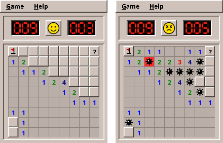

# 10. Mines

Our first game is a classic: a field of hidden cells, some with mines under them. Open every cell without a mine and you win; open a mine and you lose. Numbers tell you how many mines touch a cell, and from them you deduce where the mines are.

<figure markdown>

<figcaption>Playing, with a flag and a question mark (left), and after stepping on a mine (right).</figcaption>
</figure>

Mines is a perfect first game: no animation, no timing, no physics. The program waits for a click, reacts, and waits again. That lets us concentrate on the foundations every later game stands on.

!!! abstract "What you will learn"
    - Turning the rules of a game into a **model**: plain Java classes with tests
    - Storing a grid in an array, finding neighbours, and **flood fill** without recursion
    - **Random** numbers that tests can repeat
    - Drawing with **Java2D**: `paintComponent`, shapes, colours from the desktop theme
    - Handling the **mouse**: press, drag, release, two buttons at once
    - **Model-View-Presenter** in a real game, tested without a screen
    - **Measuring time** in a testable way
    - **High scores** with the engine

The complete game is in [amade-mines-game](https://github.com/amadeos-eu/amade-mines-game). Open it next to this chapter.

## The rules

Before writing code, write down the rules precisely. Every vague sentence here becomes a bug later.

1. The field has *columns × rows* cells. Some hold a mine; the player does not see which.
2. **Opening** a cell without a mine shows how many of its up to eight **neighbours** hold a mine: a number from 1 to 8, or an empty cell for 0.
3. An empty cell opens all its neighbours automatically, and empty ones among them open theirs, and so on. One click can open a large area.
4. Opening a mine **loses** the game. All mines are shown.
5. When every cell without a mine is open, the game is **won**.
6. A cell can carry a **flag** ("there is a mine here") or a **question mark** ("not sure"). Flagged cells cannot be opened by accident. The counter shows mines minus flags.
7. **Chord**: clicking an open number that has exactly as many flags around it as its number opens all its other neighbours at once.
8. The **first click is always safe** and always opens an area.
9. Three sizes: Beginner 9 × 9 with 10 mines, Intermediate 16 × 16 with 40, Expert 30 × 16 with 99.

Rule 8 is the interesting one. How can the first click be safe if the mines are already there? The trick: they are not. We lay the mines **after** the first click, around it.

## Step 1: The field in memory

A grid suggests a two-dimensional array, `boolean[rows][columns]`. Mines uses a one-dimensional array instead, and computes the index from column and row:

```text
index = row × columns + column

column →   0   1   2   3
row 0      0   1   2   3
row 1      4   5   6   7
row 2      8   9  10  11
```

One index per cell makes many things simpler: a cell fits into one `int`, a list of cells is an `int[]`, and a work list for the flood fill is a queue of numbers. The way back is `column = index % columns` and `row = index / columns`.

The `Board` class keeps four arrays of the same length, one value per cell: is there a mine, is the cell open, which mark does it carry (`NONE`, `FLAG` or `QUESTION`), and how many mines touch it. Then a little bookkeeping: the `state` (`READY`, `PLAYING`, `WON`, `LOST`), how many cells are open, how many flags are set, and which mine went off:

```java title="amade-mines-game · domain/Board.java"
--8<-- "amade-mines-game/src/main/java/eu/amadeos/games/mines/domain/Board.java:fields"
```

### Neighbours

Almost every rule talks about the eight neighbours of a cell. Cells at the edge have fewer: a corner has three. One method finds them for every cell:

```java title="amade-mines-game · domain/Board.java"
--8<-- "amade-mines-game/src/main/java/eu/amadeos/games/mines/domain/Board.java:neighbours"
```

The two loops visit the 3 × 3 square around the cell, skip the cell itself (`dr != 0 || dc != 0`) and anything outside the field (`contains`). You will write this pattern again in many games: Bomberman's explosions, the ghosts in Maze and the units in Sands all ask for their neighbours.

## Step 2: Laying the mines

Laying 10 mines on 81 cells sounds easy: pick a random cell, put a mine there if it has none, repeat until there are 10. Many programs do exactly that. It works, but it has two problems. On a nearly full field the loop keeps picking cells that are already taken. And the rule "not on or around the first cell" turns into more retries.

A cleaner way is to **shuffle**. Make a list of all cells that may receive a mine, shuffle it, and take the first ten. We do not even need to shuffle all of it: the *Fisher–Yates* shuffle can stop after the first ten places.

```java title="amade-mines-game · domain/Board.java"
--8<-- "amade-mines-game/src/main/java/eu/amadeos/games/mines/domain/Board.java:lay-mines"
```

Read the loop slowly. In round `k`, a random position `j` from `k` to the end is chosen, and the candidates at `k` and `j` swap places. Candidate `k` becomes a mine. Every free cell has the same chance, and no cell is drawn twice. When the field is too full to keep the neighbours free (try 8 mines on 3 × 3), only the first cell itself stays free.

!!! tip "Random numbers that tests can repeat"
    `Board` does not create its own `Random`. It receives a `RandomGenerator` in the constructor. The game passes a truly random one. A test passes `new SplittableRandom(7)`, a generator with a fixed *seed*, and gets the same field on every run. A test that fails once fails every time, and you can find the bug.

## Step 3: Opening a cell

Here is the method behind a left click:

```java title="amade-mines-game · domain/Board.java"
--8<-- "amade-mines-game/src/main/java/eu/amadeos/games/mines/domain/Board.java:open"
```

The order matters:

1. Nothing happens after the end of the game, outside the field, on open or flagged cells. The method returns `false`, "nothing changed", and the caller does not even redraw.
2. On the first click (`READY`) the mines are laid around this cell.
3. A mine loses. `exploded` remembers which one, so it can be drawn red.
4. Otherwise `flood` opens the cell and, if it is empty, the area around it.
5. If every cell without a mine is open, the game is won.

### Flood fill without recursion

Rule 3, the area opening, is a **flood fill**, like the paint bucket of a drawing program. The obvious version is recursive: open the cell, and if it is empty, call yourself for every neighbour.

The recursive version has a hidden danger: every call that has not finished yet takes a place on the **call stack**, which is limited. On a 30 × 16 field the open area can be hundreds of cells deep; on a larger custom field the program would end with a `StackOverflowError`. The robust version keeps its own list of cells still to visit:

```java title="amade-mines-game · domain/Board.java"
--8<-- "amade-mines-game/src/main/java/eu/amadeos/games/mines/domain/Board.java:flood"
```

`pending` is a stack we manage ourselves, an `ArrayDeque` that grows as needed. Take a cell; skip it if it is already open, a mine or flagged; otherwise open it, and if it shows 0, put its closed neighbours on the stack. When the stack is empty, the area is open.

!!! info "Behind the scenes"
    This "work list" pattern returns in part II and III: breadth-first search in Maze is the same loop with a queue instead of a stack, and A* in Sands is the same loop with a priority queue.

## Step 4: What a cell shows

The view will need to know what to draw for each cell. Should it look at `mine`, `open`, `marks` and `state` itself? No: then the rules of *showing* (a wrong flag is crossed out after losing, a mine you did not flag appears) would end up in the drawing code. Instead, the model answers one question per cell with an `enum`:

```java title="amade-mines-game · domain/Board.java"
--8<-- "amade-mines-game/src/main/java/eu/amadeos/games/mines/domain/Board.java:look"
```

`Look` has seven values: `HIDDEN`, `FLAG`, `QUESTION`, `OPEN`, `MINE`, `EXPLODED`, `WRONG_FLAG`. For `OPEN` cells the view asks `count(column, row)` for the number. The drawing code becomes a simple `switch`, and the rules stay testable.

## Step 5: Testing the rules

The model is complete, and there is no window yet. This is the best moment for tests. To make them readable, `Board` has a small factory that builds a field from text, `*` for a mine:

```java title="amade-mines-game · test/domain/BoardTest.java"
--8<-- "amade-mines-game/src/test/java/eu/amadeos/games/mines/domain/BoardTest.java:empty-area"
```

The field reads like a picture, and the test reads like the rules. The safe first click is tested on real random fields, twenty times over:

```java title="amade-mines-game · test/domain/BoardTest.java"
--8<-- "amade-mines-game/src/test/java/eu/amadeos/games/mines/domain/BoardTest.java:first-click"
```

And the marks, including the counter going below zero when you set more flags than there are mines:

```java title="amade-mines-game · test/domain/BoardTest.java"
--8<-- "amade-mines-game/src/test/java/eu/amadeos/games/mines/domain/BoardTest.java:marks"
```

Run them with `./gradlew test --tests '*BoardTest'`. They need no screen and finish in well under a second.

!!! warning "Pitfall: testing through the window"
    It is tempting to test a game by clicking through it. Those tests are slow, need a display and break whenever the layout changes. Test the rules in the model and the decisions in the presenter. Keep the few window tests for checking that clicks arrive at all.

## Step 6: Drawing the field

Now the field gets a face. In Swing, a component that draws itself extends `JComponent` and overrides **`paintComponent`**. Swing calls it whenever the component must be drawn: when the window appears, when it was covered, or when you call `repaint()`. You never call `paintComponent` yourself.

```java title="amade-mines-game · ui/view/BoardView.java"
--8<-- "amade-mines-game/src/main/java/eu/amadeos/games/mines/ui/view/BoardView.java:paint"
```

The `Graphics` object is a pen for this component. Its coordinates start at the top left corner, `x` to the right and `y` **downwards**, in pixels. `g.create()` makes a copy we may change freely (colour, font, smoothing) and must `dispose()` at the end, so the next component gets an unchanged pen.

Each cell is drawn at `x = column × cellSize`, `y = row × cellSize`. Closed cells get a raised 3D border from amade-commons (`AmadeUI.paintBevel`), open cells a flat background with a thin line. The colours come from `AmadeUI.theme()`, the desktop's current colour theme. When the user picks another theme in the Style Manager, amade-commons repaints all windows, `paintComponent` runs again, and the field takes the new colours without any code of ours.

!!! tip "Cells that grow with the text"
    `cellSize` is not a fixed number of pixels. The window computes it from the font size, about 1.7 times the height of the text. On a large screen with a large font, the field grows with it.

### Drawing with shapes

Mines, flags and faces are not images and not emoji characters. They are drawn from simple shapes, because an emoji font may not be installed and images do not scale. Here is the mine: four lines for the spikes, a filled circle and a small white circle as a reflection:

```java title="amade-mines-game · ui/view/BoardView.java"
--8<-- "amade-mines-game/src/main/java/eu/amadeos/games/mines/ui/view/BoardView.java:paint-mine"
```

`Line2D.Float` and `Ellipse2D.Float` take `float` coordinates, so the shape is exact at every size. Before drawing, the code switches on **antialiasing** (`RenderingHints.KEY_ANTIALIASING`), which smooths the edges of round shapes. All sizes are fractions of `cellSize`, so the mine scales with the cell.

The seven-segment digits of the counters (`Counter`) and the face on the button (`FaceIcon`) are drawn the same way. Look at them as exercises in reading Java2D code.

## Step 7: The mouse

Swing reports mouse buttons as events: `mousePressed`, `mouseReleased`, `mouseDragged`. Mines reacts like the original:

- **Left button:** the cell under the mouse looks pressed while the button is down. It opens on **release**, and only if the mouse is still over a cell. Dragging away is a way to change your mind.
- **Right button:** cycles the mark immediately on press.
- **Middle button, or left and right together:** chord. The neighbours look pressed while the buttons are down.

The first job is turning pixels into a cell, by dividing by the cell size:

```java title="amade-mines-game · ui/view/BoardView.java"
--8<-- "amade-mines-game/src/main/java/eu/amadeos/games/mines/ui/view/BoardView.java:cell-at"
```

`Math.floorDiv` instead of `/` matters for points left of or above the field: `-5 / 20` is `0` in Java, which would wrongly be the first column, while `floorDiv(-5, 20)` is `-1`, outside. The press and release handling:

```java title="amade-mines-game · ui/view/BoardView.java"
--8<-- "amade-mines-game/src/main/java/eu/amadeos/games/mines/ui/view/BoardView.java:mouse"
```

Two details are worth a closer look. First, `getModifiersEx()` tells which buttons are down *at the moment of the event*. That is how pressing the second button while the first is held becomes a chord. Second, after a chord the other button is still down; when it is released, it must not open a cell. `swallowRelease` remembers that.

Notice what `BoardView` does **not** do: it never calls `board.open`. It reports the gesture through its `Listener` interface (`open`, `chord`, `mark`, `pressing`), and someone else decides what that means. That someone is the presenter.

## Step 8: The presenter runs the game

[Chapter 2](02-structure.md#model-view-presenter) introduced Model-View-Presenter. Here is how the game uses it. The presenter starts a new game like this:

```java title="amade-mines-game · ui/main/MinesPresenter.java"
--8<-- "amade-mines-game/src/main/java/eu/amadeos/games/mines/ui/main/MinesPresenter.java:new-game"
```

It receives the gestures of the field and plays them on the model. The first successful click also starts the clock:

```java title="amade-mines-game · ui/main/MinesPresenter.java"
--8<-- "amade-mines-game/src/main/java/eu/amadeos/games/mines/ui/main/MinesPresenter.java:moves"
```

After each move, `update()` brings the counters, the face and the field up to date, stops the clock when the game ended, and records a win (you saw it in chapter 2).

### Time you can test

The clock is a small model class of its own. Mines wrote it in its `domain` package; when Solitaire needed the same clock, it moved into the engine, where you find it today:

```java title="amade-game-engine · time/GameClock.java"
--8<-- "amade-game-engine/src/main/java/eu/amadeos/gameengine/time/GameClock.java:clock"
```

It does not read the system time directly. It asks a `LongSupplier`, which the game fills with `System::nanoTime` and a test with a number it controls. `System.nanoTime()` is the right source for durations: unlike the wall clock, it never jumps when the computer adjusts its time.

Who shows the seconds while the player thinks? The presenter asks the view to start a timer (`setTicking(true)`). The window uses a **Swing `Timer`**, which calls `presenter.tick()` five times a second on the event thread. The presenter reads the clock and calls `showTime`. The timer belongs to the view because it is Swing; the decision when to run it belongs to the presenter.

```java title="amade-mines-game · test/ui/main/MinesPresenterTest.java"
--8<-- "amade-mines-game/src/test/java/eu/amadeos/games/mines/ui/main/MinesPresenterTest.java:test-first-click"
```

## Step 9: The window

`MinesWindow` is a `JFrame` that implements `MinesView`. Its constructor builds the layout:

- **top:** mine counter, face button, clock, in a sunken frame;
- **centre:** the field;
- **menu bar:** *Game* and *Help*.

It forwards the gestures of the field to the presenter:

```java title="amade-mines-game · ui/main/MinesWindow.java"
--8<-- "amade-mines-game/src/main/java/eu/amadeos/games/mines/ui/main/MinesWindow.java:forward"
```

Each `MinesView` method is a few lines: `showMinesLeft` sets the counter, `showFace` changes the icon and repaints the button, `showBoard` gives the field its new board and calls `pack()`, so the window takes the size of the new field.

Why does the window not create the presenter itself? Because each needs the other: the presenter talks to the view, the view forwards to the presenter. Guice creates both, and `bind(presenter)` connects them before the game starts. You saw this in `AmadeMinesApplication` in chapter 2.

## Step 10: High scores

The best ten times per field size are kept with the engine's `HighScores`. The game's Guice module creates it with the game's name (`mines`) and the information that **lower is better**:

```java title="amade-mines-game · bootstrap/MinesModule.java"
--8<-- "amade-mines-game/src/main/java/eu/amadeos/games/mines/bootstrap/MinesModule.java:high-scores"
```

Each field size is one *table*, a file named after the size: `beginner.scores`, `intermediate.scores`, `expert.scores`.

After a win, `qualifies(table, seconds)` tells whether the time enters the table. If it does, the presenter asks the view for the player's name, `add` stores the entry and returns its place, and the view shows the table with the new entry highlighted. The window uses the engine's `HighScoreDialog` for both. The question offers the name typed last time, and the table has one tab per field size and a *Reset* button.

The score files are plain text, one line per entry:

```text
42	2026-10-18T19:02:11Z	Anna
57	2026-10-17T21:40:03Z	Ben
```

!!! info "Why high scores are in the engine"
    High scores went into the engine with this very first game, because it was already clear that every game needs them. The same goes for the standard menu entries (*New Game* with F2, *High Scores...*, *Exit* with Ctrl+Q, *About*). Mines' own entries (field sizes, question marks) stay in the game. The rule of this book: **code moves into the engine when a second game needs it, or when it obviously will.**

## Step 11: Texts and packaging

The texts are in five languages, with the checks from [chapter 2](02-structure.md#texts-and-languages): a translation test and a test that no two entries of the *Game* menu share a mnemonic letter. That second test caught a real clash while this game was written: in English, *E&xpert* and *E&xit* both wanted the `x`.

`./gradlew deb` builds the Debian package with:

- the jar in `/opt/amade-mines-game/`;
- a start script in `/usr/bin/`;
- a desktop entry in the menu category *Game;LogicGame*;
- a 48-pixel icon.

The icon itself was drawn with the same Java2D code as the field.

## What moved into the engine

| From Mines | Engine package | Why |
|---|---|---|
| High scores, the remembered player name | `eu.amadeos.gameengine.score` | Every game has results worth keeping |
| *New Game*, *High Scores*, *Exit*, *About* | `eu.amadeos.gameengine.swing.GameMenus` | Same keys and texts in every game |
| High-score table and name question | `eu.amadeos.gameengine.swing.HighScoreDialog` | Same dialogs in every game |

Everything else stays in the game: the field, its drawing, the counters, the face. Solitaire, the next game, showed that one more piece was more general than it looked: the `GameClock` moved into the engine (`eu.amadeos.gameengine.time`) as soon as a second game measured time.

## Exercises

1. **Custom field.** Add a fourth size, *Custom*, with a dialog for columns, rows and mines. What must `Board` check? (Look at its constructor.) Which test do you write first?
2. **Play with the keyboard.** Arrow keys move a highlighted cell, space opens, `F` flags. Where does the highlighted cell belong: in the model, the presenter or the view? Argue for your choice.
3. **Statistics.** Count games played and won per size, and show the win rate in the high-score dialog. Which package reads and writes the numbers?
4. **No guessing.** Sometimes the numbers do not reveal where the last mines are, and the player must guess. Research "no-guess minesweeper generators". How could `layMines` reject fields that need guessing?
5. **Hexagons.** Change the field to hexagonal cells with six neighbours. Which methods change? You will be surprised how few.

---

In the next game, Solitaire, cards are dragged across the table, fly to their piles and bounce across the screen at the end. Things start to move.
