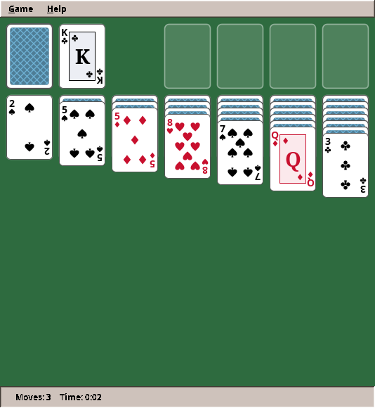
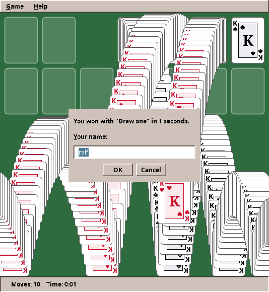

# 11. Solitaire

The second game is the patience that came with every desktop of the 1990s: **Klondike**. Fifty-two cards, seven columns, four foundations to fill from ace to king. Mines taught you to model rules, draw a grid and react to clicks. Solitaire adds what makes a game feel alive: cards you pick up and carry, cards that fly to their places, mistakes you can take back, and at the end the famous cascade of bouncing cards.

<figure markdown>
{ width="534" }
<figcaption>A game in progress. Cards, backs and suit symbols are drawn in code.</figcaption>
</figure>

!!! abstract "What you will learn"
    - Modelling **cards and piles**, and keeping the rules apart from where a card is drawn
    - A **text notation** for game positions that makes tests read like the game
    - **Undo and redo** with snapshots, and why that beats undoing each move by hand
    - Drawing complex pictures from **shapes and transforms**: pips, suit symbols, turned indices
    - **Animation**: easing curves, tweens and an animation timer, and how one idea animates every move
    - **Drag and drop** with the mouse, including drops in the wrong place
    - **Hit testing**: which card is under the mouse when cards overlap
    - A **physics** toy for the victory animation: gravity, bouncing, trails

The complete game is in [amade-solitaire-game](https://github.com/datazuul/amade-solitaire-game).

## The rules

1. A shuffled deck is dealt into **seven columns**: the first gets one card, the seventh seven. Only the top card of each column lies face up.
2. The other 24 cards form the **stock**, face down. A click turns one card (or three, in the harder variant) onto the **waste**. When the stock is empty, the waste is turned over to become the stock again.
3. The four **foundations** are built up by suit, from ace to king.
4. In the columns, cards are built **down in alternating colours**: a black 7 on a red 8. A face-up run moves together. Only a **king** may fill an empty column.
5. When a face-down card in a column is uncovered, it **turns face up**.
6. The game is **won** when all 52 cards lie on the foundations.

Two comforts of computer solitaire complete the list: any move can be **undone**, and when every card lies face up and the stock is empty, the game **finishes itself**.

## Step 1: Cards, piles and where they lie

A card is a rank and a suit, nothing more. A Java `record` says exactly that:

```java
public record Card(Rank rank, Suit suit) { … }
```

`Rank` and `Suit` are enums: thirteen ranks with a `value()` from 1 to 13, four suits, each knowing whether it is red.

Notice what a card does **not** have: a "face up" flag and a position. Whether a card lies face up is not a property of the card but of where it lies. In a column the bottom cards are face down; on a foundation every card is face up. So the face-up state belongs to the pile. A `Pile` keeps its cards bottom first and a single number, `faceDown()`: how many of the lowest cards lie face down.

This decision pays off immediately. Cards are immutable values, so a copy of a game can share them without danger, which will make undo trivial. And "turn the uncovered card over" is one line: lower `faceDown` by one.

Where a pile lies is described by a `PileId`: a kind (`STOCK`, `WASTE`, `FOUNDATION`, `TABLEAU`) and an index. Thirteen piles in all. The rules talk about `PileId`s; pixel positions are none of their business.

### Dealing

```java title="amade-solitaire-game · domain/Klondike.java"
--8<-- "amade-solitaire-game/src/main/java/eu/amadeos/games/solitaire/domain/Klondike.java:deal"
```

`Collections.shuffle` mixes the deck with the random generator it is given. As in Mines, the game receives the generator from outside, so a test with a fixed seed gets the same deal every time:

```java title="amade-solitaire-game · test/domain/KlondikeTest.java"
--8<-- "amade-solitaire-game/src/test/java/eu/amadeos/games/solitaire/domain/KlondikeTest.java:test-deal"
```

## Step 2: The rules as code

One method answers the central question of the game: *may these cards go there?*

```java title="amade-solitaire-game · domain/Klondike.java"
--8<-- "amade-solitaire-game/src/main/java/eu/amadeos/games/solitaire/domain/Klondike.java:can-move"
```

Compare it with rules 3 and 4 above: the code says the same in the same order. The `switch` over the kind of target pile makes it impossible to forget a case; the compiler checks that all four kinds are handled.

`canPick` (not shown) checks the other half: the cards must lie face up, and from the waste or a foundation only the top card may be taken. With both checks, the move itself is short:

```java title="amade-solitaire-game · domain/Klondike.java"
--8<-- "amade-solitaire-game/src/main/java/eu/amadeos/games/solitaire/domain/Klondike.java:move"
```

`move` refuses illegal moves itself (`if (!canMove(...)) return false`). The model protects its own rules. No caller can break them, however buggy it is.

Drawing from the stock, including turning the waste over:

```java title="amade-solitaire-game · domain/Klondike.java"
--8<-- "amade-solitaire-game/src/main/java/eu/amadeos/games/solitaire/domain/Klondike.java:draw"
```

## Step 3: Positions as text

Testing card games has a problem: building a position takes many lines of code, and those lines hide what the test is about. Mines solved this with fields drawn as text (`"..*."`). Solitaire does the same for card positions:

```text
stock: 2C 3C          two cards in the stock
f0: AS                the ace of spades on the first foundation
t0: [KD 9C] 8H 7S     column 0: two face-down cards, then 8♥ and 7♠ face up
```

A card is a rank letter (`A 2 … 9 T J Q K`) and a suit letter (`C D H S`). Brackets mark the face-down cards. `Klondike.of(...)` reads this, and `toString()` writes it, so a failing test prints the position in the same form. Now tests read like a description of the table:

```java title="amade-solitaire-game · test/domain/KlondikeTest.java"
--8<-- "amade-solitaire-game/src/test/java/eu/amadeos/games/solitaire/domain/KlondikeTest.java:test-columns"
```

```java title="amade-solitaire-game · test/domain/KlondikeTest.java"
--8<-- "amade-solitaire-game/src/test/java/eu/amadeos/games/solitaire/domain/KlondikeTest.java:test-draw"
```

!!! tip "Invest in test notation"
    Twenty lines for a little parser feel like a detour. They are not: every later test is shorter and clearer, and you will write many more tests because each one is cheap. Look for such a notation in every game: a maze as text, a level as text, a game state as text.

## Step 4: Undo by snapshots

How do you undo a move? The obvious way is to write, for every kind of move, its opposite: put the cards back, turn the uncovered card face down again, lower the move counter. This is the *command pattern*, and it is easy to get wrong. Forget one side effect and undo slowly corrupts the game.

Solitaire uses a simpler idea: **before each move, remember a copy of the whole game.** Undo means: throw away the current game and continue with the copy. A Klondike game is 52 small values in thirteen lists, so a copy costs almost nothing, and it cannot forget anything.

The engine provides the bookkeeping, a `History` of snapshots:

```java title="amade-game-engine · undo/History.java"
--8<-- "amade-game-engine/src/main/java/eu/amadeos/gameengine/undo/History.java:history"
```

`undo` takes the current state, so that `redo` can return to it. A new move clears the redo list: after taking a move back and playing a different one, the old future is gone. The presenter wraps every move in the same few lines:

```java title="amade-solitaire-game · ui/main/SolitairePresenter.java"
--8<-- "amade-solitaire-game/src/main/java/eu/amadeos/games/solitaire/ui/main/SolitairePresenter.java:undo"
```

For this to work, `Klondike.copy()` must be a **deep** copy: new piles with new lists. The cards themselves may be shared, because they are immutable. Here immutability pays off, as promised in step 1. A test makes sure nothing leaks between the copy and the original, and another plays undo and redo through the presenter:

```java title="amade-solitaire-game · test/ui/main/SolitairePresenterTest.java"
--8<-- "amade-solitaire-game/src/test/java/eu/amadeos/games/solitaire/ui/main/SolitairePresenterTest.java:test-undo"
```

!!! info "When snapshots are not enough"
    Snapshots need memory for every step. For a strategy game with thousands of units and a long game, copying everything before every order is too much. There, the command pattern returns, or snapshots are taken only every few moves. In part III we will meet that trade-off again. For card and board games, snapshots are the right tool.

## Step 5: Drawing cards

Every card is drawn from shapes, like the mines and faces of the previous chapter, but now the pictures are richer. `CardPainter` draws:

- **the face:** a white rounded rectangle, the index (rank and small suit) in two corners, and in the middle either pips or a court picture;
- **the back:** a lattice in the accent colour of the desktop theme, so it changes with the Style Manager;
- **empty places:** a faint outline on the table cloth.

### Shapes in a unit square

A suit symbol is a `Path2D`, a path of lines and Bézier curves, defined once in a square from 0 to 1:

```java title="amade-solitaire-game · ui/view/CardPainter.java"
--8<-- "amade-solitaire-game/src/main/java/eu/amadeos/games/solitaire/ui/view/CardPainter.java:suits"
```

`fillSuit` places the unit shape with an **`AffineTransform`**: move to the centre, rotate if needed, scale to the size, and shift by half a unit so the shape is centred. Read the transform calls from bottom to top: that is the order in which they act on the shape. The same symbol then serves as a tiny corner index, a pip and a large ace, each just a different `size`.

### Pips

Where do the seven pips of a seven go? Printed cards follow a traditional layout, here stored as data:

```java title="amade-solitaire-game · ui/view/CardPainter.java"
--8<-- "amade-solitaire-game/src/main/java/eu/amadeos/games/solitaire/ui/view/CardPainter.java:pips"
```

Each pair is a position inside the card's inner area, as fractions of its width and height. Pips in the lower half are drawn upside down, as on real cards. A table of numbers replaces ten nearly identical drawing methods. When code repeats with different numbers, put the numbers in a table.

### Turning the second index

```java title="amade-solitaire-game · ui/view/CardPainter.java"
--8<-- "amade-solitaire-game/src/main/java/eu/amadeos/games/solitaire/ui/view/CardPainter.java:face"
```

The index in the bottom right corner is the top left one, turned by 180° around the card's centre. Instead of computing mirrored coordinates, the code rotates a copy of the `Graphics2D` (`turned.rotate(Math.PI, centreX, centreY)`) and draws the same index again. Transforms let you draw in the most convenient coordinates and let Java2D do the geometry.

## Step 6: Where things lie, and what is under the mouse

`TableLayout` turns piles into pixels. It knows the card size, the gaps, how far face-down and face-up cards of a column are fanned, and that in draw-three mode the top three waste cards fan out sideways:

```java title="amade-solitaire-game · ui/view/TableLayout.java"
--8<-- "amade-solitaire-game/src/main/java/eu/amadeos/games/solitaire/ui/view/TableLayout.java:slot"
```

The reverse question is the hard part of any card game: **which card is under the mouse?** Cards overlap, and the one drawn last lies on top. So the search goes through each pile from the top card down and takes the first card whose rectangle contains the point. Where do dragged cards land? On the pile whose top card they overlap most:

```java title="amade-solitaire-game · ui/view/TableLayout.java"
--8<-- "amade-solitaire-game/src/main/java/eu/amadeos/games/solitaire/ui/view/TableLayout.java:hit"
```

`TableLayout` is pure arithmetic: it uses `Rectangle2D` and `Point2D` but no window. So it is tested like a model, without a display. `TableLayoutTest` checks the places of the piles, the fanning, and which card a click at a given point hits.

## Step 7: Animation

A card that teleports from the waste to a column looks cheap; a card that flies there over a fifth of a second looks right. Animation needs three ingredients, and the engine provides them.

### Easing: how a movement feels

Moving at constant speed looks mechanical. Real objects speed up and slow down. An **easing function** maps the elapsed share of an animation's time (0 to 1) to the share of the way covered (0 to 1):

```java title="amade-game-engine · anim/Easing.java"
--8<-- "amade-game-engine/src/main/java/eu/amadeos/gameengine/anim/Easing.java:easing"
```

With `EASE_OUT`, a card covers 87 % of its way in the first half of the time and glides into place. Try `LINEAR` instead and compare: the difference is surprisingly large.

### Tween: one animation in time

A `Tween` (from "in-between") knows when an animation started, how long it takes and how it eases. Ask it how far along it is at a given time, and interpolate any value with `lerp`:

```java title="amade-game-engine · anim/Tween.java"
--8<-- "amade-game-engine/src/main/java/eu/amadeos/gameengine/anim/Tween.java:at"
```

Neither class knows Swing or cards. They are plain functions of time, and therefore tested with plain numbers.

### Animator: frames on the event thread

Something must redraw the component about 60 times a second while cards move, and stop when they arrive. That is the engine's `Animator`, a Swing `Timer` with a twist:

```java title="amade-game-engine · swing/Animator.java"
--8<-- "amade-game-engine/src/main/java/eu/amadeos/gameengine/swing/Animator.java"
```

The frame function returns whether anything still moves; when it says no, the timer stops, and an idle game uses no CPU. `Toolkit.getDefaultToolkit().sync()` after each frame matters on Linux: without it, X11 may collect drawing commands and show several frames at once, and the animation stutters.

!!! warning "Pitfall: a Swing Timer is not a game loop"
    A `javax.swing.Timer` is fine for short animations: it runs on the event thread, so the code may touch components directly. But it is not precise; frames come a few milliseconds early or late. For a card that flies 0.2 seconds, nobody notices. For an action game where the ball must move smoothly for minutes, it is not good enough. Part II builds a real game loop.

### One idea animates everything

Now the elegant part. How does the view know *which* cards to animate after a move, an undo, a new deal or a failed drop? It does not ask. It remembers where it drew each card, and when a new state arrives, it computes where each card belongs now. **Every card whose place changed flies from the old place to the new one:**

```java title="amade-solitaire-game · ui/view/TableView.java"
--8<-- "amade-solitaire-game/src/main/java/eu/amadeos/games/solitaire/ui/view/TableView.java:show"
```

This one rule covers every situation:

| What happened | What the view sees | What the player sees |
|---|---|---|
| A card moved to a column | its place changed | it flies there |
| Undo | several places changed back | the cards fly back |
| New deal | every place changed | the cards fly from their old places into the new deal |
| A card dropped where it may not go | the presenter shows the unchanged game, but the card was last drawn where it was dropped | it flies back home |

The presenter knows nothing about any of this. It changes the model and calls `showGame`. Animation is purely the view's business, exactly as MVP intends.

## Step 8: Drag and drop

Dragging is three mouse events:

```java title="amade-solitaire-game · ui/view/TableView.java"
--8<-- "amade-solitaire-game/src/main/java/eu/amadeos/games/solitaire/ui/view/TableView.java:mouse"
```

- **Press:** find the card under the mouse. A click on the stock draws. A double click on a top card sends it to its foundation. On a card that may be picked up, the drag begins. The view remembers where on the card the mouse grabbed it (`grabX`, `grabY`), so the card does not jump to put its corner under the pointer.
- **Drag:** remember the mouse position and repaint. The dragged cards are drawn last, on top of everything, at the mouse position minus the grab offset.
- **Release:** find the pile the cards overlap most and report the move. Before that, the view records the drop position as the cards' current place. If the move is legal, they glide the last bit into the column; if not, the presenter shows the unchanged game and they fly back. No special code for failed drops exists anywhere.

A press that moves less than three pixels is not a drag. Without that threshold, a slightly shaky double click would become a tiny drag and the second click would be lost.

The drawing order is the key to making all this look right:

```java title="amade-solitaire-game · ui/view/TableView.java"
--8<-- "amade-solitaire-game/src/main/java/eu/amadeos/games/solitaire/ui/view/TableView.java:paint"
```

Resting cards first, pile by pile; then flying cards, so they pass over the others; then the cards in the player's hand.

## Step 9: The presenter and the end of the game

The presenter follows the pattern from Mines. Its new duties are undo (step 4) and the end of the game:

```java title="amade-solitaire-game · ui/main/SolitairePresenter.java"
--8<-- "amade-solitaire-game/src/main/java/eu/amadeos/games/solitaire/ui/main/SolitairePresenter.java:refresh"
```

When the game can finish itself, the presenter asks the view for a timer (`setFinishing(true)`), which calls `finishStep()` every 90 milliseconds. Each call moves the lowest card that fits to a foundation, and the view animates it. The rhythm is the view's; the decision is the presenter's, and so is the test:

```java title="amade-solitaire-game · test/ui/main/SolitairePresenterTest.java"
--8<-- "amade-solitaire-game/src/test/java/eu/amadeos/games/solitaire/ui/main/SolitairePresenterTest.java:test-finish"
```

The test plays the view's timer in a simple loop: `while (view.finishing) presenter.finishStep()`. Ten lines test the whole ending (finishing, celebration, clock, high score) in a few milliseconds.

## Step 10: The bouncing cards

<figure markdown>
{ width="534" }
<figcaption>The ending: cards bounce off the bottom edge and leave trails, while the game asks for your name.</figcaption>
</figure>

Windows 3.0 ended a won game with cards bouncing across the screen and leaving trails, and generations of players remember it. The trick behind the trails is simple: **never clear the picture**. The view takes a snapshot of the table into a `BufferedImage` and draws each card's new position on top of the old ones.

```java title="amade-solitaire-game · ui/view/TableView.java"
--8<-- "amade-solitaire-game/src/main/java/eu/amadeos/games/solitaire/ui/view/TableView.java:celebration"
```

This is your first **physics simulation**, in a few lines:

- every card has a position (`x`, `y`) and a velocity (`vx`, `vy`);
- each step, gravity adds to the vertical velocity (`vy += …`), and the velocity moves the card;
- at the bottom edge the vertical velocity turns around and loses a quarter (`vy = -vy * 0.75`): the bounce.

The physics runs in fixed steps of 1/60 second. If a frame comes late, it simply does two or three steps. That way the cards fall at the same speed on a fast and a slow computer. Keep this idea in mind, because it is the heart of the game loop in part II.

## Step 11: What moved into the engine

| From Solitaire | Engine package | Why |
|---|---|---|
| Undo and redo by snapshots | `eu.amadeos.gameengine.undo.History` | Every turn-based game wants it, and the bookkeeping is always the same |
| *Undo* (Ctrl+Z) and *Redo* (Ctrl+Y) | `eu.amadeos.gameengine.swing.GameMenus` | Same keys and texts everywhere |
| Easing curves and tweens | `eu.amadeos.gameengine.anim` | Every game animates something |
| The animation timer | `eu.amadeos.gameengine.swing.Animator` | Same frame handling, including `Toolkit.sync()` |
| The game clock (from Mines!) | `eu.amadeos.gameengine.time.GameClock` | The second game that measured time |

The `GameClock` is the rule of this book in action: Mines wrote it for itself, and when Solitaire needed the same thing, it moved into the engine, and Mines now uses it from there.

What stays in the game? Cards, piles, the layout and the card painter. A second card game (Spider or FreeCell) would move the cards and the painter into the engine. Until then they stay here.

## Exercises

1. **Scoring.** Add the classic Windows scoring: +10 for a card to a foundation, +5 for waste to column and for turning a card over, −15 for a card back from a foundation, −100 for turning the waste over in draw-one mode. Show the score in the status line. Where does the score live, and what happens to it on undo? (Hint: if it lives in `Klondike`, undo restores it for free.)
2. **Hints.** Press *H* to highlight a legal move. Which class finds it? Write a test for "no move possible".
3. **Flip animation.** When a face-down card is uncovered, show it turning: shrink it horizontally to nothing, switch to the face, grow back. Which easing fits?
4. **Spider.** Implement Spider solitaire (two decks, ten columns, runs of one suit). Which classes can you reuse unchanged? Which ones does that tell you should move into the engine?
5. **Statistics.** Games played, games won, longest winning streak, per draw mode. Which package stores them, and in which file?

---

With Solitaire, part I ends. Both games so far waited for the player. In part II the world starts moving by itself: in **Paddle**, a ball flies whether you press a key or not, and we build the game loop that keeps it moving.
