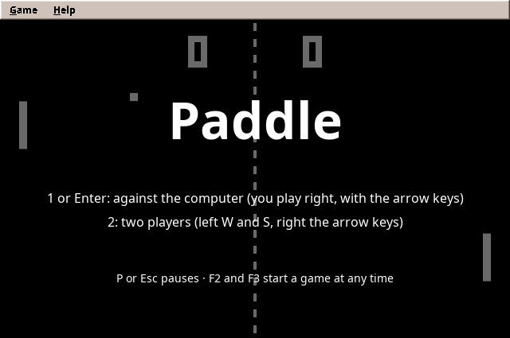
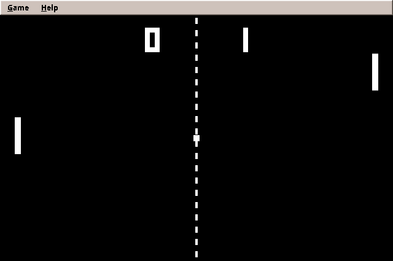
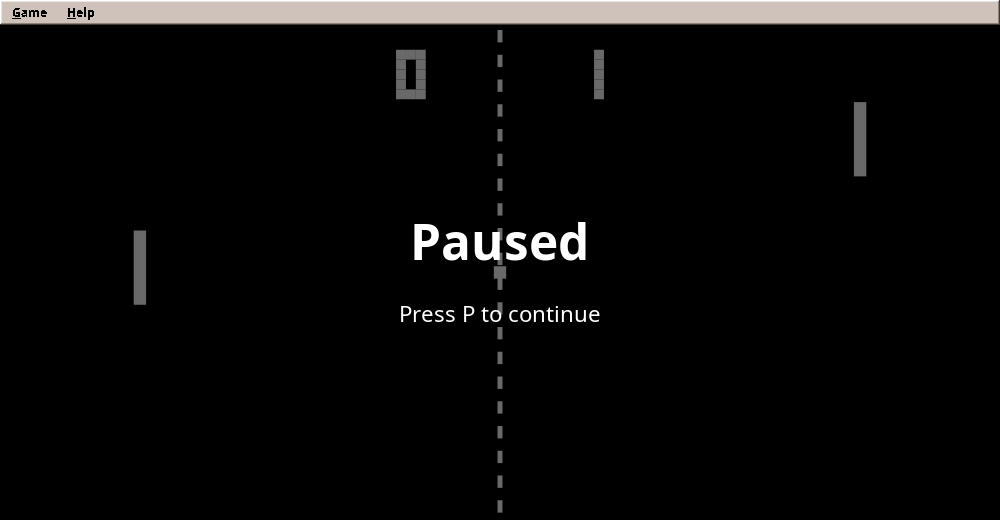
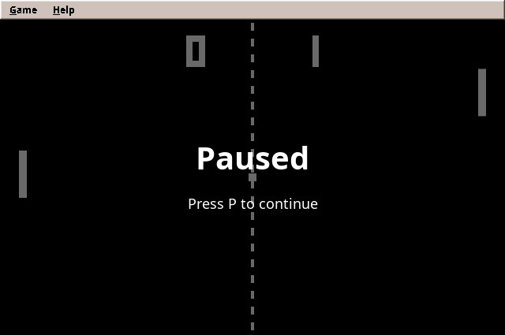

# 20. Paddle

Part I's games waited for you. Nothing in Mines or Solitaire happened until you clicked. **Paddle**, the classic ball game for two paddles, is different: the ball flies whether you press a key or not, and if you look away, you lose the point. This changes how the program works at its core. Instead of reacting to events, the game runs a **loop** that updates the world and draws it many times a second, on a thread of its own.

<figure markdown>
{ width="400" }
{ width="400" }
<figcaption>The title screen with the computer playing itself (left) and a match against it (right).</figcaption>
</figure>

!!! abstract "What you will learn"
    - The **game loop**: fixed time steps, why they matter, and drawing between steps
    - **Active rendering** with `BufferStrategy`, in **logical coordinates** scaled to any window, and **full screen**
    - **Physics** of a ball, and **swept collision** so fast objects cannot pass through each other
    - **Keyboard input** by polling: held keys, short taps, X11 key repeat, ghosting, configurable keys
    - A **computer opponent** that predicts the ball, and how to make it beatable by **tuning with self-play**
    - **Scenes**: title, match, pause and end as a stack
    - **Two threads, one game**: the loop thread, the Swing thread, and how they talk safely

The complete game is in [amade-paddle-game](https://github.com/datazuul/amade-paddle-game).

## The rules

1. Two paddles, one on each side, move only up and down. The ball bounces off the top and bottom walls.
2. A ball that passes a paddle scores a point for the other side. After a short pause, the ball is served towards the side that lost the point.
3. Where the ball meets the paddle decides its new angle: the middle sends it straight back, the edges send it off steeply. Every hit makes the ball a little faster.
4. The first to **11** points wins.
5. **One player** plays the right paddle with the arrow keys against the computer, on three difficulties. Right-handed players keep their right hand on the arrow keys, their usual place. **Two players** share one keyboard: left `W` and `S`, right the arrows.
6. On the title screen the computer plays itself.

## Step 1: The game loop

Every real-time game, from Paddle to the strategy games of part III, has the same heartbeat:

```text
forever:
    run commands from other threads
    advance the rules
    draw a frame
    wait for the next frame
```

The question is: *by how much* do we advance the rules each time? The simple answer, "by the time since the last frame", is a trap. Frames are uneven: one takes 15 ms, the next 18 ms, and when the computer is busy, 50 ms. Physics with uneven steps behaves differently on every computer. A ball moving 7.5 units in a 15 ms frame may cross a paddle in a 50 ms one. Replaying a game, testing it and comparing two computers all become impossible.

The answer of this book (and of most game engines) is a **fixed time step**. The rules always advance by the same small amount, here 1/120 second. Real time is collected, and as many steps are run as fit into it:

```java title="amade-game-engine · loop/FixedStep.java"
--8<-- "amade-game-engine/src/main/java/eu/amadeos/gameengine/loop/FixedStep.java:fixed-step"
```

The left-over time that is not yet a full step stays in `accumulated` for the next frame. A test shows how uneven frames become even steps:

```java title="amade-game-engine · test/loop/FixedStepTest.java"
--8<-- "amade-game-engine/src/test/java/eu/amadeos/gameengine/loop/FixedStepTest.java:test-fixed-step"
```

`maxSteps` guards against the "spiral of death". After a long pause (a debugger, a suspended laptop) the loop would otherwise try to catch up thousands of steps at once, fall further behind while doing so, and never recover.

### Drawing between steps

The rules step 120 times a second, the screen shows about 60 frames. A frame usually falls *between* two steps. `alpha()` says where: 0.3 means 30 % of the way from the last step to the next. Each moving object remembers its previous position, and the painter draws it in between:

```java
double y = paddle.previousY() + (paddle.y() - paddle.previousY()) * alpha;
```

Without this **interpolation**, motion stutters slightly, because some frames show the same step twice and others skip one.

### The loop itself

```java title="amade-game-engine · loop/GameLoop.java"
--8<-- "amade-game-engine/src/main/java/eu/amadeos/gameengine/loop/GameLoop.java:run"
```

The loop runs on its own thread named `game-loop`. Each round runs the waiting commands, the steps and one frame, then sleeps for the rest of the frame with `LockSupport.parkNanos`. Without that sleep, the loop would draw thousands of frames a second and keep a CPU core at 100 %. An exception in one frame is logged and the game goes on.

!!! info "Why not a Swing Timer any more?"
    Solitaire animated with a `javax.swing.Timer`. That worked because animations were short and nobody notices a frame that comes 5 ms late. A Swing timer runs on the event thread, shares it with every repaint and menu, and fires only approximately on time. A game loop on its own thread decides its own rhythm, and with the fixed step the rules do not care when a frame comes.

## Step 2: Drawing actively

Swing paints when *it* decides: `repaint()` only asks for a paint, and the event thread does it later. A game needs the opposite: draw *now*, from the loop thread, every frame. That is **active rendering**, and it needs a `java.awt.Canvas` with a `BufferStrategy`: two images in video memory, one shown while the other is drawn, then swapped.

```java title="amade-game-engine · swing/GameCanvas.java"
--8<-- "amade-game-engine/src/main/java/eu/amadeos/gameengine/swing/GameCanvas.java:render"
```

The two `do … while` loops look odd but are the documented way: buffers in video memory can be lost (another program, a screen mode change), and then the frame is simply drawn again.

### Logical coordinates

How large is the court? 640 × 400, always, as far as the game knows. Those are **logical coordinates**. The window may be any size. The canvas scales the logical picture to fit, keeps its proportions, and centres it with black bars:

```java title="amade-game-engine · swing/GameCanvas.java"
--8<-- "amade-game-engine/src/main/java/eu/amadeos/gameengine/swing/GameCanvas.java:scaled"
```

`g.translate` and `g.scale` set up the transform once; everything drawn afterwards, rectangles and text alike, is scaled by Java2D. The game never computes a real pixel.

<figure markdown>
{ width="600" }
<figcaption>A wide window: the court fills the height, black bars the sides.</figcaption>
</figure>

### A heavyweight in a Swing window

`Canvas` is an AWT component, a *heavyweight* with a native window of its own, while Swing components are *lightweight* and drawn into their parent. Mixing them works, with two pitfalls:

!!! warning "Pitfall: menus behind the canvas"
    A Swing menu that opens over the canvas is drawn *behind* it, because lightweight popups are painted into the window below the heavyweight canvas. The cure is one line before the menus are created: `JPopupMenu.setDefaultLightWeightPopupEnabled(false)`. Then menus open in native windows of their own, above the canvas.

!!! warning "Pitfall: menu shortcuts do not work"
    Swing's key bindings (F2 for a menu entry, Alt+G to open the *Game* menu) are handled by Swing components. When the canvas has the focus, keys go to the canvas, and Swing never sees them. `GameCanvas` passes on the keys the game did not use:

    ```java title="amade-game-engine · swing/GameCanvas.java"
    --8<-- "amade-game-engine/src/main/java/eu/amadeos/gameengine/swing/GameCanvas.java:keys"
    ```

    That is why Paddle's pause key has no menu shortcut: P is the game's key, and the menu would see it too.

### Full screen

With logical coordinates, full screen costs the game nothing: the screen is just a very large window, and the canvas scales the court to it. F11 switches, in the *Game* menu as *Full Screen*. The work is in the engine's `FullScreen`, and it is mostly about the window, not the drawing.

```java title="amade-game-engine · swing/FullScreen.java"
--8<-- "amade-game-engine/src/main/java/eu/amadeos/gameengine/swing/FullScreen.java:enter"
```

Three things in these lines need a word.

**No frame, no menu bar.** A full-screen game should show the court and nothing else. A `JFrame` can only lose its title bar and border (`setUndecorated(true)`) while it has no native window, so the switch calls `dispose()` first and shows the window again afterwards. The menu bar is hidden too.

**The screen keeps its resolution.** `GraphicsDevice` can also change the screen's resolution (`setDisplayMode`), which was the classic trick to make old PCs fast: fewer pixels, less to draw. Today it makes monitors flicker and go black for a second, rearranges the windows on the desktop, and on Linux often is not supported at all. The canvas scales anyway, so `FullScreen` never changes the mode. `setFullScreenWindow` is still worth calling instead of only covering the screen with a large window: it tells the window manager that this is a full-screen window, so the desktop's compositor can hand the screen straight to the game, and on Windows the buffers are then flipped instead of copied. Where full screen is not supported, the window simply covers the monitor.

**The canvas gets a new native window.** `dispose()` takes away the canvas's native window and its buffers while the game loop may be drawing on them on its own thread. `withoutFrames` in `GameCanvas` makes the switch and the drawing of a frame wait for each other: both hold the same lock. After the switch, the next frame finds no buffers and creates new ones, exactly as at the start.

!!! warning "Pitfall: the game ends on F11"
    `dispose()` sends `windowClosed`, and Paddle used to end the program on `windowClosed`. The first test of F11 closed the game. `FullScreen` counts its own `dispose()` calls and passes on only the real closing: `window.whenClosed(...)` replaces the window listener in `AmadePaddleApplication`.

!!! warning "Pitfall: a hidden menu bar has no shortcuts"
    Swing ignores the shortcuts of a menu bar that is not showing. F2 and F3 would stop working in full screen, and so would F11, the only way back. While the menu bar is hidden, `FullScreen` puts every shortcut of the menu into the window's own key bindings, where it clicks the menu entry:

    ```java title="amade-game-engine · swing/FullScreen.java"
    --8<-- "amade-game-engine/src/main/java/eu/amadeos/gameengine/swing/FullScreen.java:mirror"
    ```

Switching also takes the focus away for a moment, so a running match pauses, as it does whenever the window loses the focus.

## Step 3: The rules of the ball

The court is in `Court`: sizes and speeds in logical units per second. The match advances one step at a time:

```java title="amade-paddle-game · domain/Match.java"
--8<-- "amade-paddle-game/src/main/java/eu/amadeos/games/paddle/domain/Match.java:update"
```

Movement is the simplest physics there is: position plus velocity times time (`ball.x += ball.vx * seconds`). The walls mirror the ball: a ball that would end 2 units above the top edge ends 2 units below it, flying down.

### Swept collision

The paddle is 10 units wide. At its top speed of 900 units per second, the ball moves 7.5 units per step, almost a paddle's width. A test that only asks "does the ball overlap the paddle *now*?" will one day miss: the ball is in front of the paddle in one step and behind it in the next. This is **tunnelling**, a classic bug of games that test collisions only at the end of a step.

Paddle tests the whole way instead. Did the ball's front edge *cross* the paddle's face during this step? If so, where was the ball vertically at that moment?

```java title="amade-paddle-game · domain/Match.java"
--8<-- "amade-paddle-game/src/main/java/eu/amadeos/games/paddle/domain/Match.java:hit"
```

`t` is the share of the step at which the ball reached the face; `yAtFace` the height it had then. The rest of the step, the part "behind" the face, is mirrored back. The test proves it with a ball faster than the paddle is wide:

```java title="amade-paddle-game · test/domain/MatchTest.java"
--8<-- "amade-paddle-game/src/test/java/eu/amadeos/games/paddle/domain/MatchTest.java:test-hit"
```

### The angle

The `offset` of the hit runs from −1 (top edge) through 0 (middle) to +1 (bottom edge), and the new angle is up to 55° in that direction. This one rule turns a reflex game into a game of skill: you aim by choosing where the ball meets your paddle. It goes back to the arcade original of 1972.

## Step 4: The keyboard

Mines and Solitaire reacted to events: a click arrives, the game reacts. A real-time game asks instead, every step: *is the up arrow held right now?* That is **polling**. Java delivers key events, so something must turn events into state. `KeyState` does that, and it solves two problems of real keyboards on the way:

```java title="amade-game-engine · input/KeyState.java"
--8<-- "amade-game-engine/src/main/java/eu/amadeos/gameengine/input/KeyState.java:key-state"
```

**Short taps.** If P goes down and up between two steps, "is P held?" is false at both. `wasPressed` remembers every press until the next `poll`, so a tap is never lost.

**Key repeat on X11.** Hold a key on Linux, and the X server sends *release, press, release, press …* every 30 milliseconds, the auto-repeat meant for typing text. A game that believes every release would see the paddle stutter. `KeyState` therefore waits 25 ms before it believes a release: if a press of the same key follows, it was a repeat.

```java title="amade-game-engine · test/input/KeyStateTest.java"
--8<-- "amade-game-engine/src/test/java/eu/amadeos/gameengine/input/KeyStateTest.java:test-repeat"
```

`KeyState` knows neither AWT nor the real clock: events come in as numbers with times. The AWT side is `Keyboard`, which listens to the canvas on the Swing thread and is safe to ask from the loop thread (its methods are `synchronized`). Its clock can be replaced, which the tests do. They run the keyboard on a counter that advances exactly one step per game step.

### Keys and actions

The rules should never ask "is the up arrow down?". They ask "does the right player move up?", and a small table says which keys mean that:

```java title="amade-game-engine · input/Controls.java"
--8<-- "amade-game-engine/src/main/java/eu/amadeos/gameengine/input/Controls.java:controls"
```

```java title="amade-paddle-game · ui/game/PaddleGame.java"
--8<-- "amade-paddle-game/src/main/java/eu/amadeos/games/paddle/ui/game/PaddleGame.java:controls"
```

The keys of the paddles come from the settings, so players can change them in `paddle.properties` (`keys.right-up=UP NUMPAD8`).

!!! warning "Pitfall: ghosting"
    Many keyboards cannot report every combination of keys held at once. The keys are wired in a grid, and with three or four keys down, some combinations look like others and are dropped. This is called *ghosting* or limited *rollover*. If two players report "my paddle sometimes does not move", that is the cause. W/S together with the arrow keys is safe on practically every keyboard, which is why they are the defaults, and the keys can be changed.

## Step 5: The computer opponent

A perfect opponent is easy: move the paddle to wherever the ball is going. Nobody would ever score a point, so nobody would play. The art of game AI is the opposite: an opponent that plays *believably* and *loses sometimes*.

The computer player does what a person does:

```java title="amade-paddle-game · domain/ComputerPlayer.java"
--8<-- "amade-paddle-game/src/main/java/eu/amadeos/games/paddle/domain/ComputerPlayer.java:move"
```

- It **looks at the ball now and then**, not every step: the reaction time.
- While the ball flies away, it **waits in the middle**.
- When the ball comes, it **predicts** where the ball will arrive and **aims a bit off**, chosen once per ball.
- It **moves at a limited speed**, and slows down near its target instead of overshooting.

### Predicting with mirrors

Where will the ball be when it reaches the paddle, after any number of bounces off the walls? The trick is to forget the walls. Let the ball fly on in a straight line, as if the court continued forever, and then *fold* the result back, as light behaves between two mirrors:

```java title="amade-paddle-game · domain/ComputerPlayer.java"
--8<-- "amade-paddle-game/src/main/java/eu/amadeos/games/paddle/domain/ComputerPlayer.java:predict"
```

```java title="amade-paddle-game · test/domain/ComputerPlayerTest.java"
--8<-- "amade-paddle-game/src/test/java/eu/amadeos/games/paddle/domain/ComputerPlayerTest.java:test-predict"
```

### Three numbers make a difficulty

```java title="amade-paddle-game · domain/Difficulty.java"
--8<-- "amade-paddle-game/src/main/java/eu/amadeos/games/paddle/domain/Difficulty.java:difficulty"
```

### Tuning by self-play

How do you find good values? Guessing and playing a few rounds is slow and unreliable. The better way: **let the computer play itself** thousands of points in seconds, and measure. A small program played every difficulty against every other and printed the seconds and hits per point.

The first measurement was a surprise: even *Easy* returned about 20 balls per point, and *Hard* against *Hard* never ended. Two flaws showed up:

1. **The error was averaged away.** The first version chose a new aiming error at every look, several times per ball. Random errors around the right spot average out, so the paddle ended up right. A person decides once where to go. Choosing the error once per ball fixed this (the `coming && !wasComing` line).
2. **The error never exceeded the paddle.** A paddle reaches half its height plus half the ball, 35 units, from its centre. An error of at most half a paddle, 30 units, can never miss. Only errors larger than about 1.17 half-paddles make the computer miss a ball it could reach.

After both fixes, the measurement gave: about 7 seconds per point against Easy, 11 against Normal, about 20 between two Hard players. That makes matches of a few minutes, as the arcade original had. Tests keep the result from breaking unnoticed:

```java title="amade-paddle-game · test/domain/ComputerPlayerTest.java"
--8<-- "amade-paddle-game/src/test/java/eu/amadeos/games/paddle/domain/ComputerPlayerTest.java:test-strength"
```

And ten minutes of the title screen's demo, simulated in under a second, prove that the ball never leaves the court and points keep coming:

```java title="amade-paddle-game · test/domain/ComputerPlayerTest.java"
--8<-- "amade-paddle-game/src/test/java/eu/amadeos/games/paddle/domain/ComputerPlayerTest.java:test-demo"
```

!!! tip "Simulate, measure, then decide"
    Because the rules are plain Java without a clock, a minute of play is a loop of 7200 calls. Use it: tune difficulties, find endless rallies, check that a level can be won. You will do this again for the ghosts in Maze and the opponents in Sands.

## Step 6: Scenes

A game is more than its match: a title screen, the match, a pause screen, the end. Each is a **scene**: it updates and it draws.

```java title="amade-game-engine · scene/Scene.java"
--8<-- "amade-game-engine/src/main/java/eu/amadeos/gameengine/scene/Scene.java:scene"
```

Scenes live on a **stack**. Only the top one is updated, but all are drawn from the bottom up. So pushing the pause scene onto the match freezes the match, and it stays visible under the pause text. Popping the pause scene lets the match continue exactly where it stopped:

```java title="amade-game-engine · scene/SceneStack.java"
--8<-- "amade-game-engine/src/main/java/eu/amadeos/gameengine/scene/SceneStack.java:stack"
```

<figure markdown>
{ width="400" }
<figcaption>The pause scene drawn over the frozen match.</figcaption>
</figure>

The title scene runs a match of its own, computer against computer, and waits for 1 or 2:

```java title="amade-paddle-game · ui/game/PaddleGame.java"
--8<-- "amade-paddle-game/src/main/java/eu/amadeos/games/paddle/ui/game/PaddleGame.java:title"
```

The match scene reads the controls, asks the computer for the left paddle in one-player mode, steps the match, and when there is a winner, replaces itself with the end scene:

```java title="amade-paddle-game · ui/game/PaddleGame.java"
--8<-- "amade-paddle-game/src/main/java/eu/amadeos/games/paddle/ui/game/PaddleGame.java:match"
```

The painter draws the court, the net, the score in big block digits like the arcade original, and the paddles and ball between their last two positions:

```java title="amade-paddle-game · ui/game/CourtPainter.java"
--8<-- "amade-paddle-game/src/main/java/eu/amadeos/games/paddle/ui/game/CourtPainter.java:paint"
```

## Step 7: Two threads, one game

Paddle now has two threads, and this needs care:

| Thread | Runs | Touches |
|---|---|---|
| **Swing event thread** | menus, dialogs, the presenter, key events | the window, the settings, the high scores |
| **game-loop** | updates, scenes, drawing | the match, the scenes |

The rule that keeps this simple: **each object belongs to one thread.** The match and the scenes are touched only by the loop thread, so they need no locks at all. Where the two must talk, there are exactly two doors:

**Swing → loop: commands.** The presenter must start a match when the player chooses *Game → One Player*. It does not touch the scenes. It *posts* a command, and the loop runs it before its next step:

```java title="amade-paddle-game · ui/game/PaddleGame.java"
--8<-- "amade-paddle-game/src/main/java/eu/amadeos/games/paddle/ui/game/PaddleGame.java:post"
```

**Loop → Swing: results.** When a match ends, the presenter must ask for the player's name, a Swing dialog. The match scene does not call the presenter directly. It hands the result to an `Executor` that runs it on the event thread (`ui.execute(...)` in the match scene above).

The presenter only sees an interface, `Arena`, the game's door for commands:

```java title="amade-paddle-game · ui/game/Arena.java"
--8<-- "amade-paddle-game/src/main/java/eu/amadeos/games/paddle/ui/game/Arena.java:arena"
```

So Paddle combines both patterns of [chapter 2](02-structure.md#two-kinds-of-games-two-patterns): the court is model, renderer and loop, and everything around it is Model-View-Presenter. The presenter decides what a won match is worth:

```java title="amade-paddle-game · ui/main/PaddlePresenter.java"
--8<-- "amade-paddle-game/src/main/java/eu/amadeos/games/paddle/ui/main/PaddlePresenter.java:match-over"
```

!!! info "Is MVP still worth it here?"
    The presenter of Paddle is thin: several of its methods only pass a command on to the `Arena`. For a game this small, the menu logic could live in the window. It stays in a presenter for two reasons. The rules around the court (only a win against the computer counts, a two-player game does not) are tested in milliseconds without a screen. And the presenter keeps a clean border between the threads: it never touches the match, only the `Arena`. Swing code that reaches into the match directly is how thread bugs begin. The frame around the play area grows in later games (levels, settings, saved games), and with it the value of the presenter.

### Testing a real-time game

The threads make testing look hard. They are not, if the test plays the loop itself. `PaddleGameTest` creates the game without starting the loop, presses keys on a keyboard whose clock it controls, and calls the steps one by one, all on the test thread:

```java title="amade-paddle-game · test/ui/game/PaddleGameTest.java"
--8<-- "amade-paddle-game/src/test/java/eu/amadeos/games/paddle/ui/game/PaddleGameTest.java:test-keys"
```

```java title="amade-paddle-game · test/ui/game/PaddleGameTest.java"
--8<-- "amade-paddle-game/src/test/java/eu/amadeos/games/paddle/ui/game/PaddleGameTest.java:test-pause"
```

The presenter is tested with a fake `Arena` that only records commands, and a fake view, exactly as in part I:

```java title="amade-paddle-game · test/ui/main/PaddlePresenterTest.java"
--8<-- "amade-paddle-game/src/test/java/eu/amadeos/games/paddle/ui/main/PaddlePresenterTest.java:test-win"
```

!!! warning "Pitfall: fast taps in tests"
    The first version of the pause test tapped P twice within a few microseconds of real time. The keyboard took the second press for an X11 key repeat and ignored it. Correct behaviour, and nobody types that fast, but the test failed. The cure was the replaceable clock: the test's keyboard runs on a counter that moves one step per game step, so time in the test is as slow as the test says.

## Step 8: Putting it together

The window holds the menu and the canvas:

```java title="amade-paddle-game · ui/main/PaddleWindow.java"
--8<-- "amade-paddle-game/src/main/java/eu/amadeos/games/paddle/ui/main/PaddleWindow.java:canvas"
```

and `main` starts the loop only after the window is visible, because a canvas that is not on the screen cannot get its buffers:

```java title="amade-paddle-game · bootstrap/AmadePaddleApplication.java"
--8<-- "amade-paddle-game/src/main/java/eu/amadeos/games/paddle/bootstrap/AmadePaddleApplication.java:main"
```

The loop itself is two lines in `PaddleGame`. It updates the scenes 120 times a second and draws them about 60 times:

```java title="amade-paddle-game · ui/game/PaddleGame.java"
--8<-- "amade-paddle-game/src/main/java/eu/amadeos/games/paddle/ui/game/PaddleGame.java:start"
```

## What moved into the engine

| From Paddle | Engine package | Why |
|---|---|---|
| Fixed time step and the loop thread | `eu.amadeos.gameengine.loop` | Every real-time game needs exactly this |
| Active rendering in logical coordinates | `eu.amadeos.gameengine.swing.GameCanvas` | Same buffers, scaling and pitfalls everywhere |
| Full screen with F11 | `eu.amadeos.gameengine.swing.FullScreen` | Every real-time game can fill the screen |
| Held keys, taps, X11 key repeat | `eu.amadeos.gameengine.input.KeyState`, `Keyboard` | Keyboards behave the same in every game |
| Keys mapped to actions | `eu.amadeos.gameengine.input.Controls` | Configurable keys for every game |
| Scenes and the scene stack | `eu.amadeos.gameengine.scene` | Title, pause and end screens everywhere |

What stays in the game: the court, the match, the computer player, the painter and the scenes themselves. Bricks, the next game, will reuse the loop, the canvas, the keyboard and the scenes unchanged, and add what Paddle did not need: images instead of rectangles, many objects colliding, and sound.

## Exercises

1. **Sound.** Paddle is silent; the original went *blip*. Generate a short square wave with `javax.sound.sampled` (a `SourceDataLine` and a few hundred samples) and play it on every hit. Which thread should play it? (The next chapter builds a proper sound mixer.)
2. **Mouse control.** Let the right paddle follow the mouse's vertical position. You need to turn the mouse position from real pixels into logical coordinates: use `GameCanvas.scale`.
3. **An opponent with a style.** Make a fourth difficulty that likes to hit the ball with its paddle edge on purpose. What does the computer need to know to aim the ball, not just reach it?
4. **Replay.** Because the rules are deterministic with a seeded random generator, a match can be replayed from the seed and the recorded inputs alone. Record the inputs of a match and play it back. How large is the recording for one minute?

---

In the next game, **Bricks**, the ball breaks a wall of bricks: many objects, images instead of rectangles, and sound.
