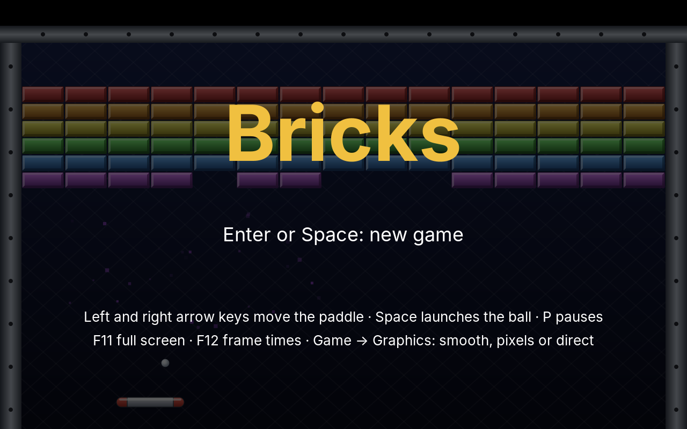
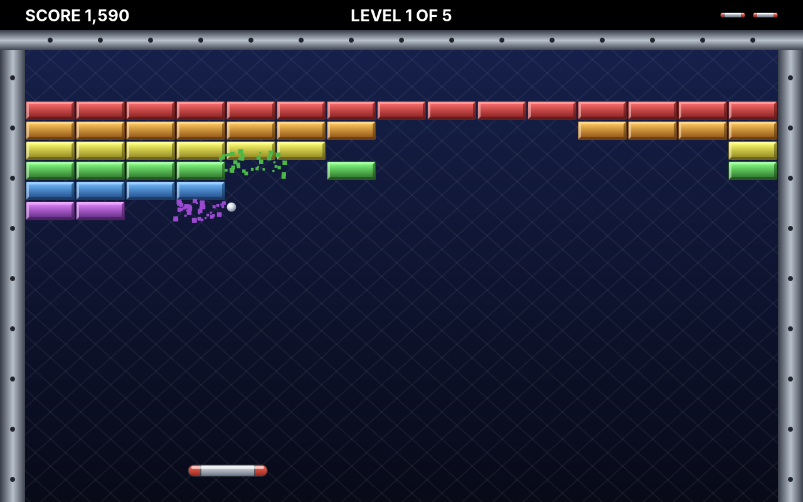
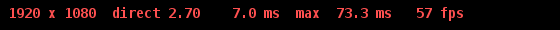
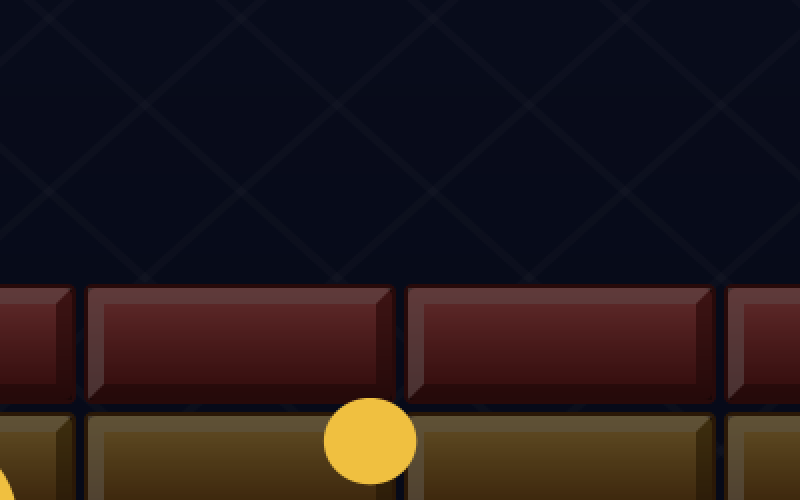
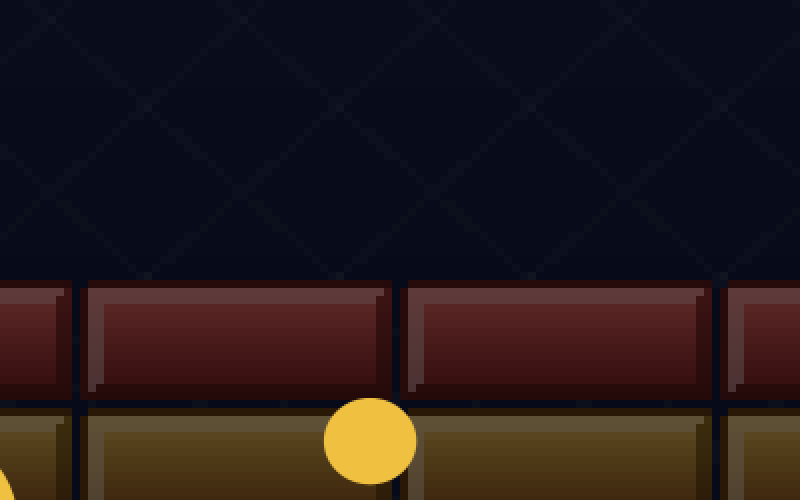
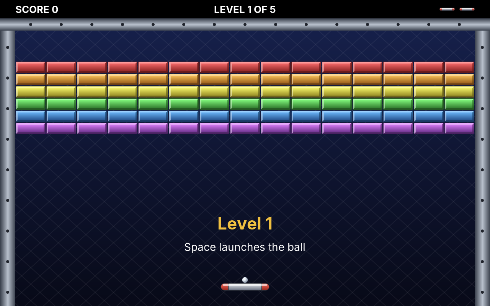

# 21. Bricks

In Paddle, the ball flew between two players. In **Bricks** it flies against a wall: a paddle at the bottom, a wall of coloured bricks at the top, and every brick the ball touches breaks. Clear the wall, and the next one is waiting. The idea is as old as Paddle's, and it brings three new things into our games at once: **many objects** on the screen, **pictures** instead of white rectangles, and **sound**.

<figure markdown>
{ width="400" }
{ width="400" }
<figcaption>The title screen with the computer playing (left), and a game in full swing (right).</figcaption>
</figure>

With pictures and splinters, drawing a frame begins to cost real time, and on a large screen it costs a lot more. So this chapter ends with the question every game programmer meets sooner or later: *is it fast enough?* We will answer it the only reliable way, by measuring, and find out that one of two plausible ideas helps a lot and the other not at all.

!!! abstract "What you will learn"
    - **Collision of moving boxes**, and a ball that may bounce twice within one step
    - **Levels as data files** that anyone can write
    - **Events**: the rules report what happened, the user interface decides what it looks and sounds like
    - **Sprites**: pictures with a size in logical coordinates, from image files or drawn in code
    - **Particles**: hundreds of splinters without hundreds of objects
    - **Sound effects** made from tones, and a **mixer** that plays several at once
    - **Measuring** frame times, finding what is slow, and fixing it: a sprite cache, a pixel mode, and an idea that did not work

The complete game is in [amade-bricks-game](https://github.com/datazuul/amade-bricks-game).

## The rules

1. A wall of bricks hangs at the top of the field, between three walls. The player moves a paddle left and right at the bottom.
2. The ball lies on the paddle until the player launches it with Space. It bounces off the walls, the bricks and the paddle.
3. As in Paddle, where the ball meets the paddle decides its angle: the middle sends it straight up, the edges steeply to the side.
4. A coloured brick breaks at the first hit and gives points: the higher its row in the classic wall, the more. **Silver** bricks take two hits. **Gold** bricks never break; a level is cleared without them.
5. Every hit makes the ball a little faster.
6. A ball that falls past the paddle is lost. The player has three; with the last one the game ends.
7. When the last breakable brick breaks, the next level begins. There are five; the best scores are kept.

## Step 1: The field and the levels

The field is 640 × 400 logical units, like Paddle's court, and its sizes are constants in `Field`: a band of 24 units at the top for the score, walls 20 units wide, bricks of 40 × 16, fifteen to a row.

The bricks of a level are not code. They are a text file, one line per row, one letter per brick:

```text title="amade-bricks-game · resources/.../levels/02.txt"
--8<-- "amade-bricks-game/src/main/resources/eu/amadeos/games/bricks/levels/02.txt"
```

The letters belong to the kinds of brick:

```java title="amade-bricks-game · domain/BrickType.java"
--8<-- "amade-bricks-game/src/main/java/eu/amadeos/games/bricks/domain/BrickType.java:brick-type"
```

`Level` reads such a file and checks it. A level is the place where a typing mistake is likely, so the error message names the row and the letter:

```java title="amade-bricks-game · domain/Level.java"
--8<-- "amade-bricks-game/src/main/java/eu/amadeos/games/bricks/domain/Level.java:level"
```

```java title="amade-bricks-game · test/domain/LevelTest.java"
--8<-- "amade-bricks-game/src/test/java/eu/amadeos/games/bricks/domain/LevelTest.java:test-level"
```

The files lie among the game's resources, numbered. `LevelFiles` reads `01.txt`, `02.txt` and so on until a number is missing, so a sixth level is a sixth file and no change to the program:

```java title="amade-bricks-game · repository/LevelFiles.java"
--8<-- "amade-bricks-game/src/main/java/eu/amadeos/games/bricks/repository/LevelFiles.java:level-files"
```

!!! tip "Data, not code"
    Whatever changes often and is not logic belongs in a data file: levels, maps, the waves of enemies in Swarm, the units of Sands. A designer can change it without a compiler, and a test can check every file at once (`LevelFilesTest` loads all five and makes sure each has a brick to break).

## Step 2: Collision of moving boxes

In Paddle there were two paddles and one ball, and `Match` tested the paddles' faces by hand. In Bricks the ball can hit any of up to 180 bricks, three walls and the paddle, from any side. That calls for a general tool, and it goes into the engine.

Everything that collides in Bricks is an **axis-aligned box**: a rectangle whose edges are horizontal and vertical. Two such boxes overlap when they overlap on both axes:

```java title="amade-game-engine · collision/Box.java"
--8<-- "amade-game-engine/src/main/java/eu/amadeos/gameengine/collision/Box.java:overlaps"
```

That test alone is not enough, as Paddle taught us: a fast ball can be in front of a brick in one step and behind it in the next (tunnelling). We need to know whether the ball touches the brick *on its way*, and when. That is a **swept** test:

```java title="amade-game-engine · collision/Sweep.java"
--8<-- "amade-game-engine/src/main/java/eu/amadeos/gameengine/collision/Sweep.java:sweep"
```

The trick is in the first four lines. A box of 8 × 8 hits a brick of 40 × 16 exactly when its top left corner enters a box that is 8 units larger to the left and to the top: the brick *grown by the ball*. So the moving box shrinks to a point, and the question becomes where a line enters a rectangle. For each axis the point is inside the rectangle's range during an interval of time; it is inside the rectangle while both intervals overlap. The later of the two entries is the moment of contact, and the axis entered last tells which face was hit, and so in which direction to bounce.

```java title="amade-game-engine · test/collision/SweepTest.java"
--8<-- "amade-game-engine/src/test/java/eu/amadeos/gameengine/collision/SweepTest.java:test-tunnel"
```

### Bouncing within a step

With the sweep, moving the ball becomes a small loop. Find the first thing the ball touches during the step. If there is none, move the whole way. If there is one, move only up to it, bounce, and go on with the rest of the step:

```java title="amade-bricks-game · domain/Game.java"
--8<-- "amade-bricks-game/src/main/java/eu/amadeos/games/bricks/domain/Game.java:move-ball"
```

A ball that hits a brick near a wall bounces twice in one step, and neither bounce is lost. Four bounces per step are plenty; the limit only guards against a ball caught between two surfaces. The paddle catches only a falling ball, so a ball that has just left it cannot hit it again from below.

Bouncing mirrors the velocity at the face that was hit. The paddle is the exception, the same as in Paddle: there, the point of contact decides the new angle.

```java title="amade-bricks-game · domain/Game.java"
--8<-- "amade-bricks-game/src/main/java/eu/amadeos/games/bricks/domain/Game.java:bounce"
```

```java title="amade-bricks-game · domain/Game.java"
--8<-- "amade-bricks-game/src/main/java/eu/amadeos/games/bricks/domain/Game.java:hit-brick"
```

The tests put the ball where they want it and let the game run:

```java title="amade-bricks-game · test/domain/GameTest.java"
--8<-- "amade-bricks-game/src/test/java/eu/amadeos/games/bricks/domain/GameTest.java:test-brick"
```

```java title="amade-bricks-game · test/domain/GameTest.java"
--8<-- "amade-bricks-game/src/test/java/eu/amadeos/games/bricks/domain/GameTest.java:test-big-step"
```

A step of a tenth of a second never happens in the game, which steps 120 times a second. The test uses it anyway: if the collision holds at forty units per step, it holds at four.

!!! warning "Pitfall: the paddle moves into the ball"
    The sweep moves the *ball* and keeps the brick still. But the paddle moves too. When the player pushes the paddle sideways into a falling ball, the two boxes overlap at the start of the next step, and a sweep that starts inside finds no entry. The ball would fall through the paddle, and the player would rightly call it a bug. `Game.catchOverlap()` handles that one case before the sweep: a falling ball that overlaps the paddle above its middle counts as caught.

## Step 3: Events

When a brick breaks, three things should happen: the score goes up, the brick bursts into splinters, and a sound plays. Only the first one is a rule. Splinters and sound are presentation; they have no place in `Game`, which knows nothing about pixels or loudspeakers and is tested without either.

So the rules only *report* what happened during a step, as **events**:

```java title="amade-bricks-game · domain/Event.java"
--8<-- "amade-bricks-game/src/main/java/eu/amadeos/games/bricks/domain/Event.java:event"
```

The step itself:

```java title="amade-bricks-game · domain/Game.java"
--8<-- "amade-bricks-game/src/main/java/eu/amadeos/games/bricks/domain/Game.java:update"
```

After every step, the user interface reads the events and turns them into what you see and hear. A sealed interface and records make this a `switch` that the compiler checks: forget a kind of event, and it does not compile.

```java title="amade-bricks-game · ui/game/Effects.java"
--8<-- "amade-bricks-game/src/main/java/eu/amadeos/games/bricks/ui/game/Effects.java:react"
```

Tests read the same events (`events.contains(new Event.LevelCleared(1))`), and the title screen's demo uses them too, with sound off.

## Step 4: Sprites

Paddle drew white rectangles. Bricks draws pictures: bricks with bevelled edges, a metal paddle, a shiny ball. A picture that moves around in a game is called a **sprite**.

The engine's `Sprite` is a picture with a size in **logical** coordinates. A brick is 40 × 16, whatever its image file says:

```java title="amade-bricks-game · ui/game/FieldPainter.java"
--8<-- "amade-bricks-game/src/main/java/eu/amadeos/games/bricks/ui/game/FieldPainter.java:sprites"
```

The image files are four times as large as the logical size: the brick image is 160 × 64 pixels. Why? Because the canvas scales the logical picture to the screen, and on a 2560 × 1600 screen one logical unit is four pixels. **A sprite is only as sharp as its source.** A 40 × 16 image enlarged four times is blurred or blocky, whatever the program does; a 160 × 64 image shrunk to the screen's size stays sharp. The images were drawn with Java2D themselves, by `tools/MakeSprites.java` in the game repository, so you can change them without a paint program.

The background is a sprite too, but without a file: `Sprite.drawn` takes a piece of Java2D code (a gradient, a lattice of thin lines, the metal walls) that draws it at whatever size it is needed. Vector pictures like this are sharp at any size.

With sprites, the painter is short. The ball and the paddle are drawn between their last two positions, as in Paddle:

```java title="amade-bricks-game · ui/game/FieldPainter.java"
--8<-- "amade-bricks-game/src/main/java/eu/amadeos/games/bricks/ui/game/FieldPainter.java:paint"
```

How `Sprite.draw` brings the picture to the screen is the subject of step 7, because the first, obvious way turned out to be the slowest part of the game.

## Step 5: Particles

A breaking brick bursts into forty splinters that fly apart, fall and fade. With a few bricks breaking in quick succession, several hundred splinters are in the air. Each lives for about a second.

The obvious design is a `Splinter` class and a `List<Splinter>`. It works, but it creates and discards hundreds of small objects every second, and those objects lie all over memory. The engine's `Particles` uses another design, common in games: **one array per property**, and a particle is a row in those arrays.

```java title="amade-game-engine · fx/Particles.java"
--8<-- "amade-game-engine/src/main/java/eu/amadeos/gameengine/fx/Particles.java:spawn"
```

The living particles always fill the first `count` rows. When one dies, the last living one moves into its row, so the update never shifts arrays and never creates anything:

```java title="amade-game-engine · fx/Particles.java"
--8<-- "amade-game-engine/src/main/java/eu/amadeos/gameengine/fx/Particles.java:update"
```

Drawing fades a particle in its second half of life. Fading needs a colour with less opacity, and `new Color(...)` in a loop over hundreds of particles sixty times a second would undo all the care above. So every colour is made once in sixteen shades, and drawing only picks one:

```java title="amade-game-engine · fx/Particles.java"
--8<-- "amade-game-engine/src/main/java/eu/amadeos/gameengine/fx/Particles.java:render"
```

The splinters of a brick start where the brick was, fly outward and up, and gravity does the rest:

```java title="amade-bricks-game · ui/game/Effects.java"
--8<-- "amade-bricks-game/src/main/java/eu/amadeos/games/bricks/ui/game/Effects.java:splinters"
```

!!! info "Behind the scenes: why arrays?"
    Java's garbage collector is good at short-lived objects, and for a few hundred particles a list of objects would be fine too. The arrays pay off when the numbers grow: thousands of particles, the bullets of Swarm, the units of Sands. A loop over an array of `double` reads memory in order, which processors are fastest at, while a list of objects jumps from one object to the next. Games call this *data-oriented design*. Here it is mostly a habit worth learning early.

## Step 6: Sound

The arcade games of the 1970s did not play recordings. Their sounds were made by the machine: a tone, a slide in pitch, a burst of noise. We do the same, and need no sound files.

A sound card plays **samples**: 44,100 numbers per second, each one the position of the loudspeaker's membrane. A tone is a wave of these numbers. A square wave (high, low, high, low) gives the hard *blip* of the arcade; a triangle wave sounds softer; random numbers sound like a crash. `Sound.tone` computes one, sliding from one pitch to another, and fades it in and out over five milliseconds, because a membrane that jumps from rest to full swing clicks:

```java title="amade-game-engine · audio/Sound.java"
--8<-- "amade-game-engine/src/main/java/eu/amadeos/gameengine/audio/Sound.java:tone"
```

The sounds of Bricks are a handful of lines, made once when the game starts:

```java title="amade-bricks-game · ui/game/SoundBank.java"
--8<-- "amade-bricks-game/src/main/java/eu/amadeos/games/bricks/ui/game/SoundBank.java:sounds"
```

### The mixer

Java can play a sound with a `Clip`, one per sound. But a brick breaking while the ball hits the wall means two sounds at once, and a `Clip` that is still playing cannot start again. The engine therefore has a **mixer**: one line to the sound card, fed by a thread of its own. The game only queues a sound and never waits:

```java title="amade-game-engine · audio/Mixer.java"
--8<-- "amade-game-engine/src/main/java/eu/amadeos/gameengine/audio/Mixer.java:play"
```

The mixer thread fills blocks of 512 samples (11.6 ms) and writes them to the line. `write` waits while the sound card's buffer is full; that waiting is what paces the thread, so it needs no clock:

```java title="amade-game-engine · audio/Mixer.java"
--8<-- "amade-game-engine/src/main/java/eu/amadeos/gameengine/audio/Mixer.java:run"
```

Mixing itself is addition. Two sounds at once are the sum of their samples. Two loud sounds can exceed what 16 bits hold, and then the sum must be *clipped* to the largest value, not left to wrap around into a large negative number, which would crack in the loudspeaker:

```java title="amade-game-engine · audio/Mixer.java"
--8<-- "amade-game-engine/src/main/java/eu/amadeos/gameengine/audio/Mixer.java:mix"
```

```java title="amade-game-engine · test/audio/MixerTest.java"
--8<-- "amade-game-engine/src/test/java/eu/amadeos/gameengine/audio/MixerTest.java:test-mix"
```

!!! warning "Pitfall: a computer without sound"
    Servers and build machines have no sound card, and some desktops have one that another program holds. `AudioSystem.getSourceDataLine` then throws. The mixer catches that, logs one line and stays silent; `play` does nothing. The game must never fail because it cannot make noise. The tests run the same way: they test the mixing without a sound card at all.

The latency of this design is the line's buffer, four blocks or 46 ms at most, usually less. Players notice delays from about 50 ms, so this is enough for effects. Music, which the roadmap brings in Swarm, can reuse the same mixer.

## Step 7: How fast is it?

So far everything in Bricks worked on the first try in a window. Then full screen on a large monitor: the game felt sluggish. Before changing anything, find out *what* is slow, and by how much. Programmers are notoriously bad at guessing where the time goes, and a guess that turns out wrong costs a day of work for nothing. This section shows that twice.

### A display for frame times

At 60 frames per second a frame has 16.7 ms. The engine's `FrameTimes` keeps the frames of the last second: how long each one took to draw, from the first drawing call until the picture is on the screen.

```java title="amade-game-engine · loop/FrameTimes.java"
--8<-- "amade-game-engine/src/main/java/eu/amadeos/gameengine/loop/FrameTimes.java:frame-times"
```

`GameCanvas` records every frame and, after **F12** (*Game → Frame Times*), shows the numbers in the top left corner, in screen pixels, over everything else: the screen size, the render mode and its scale, the average and the worst drawing time, and the frames per second. Green means every frame of the last second fitted into 1/60 s, red that at least one did not.

<figure markdown>

<figcaption>The frame-time display on a 1920 × 1080 screen, the field scaled 2.70 times: 7.0 ms per frame on average, but one frame of the last second took 73 ms, so the line is red.</figcaption>
</figure>

```java title="amade-game-engine · swing/GameCanvas.java"
--8<-- "amade-game-engine/src/main/java/eu/amadeos/gameengine/swing/GameCanvas.java:render"
```

!!! tip "The worst frame matters more than the average"
    An average of 8 ms with single frames of 40 ms feels worse than a steady 14 ms: the player sees the 40 ms frame as a jolt. That is why the display shows the maximum next to the average.

### Measuring

Looking at the display while playing is a start. For numbers you can compare, the game repository has a benchmark: it opens Bricks in full screen, lets the title screen's demo play, and prints the frame times for each render mode.

```bash
./gradlew benchmark                          # on the screen you want to measure
./gradlew benchmark -Pseconds=20 -Pmodes=direct
```

Our measurements below come from **Xvfb**, an X server without a graphics card that draws everything with the processor, at four screen sizes. That is the hard case: a computer without a usable graphics driver, or amadeOS in a virtual machine (QEMU) without a virtual graphics card. On your own computer the numbers will be smaller; their *proportions* are what matters. Run the benchmark on your machine and compare.

The first measurement is the game as it was: each sprite drawn with `g.drawImage(image, x, y, width, height)`, scaled by Java2D from its large source image in every frame, and the background drawn anew from its gradient and lines. (The engine can still do that, for exactly this comparison: `./gradlew benchmark -Pjvm=-Damade.sprites.uncached=true`.)

| Screen | Drawing time per frame | Frames per second |
|---|---|---|
| 1280 × 800 | 18.6 ms | 53 |
| 1920 × 1080 | 26.1 ms | 39 |
| 2560 × 1600 | 56.3 ms | 19 |
| 3840 × 2160 | 89.7 ms | 12 |

Already at 1280 × 800 the game does not reach 60 frames per second, and on a 4K screen it is a slide show. The time grows with the screen: roughly in proportion to its pixels. That is the first lesson of this measurement. **In Java2D, a frame costs pixels.** Every sprite costs as many pixels as it covers on the screen, and scaling an image costs more per pixel than copying one, because each screen pixel is computed from several pixels of the source.

How much of a frame is unavoidable? A frame with nothing in it, only the black background, the buffer shown and `Toolkit.sync()`, costs 1.0 ms at 1280 × 800 and 11.0 ms at 3840 × 2160 in the same X server. Everything above that is our drawing.

### Fix 1: scale once, then copy

The bricks do not change their size from frame to frame. Scaling the same 160 × 64 image down to the same 108 × 43 pixels sixty times a second is wasted work. So the sprite scales its picture *once*, into an image of exactly the size it has on the screen, and from then on only copies that image:

```java title="amade-game-engine · sprite/Sprite.java"
--8<-- "amade-game-engine/src/main/java/eu/amadeos/gameengine/sprite/Sprite.java:draw"
```

The size on the screen comes from the graphics' transform, which the canvas set up for the logical coordinates: a brick 40 units wide on a canvas scaled 2.7 times is 108 pixels wide. When the window changes size, the transform changes, and the next frame scales once more. The copy is placed on whole screen pixels, with a transform that only moves, so it is a plain copy, never a blurred one.

The cached picture is made like this:

```java title="amade-game-engine · sprite/Sprite.java"
--8<-- "amade-game-engine/src/main/java/eu/amadeos/gameengine/sprite/Sprite.java:render"
```

Two details matter here. First, the image is made with `createCompatibleImage` of the screen's `GraphicsConfiguration`: it has the screen's own pixel format, so copying it needs no conversion, and Java2D can keep a copy in video memory where there is one (a *managed image*). Second, shrinking a picture to less than half in one step looks rough, because bicubic interpolation only looks at the nearest source pixels; `halvedTowards` shrinks in halves first.

```java title="amade-game-engine · test/sprite/SpriteTest.java"
--8<-- "amade-game-engine/src/test/java/eu/amadeos/gameengine/sprite/SpriteTest.java:test-cache"
```

The same measurement again:

| Screen | Before | Sprites scaled once | Frames per second |
|---|---|---|---|
| 1280 × 800 | 18.6 ms | 3.2 ms | 60 |
| 1920 × 1080 | 26.1 ms | 5.9 ms | 60 |
| 2560 × 1600 | 56.3 ms | 10.9 ms | 60 |
| 3840 × 2160 | 89.7 ms | 19.0 ms | 53 |

Four to six times faster, with one change in one class, and the picture looks exactly the same. Up to 2560 × 1600 the game now draws 60 frames per second even without a graphics card, and on the 4K screen it nearly does.

### A fix that was not one

Before measuring, we had a different plan, and it sounded convincing. Draw the world not at the screen's full size but into a hidden **back buffer** at a whole multiple of the logical size, the largest that fits (on 1920 × 1080, two times 640 × 400, so 1280 × 800), and stretch that buffer to the screen with one smooth (bilinear) scaling at the end. Fewer pixels to draw, and the rest of the scaling, less than a factor of two, would hardly show.

We built it as a render mode, *Smooth*, and measured it, with the sprite cache already in place (in one run, before the mode was removed again, so the numbers differ a little from the tables around it):

| Screen | Sprites scaled once | Back buffer, stretched |
|---|---|---|
| 1280 × 800 | 4.1 ms | 4.4 ms |
| 1920 × 1080 | 7.2 ms | 10.2 ms |
| 2560 × 1600 | 13.9 ms | 17.0 ms |
| 3840 × 2160 | 26.0 ms | 44.2 ms |

Slower everywhere, and on the 4K screen much slower. An empty frame showed why: in this mode it cost 27.8 ms at 3840 × 2160 instead of 11.0 ms. The back buffer saves little drawing once the sprites are only copied (at 4K, five times 640 × 400 is 3200 × 2000, nearly the screen), but stretching it with interpolation is a second pass over every pixel of the screen, and without a graphics card that pass is expensive. On a graphics card with a fast driver, stretching may cost almost nothing; then the mode would be about as fast as drawing directly, and still not faster.

So the mode was removed again. That is not a failure. It is what measuring is for: the idea was plausible, the numbers said no, and the engine stayed simpler.

### Pixel mode

One variant of the back buffer is worth keeping, for a different reason. Draw the world at exactly 640 × 400, and enlarge it by a *whole* factor with **nearest-neighbour** interpolation: every logical pixel becomes a square of 2 × 2, 3 × 3 or 4 × 4 screen pixels, and black bars fill the rest. That is the look of the games of the 1980s and 1990s, hard square pixels, and it is what pixel-art games want.

```java title="amade-game-engine · swing/GameCanvas.java"
--8<-- "amade-game-engine/src/main/java/eu/amadeos/gameengine/swing/GameCanvas.java:pixels"
```

The back buffer is a `VolatileImage`, an image that lives in video memory where there is one. Like the screen's own buffers, it can be lost at any moment (a mode switch, another program taking the graphics card), so it is checked before and after drawing, with the same kind of loop as `BufferStrategy`:

```java title="amade-game-engine · swing/GameCanvas.java"
--8<-- "amade-game-engine/src/main/java/eu/amadeos/gameengine/swing/GameCanvas.java:world"
```

The factor is the largest whole number that fits:

```java title="amade-game-engine · test/swing/GameCanvasTest.java"
--8<-- "amade-game-engine/src/test/java/eu/amadeos/gameengine/swing/GameCanvasTest.java:test-whole-scale"
```

<figure markdown>
{ width="400" }
{ width="400" }
<figcaption>The same detail of the title screen on a 2560 × 1600 screen, enlarged twice: drawn directly (left) and in pixel mode (right). In pixel mode, the sprites are shrunk to 40 × 16 pixels and then enlarged as squares.</figcaption>
</figure>

In pixel mode the world costs 256,000 pixels to draw on any screen; only the final enlargement grows with the screen, and it is a simple copy without interpolation. When drawing is expensive, this is the mode that stays fast: without the sprite cache, pixel mode needed 21.4 ms per frame at 3840 × 2160, against 89.7 ms for direct drawing. With the cache, both modes are close: 19.0 ms direct, 16.9 ms in pixel mode.

| Screen | Direct, sprites scaled once | Pixel mode |
|---|---|---|
| 1280 × 800 | 3.2 ms | 3.4 ms |
| 1920 × 1080 | 5.9 ms | 4.0 ms |
| 2560 × 1600 | 10.9 ms | 10.2 ms |
| 3840 × 2160 | 19.0 ms | 16.9 ms |
| 2560 × 1600, Windows with a graphics card | not measured | 6.5 ms |

The last row is the same benchmark on real hardware: a Windows computer, where Java2D draws through Direct3D on the graphics card, with a 2560 × 1600 screen in pixel mode, enlarged three times. The frame-time display read 6.5 ms on average and 7.0 ms at most, at 62 frames per second. That is about a third less than Xvfb's 10.2 ms in the same mode and size, and the low maximum matters as much as the average: no frame of that second came close to the 16.7 ms budget. The 62 frames per second are the monitor's refresh rate, not the game's limit; a frame waits for the screen, and more than half of each frame's time is left over.

The render modes are an engine enum, and `GameMenus.graphics` builds the submenu *Game → Graphics* for them:

```java title="amade-game-engine · swing/RenderMode.java"
--8<-- "amade-game-engine/src/main/java/eu/amadeos/gameengine/swing/RenderMode.java:modes"
```

Bricks starts in direct mode and remembers the player's choice in `bricks.properties`.

### Two layers: the world and the overlay

In pixel mode, the score in the top band would be drawn at 640 × 400 too, as blocky letters. Text should stay sharp. So a frame now has two layers. The **world** (field, sprites, particles) goes through the render mode. The **overlay** (score, level, lives, the texts of the title and pause screens) is drawn afterwards, straight onto the screen, in the same logical coordinates.

The window passes two painters to the canvas:

```java title="amade-bricks-game · ui/main/BricksWindow.java"
--8<-- "amade-bricks-game/src/main/java/eu/amadeos/games/bricks/ui/main/BricksWindow.java:canvas"
```

and a scene has a second drawing method, empty unless the scene needs it:

```java title="amade-game-engine · scene/Scene.java"
--8<-- "amade-game-engine/src/main/java/eu/amadeos/gameengine/scene/Scene.java:scene"
```

The scene stack draws all worlds first, then all overlays, so a pause text lies over everything. Bricks' status band is an overlay:

```java title="amade-bricks-game · ui/game/Hud.java"
--8<-- "amade-bricks-game/src/main/java/eu/amadeos/games/bricks/ui/game/Hud.java:hud"
```

!!! info "Why HUD?"
    *Head-up display*: in aircraft, the instruments projected onto the windscreen, so the pilot sees them over the world outside. Games took the name for everything drawn over the playing field.

### What the measurements taught

- **Measure before you optimise, and after.** The frame-time display costs a few lines and answers questions that guessing gets wrong.
- **A frame costs pixels.** Drawing time grows with the area drawn, not with the number of calls. Large screens multiply every cost.
- **Scale once, copy often.** Pictures that do not change size are scaled once into compatible images. This was the biggest win by far.
- **Don't create objects in the loop.** Colours, fonts and shapes are made once (`Particles`, `Hud`).
- **An optimisation that measures no faster is removed again**, however convincing it sounded.

These rules, and the traps of Java2D on Linux behind them, are collected in the appendix [Java2D and X11 Pitfalls](appendix-java2d.md).

## Step 8: Putting it together

The running game has the same parts as Paddle: a loop, controls, scenes, and the `Arena` for the presenter. The play scene reads the keys, steps the game and passes the events to the effects; when the game ends, it hands the result to the Swing thread:

```java title="amade-bricks-game · ui/game/BricksGame.java"
--8<-- "amade-bricks-game/src/main/java/eu/amadeos/games/bricks/ui/game/BricksGame.java:play"
```

The menu adds the new engine entries: *Graphics* with its render modes, *Frame Times* on F12, and *Sound*:

```java title="amade-bricks-game · ui/main/BricksWindow.java"
--8<-- "amade-bricks-game/src/main/java/eu/amadeos/games/bricks/ui/main/BricksWindow.java:menu"
```

`main` starts the mixer before the window, and closes it with the game:

```java title="amade-bricks-game · bootstrap/AmadeBricksApplication.java"
--8<-- "amade-bricks-game/src/main/java/eu/amadeos/games/bricks/bootstrap/AmadeBricksApplication.java:main"
```

The title screen lets the computer play, as in Paddle. Its autopilot looks where the falling ball will reach the paddle, folding the path at the walls like Paddle's computer player, and meets it a little off the middle, so the shots go to all sides. Ten minutes of it run in a test in under a second:

```java title="amade-bricks-game · test/domain/AutopilotTest.java"
--8<-- "amade-bricks-game/src/test/java/eu/amadeos/games/bricks/domain/AutopilotTest.java:test-demo"
```

<figure markdown>
{ width="400" }
<figcaption>The start of a level: the ball waits on the paddle until Space.</figcaption>
</figure>

## What moved into the engine

| From Bricks | Engine package | Why |
|---|---|---|
| Boxes and swept collision | `eu.amadeos.gameengine.collision` | Every action game needs to know what hits what |
| Sprites with a cache per screen size | `eu.amadeos.gameengine.sprite` | Pictures in logical coordinates, fast on any screen |
| Particles in arrays | `eu.amadeos.gameengine.fx` | Splinters, sparks, explosions, without garbage |
| Tones and a mixer | `eu.amadeos.gameengine.audio` | Several sound effects at once, never waiting |
| Frame times | `eu.amadeos.gameengine.loop.FrameTimes` | Measuring belongs in every game |
| Render modes, the overlay, the frame-time display | `eu.amadeos.gameengine.swing.GameCanvas`, `RenderMode`, `GameMenus` | Pixel look and sharp text, in every game |
| A scene's overlay | `eu.amadeos.gameengine.scene.Scene` | Score and texts over the world |

What stays in the game: the field, the bricks and levels, the rules of the ball, the autopilot, the painters, the sounds and the scenes.

## Exercises

1. **A new level.** Write `06.txt`. Can you design one that the autopilot cannot clear? Run the demo test with your level and find out.
2. **Power-ups.** In the classic game, some bricks drop a capsule when they break: a wider paddle, a slower ball, three balls at once. Add an event `PowerUpDropped`, let the capsule fall, and catch it with the paddle. Which parts of `Game` assume there is exactly one ball?
3. **Measure your own computer.** Run `./gradlew benchmark` on your screen, with and without `-Damade.sprites.uncached=true`. Are the proportions the same as in this chapter? Try `-Dsun.java2d.opengl=true` too, and read the appendix on what it does.
4. **Fewer splinters.** Particles are drawn as squares with `fill`. Draw them instead with a small cached sprite per colour and shade, and measure the difference with five times as many splinters.
5. **Stereo.** The mixer is mono. Make it stereo, and let a brick's sound come from the side where the brick is. What changes in `mix`?

---

In the next game, **Snake**, the rules move in ticks of their own, slower than the frames, and random numbers must repeat exactly.
