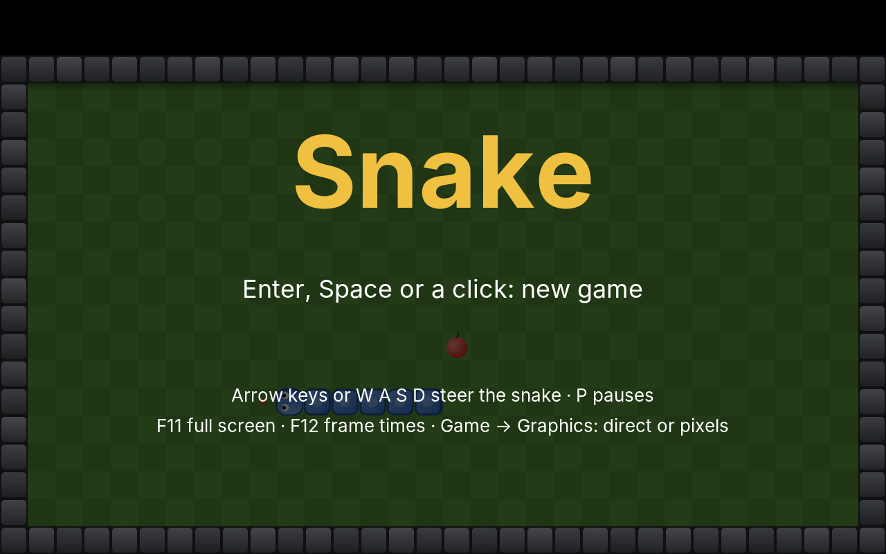
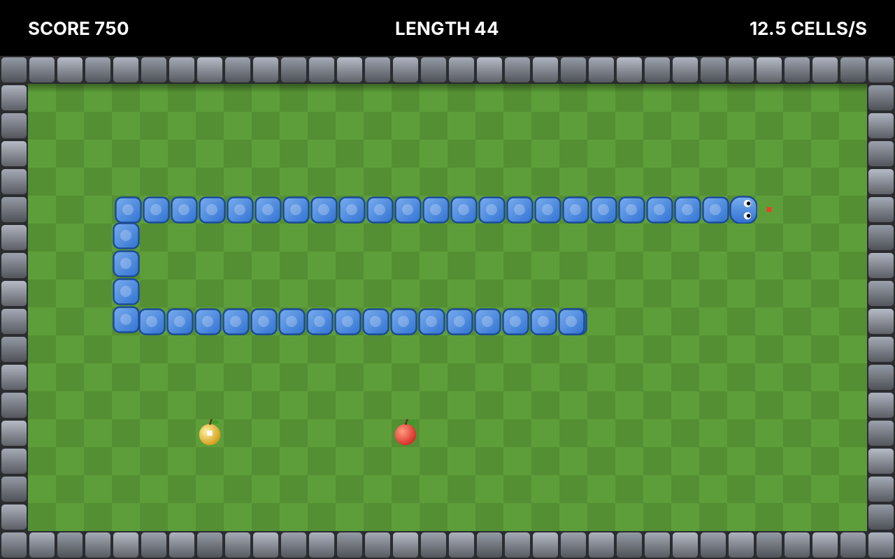
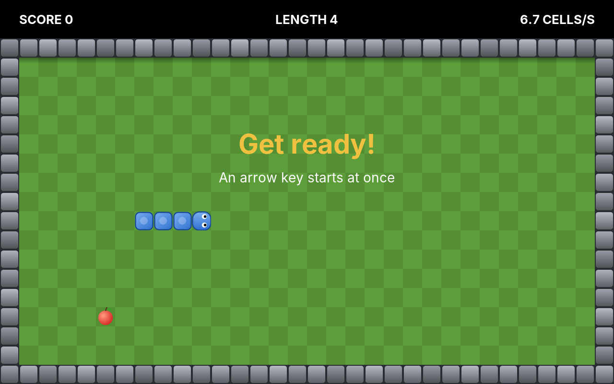

# 22. Snake

Paddle and Bricks move smoothly: a ball goes a few units further in every step of the loop. **Snake** moves in jumps. The field is a grid of cells, and the snake moves exactly one cell at a time, a few times a second, faster with every apple it eats. Steer it to the apples, let it grow, and never bite the wall or yourself.

<figure markdown>
{ width="400" }
{ width="400" }
<figcaption>The title screen with the computer playing (left), and a snake of 44 cells going for a golden apple (right).</figcaption>
</figure>

Snake is simpler than Bricks, which is why it is here. With few rules, there is room for three questions that every later game needs answered. How do rules with a **pace of their own** fit into a loop of 120 steps a second? How do we keep **key presses** that come between two moves? And how does a game that depends on **chance** become exactly repeatable, so that the title screen can replay your best game, cell by cell?

!!! abstract "What you will learn"
    - A **tick** for the rules, apart from the update steps and the frames, and a pace that changes while the game runs
    - **Drawing between ticks**, so a snake that moves in jumps glides
    - **Input between ticks**: a queue of turns, so no key press is lost
    - **Random numbers that repeat**: a seed, a generator of our own, and a second generator for the effects
    - **Replays**: a whole game as a seed and a few dozen turns, played back on the title screen
    - A **computer player** that counts its room with the flood fill from Mines

The complete game is in [amade-snake-game](https://github.com/datazuul/amade-snake-game).

## The rules

1. The field is a grid of 32 × 18 cells; the outermost ring is a stone wall. The snake starts four cells long in the middle, heading right.
2. The snake moves one cell per tick. The arrow keys turn it; it cannot turn back into its own neck.
3. An **apple** gives 10 points and makes the snake one cell longer and a little faster. The next apple appears on a random empty cell.
4. After every fifth apple, a **golden apple** appears for 40 ticks. It gives 50 points and does not make the snake longer.
5. Running into the wall or the snake's own body ends the game. The tail is not in the way, because it moves on in the same tick.
6. The best scores are kept. The title screen replays the best game, and lets the computer play in between.

## Step 1: Cells and the snake

The field is 640 × 400 logical units, as always: a band of 40 units at the top for the score, and below it 32 × 18 cells of 20 units. Positions in the rules are **cells**, whole numbers, and only the painter turns them into units:

```java title="amade-snake-game · domain/Cell.java"
--8<-- "amade-snake-game/src/main/java/eu/amadeos/games/snake/domain/Cell.java"
```

The snake is a `Deque<Cell>`, the head first. Moving one cell means adding a new head and removing the tail; growing means adding a head and keeping the tail. A new game puts the snake in the middle and the first apple somewhere free:

```java title="amade-snake-game · domain/Game.java"
--8<-- "amade-snake-game/src/main/java/eu/amadeos/games/snake/domain/Game.java:new-game"
```

One move is a **tick**. Like `update` in Bricks, it knows no clock; it only moves by one cell, and reports what happened as events:

```java title="amade-snake-game · domain/Game.java"
--8<-- "amade-snake-game/src/main/java/eu/amadeos/games/snake/domain/Game.java:tick"
```

```java title="amade-snake-game · domain/Event.java"
--8<-- "amade-snake-game/src/main/java/eu/amadeos/games/snake/domain/Event.java:event"
```

`isFree` holds the one subtle rule. The cell the tail occupies now will be empty after this tick, so the head may move into it, unless the snake eats an apple there and the tail stays. Tests show the rules with a snake the test puts where it wants:

```java title="amade-snake-game · test/domain/GameTest.java"
--8<-- "amade-snake-game/src/test/java/eu/amadeos/games/snake/domain/GameTest.java:test-eat"
```

## Step 2: A pace of its own

A tick is not an update step. The loop still steps 120 times a second, as in Paddle and Bricks. The snake starts at a cell every 150 ms, nearly seven cells a second, and gets faster with every apple:

```java title="amade-snake-game · domain/Field.java"
--8<-- "amade-snake-game/src/main/java/eu/amadeos/games/snake/domain/Field.java:pace"
```

```java title="amade-snake-game · domain/Game.java"
--8<-- "amade-snake-game/src/main/java/eu/amadeos/games/snake/domain/Game.java:interval"
```

Why not simply run the loop at seven steps a second? Three reasons. The pace changes during the game, and a loop with a changing step length gives up what made fixed steps worth having. The keys would be read only seven times a second, so a short tap could fall between two looks. And everything else on the screen, the splinters, the blinking golden apple and the pause screen, would move in jumps too.

So the loop keeps its 120 steps, and the rules get a clock of their own, the engine's `Ticker`. Each update step passes its time to the ticker, and the ticker says whether a tick is due:

```java title="amade-game-engine · loop/Ticker.java"
--8<-- "amade-game-engine/src/main/java/eu/amadeos/gameengine/loop/Ticker.java:ticker"
```

It is `FixedStep` once more, one level up: time is collected, and what is left over waits for the next step. The difference is that the interval may change between two ticks, and the time already collected is kept when it does.

```java title="amade-game-engine · test/loop/TickerTest.java"
--8<-- "amade-game-engine/src/test/java/eu/amadeos/gameengine/loop/TickerTest.java:test-ticker"
```

!!! warning "Pitfall: 120 times 1/120 is not 1"
    In floating point, 120 steps of 1/120 second add up to 0.99999999 seconds, not one second. A tick due after exactly one second would then come a step late, and the snake would stutter now and then. `Ticker` therefore allows a nanosecond of tolerance. `FixedStep` counts whole nanoseconds and has no such problem; the ticker works in seconds because the rules speak in seconds per tick.

The game's own test steps the scenes 120 times a second, as the loop does, and counts the ticks:

```java title="amade-snake-game · test/ui/game/SnakeGameTest.java"
--8<-- "amade-snake-game/src/test/java/eu/amadeos/games/snake/ui/game/SnakeGameTest.java:test-pace"
```

### Drawing between ticks

A snake drawn only where the rules put it jumps a whole cell, seven times a second. That is how the first snake games looked, and it is easy to do better. The ticker knows how far the time is between the last tick and the next, from 0 to 1. The game keeps the snake as it was before the last tick, so each segment can be drawn that far on its way from its old cell to its new one:

```java title="amade-snake-game · ui/game/FieldPainter.java"
--8<-- "amade-snake-game/src/main/java/eu/amadeos/games/snake/ui/game/FieldPainter.java:paint"
```

Each segment moves into the cell the segment in front of it had, so it always moves in a straight line to a neighbouring cell, and the snake bends at its corners by itself. A segment that has just grown has no old cell; it appears where it is.

The scene asks the ticker for its progress with `alpha * STEP` as the time ahead. A frame is drawn between two update steps, and `alpha` says how far between, as in Paddle. Without it, the snake would be drawn where it was at the last update step, not at the moment of the frame. Frames and steps do not keep in line, so it would move unevenly: a little more in one frame, a little less in the next.

!!! info "Behind the scenes: pixel mode"
    In pixel mode, the snake glides in whole logical pixels: twenty positions from one cell to the next. That is how the arcade machines of the 1980s moved their sprites, and why their smooth movement still looked crisp.

## Step 3: Turns between ticks

The player presses up, and a moment later left, to turn the snake around a corner and back. Both presses come within one tick. A game that only remembers "the last key pressed" loses the up: the snake turns left into its own neck and dies, and the player rightly blames the game.

The turns therefore wait in a short **queue**, and each tick takes one:

```java title="amade-snake-game · domain/Game.java"
--8<-- "amade-snake-game/src/main/java/eu/amadeos/games/snake/domain/Game.java:turn"
```

A turn is compared with the *last queued* direction, not with the current heading. Heading right, *up* then *down* would otherwise both be accepted, and the second would turn the snake back into itself one tick later. Two places in the queue are enough for any human hand; more would let a nervous player queue up moves they no longer mean.

```java title="amade-snake-game · test/domain/GameTest.java"
--8<-- "amade-snake-game/src/test/java/eu/amadeos/games/snake/domain/GameTest.java:test-turns"
```

!!! tip "Events or states?"
    In Paddle and Bricks, the paddles asked `isDown`: is the key held right now? A snake does not care how long a key is held, only that it was pressed. So Snake asks `wasPressed`, as Bricks did for launching the ball. The keyboard collects presses between two update steps, and the game collects them between two ticks.

## Step 4: Chance that repeats

Where does the next apple appear? On a random empty cell:

```java title="amade-snake-game · domain/Game.java"
--8<-- "amade-snake-game/src/main/java/eu/amadeos/games/snake/domain/Game.java:free-cell"
```

"Random" is the interesting word here. A computer has no dice. Its random numbers come from a formula that turns one number into the next. Start the formula with the same number, the **seed**, and it produces the same sequence again. Usually that is hidden: Java seeds its generators from the clock. For a game, it is a gift. If all chance in the rules comes from one generator with a known seed, and the rules know no time but their ticks, then the same seed and the same turns at the same ticks play **the same game**. That is called *deterministic*. It makes three things possible: tests that play whole games, a "game of the day" that everyone plays with the same apples, and replays.

Which of Java's generators repeats reliably? `Math.random()` cannot be seeded at all. `RandomGenerator.getDefault()` names no algorithm; a later Java may choose another one, and every saved replay would break. `java.util.Random` is specified to the bit and does repeat, but it cannot tell its seed and cannot be copied or split. So the engine has a generator of its own, a dozen lines of a well-known algorithm (SplitMix64), written out so that no library update can ever change it:

```java title="amade-game-engine · random/SeededRandom.java"
--8<-- "amade-game-engine/src/main/java/eu/amadeos/gameengine/random/SeededRandom.java:seeded-random"
```

`nextInt(bound)` is written out too, because turning a 64-bit number into a number below `bound` is a formula of its own. Dividing and keeping the remainder makes small results a little more likely than large ones, so the few largest raw values that cause this are drawn again. The test pins the first numbers. If they ever change, every replay is broken, and the test says so first:

```java title="amade-game-engine · test/random/SeededRandomTest.java"
--8<-- "amade-game-engine/src/test/java/eu/amadeos/gameengine/random/SeededRandomTest.java:test-seeded-random"
```

`Game` gets a seed, not a generator, and makes its own. Nobody outside can draw a number from it and change the next apple by accident.

### Effects need chance too

The juice of an eaten apple flies in random directions. If the particles drew their numbers from the rules' generator, a burst of twenty particles would move the generator twenty numbers on, and the next apple would appear elsewhere. Worse: turning the effects off, or drawing fewer particles on a slow computer, would change the game. **Chance for the looks must never come from the rules' generator.** Snake's effects get a generator of their own. For games where both start from one seed, `fork` makes a second generator that is independent of the first:

```java title="amade-game-engine · random/SeededRandom.java"
--8<-- "amade-game-engine/src/main/java/eu/amadeos/gameengine/random/SeededRandom.java:fork"
```

```java title="amade-game-engine · test/random/SeededRandomTest.java"
--8<-- "amade-game-engine/src/test/java/eu/amadeos/gameengine/random/SeededRandomTest.java:test-fork"
```

!!! info "What makes a game deterministic"
    - All chance in the rules comes from one seeded generator, used in a fixed order.
    - Time exists only as ticks or fixed steps, never as `System.nanoTime()` inside the rules.
    - Nothing in the rules depends on the iteration order of a `HashSet` or `HashMap`. `freeCell` uses a set only to *look up* taken cells; the order comes from the two loops over rows and columns.
    - Effects, sound and drawing may do what they like, as long as they only read the rules.

    Since Java 17, `+`, `-`, `*` and `/` on `double` give the same result on every computer. Functions such as `Math.sin` may still differ in the last bit between processors; `StrictMath` does not. Bricks, with its angles, would need `StrictMath` for replays that work everywhere. Snake has whole cells and needs no such care.

## Step 5: Replays

With a deterministic game, a replay is small: the seed, and every turn with the tick before which the rules received it. The engine's `Replay` holds exactly that:

```java title="amade-game-engine · replay/Replay.java"
--8<-- "amade-game-engine/src/main/java/eu/amadeos/gameengine/replay/Replay.java:replay"
```

The play scene records every turn the game accepts, at the game's tick count. Before the first turn, a new game waits one and a half seconds ("Get ready!"), unless the player turns the snake first:

```java title="amade-snake-game · ui/game/SnakeGame.java"
--8<-- "amade-snake-game/src/main/java/eu/amadeos/games/snake/ui/game/SnakeGame.java:play"
```

!!! warning "Pitfall: record ticks, not time"
    It is tempting to record "UP after 3.2 seconds". But the rules never see seconds; they see turns arriving between ticks. Time also depends on the frame rate, the computer and the length of the pause the player took. The tick count does not, so the replay records ticks, and a replay recorded on a fast computer plays the same on a slow one.

Playing back is the same loop with the replay at the keys. The title screen does that, and lets the computer play the next round:

```java title="amade-snake-game · ui/game/SnakeGame.java"
--8<-- "amade-snake-game/src/main/java/eu/amadeos/games/snake/ui/game/SnakeGame.java:title-update"
```

The test plays a short game with the keyboard, hands the replay to the title screen, and checks that the replayed snake ends in exactly the same cells, after exactly as many ticks:

```java title="amade-snake-game · test/ui/game/SnakeGameTest.java"
--8<-- "amade-snake-game/src/test/java/eu/amadeos/games/snake/ui/game/SnakeGameTest.java:test-replay"
```

A whole game played by the computer, recorded and replayed, gives the same points too:

```java title="amade-snake-game · test/domain/GameTest.java"
--8<-- "amade-snake-game/src/test/java/eu/amadeos/games/snake/domain/GameTest.java:test-determinism"
```

### Replays as text

A replay is saved as text, which a person can read and a test can write:

```java title="amade-game-engine · replay/Replay.java"
--8<-- "amade-game-engine/src/main/java/eu/amadeos/gameengine/replay/Replay.java:text"
```

```java title="amade-game-engine · test/replay/ReplayTest.java"
--8<-- "amade-game-engine/src/test/java/eu/amadeos/gameengine/replay/ReplayTest.java:test-replay"
```

A good game of a hundred apples is a seed and a few hundred lines. Snake keeps the best one next to the high scores, with its points in a comment line, and writes it to a temporary file first, so a crash never leaves half a replay:

```java title="amade-snake-game · repository/ReplayFile.java"
--8<-- "amade-snake-game/src/main/java/eu/amadeos/games/snake/repository/ReplayFile.java:replay-file"
```

The presenter decides what is kept, on the Swing thread, when a game ends:

```java title="amade-snake-game · ui/main/SnakePresenter.java"
--8<-- "amade-snake-game/src/main/java/eu/amadeos/games/snake/ui/main/SnakePresenter.java:game-over"
```

!!! tip "Replays find bugs"
    A player reports that the snake died "for no reason". With a replay, you do not have to believe or doubt them: load the file into a test, play it to the end and look at the last tick. Many games keep the replay of every game for exactly that reason.

## Step 6: The computer player

The title screen's computer player is simple. Before each tick it looks at the three cells the head can move to, drops those that crash, and takes the one nearest the apple:

```java title="amade-snake-game · domain/Autopilot.java"
--8<-- "amade-snake-game/src/main/java/eu/amadeos/games/snake/domain/Autopilot.java:choose"
```

Nearest the apple alone is not enough. A long snake heading for an apple can turn into a pocket enclosed by its own body, with no way out. So the autopilot first counts how much **room** each move leaves, with the flood fill from Mines: start at the cell, visit every free neighbour, and their free neighbours, until the snake's length is reached. That is enough room to survive until the tail clears the way. A move with more room wins; among equal ones, the one nearer the apple.

```java title="amade-snake-game · test/domain/AutopilotTest.java"
--8<-- "amade-snake-game/src/test/java/eu/amadeos/games/snake/domain/AutopilotTest.java:test-demo"
```

Ten minutes of play at the highest pace are four games, the longest snake 106 cells long, and the test needs a fraction of a second for them. The computer still dies, because counting room is not planning. In Maze, the ghosts will search their way properly, with breadth-first search, the flood fill's orderly sibling.

## Step 7: Putting it together

The rest follows Bricks. The events become sounds and particles:

```java title="amade-snake-game · ui/game/Effects.java"
--8<-- "amade-snake-game/src/main/java/eu/amadeos/games/snake/ui/game/Effects.java:react"
```

```java title="amade-snake-game · ui/game/SoundBank.java"
--8<-- "amade-snake-game/src/main/java/eu/amadeos/games/snake/ui/game/SoundBank.java:sounds"
```

The loop starts the same way as in Bricks, at 120 steps and 60 frames a second; only the scenes inside it use the ticker:

```java title="amade-snake-game · ui/game/SnakeGame.java"
--8<-- "amade-snake-game/src/main/java/eu/amadeos/games/snake/ui/game/SnakeGame.java:start"
```

All pictures are sprites drawn in code: the lawn and the wall as one background, the apples, a segment, and the head in four directions. Drawn once per screen size, they cost nothing to copy, so full screen (F11), the render modes, and the frame-time display (F12) work just as in Bricks, from the same engine classes. The mouse starts a game and continues after a pause; steering stays with the keys, as in the original.

<figure markdown>
{ width="400" }
<figcaption>The start of a game: the snake waits until an arrow key, or for a second and a half.</figcaption>
</figure>

## What moved into the engine

| From Snake | Engine package | Why |
|---|---|---|
| A tick for the rules, with a changing pace | `eu.amadeos.gameengine.loop.Ticker` | Rules that move in ticks: Snake, a falling piece, a turn-based opponent |
| Random numbers that repeat | `eu.amadeos.gameengine.random.SeededRandom` | Tests of whole games, games of the day, replays; effects apart from the rules |
| Replays | `eu.amadeos.gameengine.replay.Replay` | A whole game as a seed and the player's actions, played back or tested |

What stays in the game: the field and its cells, the snake, the turn queue, the apples, the autopilot, the painter, the sounds and the scenes.

## Exercises

1. **No walls.** Let the snake leave the field on one side and come back on the other. Which method decides this, and what does the autopilot need to learn?
2. **Game of the day.** Make the seed from today's date, so everyone who plays today gets the same apples. Add *Game → Game of the Day*, and keep its best score in a table of its own.
3. **Fast forward.** Let the title screen replay the best game at double speed. Where do you change the time, and why does the game still end the same?
4. **Obstacles.** Add levels with stone walls inside the field, as text files like the levels of Bricks. Which test makes sure the snake's starting cells are free?
5. **A replay for every record.** Keep a replay for each entry of the high-score table, and let the high-score dialog play one back.

---

In the next game, **Rocks**, things fly at any angle and turn: vectors, rotation, a field without edges, and many short-lived bullets from a pool.
