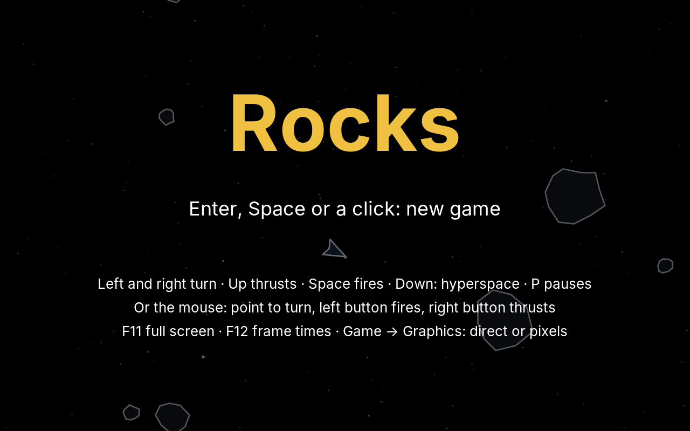
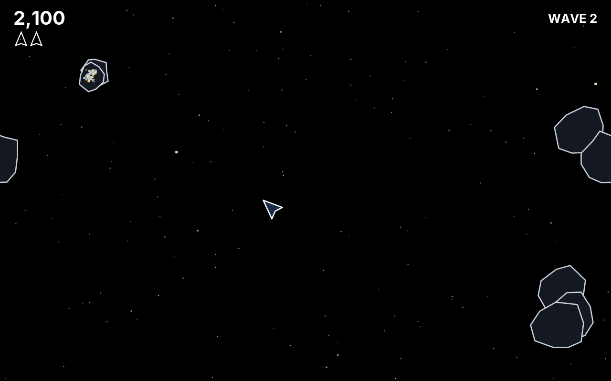
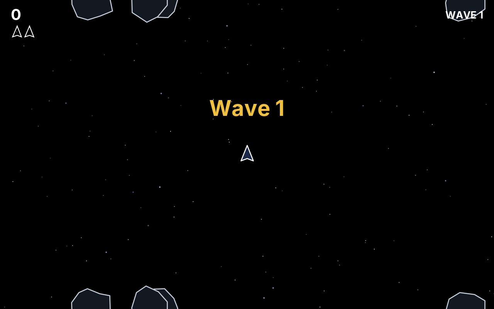

# 23. Rocks

Paddle, Bricks and Snake move along the axes: left and right, up and down. In **Rocks**, everything flies at any angle. The ship turns on the spot, its engine pushes it the way its nose points, and it drifts on when the engine stops. Large rocks tumble through space; a hit breaks them into smaller and faster ones. And space has no edges: whatever flies out on one side comes back on the other.

<figure markdown>
{ width="400" }
{ width="400" }
<figcaption>The title screen with the computer playing (left), and the second wave, with a rock reaching over the left edge and its other half on the right (right).</figcaption>
</figure>

The original came from an arcade hall in 1979, and it drew with lines on a vector screen, not with pixels. Our Rocks does the same, for a reason this chapter explains. It needs five new things in the engine, and all of them come back in the next games: Swarm's ships fly curves, Maze's ghosts turn, and every shooter has bullets.

!!! abstract "What you will learn"
    - **Vectors**: position, velocity and direction as one small type, and the arithmetic of flying
    - **Rotation**: turning a point, a direction and a whole figure, and the short way round between two angles
    - **Outlines**: why a game that turns things draws lines, not pictures
    - **A field without edges**: wrapping positions, the shortest distance, drawing things twice
    - **Circle collision**, also across an edge
    - **Object pools**: four shots, made once, used again and again
    - **The mouse** as a second way to steer, and sound made from filtered noise

The complete game is in [amade-rocks-game](https://github.com/amadeos-eu/amade-rocks-game).

## The rules

1. The ship starts in the centre with its nose up. Left and right turn it, up fires the engine, Space shoots, down jumps into hyperspace.
2. At most **four shots** fly at a time. Each flies a little more than half the field and then vanishes.
3. A shot breaks a **large rock** (20 points) into two medium ones (50 points each), a medium one into two small ones (100 points each), and a small one into dust.
4. The field has **no edges**. Rocks, shots and the ship leave it on one side and come back on the other.
5. A rock that touches the ship destroys it. The next ship appears in the centre, but only when no rock is near. There are three ships, and an extra one every 10,000 points.
6. When all rocks are gone, the next wave comes: 4, 6, 8, 10, then 11 large rocks, a little faster each time.
7. **Hyperspace** takes the ship to a random place, perhaps right next to a rock.

## Step 1: Vectors

A ship in Rocks has a position, a velocity and a direction. Each is two numbers, and each changes with the others: the direction changes the velocity, the velocity changes the position. Written with separate `x` and `y` fields, every line of physics comes twice, and sooner or later one of the twins has a typo. So the engine has a type for "two numbers that belong together", the **vector**:

```java title="amade-game-engine · math/Vector.java"
--8<-- "amade-game-engine/src/main/java/eu/amadeos/gameengine/math/Vector.java:vector"
```

A vector is a record and cannot change. `plus` does not move a vector, it makes a new one. That rules out a whole family of bugs: a rock that keeps a reference to the ship's position cannot move the ship by accident.

!!! info "Behind the scenes: are all these small objects slow?"
    A ship's step makes half a dozen new vectors, 120 times a second. That sounds wasteful, and twenty years ago it was. Today the JVM sees that most of them never leave the method that made them (*escape analysis*) and keeps their two numbers in processor registers, without creating an object at all. Those that remain live a few microseconds and cost the garbage collector next to nothing. Measure before you trade readable code for a few saved objects; [Step 5](#step-5-four-shots-from-a-pool) is about when it is worth it.

Angles need one decision, made once for the whole engine. In mathematics, angles turn anticlockwise, with *y* pointing up. On the screen, *y* points **down**. The engine keeps the formulas of mathematics and accepts that a positive angle turns **clockwise** on the screen; angle 0 points right, and -π/2 points up:

```java title="amade-game-engine · test/math/VectorTest.java"
--8<-- "amade-game-engine/src/test/java/eu/amadeos/gameengine/math/VectorTest.java:test-vector"
```

With vectors, flying is four lines. The keys turn the nose, the engine adds a little velocity in the direction of the nose, drag takes a little away, and the velocity moves the ship:

```java title="amade-rocks-game · domain/Ship.java"
--8<-- "amade-rocks-game/src/main/java/eu/amadeos/games/rocks/domain/Ship.java:steer"
```

```java title="amade-rocks-game · domain/Field.java"
--8<-- "amade-rocks-game/src/main/java/eu/amadeos/games/rocks/domain/Field.java:ship"
```

Space has no friction, and the original had some anyway. Without drag, the ship would keep every bit of speed it ever had, and a player would spend the game braking with the nose turned back. Each step here takes 0.45 × 1/120 of the speed away, which adds up to a little more than a third per second; after a few seconds without thrust the ship comes to rest. Note that `velocity.times(1 - DRAG * seconds)` gives a slightly different result with a different step length. With fixed steps that does not matter, one more reason to have them.

```java title="amade-rocks-game · test/domain/GameTest.java"
--8<-- "amade-rocks-game/src/test/java/eu/amadeos/games/rocks/domain/GameTest.java:test-flying"
```

## Step 2: Turning

Turning a point by an angle around the origin is one formula, and every rotation in this chapter uses it:

```java title="amade-game-engine · math/Vector.java"
--8<-- "amade-game-engine/src/main/java/eu/amadeos/gameengine/math/Vector.java:rotated"
```

Why does it work? A point at distance *r* and angle *a* is (*r* cos *a*, *r* sin *a*). Turned by *b*, it is at angle *a* + *b*, and the addition theorems for sine and cosine turn cos(*a* + *b*) and sin(*a* + *b*) into exactly the two lines above. You do not need to remember the proof; you need to remember that turning costs four multiplications.

### The short way round

The mouse gives the ship a target angle, and the ship turns towards it at its turning speed. Which way? An angle has many names: 170° and -190° are the same direction. If the ship points at 170° and the target is -170°, the naive difference is -340°, and the ship would turn almost all the way round, instead of 20° the other way. `Angles` brings every difference into -180° … 180°:

```java title="amade-game-engine · math/Angles.java"
--8<-- "amade-game-engine/src/main/java/eu/amadeos/gameengine/math/Angles.java:difference"
```

```java title="amade-game-engine · test/math/AnglesTest.java"
--8<-- "amade-game-engine/src/test/java/eu/amadeos/gameengine/math/AnglesTest.java:test-angles"
```

### Pictures or lines?

Now the ship must be *drawn* at its angle, and so must every rock. In Snake, the head had four directions, and four sprites did the job. Here there are as many directions as there are numbers. Three ways come to mind:

1. **Turn the sprite in every frame.** `Graphics2D.rotate` and then `drawImage`. Java2D then has to work out every pixel of the turned picture, and it cannot use the sprite cache from chapter 21: a cached picture is only valid at one angle. `Sprite.draw` notices a turned transform and falls back to drawing the source, which is the slow path Bricks taught us to avoid.
2. **Turn it in advance.** Draw each sprite at, say, 64 angles once and pick the nearest. The classic solution of the 16-bit era. But count: a large rock is 60 units wide, on a 1920 × 1200 screen 180 pixels, and turned it needs a square of 255 × 255 pixels, 260 KB. Times 64 angles, times four rock shapes, plus the smaller sizes: about 90 MB of pictures. On a 4K screen, four times that.
3. **Draw lines.** Keep the figure as a list of corners, turn the corners with the formula above, and draw the lines between them. A rock with eleven corners costs eleven turned points per frame, and nothing in memory. The lines are sharp at every size and every angle.

The original had no choice, its screen *could* only draw lines. We choose lines because they are the right tool for things that turn. The engine's `Outline` holds the corners and turns them all with one sine and one cosine:

```java title="amade-game-engine · shape/Outline.java"
--8<-- "amade-game-engine/src/main/java/eu/amadeos/gameengine/shape/Outline.java:path"
```

The `Path2D` is made once and filled anew for each drawing, so drawing creates no objects. The figure is given around its own centre, nose to the right, and `scale` enlarges it: Rocks has four rock shapes of radius about 1, and each rock draws one of them at its own size.

```java title="amade-game-engine · test/shape/OutlineTest.java"
--8<-- "amade-game-engine/src/test/java/eu/amadeos/gameengine/shape/OutlineTest.java:test-outline"
```

The rock shapes come from a fixed seed, so every game has the same four rocks. Corners at even angles, each at a random distance from the centre, look like a rock to anybody:

```java title="amade-rocks-game · ui/game/SpacePainter.java"
--8<-- "amade-rocks-game/src/main/java/eu/amadeos/games/rocks/ui/game/SpacePainter.java:shapes"
```

!!! tip "Fill, then lines"
    A rock drawn only as lines lets the stars shine through it. Each outline is filled with a very dark colour first and then drawn with a light line, from the same path. That is cheap and makes the rocks solid, and it is what the original could not do.

## Step 3: A field without edges

When a rock flies out on the right, it comes back on the left. In the rules, that is one line: bring the position back into the field. The engine's `Wrap` knows the field's size:

```java title="amade-game-engine · math/Wrap.java"
--8<-- "amade-game-engine/src/main/java/eu/amadeos/gameengine/math/Wrap.java:wrap"
```

```java title="amade-rocks-game · domain/Rock.java"
--8<-- "amade-rocks-game/src/main/java/eu/amadeos/games/rocks/domain/Rock.java:move"
```

`Math.floor` instead of the remainder operator `%`, because `-10 % 640` is -10 in Java, not 630. A field without edges is what mathematicians call a **torus**: roll the screen into a tube, joining top and bottom, then bend the tube into a ring, joining left and right. That picture explains the three surprises that follow.

### Distance goes the short way

Two rocks at x = 630 and x = 10 are 20 units apart, not 620: on the doughnut, they are neighbours. Everything that measures distance must know this, from collisions to the computer player choosing the nearest rock:

```java title="amade-game-engine · math/Wrap.java"
--8<-- "amade-game-engine/src/main/java/eu/amadeos/gameengine/math/Wrap.java:delta"
```

```java title="amade-game-engine · test/math/WrapTest.java"
--8<-- "amade-game-engine/src/test/java/eu/amadeos/gameengine/math/WrapTest.java:test-wrap"
```

### A thing over the edge is in two places

A large rock centred 10 units from the left edge reaches 20 units beyond it. Those 20 units must appear on the right side of the screen. So a thing near an edge is drawn twice, and near a corner four times:

```java title="amade-game-engine · math/Wrap.java"
--8<-- "amade-game-engine/src/main/java/eu/amadeos/gameengine/math/Wrap.java:copies"
```

```java title="amade-game-engine · test/math/WrapTest.java"
--8<-- "amade-game-engine/src/test/java/eu/amadeos/gameengine/math/WrapTest.java:test-copies"
```

<figure markdown>
{ width="400" }
<figcaption>A new wave starts with its rocks on the edges, away from the ship: each one is drawn at the top and again at the bottom.</figcaption>
</figure>

### Drawing between steps, across the edge

!!! warning "Pitfall: the streak across the screen"
    Since Paddle, every frame draws things between their last two positions, by `alpha`. Do that naively here, and a rock that crossed the right edge in the last step, from x = 638 to x = 2, is drawn for one frame half-way between, at x = 320, in the middle of the screen. It flashes there, and on a fast ship you see a ghostly streak. The fix is the same as for distance: go the short way. `between` moves back from the new position along the short step, which may lead a little outside the field, and `forEachCopy` then draws it on both sides.

```java title="amade-game-engine · math/Wrap.java"
--8<-- "amade-game-engine/src/main/java/eu/amadeos/gameengine/math/Wrap.java:between"
```

The painter puts it together. For every rock it works out the position between the steps, the angle between the steps, and then lets `forEachCopy` call `drawCopy` once per place:

```java title="amade-rocks-game · ui/game/SpacePainter.java"
--8<-- "amade-rocks-game/src/main/java/eu/amadeos/games/rocks/ui/game/SpacePainter.java:paint"
```

`drawCopy` is a method reference made once, in a field; what to draw is in fields too, set before each call. A lambda written inline, `(x, y) -> draw(rock, x, y)`, would capture the rock and could cost a new object per rock per frame. Not much, but the painter runs 60 times a second for the whole game, and the fields cost nothing.

## Step 4: Circles

How do we know that a shot hit a rock? In Bricks, everything was a box, and `Box.overlaps` compared edges. A box does not turn, and a rock does. But a rock is roughly round, and a **circle** looks the same at every angle: two circles overlap when their centres are closer than both radii together. No angle, no corners, one comparison:

```java title="amade-game-engine · collision/Circle.java"
--8<-- "amade-game-engine/src/main/java/eu/amadeos/gameengine/collision/Circle.java:circle"
```

The comparison is squared, `dx² + dy² < (r₁ + r₂)²`, which needs no square root. On the field without edges, `dx` and `dy` take the short way first, exactly as in `Wrap.delta`:

```java title="amade-game-engine · test/collision/CircleTest.java"
--8<-- "amade-game-engine/src/test/java/eu/amadeos/gameengine/collision/CircleTest.java:test-circle"
```

The rules check every shot against every rock, and the ship against every rock. A shot is a circle of radius 0, a point:

```java title="amade-rocks-game · domain/Game.java"
--8<-- "amade-rocks-game/src/main/java/eu/amadeos/games/rocks/domain/Game.java:hits"
```

The ship's hit circle is 8 units, smaller than its drawing: the tips of its wings may touch a rock without harm. A hit circle a little smaller than the picture feels fair, and a larger one feels like cheating, every time.

!!! info "Why no sweep, as in Bricks?"
    Bricks needed a swept test because the ball could jump over a brick between two steps. Here, the fastest shot flies 400 units a second plus the ship's speed, at most 5.5 units per step. The smallest rock is 16 units wide. A shot cannot jump over it, and the simple test is enough. Check that sum whenever speeds or sizes change; it is the kind of number that silently stops being true.

A test shows the circle across the edge at work: the ship shoots up at a rock whose centre is near the bottom, but whose upper part shows at the top. The shot hits it at the top, long before it reaches the rock's centre on the other side:

```java title="amade-rocks-game · test/domain/GameTest.java"
--8<-- "amade-rocks-game/src/test/java/eu/amadeos/games/rocks/domain/GameTest.java:test-break"
```

## Step 5: Four shots from a pool

The original allowed four shots in the air at once. A fifth press of the button did nothing. That is a rule of the game, and it has a natural home: a **pool** of four shot objects, made once. Firing takes one from the pool; a shot that has flown its distance or hit a rock goes back:

```java title="amade-game-engine · pool/Pool.java"
--8<-- "amade-game-engine/src/main/java/eu/amadeos/gameengine/pool/Pool.java:pool"
```

The pool keeps the objects in use at the front of its array. Giving one back swaps it with the last one in use, the same trick `Particles` uses for its rows in chapter 21: no gaps, no copying, but the order changes. That is why `releaseIf` walks backwards.

```java title="amade-game-engine · test/pool/PoolTest.java"
--8<-- "amade-game-engine/src/test/java/eu/amadeos/gameengine/pool/PoolTest.java:test-pool"
```

A pooled object must be mutable, because it is reused, and it needs a method that makes it like new. Forgetting to reset one field is the classic pool bug: the new shot inherits the old one's life and vanishes at once. `launch` therefore sets *every* field:

```java title="amade-rocks-game · domain/Bullet.java"
--8<-- "amade-rocks-game/src/main/java/eu/amadeos/games/rocks/domain/Bullet.java:bullet"
```

```java title="amade-rocks-game · domain/Game.java"
--8<-- "amade-rocks-game/src/main/java/eu/amadeos/games/rocks/domain/Game.java:fire"
```

```java title="amade-rocks-game · test/domain/GameTest.java"
--8<-- "amade-rocks-game/src/test/java/eu/amadeos/games/rocks/domain/GameTest.java:test-bullets"
```

!!! info "Is pooling still worth it in Java?"
    Many old game books pool everything, because creating objects used to be expensive. In today's Java it is not; a new object costs about as much as a few additions. Pools are worth it for two other reasons. A **limit** the game relies on, like the four shots, is a pool's capacity, written down in one place. And a game that creates no garbage while it runs never makes the garbage collector stop it for a moment, which matters most for things made by the hundred every second, like the particles. For four shots, the first reason is the one that counts. For the rocks, which come and go a few times a second and have no limit, Rocks uses a plain `ArrayList`, and that is fine.

## Step 6: Rocks, waves and new ships

The three sizes of rocks are an enum with their radius, points and speed:

```java title="amade-rocks-game · domain/RockSize.java"
--8<-- "amade-rocks-game/src/main/java/eu/amadeos/games/rocks/domain/RockSize.java:sizes"
```

A hit takes the rock out and puts two smaller ones in its place, flying apart at an angle to the old direction:

```java title="amade-rocks-game · domain/Game.java"
--8<-- "amade-rocks-game/src/main/java/eu/amadeos/games/rocks/domain/Game.java:break"
```

Like Snake, the game is deterministic: all chance comes from a `SeededRandom` made from the game's seed. A new wave puts its rocks on the edges of the field, never close to the ship, and they reach over the edges from the first frame:

```java title="amade-rocks-game · domain/Game.java"
--8<-- "amade-rocks-game/src/main/java/eu/amadeos/games/rocks/domain/Game.java:wave"
```

A new ship must not appear inside a rock. The original solved this with a simple rule that players still remember: the next ship waits until the centre is clear.

```java title="amade-rocks-game · domain/Game.java"
--8<-- "amade-rocks-game/src/main/java/eu/amadeos/games/rocks/domain/Game.java:centre"
```

```java title="amade-rocks-game · test/domain/GameTest.java"
--8<-- "amade-rocks-game/src/test/java/eu/amadeos/games/rocks/domain/GameTest.java:test-crash"
```

The whole step reads like the rules: fly, shoot, move, collide, then see whether a ship or a wave is due. The events tell the user interface what happened:

```java title="amade-rocks-game · domain/Game.java"
--8<-- "amade-rocks-game/src/main/java/eu/amadeos/games/rocks/domain/Game.java:update"
```

```java title="amade-rocks-game · domain/Event.java"
--8<-- "amade-rocks-game/src/main/java/eu/amadeos/games/rocks/domain/Event.java:event"
```

## Step 7: Steering with the mouse

The rules never see a key. They get a `Steering` for each step: turn left or right, or turn towards an angle; thrust; fire; hyperspace. That makes a second way to steer easy. The ship turns towards the mouse pointer, the left button fires and the right button, held, fires the engine. The play scene builds the `Steering` from whichever the player uses:

```java title="amade-rocks-game · ui/game/RocksGame.java"
--8<-- "amade-rocks-game/src/main/java/eu/amadeos/games/rocks/ui/game/RocksGame.java:play"
```

The mouse aims only after it has moved, and a turning key takes over until it moves again. Without that rule, a player who uses the keys would find the ship pulled towards a pointer resting somewhere on the screen. For the thrust, the engine's `Mouse` learned one new thing, whether a button is *held*, like `isDown` on the keyboard:

```java title="amade-game-engine · input/Mouse.java"
--8<-- "amade-game-engine/src/main/java/eu/amadeos/gameengine/input/Mouse.java:mouse"
```

```java title="amade-rocks-game · test/ui/game/RocksGameTest.java"
--8<-- "amade-rocks-game/src/test/java/eu/amadeos/games/rocks/ui/game/RocksGameTest.java:test-mouse"
```

The window shows a cross-hair over the field, so the pointer reads as a sight, not as an arrow waiting for a click.

## Step 8: Bangs and a heartbeat

Snake's and Bricks' sounds were tones. An explosion is not a tone but **noise**, and plain noise from `Sound.tone(Wave.NOISE, …)` hisses like a radio between stations. A bang is noise with the high frequencies taken away. The simplest way to take them away is to let each sample move only part of the way towards the next random value: the speaker cannot move fast any more, so only slow, deep vibrations remain. That is a **low-pass filter**, in one line:

```java title="amade-rocks-game · ui/game/SoundBank.java"
--8<-- "amade-rocks-game/src/main/java/eu/amadeos/games/rocks/ui/game/SoundBank.java:rumble"
```

```java title="amade-rocks-game · ui/game/SoundBank.java"
--8<-- "amade-rocks-game/src/main/java/eu/amadeos/games/rocks/ui/game/SoundBank.java:sounds"
```

The larger the rock, the darker and longer its bang. The engine is the same rumble, short and quiet, played again every tenth of a second while the engine fires.

The original's most famous sound is not a bang but its **heartbeat**: two low notes in turn, slow at the start of a wave and faster the longer it lasts. It is music made from nothing, and it makes players nervous in the best way. Its pace is a job for the `Ticker` from Snake, with an interval that shrinks with the wave's time:

```java title="amade-rocks-game · ui/game/Effects.java"
--8<-- "amade-rocks-game/src/main/java/eu/amadeos/games/rocks/ui/game/Effects.java:heartbeat"
```

The other events become sounds and particles as in the earlier games; in space, the particles have no gravity:

```java title="amade-rocks-game · ui/game/Effects.java"
--8<-- "amade-rocks-game/src/main/java/eu/amadeos/games/rocks/ui/game/Effects.java:react"
```

## Step 9: Putting it together

The score, the ships left and the wave are the overlay; the ships left are the ship's own outline, small and pointing up:

```java title="amade-rocks-game · ui/game/Hud.java"
--8<-- "amade-rocks-game/src/main/java/eu/amadeos/games/rocks/ui/game/Hud.java:hud"
```

The computer player of the title screen turns towards the nearest rock and fires when its nose points there. It could aim perfectly, even where a rock *will* be when the shot arrives. It did, at first, and played for ten minutes without losing a ship, which made a dull title screen. So it aims at where the rock is now, and its hand shakes, from a random generator of its own:

```java title="amade-rocks-game · domain/Pilot.java"
--8<-- "amade-rocks-game/src/main/java/eu/amadeos/games/rocks/domain/Pilot.java:steer"
```

```java title="amade-rocks-game · test/domain/PilotTest.java"
--8<-- "amade-rocks-game/src/test/java/eu/amadeos/games/rocks/domain/PilotTest.java:test-demo"
```

Now it lasts one to three minutes and reaches the third to fifth wave. A computer player that is too good is a common problem in games; making it worse in a believable way is a design task of its own.

Since the rules are deterministic, the same seed and the same pilot play the same game, and a test can prove it:

```java title="amade-rocks-game · test/domain/GameTest.java"
--8<-- "amade-rocks-game/src/test/java/eu/amadeos/games/rocks/domain/GameTest.java:test-determinism"
```

!!! info "Behind the scenes: what the lines cost"
    Measured with the title screen (the busiest one: rocks, ship, particles, a veil and large text) in Xvfb, which draws in software without a graphics card: 1.4 ms per frame at 640 × 400, 3.6 ms at 1280 × 800, 8.5 ms at 1920 × 1200. A frame at 60 frames per second may take 16.7 ms. Antialiased lines are among the more expensive things Java2D draws in software; on a real screen with a graphics card, they cost less. Press F12 and measure on yours.

Full screen (F11), the render modes, the frame times (F12), sound, the best scores and the five languages work as in the earlier games, from the same engine classes. In pixel mode, the lines become the jagged lines of an early home computer; in direct mode, they are as sharp as the vector screen of 1979.

## What moved into the engine

| From Rocks | Engine package | Why |
|---|---|---|
| Vectors and angles | `eu.amadeos.gameengine.math.Vector`, `Angles` | Anything that flies at an angle: ships, bullets, flight paths in Swarm, the camera in Jump |
| A field without edges | `eu.amadeos.gameengine.math.Wrap` | Wrapping, the shortest distance, drawing over an edge; also Maze's tunnel |
| Figures of lines, turned and scaled | `eu.amadeos.gameengine.shape.Outline` | Things that turn freely, without a picture per angle |
| Object pools | `eu.amadeos.gameengine.pool.Pool` | Shots and other short-lived things with a limit: Swarm's bullets, Blast's bombs |
| Circle collision | `eu.amadeos.gameengine.collision.Circle` | Round things and things that turn, also across an edge |
| Held mouse buttons | `eu.amadeos.gameengine.input.Mouse#isDown` | Actions that last as long as a button is held |

What stays in the game: the ship, the rocks and their sizes, the shots, waves and lives, hyperspace, the pilot, the painter, the sounds and the scenes.

## Exercises

1. **The saucer.** The original sent a flying saucer now and then, which shot at the ship. Add one that crosses the field, changes its course from time to time and fires in random directions; a small saucer that aims comes later. Where does its pool of shots live, and how many may it have?
2. **Debris.** When the ship is lost, let its outline fall apart: each of its four lines flies off on its own, turning. What does a line need, and which engine class helps?
3. **Pre-turned pictures.** Draw the rocks as sprites turned in advance at 32 angles, as described in Step 2, and compare memory and frame times (F12) with the outlines at 1920 × 1200.
4. **Smaller field, same game.** Let the field have the size of the window, not 640 × 400, so a larger window shows more space. Which classes have to change, and which do not notice?
5. **Gravity.** Put a small star in the centre that pulls the ship and the shots towards it, as in *Spacewar!* (1962), the first video game of this kind. Which one line of `Ship.fly` changes?

---

In the next game, **Swarm**, enemies come in formation: sprite sheets and animation, entities made from components, flight paths, waves read from files, and a grid that keeps the collisions of many things cheap.
