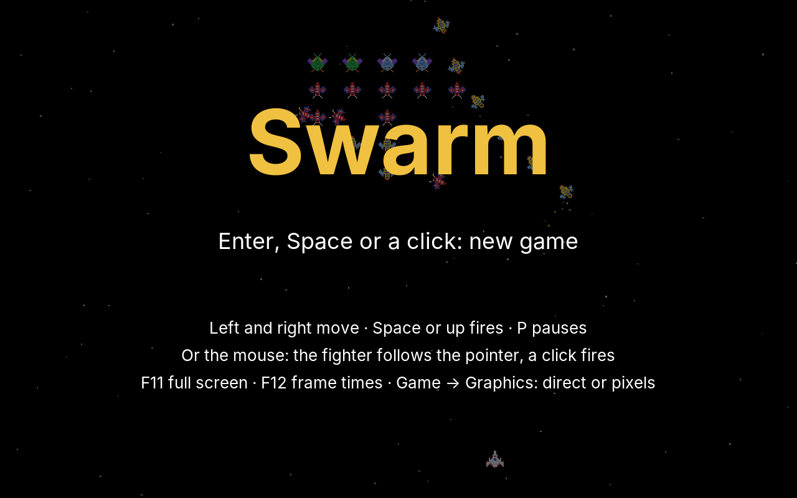
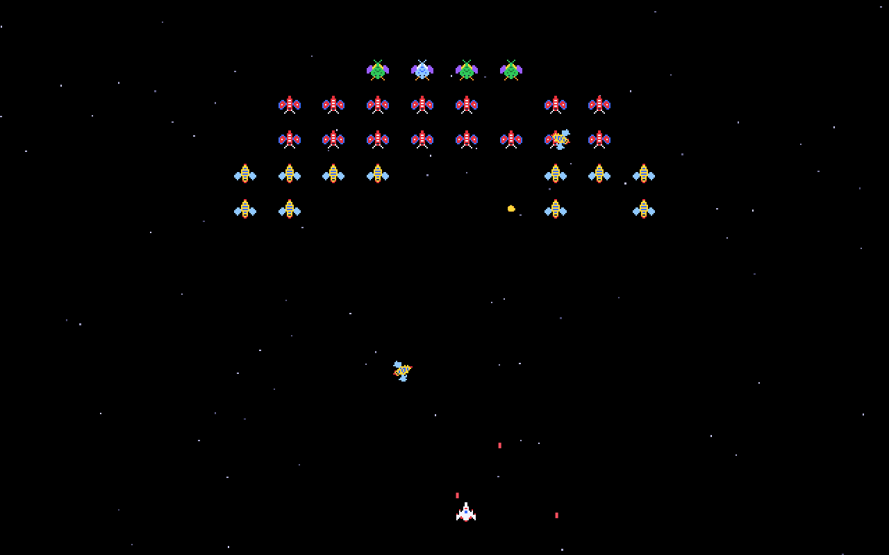
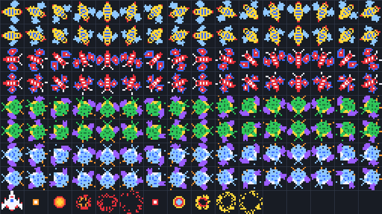
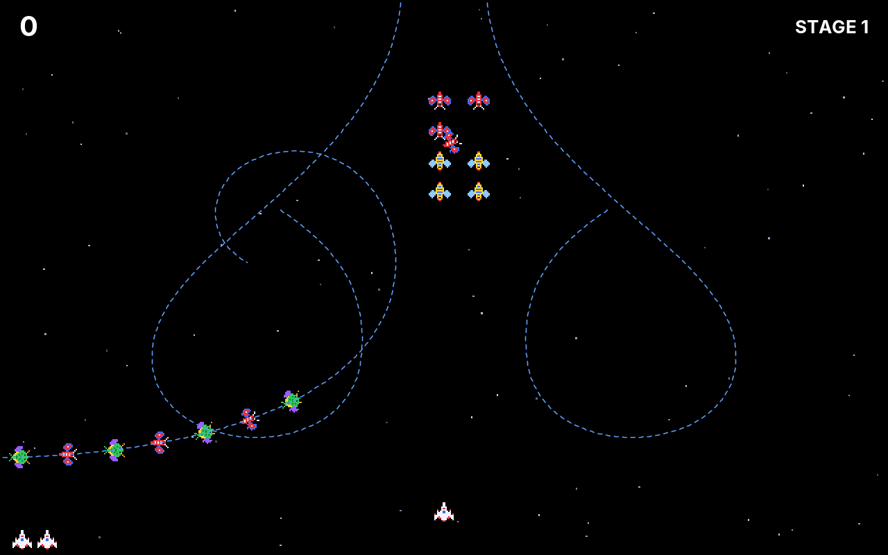
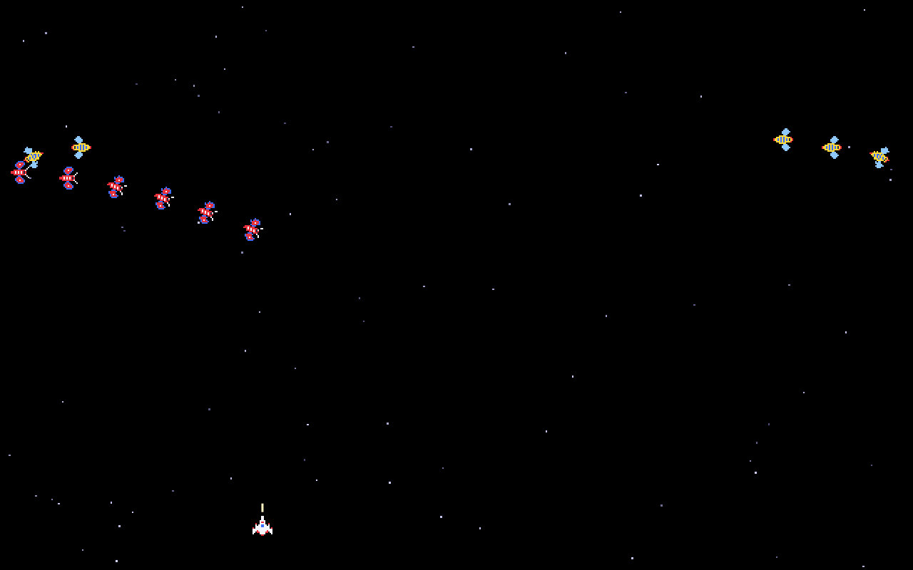

# 24. Swarm

Rocks had a handful of things on the screen, all of the same kind. **Swarm** has forty insects of three kinds. They fly in along curves, one after the other, and take their places in a formation at the top. The formation sways and breathes, and now and then an insect leaves it, loops and dives at the fighter at the bottom, shooting as it comes. The fighter moves only left and right, and it has two shots in the air at most.

<figure markdown>
{ width="400" }
{ width="400" }
<figcaption>The title screen with the computer playing (left), and the second stage, with the formation complete and two insects diving at the fighter (right).</figcaption>
</figure>

The original came from an arcade hall in 1981, and its insects were small pictures, drawn by hand in every direction they could fly. Ours are too. The game needs more new engine parts than any game before it: sprite sheets and animation, entities made from components, flight paths, stages read from a text file, a grid for collisions, and music. Most of them come back in every game that follows.

!!! abstract "What you will learn"
    - **Sprite sheets**: many small pictures in one image, cut into cells, and **animation** as a list of cells over time
    - **Pixel art** turned in advance, sixteen directions, and why that suits small pictures and did not suit Rocks
    - **Entities and components**: a thing is what it has, and **systems** work on everything that has the right parts
    - **Flight paths**: Bézier curves, and flying along them at an even speed
    - **Data files**: the stages in a text file, with error messages that name the line
    - **A spatial grid** for collisions, and when it pays off
    - **Music**: tunes written as text, played by the mixer next to the sound effects

The complete game is in [amade-swarm-game](https://github.com/amadeos-eu/amade-swarm-game).

## The rules

1. The fighter flies along the bottom, left and right only. Space fires; at most **two shots** fly at a time.
2. A stage begins with insects flying in, in groups along curved paths. Each one takes its own **slot** in the formation: four bosses at the top, sixteen butterflies, twenty bees.
3. A bee is worth 50 points, a butterfly 80, a boss 150. Shot down while flying, not sitting, they are worth twice as much, a boss 400.
4. A **boss takes two hits**. The first only changes its colour.
5. From the formation, insects **dive** at the fighter and shoot. A diver that misses flies out at the bottom, comes back in from the top and returns to its slot. An insect that rams the fighter is lost with it.
6. When all insects of a stage are gone, the next stage begins, a little faster. More insects dive at once, and more often.
7. Every third stage is a **challenge stage**: forty insects fly through and leave again. Nobody shoots and nobody dives. Each hit is worth 100 points, and hitting all forty brings 10,000 more.
8. There are three fighters, an extra one at 20,000 points and then every 60,000.

## Step 1: A sprite sheet

Bricks had a few sprites, each drawn from code. Swarm has three insects, each with two wing positions, each in sixteen directions, plus a hit boss, the fighter and two explosions: 144 small pictures. Keeping them as 144 files would be tiresome; the classic answer is one image with all of them in a grid, a **sprite sheet**:

<figure markdown>
{ width="600" }
<figcaption>The sprite sheet, enlarged three times, with the cells marked: bees, butterflies, bosses and hit bosses, each in two rows for the wing positions and sixteen columns for the directions; at the bottom the fighter and the frames of two explosions.</figcaption>
</figure>

`SpriteSheet` cuts an image into cells of equal size. Each cell becomes a `Sprite`, with the cache from chapter 21:

```java title="amade-game-engine · sprite/SpriteSheet.java"
--8<-- "amade-game-engine/src/main/java/eu/amadeos/gameengine/sprite/SpriteSheet.java:sheet"
```

`getSubimage` makes no copy, only a view into the sheet's pixels; the copies come when each sprite is scaled to the screen, and only for the cells that are actually drawn. Frames are numbered row by row, so frame 17 of a sheet with 16 columns is column 1 of row 1. A sheet whose size does not divide evenly is an error at once, not a picture cut one pixel off in each cell:

```java title="amade-game-engine · test/sprite/SpriteSheetTest.java"
--8<-- "amade-game-engine/src/test/java/eu/amadeos/gameengine/sprite/SpriteSheetTest.java:test-sheet"
```

### Pixel art needs hard edges

The insects are 16 × 16 pixels, and the screen shows them at three times that size on a 1920 × 1200 screen. Scaled smoothly, as the sprites of Bricks were, they blur: each pixel melts into its neighbours, and the sharp little pictures turn into coloured smudges. Pixel art must be scaled the other way, each source pixel becoming a square block of screen pixels. Pixel mode always does that, for the whole frame. A sprite now has its own say: `hardEdges()` makes a sprite that is always scaled in blocks, also in direct mode, where the lines and the text around it stay smooth.

```java title="amade-swarm-game · ui/game/SwarmPainter.java"
--8<-- "amade-swarm-game/src/main/java/eu/amadeos/games/swarm/ui/game/SwarmPainter.java:sheet"
```

The second sheet shows the same image with cells twice as large: the fighter's explosion is bigger than an insect's. One image, two ways to cut it.

### Turned in advance

The insects fly curves, and their noses point along them. In [chapter 23](23-rocks.md#pictures-or-lines), we drew the rocks as lines because turning pictures in advance would have cost about 90 megabytes. Here it costs almost nothing, and that is worth understanding: the rocks were large, 180 pixels on a 1920 screen, and smooth, so they needed 64 angles to look round. The insects are 16 pixels of pixel art. Sixteen directions are enough, because pixel art cannot show finer turns anyway; the original had exactly sixteen. A cell scaled to 48 × 48 screen pixels takes 9 KB, and all 144 cells together 1.3 MB.

The turning is done by a small program in the game's `tools` folder, once, when the pictures change: for every pixel of the turned picture, it turns the position back and takes the source pixel it lands on. That is the rotation formula from chapter 23, and nothing is interpolated, so the colours stay the colours of the palette. The game picks the column nearest to the insect's angle:

```java title="amade-swarm-game · ui/game/SwarmPainter.java"
static int column(double angle) {
    return Math.floorMod(Math.round(angle / (2 * Math.PI / DIRECTIONS)), DIRECTIONS);
}
```

### Animation

An animation is a list of frame numbers and a time per frame. What happens at the end is the only real choice: start again (wings), stay on the last frame (an explosion), or run back (breathing):

```java title="amade-game-engine · sprite/Animation.java"
--8<-- "amade-game-engine/src/main/java/eu/amadeos/gameengine/sprite/Animation.java:animation"
```

```java title="amade-game-engine · test/sprite/AnimationTest.java"
--8<-- "amade-game-engine/src/test/java/eu/amadeos/gameengine/sprite/AnimationTest.java:test-animation"
```

An animation keeps no time of its own. It answers "which frame, so many seconds after the start?", and whoever asks keeps the start. All insects beat their wings together, as in the arcade, so one clock does for all forty. An explosion asks with the seconds since it began.

## Step 2: Entities and components

So far each game had a class per kind of thing: `Ball`, `Brick`, `Rock`. An insect in Swarm is harder to pin down. It flies in along a path, then flies towards its slot, then sits; later it dives along another path, shooting, then it flies home. A challenge insect flies along a path and leaves. With a class `Insect` holding fields for all of that, and a `state` field saying which of them count, every method starts with a `switch`, and every new behaviour touches all of them.

The alternative has a name: **entities and components**. An entity is nothing but an identity and a bag of parts. What it does follows from which parts it has right now:

```java title="amade-game-engine · entity/Entity.java"
--8<-- "amade-game-engine/src/main/java/eu/amadeos/gameengine/entity/Entity.java:entity"
```

The parts of an insect are small and say one thing each:

| Component | Means |
|---|---|
| `Body` | where it is and which way it points, now and one step ago |
| `Insect` | its kind and the hits it can still take |
| `Slot` | its place in the formation; an insect without one never stays |
| `Flight` | it is flying along a path, so far along it |
| `Homing` | it is flying straight back to its slot |
| `Gun` | it will shoot, so many times, at these intervals |

```java title="amade-swarm-game · domain/Body.java"
--8<-- "amade-swarm-game/src/main/java/eu/amadeos/games/swarm/domain/Body.java:body"
```

A **system** is a piece of the rules that works on every entity with certain components. `Entities` holds the entities and offers exactly that: every entity that has an `A`, or an `A` and a `B`:

```java title="amade-game-engine · entity/Entities.java"
--8<-- "amade-game-engine/src/main/java/eu/amadeos/gameengine/entity/Entities.java:entities"
```

One detail decides whether this is pleasant or a source of strange bugs: a system may create and destroy entities while `forEach` walks the list. A new entity therefore waits in `born`, and a destroyed one is only marked; both take effect at `flush()`, which the game calls once at the end of its step. Until then, the walk sees the same list it started with, and dead entities are skipped.

```java title="amade-game-engine · test/entity/EntitiesTest.java"
--8<-- "amade-game-engine/src/test/java/eu/amadeos/gameengine/entity/EntitiesTest.java:test-entities"
```

Now the systems of Swarm read like the rules. The flight system moves everything with a `Flight` along its path. At the end, the flight and the gun are taken away: with a `Slot`, the insect gets a `Homing`; without one, it is a challenge insect and goes. The homing system flies straight to the slot, and in it, the insect loses its `Homing` and so belongs to the formation system:

```java title="amade-swarm-game · domain/Game.java"
--8<-- "amade-swarm-game/src/main/java/eu/amadeos/games/swarm/domain/Game.java:systems"
```

A dive adds components, nothing else. The insect keeps its slot, so its place in the formation waits for it:

```java title="amade-swarm-game · domain/Game.java"
--8<-- "amade-swarm-game/src/main/java/eu/amadeos/games/swarm/domain/Game.java:dive"
```

```java title="amade-swarm-game · test/domain/GameTest.java"
--8<-- "amade-swarm-game/src/test/java/eu/amadeos/games/swarm/domain/GameTest.java:test-dive"
```

The game's step is the systems in their order:

```java title="amade-swarm-game · domain/Game.java"
--8<-- "amade-swarm-game/src/main/java/eu/amadeos/games/swarm/domain/Game.java:update"
```

!!! info "Behind the scenes: is this a real entity–component system?"
    Big engines store components in arrays, one per type, so a system runs through memory in order and the processor's cache helps; that is worth it for tens of thousands of entities. Ours keeps a map per entity, which costs a lookup per component, and that is fine for forty insects: the whole step takes a few microseconds. The idea is what counts, and it does not change when the storage does: behaviour comes from which parts an entity has. The shots stay a `Pool` from chapter 23, because they have one kind of behaviour and a limit.

## Step 3: Flight paths

The insects fly in along smooth curves, and the curves need to be easy to write down, to change and to mirror. The curve of choice in every drawing program, in fonts and in Java2D's own `Path2D`, is the **cubic Bézier curve**: a start, an end, and two control points that bend it. The curve leaves the start towards the first control point and arrives at the end coming from the second:

<figure markdown>
{ width="600" }
<figcaption>The flight paths of the first stage, drawn into the game: from the top left and right, round a loop and up into the formation. The butterflies and bosses on the left follow each other along their path.</figcaption>
</figure>

A point on the curve is a weighted mean of the four points. At a parameter *t* from 0 to 1, the weights are the **Bernstein polynomials** (1 − *t*)³, 3(1 − *t*)²*t*, 3(1 − *t*)*t*² and *t*³. At *t* = 0 all weight is on the start, at *t* = 1 on the end, and in between the control points pull. The direction of flight comes from the derivative, and with it the column of the sprite sheet:

```java title="amade-game-engine · motion/FlightPath.java"
--8<-- "amade-game-engine/src/main/java/eu/amadeos/gameengine/motion/FlightPath.java:bezier"
```

A path is several curves in a row, each starting where the last one ended. `lineTo` is a curve too, with its control points on the straight line, a third and two thirds of the way.

### An even speed

Here is the catch. *t* is not distance. Where the control points are far apart the curve covers a lot of ground per step of *t*, and where they bunch up it covers little. An insect that increases *t* evenly races through some parts of its path and crawls through others. There is no formula for the length of a Bézier curve, so `FlightPath` measures it: it walks the curve in 48 small straight steps per curve and writes down the distance flown at each. To find where one is after a given distance, it looks the distance up in that table with a binary search and goes the rest of the way in a straight line between two neighbouring samples:

```java title="amade-game-engine · motion/FlightPath.java"
--8<-- "amade-game-engine/src/main/java/eu/amadeos/gameengine/motion/FlightPath.java:measure"
```

```java title="amade-game-engine · motion/FlightPath.java"
--8<-- "amade-game-engine/src/main/java/eu/amadeos/gameengine/motion/FlightPath.java:at"
```

```java title="amade-game-engine · test/motion/FlightPathTest.java"
--8<-- "amade-game-engine/src/test/java/eu/amadeos/gameengine/motion/FlightPathTest.java:test-path"
```

The test allows 1 percent. The straight steps are a little shorter than the curve, so the distances are not exact; 48 steps per curve keep the error below what anybody sees, and the table is made once per path, when the stage file is read. A dive path is made at the moment of the dive, from where the insect sits and where the fighter is, and the 145 samples of its three curves take a few microseconds.

With that, a `Flight` is a path, a speed and the distance flown so far:

```java title="amade-swarm-game · domain/Flight.java"
--8<-- "amade-swarm-game/src/main/java/eu/amadeos/games/swarm/domain/Flight.java:flight"
```

```java title="amade-swarm-game · domain/Field.java"
--8<-- "amade-swarm-game/src/main/java/eu/amadeos/games/swarm/domain/Field.java:speeds"
```

### The formation

The slots are not fixed points either. While insects arrive, the formation sways left and right, which makes the insects' homing look alive; once all have arrived, it breathes instead, spreading and closing. Switching from one to the other at a random moment would make every insect jump, so the switch waits until the sway passes the middle:

```java title="amade-swarm-game · domain/Formation.java"
--8<-- "amade-swarm-game/src/main/java/eu/amadeos/games/swarm/domain/Formation.java:formation"
```

```java title="amade-swarm-game · domain/Field.java"
--8<-- "amade-swarm-game/src/main/java/eu/amadeos/games/swarm/domain/Field.java:formation"
```

## Step 4: Stages as data

Forty insects per stage, each with a path, a slot and a moment to start: written as Java code, a stage is a page of `new Group(...)` that nobody but a programmer can change, and every change needs a compiler. A stage is **data**, and data belongs in a file. The format can be very simple, a line per thing, words separated by spaces:

```text title="amade-swarm-game · stages.txt"
path top-left
from 290 -16
curve 290 120  120 170  110 250
curve 100 330  250 340  260 260
curve 268 200  230 170  200 150
mirror top-right top-left

stage
group 0    top-left   butterfly@4,1 butterfly@5,1 butterfly@4,2 butterfly@5,2
group 0    top-right  bee@4,3 bee@5,3 bee@4,4 bee@5,4
group 3.5  side-left  boss@3,0 butterfly@3,1 boss@4,0 butterfly@6,1 ...
```

`mirror` saves half the work: the paths on the right are those on the left, mirrored. The engine's `TextData` reads such files. It knows nothing about stages: it drops comments and empty lines, splits the rest into words, and remembers where each line came from:

```java title="amade-game-engine · data/TextData.java"
--8<-- "amade-game-engine/src/main/java/eu/amadeos/gameengine/data/TextData.java:textdata"
```

```java title="amade-game-engine · test/data/TextDataTest.java"
--8<-- "amade-game-engine/src/test/java/eu/amadeos/gameengine/data/TextDataTest.java:test-textdata"
```

Why not JSON, or XML? Both would work, and both need a library or a lot of brackets. A format of lines and words is what game files looked like for decades, and it is easy to write by hand, to compare in Git and to read in an error message. The game gives the words their meaning:

```java title="amade-swarm-game · domain/Stages.java"
--8<-- "amade-swarm-game/src/main/java/eu/amadeos/games/swarm/domain/Stages.java:parse"
```

The most important thing about a data file is what happens when it is wrong. Somebody will type `bee@10,0` in a formation with columns 0 to 9, or give two insects the same slot. Without care, that ends in an `ArrayIndexOutOfBoundsException` deep in the game, or worse, in an insect that never arrives. Every check here throws an error that names the file and the line, and the game reads the whole file at start, so a mistake shows at once:

```java title="amade-swarm-game · test/domain/StagesTest.java"
--8<-- "amade-swarm-game/src/test/java/eu/amadeos/games/swarm/domain/StagesTest.java:test-stages"
```

The game turns a stage's groups into a list of arrivals, sorted by time; insects of a group follow each other along the path at a short distance. Each arrival becomes an entity with the components it needs, and only some get a gun:

```java title="amade-swarm-game · domain/Game.java"
--8<-- "amade-swarm-game/src/main/java/eu/amadeos/games/swarm/domain/Game.java:stage"
```

```java title="amade-swarm-game · domain/Game.java"
--8<-- "amade-swarm-game/src/main/java/eu/amadeos/games/swarm/domain/Game.java:arrive"
```

```java title="amade-swarm-game · test/domain/GameTest.java"
--8<-- "amade-swarm-game/src/test/java/eu/amadeos/games/swarm/domain/GameTest.java:test-arrive"
```

After the last stage in the file, the first comes again, faster: `Field.pace` adds 6 percent per stage. A challenge stage is a `stage challenge` line, with insects that have no slot:

<figure markdown>
{ width="400" }
<figcaption>A challenge stage: insects without slots swirl through the field and leave again.</figcaption>
</figure>

```java title="amade-swarm-game · test/domain/GameTest.java"
--8<-- "amade-swarm-game/src/test/java/eu/amadeos/games/swarm/domain/GameTest.java:test-challenge"
```

## Step 5: Collisions on a grid

Two shots against forty insects, and the fighter against forty insects and eight insect shots: about a hundred circle tests per step, which the plain loop of chapter 23 does in well under a microsecond each. But consider a game with 2000 things that may all hit each other: two million tests per step. The cure is to test only things that are near each other, and the simplest way to know what is near is a **grid**. The field is cut into cells; each thing goes into every cell it touches; a question asks only the cells around a point.

```java title="amade-game-engine · collision/Grid.java"
--8<-- "amade-game-engine/src/main/java/eu/amadeos/gameengine/collision/Grid.java:grid"
```

Three choices make it fast and keep it simple:

- It is rebuilt **every step**. Things move, and moving one between cells costs as much as adding it anew. `clear` resets an array, no objects are freed.
- The cells are linked lists, but made of `int` arrays, not of objects: `firstEntry` per cell, `nextEntry` per entry. Adding a thing creates no garbage once the arrays have grown to size.
- A thing that touches several cells is in several lists. So that a question meets it only once, each question gets a number, and each thing remembers the number of the last question that met it.

The grid answers *candidates*: things in cells nearby. Whether a candidate really touches is still the circle test:

```java title="amade-swarm-game · domain/Game.java"
--8<-- "amade-swarm-game/src/main/java/eu/amadeos/games/swarm/domain/Game.java:collide"
```

```java title="amade-game-engine · test/collision/GridTest.java"
--8<-- "amade-game-engine/src/test/java/eu/amadeos/gameengine/collision/GridTest.java:test-grid"
```

Is it worth it for Swarm? Measured, honestly:

| Things | Questions | Testing all pairs | With the grid |
|---|---|---|---|
| 40 | 2 | 0.005 ms | 0.006 ms |
| 2000 | 2000 | 10.0 ms | 1.1 ms |

For forty insects and two shots, the grid is no faster; filling it costs as much as it saves. Swarm uses it anyway, because it is the place to learn it, and because the next games have more: Maze's tiles, Blast's flames, the units of Towers and Sands. At 2000 things the plain loop takes more than half a frame and the grid a fifteenth of it. The cell size matters: about the size of the things, or a little more. Much smaller, and each thing is in many cells; much larger, and each cell holds many things.

A boss falls at the second hit, an insect that rams the fighter falls with it, and a flying insect is worth more:

```java title="amade-swarm-game · domain/Game.java"
--8<-- "amade-swarm-game/src/main/java/eu/amadeos/games/swarm/domain/Game.java:hit"
```

```java title="amade-swarm-game · domain/Kind.java"
--8<-- "amade-swarm-game/src/main/java/eu/amadeos/games/swarm/domain/Kind.java:kind"
```

```java title="amade-swarm-game · test/domain/GameTest.java"
--8<-- "amade-swarm-game/src/test/java/eu/amadeos/games/swarm/domain/GameTest.java:test-boss"
```

## Step 6: The fighter and the mouse

The fighter is simple next to the insects: it moves along one line, by the keys or towards the mouse pointer, and never past the edges.

```java title="amade-swarm-game · domain/Fighter.java"
--8<-- "amade-swarm-game/src/main/java/eu/amadeos/games/swarm/domain/Fighter.java:move"
```

```java title="amade-swarm-game · domain/Field.java"
--8<-- "amade-swarm-game/src/main/java/eu/amadeos/games/swarm/domain/Field.java:fighter"
```

As in Rocks, the mouse steers only after it has moved, and a key takes over until it moves again; a left click fires:

```java title="amade-swarm-game · ui/game/SwarmGame.java"
--8<-- "amade-swarm-game/src/main/java/eu/amadeos/games/swarm/ui/game/SwarmGame.java:play"
```

```java title="amade-swarm-game · test/ui/game/SwarmGameTest.java"
--8<-- "amade-swarm-game/src/test/java/eu/amadeos/games/swarm/ui/game/SwarmGameTest.java:test-mouse"
```

## Step 7: Music

The original greeted each game with a short fanfare, and its challenge stages had a tune of their own. Music in a game is more than one long sound effect, for two reasons. First, it has to be written somehow; recording it into files is one way, and writing it as notes is the way of the 8-bit era, which fits our sounds made from waves. Second, it plays *beside* the effects: a new tune replaces the old one, but a shot does not stop the music.

### Tunes as text

The home computers of the 1980s wrote music in the **Music Macro Language**, MML: a line of letters per voice. `c d e` are notes, a number after a note is its length (4 a quarter, 8 an eighth), `o5` sets the octave, `>` and `<` go up and down one, `l8` makes eighths the default, `t140` sets the tempo, `r` is a rest, `+` raises a note by a semitone. `Tune.voice` turns such a line into a `Sound`:

```java title="amade-game-engine · audio/Tune.java"
--8<-- "amade-game-engine/src/main/java/eu/amadeos/gameengine/audio/Tune.java:tune"
```

Two details. Each note sounds for 90 percent of its length, so two equal notes in a row are heard as two. And each note's start is computed from the beats counted so far, not by adding up note lengths rounded to whole samples: rounded lengths drift, and after a few bars the bass would lag behind the melody. The frequency is the rule of equal temperament: A in octave 4 is 440 Hz, and each of the twelve semitones of an octave multiplies by the twelfth root of 2.

```java title="amade-game-engine · test/audio/TuneTest.java"
--8<-- "amade-game-engine/src/test/java/eu/amadeos/gameengine/audio/TuneTest.java:test-tune"
```

Voices are mixed into one sound with `Sound.mix`, which adds the samples, as the mixer does:

```java title="amade-game-engine · audio/Sound.java"
--8<-- "amade-game-engine/src/main/java/eu/amadeos/gameengine/audio/Sound.java:mix"
```

```java title="amade-swarm-game · ui/game/Music.java"
--8<-- "amade-swarm-game/src/main/java/eu/amadeos/games/swarm/ui/game/Music.java:music"
```

A square wave for the melody and a triangle for the bass is the sound of the consoles of that time: the triangle is soft and low, the square cuts through.

### A voice for the music

The `Mixer` from chapter 20 plays effects on a number of voices, and a new effect takes the oldest voice when all are busy. Music must never be taken that way, so it gets a voice of its own. `playMusic` replaces what is playing and may loop; `stopMusic` stops it. Like `play`, both only leave a request for the mixer's thread, so the game loop never waits:

```java title="amade-game-engine · audio/Mixer.java"
--8<-- "amade-game-engine/src/main/java/eu/amadeos/gameengine/audio/Mixer.java:music"
```

```java title="amade-game-engine · test/audio/MixerTest.java"
--8<-- "amade-game-engine/src/test/java/eu/amadeos/gameengine/audio/MixerTest.java:test-music"
```

Muting the sound mutes the music too. The game starts its tunes from the events, like every other sound:

```java title="amade-swarm-game · ui/game/Effects.java"
--8<-- "amade-swarm-game/src/main/java/eu/amadeos/games/swarm/ui/game/Effects.java:react"
```

```java title="amade-swarm-game · domain/Event.java"
--8<-- "amade-swarm-game/src/main/java/eu/amadeos/games/swarm/domain/Event.java:event"
```

## Step 8: The computer player

The pilot of the title screen looks for danger first: an insect shot that will land where the fighter is, or a diver close above it. If there is one, it moves away. Otherwise it goes under the lowest insect and fires when it is there:

```java title="amade-swarm-game · domain/Pilot.java"
--8<-- "amade-swarm-game/src/main/java/eu/amadeos/games/swarm/domain/Pilot.java:steer"
```

The first version did only that, and it was too good again, as in Rocks: it dodged every shot and played for ten minutes. Its aim already shakes. What made it human was **distraction**: now and then, for a moment, it stops looking for danger. Now it ends at the fourth or fifth stage, after three or four minutes, and the title screen shows a game over too:

```java title="amade-swarm-game · test/domain/PilotTest.java"
--8<-- "amade-swarm-game/src/test/java/eu/amadeos/games/swarm/domain/PilotTest.java:test-demo"
```

```java title="amade-swarm-game · test/domain/GameTest.java"
--8<-- "amade-swarm-game/src/test/java/eu/amadeos/games/swarm/domain/GameTest.java:test-determinism"
```

## Step 9: Putting it together

The painter draws the insects with the systems' own tool: every entity with a `Body` and an `Insect`. The cell comes from the insect's kind, the wing beat and its angle between the last two steps:

```java title="amade-swarm-game · ui/game/SwarmPainter.java"
--8<-- "amade-swarm-game/src/main/java/eu/amadeos/games/swarm/ui/game/SwarmPainter.java:paint"
```

The score, the stage and the fighters left are the overlay; points for a boss rise from its explosion:

```java title="amade-swarm-game · ui/game/Hud.java"
--8<-- "amade-swarm-game/src/main/java/eu/amadeos/games/swarm/ui/game/Hud.java:hud"
```

### A black rectangle

The first measurements were a surprise. In Xvfb, which draws in software, a frame of play at 1920 × 1200 took 13.5 ms, much more than Rocks with all its lines. Forty small sprites could not cost that. Measuring the pieces one by one found the culprit in the first line of `paint`: the black background. With antialiasing on, Java2D fills even a plain rectangle by computing the coverage of every pixel's edges, and the full-screen black cost 3.5 to 3.8 ms, three times as much as without. The veil behind the title texts cost the same again.

A rectangle on whole pixels has no edges to smooth. Turned off for the background and the stars, and on again for the rest, the world takes 1.1 ms instead of 3.4, and the whole frame:

| Scene and mode | 640 × 400 | 1280 × 800 | 1920 × 1200 |
|---|---|---|---|
| Play, direct | 1.7 ms | 3.3 ms | 6.5 ms |
| Play, pixels | 1.9 ms | 4.4 ms | 7.4 ms |
| Title, direct | 3.0 ms | 6.3 ms | 14.4 ms |

The title is still the most expensive scene, with its large antialiased letters over the veil. A frame at 60 frames per second may take 16.7 ms. As always: on a real screen with a graphics card, these cost less; press F12 and measure on yours. The rule went into the [appendix](appendix-java2d.md#drawing).

Full screen (F11), the render modes, the frame times (F12), sound, the best scores and the five languages work as in the earlier games, from the same engine classes. In pixel mode, the whole frame becomes pixel art; in direct mode, the insects stay pixel art and the text stays smooth.

## What moved into the engine

| From Swarm | Engine package | Why |
|---|---|---|
| Sprite sheets, hard-edged sprites | `eu.amadeos.gameengine.sprite.SpriteSheet`, `Sprite#hardEdges` | Many pictures in one image; pixel art at any size: Maze's ghosts, Blast's bombers, Jump's hero |
| Animation | `eu.amadeos.gameengine.sprite.Animation` | Wings, walking, explosions, anything that runs through frames |
| Entities and components | `eu.amadeos.gameengine.entity.Entity`, `Entities` | Things whose behaviour changes: Maze's ghosts, the units of Towers and Sands |
| Flight paths | `eu.amadeos.gameengine.motion.FlightPath` | Smooth curves at an even speed: enemies, cameras, anything on rails |
| Data files | `eu.amadeos.gameengine.data.TextData` | Levels, waves, units and towers as text, with errors that name the line |
| A spatial grid | `eu.amadeos.gameengine.collision.Grid` | Collisions and "who is near?" for many things |
| Music | `eu.amadeos.gameengine.audio.Tune`, `Sound#mix`, `Mixer#playMusic` | Tunes written as notes, on a voice of their own |

What stays in the game: the insects and their components, the formation, the stages and their file, the fighter, the shots, the pilot, the painter, the sounds and tunes, and the scenes.

## Exercises

1. **The capture beam.** In the original, a boss could dive, stop above the fighter and catch it with a beam; shooting that boss later freed the fighter, and the player then flew two fighters side by side. Which new components does it take, and which systems change? Where does the double fighter's hit test go?
2. **Escorts.** Let a boss dive with the two butterflies below it, flying the same path a little behind. Is that a new component, or the same `Flight` with an offset?
3. **A stage of your own.** Write a fourth stage in `stages.txt` with new paths, without changing any Java. Make a mistake on purpose and read the error.
4. **An editor.** Draw the paths of the stage file over the field while the game runs (the screenshot above does), and reload the file with a key. How short does the loop from idea to test become?
5. **More directions.** Turn the insects into 32 directions instead of 16, and compare how the curves look. What does it cost in memory, and why do the explosions not need it?
6. **The grid at work.** Fill the field with 2000 insects of a challenge stage and press F12, with the grid and with a plain loop over all pairs.

---

In the next game, **Maze**, the field is a map of tiles. Four ghosts hunt the player through the corridors, each with its own mind: state machines, and the search for the shortest way, from breadth-first search to A*.
