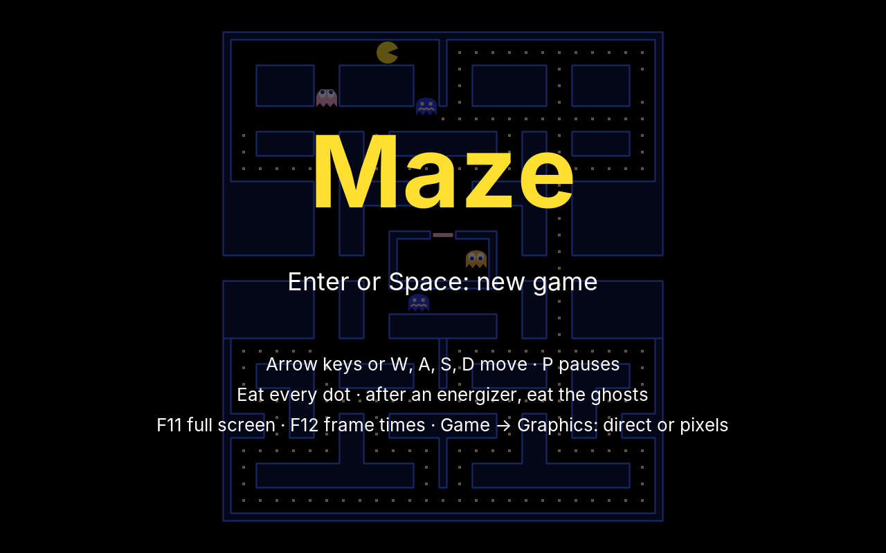
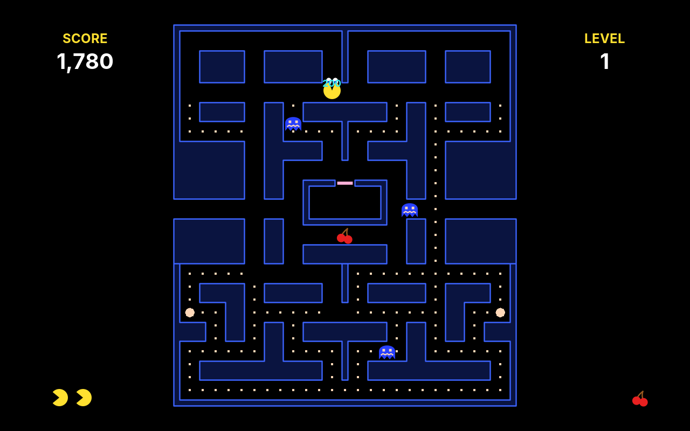
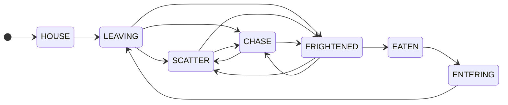
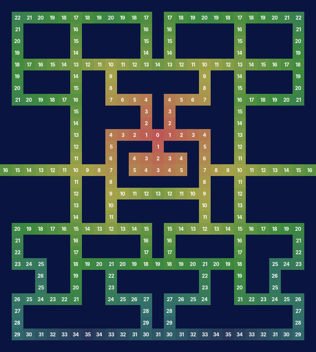
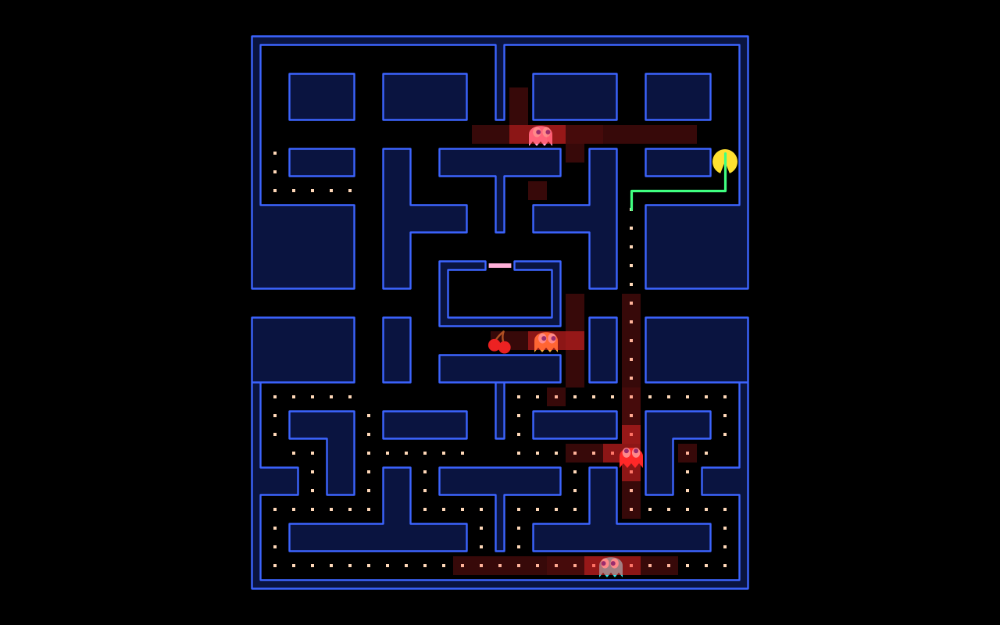
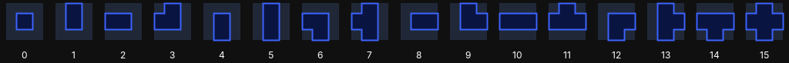

# 25. Maze

Swarm's insects flew wherever their curves took them. In **Maze**, nobody flies: the muncher and four ghosts walk the corridors of a maze, from tile to tile, and they can only turn where two corridors cross. The muncher eats the dots; the ghosts hunt it. Four large dots, the energizers, turn the tables for a few seconds: the ghosts turn blue and flee, and the muncher may eat them.

<figure markdown>
{ width="400" }
{ width="400" }
<figcaption>The title screen with the computer playing (left), and an energizer at work (right): three ghosts are blue, the fourth has just been eaten for 200 points, and its eyes are on their way home.</figcaption>
</figure>

The original came from an arcade hall in 1980, and its ghosts are famous for seeming to think. They do not. Each one follows a rule of a single line, and the rules are cleverly different. This chapter builds the pieces that rule, and the ones that a real computer player needs: a map of tiles, walking on it, ghosts as **state machines**, and the search for a way through a maze, from **breadth-first search** to **A\***.

!!! abstract "What you will learn"
    - **Tile maps**: a level as rows of letters in a text file, read with errors that name the line and the column
    - **Walking on a grid**: from the centre of one tile to the next, turning only at centres, and keys that are kept until the way is open
    - **State machines**: a ghost is always in exactly one mode, and a table says which changes are allowed
    - **Four characters from one rule**: the tile each ghost aims at, and the greedy choice at every crossing
    - **Breadth-first search**: a wave of distances from a goal, and the way home downhill from anywhere
    - **A\***: the cheapest way, when some tiles cost more than others, and a computer player that fears the ghosts
    - **Autotiling**: the picture of a wall from its neighbours, sixteen pieces from four bits

The complete game is in [amade-maze-game](https://github.com/amadeos-eu/amade-maze-game).

## The rules

1. The maze is 27 tiles wide and 30 high. The muncher walks its corridors; the arrow keys choose the way at the next crossing. Back the way it came works at once.
2. A **dot** is worth 10 points, an **energizer** 50. When all 240 are eaten, the next level begins, a little faster.
3. Four ghosts hunt the muncher, each in its own way. They leave their house in the middle one after the other. Now and then they all **scatter** to their own corners for a few seconds, then hunt again.
4. A ghost that touches the muncher costs a life. Three lives, and an extra one at 10,000 points.
5. After an energizer the ghosts turn **blue** for six seconds, fewer in later levels: they are slow and wander aimlessly. A blue ghost touched is eaten, for 200, 400, 800 and 1,600 points one after the other. Its eyes fly back to the house, and it comes out again.
6. Twice a level, after 70 and 170 dots, a **fruit** appears below the house for a few seconds: a cherry worth 100 points in the first level, more in later ones.
7. At both ends of the middle row, a **tunnel** leads to the other side. Ghosts are slow in it; the muncher is not.

## Step 1: A map of tiles

Every game so far had its own grid: the cells of Mines, the bricks of Bricks, the field of Snake. Maze needs one with more in it, and so will Blast, Jump, Towers and Sands, so the grid moves into the engine. A `TileMap` is columns and rows of tiles, each holding one value, usually an enum:

```java title="amade-game-engine · tile/TileMap.java"
--8<-- "amade-game-engine/src/main/java/eu/amadeos/gameengine/tile/TileMap.java:tilemap"
```

`step` makes the map a field without edges, like the field of Rocks: a step over the right edge arrives on the left. A maze with walls all round never notices. A row that has no wall at its ends becomes a tunnel, without a line of code for it.

### The maze is a text file

Chapter 24 put the stages of Swarm into a text file; a maze belongs in one even more, because it can be *drawn* as text. One letter per tile, one line per row:

```text title="amade-maze-game · maze.txt"
row XXXXXXXXXXXXXXXXXXXXXXXXXXX
row X............X............X
row X.XXXX.XXXXX.X.XXXXX.XXXX.X
row XoXXXX.XXXXX.X.XXXXX.XXXXoX
...
row XXXXXX.XX_XXX-XXX_XX.XXXXXX
row XXXXXX.XX_XHHHHHX_XX.XXXXXX
row TTTTTT.___XHHHHHX___.TTTTTT
...
muncher 13 22 left
ghost red     13 11 left
ghost pink    13 14 up
corner red    24 -3
release cyan   5
fruit 13 16
```

`X` is a wall, `.` a dot, `o` an energizer, `_` an empty floor, `T` the tunnel, `-` the door of the ghosts' house and `H` its inside. `#` would have been the obvious letter for a wall, but `TextData` reads everything after a `#` as a comment. The maze is 27 tiles wide, an odd number on purpose: the middle column is a whole column, so the door, the house and the muncher's start lie on it, not between two.

The engine reads the rows; the game says what the letters mean:

```java title="amade-game-engine · tile/TileMap.java"
--8<-- "amade-game-engine/src/main/java/eu/amadeos/gameengine/tile/TileMap.java:read"
```

```java title="amade-game-engine · test/tile/TileMapTest.java"
--8<-- "amade-game-engine/src/test/java/eu/amadeos/gameengine/tile/TileMapTest.java:test-read"
```

`Maze` reads the rest of the file and checks what a maze needs to be playable. The last check is the interesting one: every dot must be reachable from the muncher's start, or the level can never be cleared. It uses breadth-first search, which comes in step 5; for now it is enough that a dot walled off by a slip of the keyboard is found at once:

```java title="amade-maze-game · domain/Maze.java"
--8<-- "amade-maze-game/src/main/java/eu/amadeos/games/maze/domain/Maze.java:read"
```

```java title="amade-maze-game · test/domain/MazeTest.java"
--8<-- "amade-maze-game/src/test/java/eu/amadeos/games/maze/domain/MazeTest.java:test-errors"
```

Each level plays on a copy of the tiles (`maze.tiles()`), from which the muncher eats the dots; the next level gets a fresh copy with all its dots.

## Step 2: Walking on a grid

Snake jumped from cell to cell. The muncher must glide, at 7.6 tiles a second, and still keep to the corridors exactly: a muncher half a tile into a wall, because a key came a moment late, looks broken. The rule that makes both possible is old: **positions are in tiles, and turns happen only at the centre of a tile.** The centre of the tile in column 3, row 5 is the point (3, 5); halfway to the right of it is (3.5, 5). Between two centres, a walker can only go on, or turn round.

The four ways get an enum of their own. Its order matters, as we will see with the ghosts: when two ways are equally good, the first one wins.

```java title="amade-game-engine · tile/Direction.java"
--8<-- "amade-game-engine/src/main/java/eu/amadeos/gameengine/tile/Direction.java:direction"
```

A `Walker` moves a distance along its heading. Whenever it reaches a centre on the way, it asks a `Steering` which way to go on; it does not know about walls, keys or targets itself. A step of 1/120 second covers less than a tenth of a tile, but the eyes of an eaten ghost are fast, and a long step at a slow frame must not skip a centre, so the walk goes centre by centre:

```java title="amade-game-engine · tile/Walker.java"
--8<-- "amade-game-engine/src/main/java/eu/amadeos/gameengine/tile/Walker.java:walker"
```

The arithmetic of "the next centre ahead" is one line: moving towards larger numbers, it is the next whole number above; moving towards smaller ones, the next below. Arriving there, the position is set to that whole number exactly, so no rounding error can pile up over a game.

```java title="amade-game-engine · test/tile/WalkerTest.java"
--8<-- "amade-game-engine/src/test/java/eu/amadeos/gameengine/tile/WalkerTest.java:test-walker"
```

Through the tunnel, the walker leaves at one edge and arrives at the other. Its previous position moves with it, so drawing between two steps still sees a short step, not a jump back across the screen; the painter clips the maze, and the muncher disappears into the tunnel and comes out of the other side.

### A key that waits

The player's steering is where the game becomes pleasant to play. Nobody can press a key at the exact moment the muncher passes a crossing. So the wanted way is *kept*: at every centre, the muncher takes it if it is open, else goes on, else stops at the wall. Only the opposite way is taken at once, between centres too:

```java title="amade-maze-game · domain/Muncher.java"
--8<-- "amade-maze-game/src/main/java/eu/amadeos/games/maze/domain/Muncher.java:move"
```

```java title="amade-maze-game · test/domain/GameTest.java"
--8<-- "amade-maze-game/src/test/java/eu/amadeos/games/maze/domain/GameTest.java:test-eat"
```

In the scene, the last arrow key pressed is the wanted way, and it stays until another is pressed or a new round begins:

```java title="amade-maze-game · ui/game/MazeGame.java"
--8<-- "amade-maze-game/src/main/java/eu/amadeos/games/maze/ui/game/MazeGame.java:play"
```

```java title="amade-maze-game · test/ui/game/MazeGameTest.java"
--8<-- "amade-maze-game/src/test/java/eu/amadeos/games/maze/ui/game/MazeGameTest.java:test-keys"
```

## Step 3: Ghosts as state machines

A ghost waits in the house, bobbing up and down. It leaves through the door. Outside, it scatters to its corner or hunts the muncher, by turns. After an energizer it is blue, and if it is eaten, its eyes fly home and go back into the house, from where it leaves again. Seven modes, and the rules of each are different: how fast it walks, how it chooses its way, whether it is dangerous.

Swarm solved a similar problem with components: an insect *was* what it *had*. A ghost is simpler, and stricter: it is always in exactly one mode, and only some changes make sense. Eaten while already flying home? Blue while still in the house? Such combinations are the classic bugs of this kind of game, and they show up as strange sights minutes later. A **finite state machine** writes the allowed changes down, as a table, and refuses everything else at once:



```java title="amade-game-engine · ai/StateMachine.java"
--8<-- "amade-game-engine/src/main/java/eu/amadeos/gameengine/ai/StateMachine.java:machine"
```

```java title="amade-game-engine · test/ai/StateMachineTest.java"
--8<-- "amade-game-engine/src/test/java/eu/amadeos/gameengine/ai/StateMachineTest.java:test-machine"
```

The ghost's table is the diagram above, written in Java:

```java title="amade-maze-game · domain/Ghost.java"
--8<-- "amade-maze-game/src/main/java/eu/amadeos/games/maze/domain/Ghost.java:modes"
```

The listener does one thing, and it is a piece of game design from the original: a hunting ghost that changes its mind **turns round at once**. Everywhere else a ghost may never turn back, so a sudden turn of all four is a signal the player learns to read: the ghosts just changed from scattering to hunting, or an energizer took effect.

```java title="amade-maze-game · domain/Ghost.java"
--8<-- "amade-maze-game/src/main/java/eu/amadeos/games/maze/domain/Ghost.java:turn"
```

### Scatter and chase

Who decides when the ghosts scatter? A schedule, the same for all, counted from the start of the round. While the energizer works, the schedule waits:

```java title="amade-maze-game · domain/Field.java"
--8<-- "amade-maze-game/src/main/java/eu/amadeos/games/maze/domain/Field.java:schedule"
```

```java title="amade-maze-game · domain/Game.java"
--8<-- "amade-maze-game/src/main/java/eu/amadeos/games/maze/domain/Game.java:schedule"
```

```java title="amade-maze-game · test/domain/GameTest.java"
--8<-- "amade-maze-game/src/test/java/eu/amadeos/games/maze/domain/GameTest.java:test-schedule"
```

The speed depends on the mode too, and in the hunting modes on the tile: the tunnel slows the ghosts down, which makes it the muncher's escape route.

```java title="amade-maze-game · domain/Game.java"
--8<-- "amade-maze-game/src/main/java/eu/amadeos/games/maze/domain/Game.java:speed"
```

```java title="amade-maze-game · domain/Field.java"
--8<-- "amade-maze-game/src/main/java/eu/amadeos/games/maze/domain/Field.java:speeds"
```

## Step 4: Four characters, one rule

Here is how a ghost chooses its way. At the centre of a tile, it looks at the open ways except back, and takes the one whose next tile is nearest to its **target tile**, as the crow flies. That is all. It does not search the maze, it does not plan; it is greedy, and it can be fooled by a wall between it and its target.

```java title="amade-maze-game · domain/Ghost.java"
--8<-- "amade-maze-game/src/main/java/eu/amadeos/games/maze/domain/Ghost.java:choose"
```

The modes differ only in what happens at a centre. In the house the ghost bobs between the walls. Leaving, flying home and entering, it follows a way found once for the whole maze (step 5). Blue, it takes a random open way. Scattering, its target is its own corner, which lies outside the maze, so it never arrives and circles the block nearest to it. Hunting, the target depends on the ghost, and this is where the characters come from:

```java title="amade-maze-game · domain/Kind.java"
--8<-- "amade-maze-game/src/main/java/eu/amadeos/games/maze/domain/Kind.java:kind"
```

The red ghost follows the muncher. The pink one aims four tiles ahead of it, so it comes from the front and the two of them close in from both sides. The cyan one uses red's position: it takes the point two tiles ahead of the muncher and doubles the way from red to that point, so it is dangerous when red is near and wanders when red is far. The orange one hunts like red, but as soon as it comes within eight tiles, it turns to its corner, so it seems to lose interest.

```java title="amade-maze-game · test/domain/GhostTest.java"
--8<-- "amade-maze-game/src/test/java/eu/amadeos/games/maze/domain/GhostTest.java:test-targets"
```

!!! info "Behind the scenes: why the ghosts do not search"
    A ghost with A\* (step 6) would always find the shortest way to the muncher, and four of them would trap it in a few seconds. The greedy rule is weaker on purpose. It makes mistakes the player can learn and use: a ghost on the other side of a wall goes the wrong way, a ghost aiming ahead of the muncher can be led past it, the orange one always gives up. Good game characters are not the cleverest possible; they are the ones whose behaviour a person can read. In the original, pink's rule had a small slip: facing up, it aimed four tiles up *and four to the left*, from an overflow in the arcade's arithmetic. Players have used it for forty years. Ours aims straight.

## Step 5: Breadth-first search, the way home

An eaten ghost's eyes must fly back to the door of the house, from wherever they are, by a shortest way. The greedy rule would get them lost behind walls. What they need is a real search, and the simplest one is **breadth-first search**: start at the goal with distance 0; give each open neighbour distance 1; give each of their unvisited open neighbours distance 2; and so on, a wave that spreads through the corridors until it has filled them all. It is the flood fill of [chapter 10](10-mines.md#flood-fill-without-recursion), with a counter.

```java title="amade-game-engine · path/DistanceMap.java"
--8<-- "amade-game-engine/src/main/java/eu/amadeos/gameengine/path/DistanceMap.java:distances"
```

The queue is an array of tile numbers, as in Mines: `head` is where the wave is, `tail` where it will be. Each tile goes into the queue once, so the search takes as many steps as there are tiles, 291 corridors here, a few microseconds.

<figure markdown>
{ width="500" }
<figcaption>The distance map of the eyes: every corridor with the number of steps to the tile in front of the door. Downhill from any number leads home. The tunnel row shows that a step over the edge counts: 14 on both ends.</figcaption>
</figure>

The result answers the question for every tile at once, and that is its strength. Search once, from the goal, and from anywhere the way home is simply **downhill**: to the neighbour with the smaller number.

```java title="amade-game-engine · path/DistanceMap.java"
--8<-- "amade-game-engine/src/main/java/eu/amadeos/gameengine/path/DistanceMap.java:downhill"
```

```java title="amade-game-engine · test/path/DistanceMapTest.java"
--8<-- "amade-game-engine/src/test/java/eu/amadeos/gameengine/path/DistanceMapTest.java:test-distances"
```

The maze never changes, so the maps for the eyes are made once, when the maze is read. A ghost flying home may pass the door, so walls are all that stop the wave:

```java title="amade-maze-game · domain/Maze.java"
--8<-- "amade-maze-game/src/main/java/eu/amadeos/games/maze/domain/Maze.java:ways-home"
```

Four ghosts, three uses: the eyes go downhill to the doorstep, then down the second map into the house; and a ghost leaving the house goes downhill to the doorstep too, the same map as the eyes.

```java title="amade-maze-game · test/domain/GameTest.java"
--8<-- "amade-maze-game/src/test/java/eu/amadeos/games/maze/domain/GameTest.java:test-energizer"
```

## Step 6: A\*, the computer player

The title screen needs a player. Its first question is "where is the nearest dot?", and breadth-first search answers it: one wave from the muncher's tile, then the dot with the smallest number. Nearest by *steps*, not as the crow flies; in a maze, the dot behind the wall is far away.

The second question is harder: "how do I get there *without meeting a ghost*?" All steps are no longer equal. A step next to a hunting ghost is a bad step, and a longer way round may be better. Breadth-first search cannot weigh steps; it only counts them. The algorithm for this is **A\*** (Hart, Nilsson and Raphael, 1968), and it is the most used search in games.

A\* keeps a border of tiles it has reached, and always continues from the most promising one: the tile with the smallest *g* + *h*, where *g* is the cost of the way to it so far, and *h* a *guess* of the cost still to come. The guess is the number of steps if there were no walls, the Manhattan distance. Two properties make it work. Every tile costs at least 1, so the guess is never too high; a search with such a guess finds a cheapest way, always. And the guess pulls the search towards the goal: where breadth-first search spreads evenly in all directions, A\* reaches out in the direction of the goal and only spreads where walls force it to.

```java title="amade-game-engine · path/AStar.java"
--8<-- "amade-game-engine/src/main/java/eu/amadeos/gameengine/path/AStar.java:astar"
```

Three details. The border is a `PriorityQueue`, so taking the cheapest tile costs a logarithm, not a look at all of them. A tile can be reached a second time by a cheaper way; instead of finding and changing its old entry, the search adds a new one and skips the old one when it comes up (`closed`). And of two tiles with the same *g* + *h*, the one nearer to the goal goes first, which saves a lot of work in corridors where many ways are equally long.

```java title="amade-game-engine · test/path/AStarTest.java"
--8<-- "amade-game-engine/src/test/java/eu/amadeos/gameengine/path/AStarTest.java:test-astar"
```

How much does the guess save? From the muncher's start, measured:

| Goal | Steps | Breadth-first search looks at | A\* looks at |
|---|---|---|---|
| (20, 22), on the same row | 7 | 291 tiles | 8 tiles |
| (6, 19), up and left | 10 | 291 | 11 |
| (25, 28), the corner down right | 18 | 291 | 22 |
| (1, 1), the far corner | 33 | 291 | 149 |

Breadth-first search always fills the whole maze; that is what makes its one search good for every tile. A\* looks at little more than the way itself when the way is direct, and at half the maze when the walls send it round. Both take microseconds here. On the maps of Towers and Sands, with thousands of tiles and hundreds of units, the difference decides whether the game runs at all.

### The pilot

Each time the muncher reaches a new tile, the pilot makes a plan: the goal by breadth-first search, the way by A\*, with tiles near hunting ghosts made expensive. The corridor in front of a ghost costs too, because that is where it is going:

```java title="amade-maze-game · domain/Pilot.java"
--8<-- "amade-maze-game/src/main/java/eu/amadeos/games/maze/domain/Pilot.java:steer"
```

```java title="amade-maze-game · domain/Pilot.java"
--8<-- "amade-maze-game/src/main/java/eu/amadeos/games/maze/domain/Pilot.java:goal"
```

<figure markdown>
{ width="600" }
<figcaption>What the pilot sees: red tiles are near a hunting ghost or ahead of it, the darker the dearer; the green line is the way A* found to the nearest dot, round the danger.</figcaption>
</figure>

The pilot is not good. It sees danger only a few tiles away, and the pink and cyan ghosts, which come from the front, catch it between two of them. It also looks away now and then, as in Swarm. It clears the first level in about half its games and loses its last life within two minutes, which is what the title screen needs:

```java title="amade-maze-game · test/domain/PilotTest.java"
--8<-- "amade-maze-game/src/test/java/eu/amadeos/games/maze/domain/PilotTest.java:test-demo"
```

## Step 7: Eating and meeting

The game's step puts the pieces together. The muncher walks and eats; then it meets the ghosts; then the ghosts walk; then it meets them again:

```java title="amade-maze-game · domain/Game.java"
--8<-- "amade-maze-game/src/main/java/eu/amadeos/games/maze/domain/Game.java:update"
```

Eating is a look at the muncher's tile, the nearest centre. An energizer starts the blue time and resets the points for ghosts to 200:

```java title="amade-maze-game · domain/Game.java"
--8<-- "amade-maze-game/src/main/java/eu/amadeos/games/maze/domain/Game.java:eat"
```

Why meet twice? The muncher and a ghost walking towards each other close the gap by 15 tiles a second together, an eighth of a tile per step. Tested only after both moved, they could be 0.55 tiles apart before the step and 0.55 tiles apart *the other way round* after it, and pass through each other. Tested after each one moves, the gap is never more than one walker's step:

```java title="amade-maze-game · domain/Game.java"
--8<-- "amade-maze-game/src/main/java/eu/amadeos/games/maze/domain/Game.java:meet"
```

```java title="amade-maze-game · test/domain/GameTest.java"
--8<-- "amade-maze-game/src/test/java/eu/amadeos/games/maze/domain/GameTest.java:test-caught"
```

The rest is as in the earlier games: the rules report events, and the same seed plays the same game:

```java title="amade-maze-game · domain/Event.java"
--8<-- "amade-maze-game/src/main/java/eu/amadeos/games/maze/domain/Event.java:event"
```

```java title="amade-maze-game · test/domain/GameTest.java"
--8<-- "amade-maze-game/src/test/java/eu/amadeos/games/maze/domain/GameTest.java:test-determinism"
```

## Step 8: Drawing the maze

The maze has 459 wall tiles. Drawn as 459 blue squares, it looks like a spreadsheet. Arcade mazes are drawn as **outlines**: thin walls with rounded corners, the corridors between them wider than the walls. The picture of a wall tile depends on its neighbours: a wall with neighbours left and right is a straight horizontal piece, one with neighbours right and below is a corner, one alone is a pillar. Four neighbours, each a wall or not: four bits, sixteen pieces. Choosing the piece from the bits is called **autotiling**, and the engine computes the bits:

```java title="amade-game-engine · tile/TileMap.java"
--8<-- "amade-game-engine/src/main/java/eu/amadeos/gameengine/tile/TileMap.java:mask"
```

```java title="amade-game-engine · test/tile/TileMapTest.java"
--8<-- "amade-game-engine/src/test/java/eu/amadeos/gameengine/tile/TileMapTest.java:test-mask"
```

<figure markdown>
{ width="700" }
<figcaption>The sixteen pieces, by their mask: 0 is a pillar, 5 a wall from top to bottom, 10 one from left to right, 15 a crossing. Each is a square smaller than the tile, with an arm towards each neighbour that is a wall.</figcaption>
</figure>

A game with tile pictures would now pick one of sixteen images per wall. Ours draws them as shapes: each piece is a small square with arms, and all pieces together become one Java2D `Area`, which merges them into the outline of every wall. Where four walls form a block, the gap between their arms is filled, so thick walls are solid:

```java title="amade-maze-game · ui/game/MazePainter.java"
--8<-- "amade-maze-game/src/main/java/eu/amadeos/games/maze/ui/game/MazePainter.java:walls"
```

Merging a thousand rectangles into one shape takes a moment, about 20 milliseconds; that happens once, when the game starts. Drawing the shape with its outline, antialiased, at full screen size would cost several milliseconds in every frame, so the walls are a `Sprite` drawn in code, cached at the screen's size as in [chapter 21](21-bricks.md). A second sprite has white edges, for the flashing of a cleared maze. The dots are drawn every frame, as small squares without antialiasing ([chapter 24](24-swarm.md#a-black-rectangle) showed what antialiasing costs for straight edges):

```java title="amade-maze-game · ui/game/MazePainter.java"
--8<-- "amade-maze-game/src/main/java/eu/amadeos/games/maze/ui/game/MazePainter.java:paint"
```

The muncher and the ghosts are sprites drawn in code too: the muncher in four directions with four mouth openings, a ghost body in two skirt positions, and the eyes, which look where the ghost goes, as a sprite of their own on top. An eaten ghost is only eyes:

```java title="amade-maze-game · ui/game/MazePainter.java"
--8<-- "amade-maze-game/src/main/java/eu/amadeos/games/maze/ui/game/MazePainter.java:ghost"
```

The mouth opens and closes with the distance walked, not with the time: a muncher stopped at a wall keeps its mouth still. Score, level, lives and the fruit of the level are the overlay, left and right of the maze:

```java title="amade-maze-game · ui/game/Hud.java"
--8<-- "amade-maze-game/src/main/java/eu/amadeos/games/maze/ui/game/Hud.java:hud"
```

Sounds and music come from the events, as in Swarm. The wail of blue ghosts is music: it loops on the mixer's music voice until the blue time ends.

```java title="amade-maze-game · ui/game/Effects.java"
--8<-- "amade-maze-game/src/main/java/eu/amadeos/games/maze/ui/game/Effects.java:react"
```

Full screen (F11), the render modes, the frame times (F12), sound, the best scores and the five languages work as in the earlier games, from the same engine classes.

## What moved into the engine

| From Maze | Engine package | Why |
|---|---|---|
| Tile maps, read from text; the neighbour mask | `eu.amadeos.gameengine.tile.TileMap`, `Cell`, `Direction` | Levels on a grid: Blast's arena, Jump's levels, the maps of Towers and Sands |
| Walking on a grid | `eu.amadeos.gameengine.tile.Walker` | Anything that keeps to corridors and turns only at centres |
| State machines | `eu.amadeos.gameengine.ai.StateMachine` | Enemies, units, doors, the phases of a game: anything that is in one state at a time |
| Breadth-first search | `eu.amadeos.gameengine.path.DistanceMap` | One goal for many: the way home, flow fields for the units of Towers |
| A\* | `eu.amadeos.gameengine.path.AStar` | The cheapest way for one: computer players, units with costs per terrain |

What stays in the game: the tiles and their meaning, the maze file, the muncher, the ghosts' modes and targets, the schedule, the pilot, the painter, the sounds and tunes, and the scenes.

## Exercises

1. **A maze of your own.** Change `maze.txt`: move walls, add a second tunnel, put the house elsewhere. Wall off a dot on purpose and read the error.
2. **Pink's slip.** Make the pink ghost aim four up *and four left* when the muncher faces up, as the original did. Can you lead it astray with that?
3. **Smart eyes, dumb ghosts.** Give the red ghost A\* towards the muncher instead of the greedy rule. Play a few rounds. Is the game better, or only harder?
4. **A better pilot.** The pilot dies between two ghosts that come from both ends of a corridor. Make the cost of a tile grow with the number of ghosts that can reach it before the muncher can (one breadth-first search per ghost). How far does it get now?
5. **Count the work.** Print `visited()` of the pilot's searches during a game. When is A\* close to breadth-first search, and why?
6. **The original's dot counters.** The arcade let the ghosts leave the house after a number of dots, not after seconds, and sent one out when the player stopped eating for four seconds. Build that, and compare how the start of a level feels.

---

In the next game, **Blast**, up to four players share one arena of tiles, with gamepads, and bombs whose flames run along the corridors: timers, events, and chain reactions.
