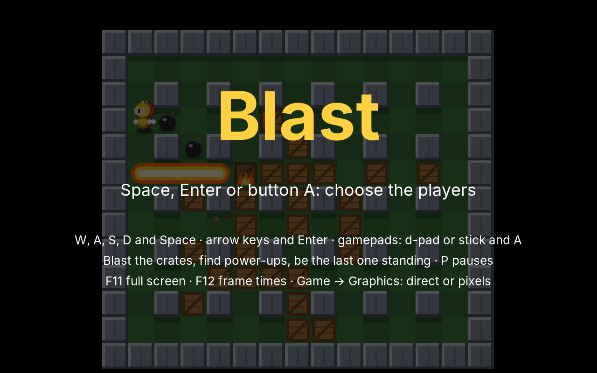
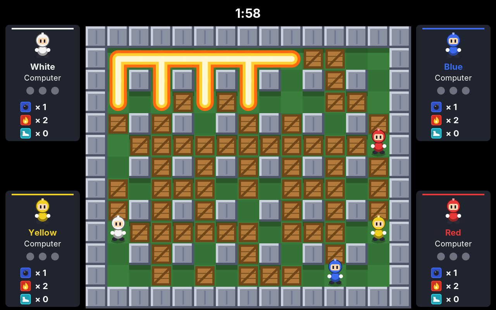
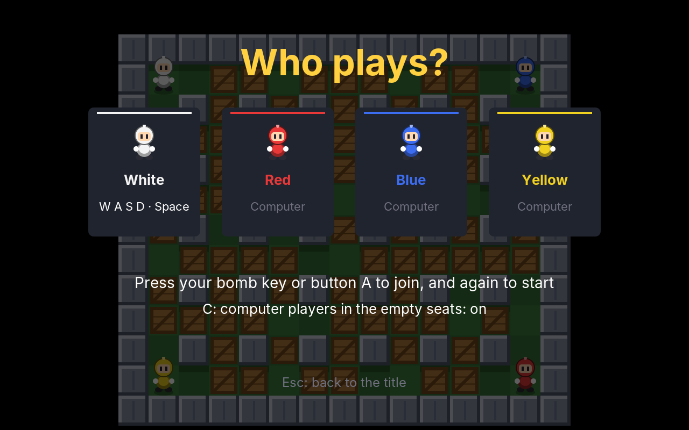
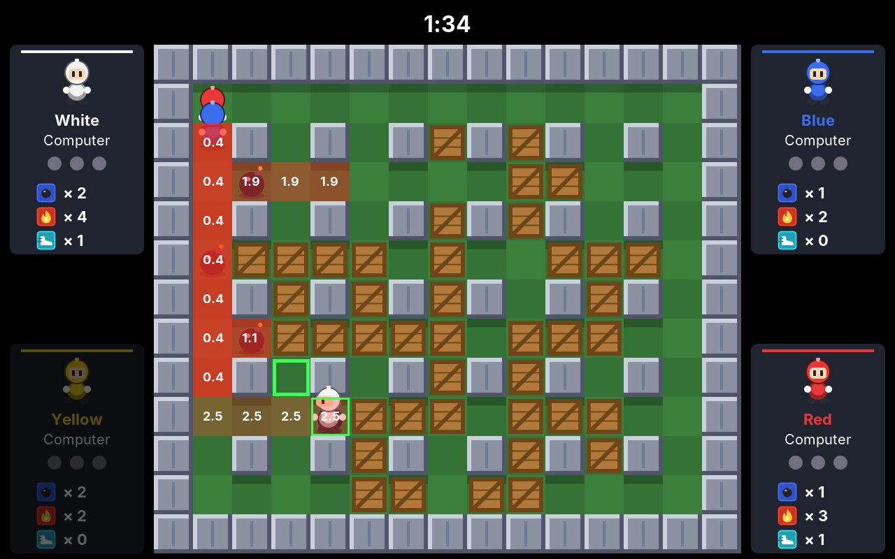
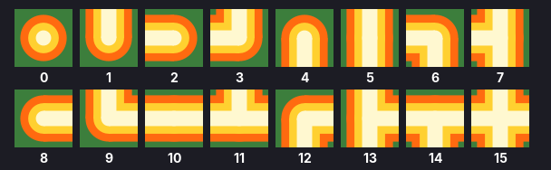

# 26. Blast

Maze had one player against four ghosts that the computer moved. In **Blast**, all four figures can be people: up to four players share one arena, two at the keyboard and the others with gamepads, and the computer takes the seats nobody wants. Each lays bombs among crates; the bombs explode after a moment, their flames run along the corridors, burn the crates and set off other bombs. The last one standing wins the round.

<figure markdown>
{ width="400" }
{ width="400" }
<figcaption>The title screen with four computer players (left), and a chain reaction (right): the bomb on the left went off by its fuse, its flames set off the next one, and that one the next: four bombs in one step.</figcaption>
</figure>

The original came out in 1983 and became a party game when it let five people play on one screen. Its rules fit on a card, and the interesting part is underneath: many things wait at the same time (every fuse, every flame, every burning crate), and one thing causes the next, which causes the next. This chapter builds the pieces for that, **timers** and **events**, and the one Blast cannot do without: **gamepads**.

!!! abstract "What you will learn"
    - **Gamepads**: four pads, read from the joystick devices on Linux and through XInput on Windows, with a dead zone for the stick
    - **The foreign function interface**: calling a function of a Windows library from Java, without a line of C
    - **Seats**: one player's controls, whatever they are: keys, a pad or the computer; a lobby where people join with a button
    - **Timers**: many countdowns that run out in the order of their time, even within one step
    - **Events**: consequences as messages on a queue, so that a chain reaction runs wave by wave
    - **Danger maps**: when flames will reach each tile, along chains, for a computer player that does not blow itself up

The complete game is in [amade-blast-game](https://github.com/datazuul/amade-blast-game).

## The rules

1. The arena is 15 tiles wide and 13 high: walls round it, pillars in every second row and column, and crates on most of the rest. The four players start in the corners.
2. A player lays a **bomb** on the tile they stand on. It explodes after two and a half seconds. Its **flames** run from it in the four directions, two tiles at first, and stay for half a second. Walls stop them; a crate stops them and burns.
3. A flame that reaches another bomb sets it off at once: a **chain reaction**.
4. Crates hide **power-ups**: one more bomb at a time, one tile longer flames, faster feet. A flame burns a power-up that lies in the open.
5. Bombs block the way. A player can leave the bomb they just laid, but cannot walk onto one.
6. Whoever is in the flames is out of the round. The last one standing wins it; if the last ones fall together, nobody does. Three won rounds win the match.
7. After two minutes, **walls fall**: one every 0.3 seconds, in a spiral from the edge inwards, on whatever is there.

## Step 1: The arena as a text file

The arena is a `TileMap`, as the maze was, read from a text file. Blast adds one idea: some tiles are crates only *by chance*, so every round has a different arena.

```text title="amade-blast-game · board.txt"
row XXXXXXXXXXXXXXX
row X__.........__X
row X_X.X.X.X.X.X_X
row X.............X
row X.X.X.X.X.X.X.X
...
row X__.........__X
row XXXXXXXXXXXXXXX

start 1 1
start 13 11
start 13 1
start 1 11

crates 0.8
hide bomb 10
hide fire 10
hide speed 6
```

`X` is a wall, `+` always a crate, `_` always free floor, and `.` a crate with the chance given by `crates`. `hide` says how many of each power-up are hidden in the crates. The corners are free: a player who cannot get round a corner from their start is dead with their first bomb, because flames go straight. `Board` checks exactly that, with a breadth-first search from each start:

```java title="amade-blast-game · domain/Board.java"
--8<-- "amade-blast-game/src/main/java/eu/amadeos/games/blast/domain/Board.java:read"
```

```java title="amade-blast-game · test/domain/BoardTest.java"
--8<-- "amade-blast-game/src/test/java/eu/amadeos/games/blast/domain/BoardTest.java:test-errors"
```

Each round lays the crates anew, from the match's seeded random generator, and shuffles the power-ups into them:

```java title="amade-blast-game · domain/Board.java"
--8<-- "amade-blast-game/src/main/java/eu/amadeos/games/blast/domain/Board.java:lay"
```

The players walk as the muncher did: a `Walker` from centre to centre, turning only at centres. One rule is new. A bomb blocks the way, but the player who just laid it stands on it; `walkable` only asks about the tile *ahead*, so they can always step off:

```java title="amade-blast-game · domain/Player.java"
--8<-- "amade-blast-game/src/main/java/eu/amadeos/games/blast/domain/Player.java:move"
```

## Step 2: Gamepads

Four people at one keyboard do not work: hands get in each other's way, and most keyboards cannot even report more than a few keys held at once. So Blast needs gamepads, and the engine gets them.

Java has no gamepad support of its own. Every operating system has one, though, and the engine needs two of them: Linux, which amadeOS is, and Windows, where many of the games' players are. Behind both stands the same small class for one pad:

```java title="amade-game-engine · input/Gamepad.java"
--8<-- "amade-game-engine/src/main/java/eu/amadeos/gameengine/input/Gamepad.java:gamepad"
```

Two sides, two threads. A **backend** reports what the pad does, whenever it learns about it, perhaps on a thread of its own: `connect`, `disconnect`, `report`. The **game** calls `poll()` once per update step on the loop thread, and from then on until the next poll it sees one unchanging state, as the keyboard does since chapter 20. The lock is held only for the moment of copying.

Two details make the pad pleasant to play:

- **A press is never lost.** A button pressed and released again between two polls (a quick tap, at 120 polls a second, is rare, but it happens) still counts as pressed once: `report` collects every button that went down into `pressedSincePoll`.
- **A stick at rest is at rest.** A stick never comes back exactly to the middle; a worn one stops a few percent off. Inside a round **dead zone** it counts as zero; outside, the rest of the way is stretched to the full range again, so the player still gets every speed. Pushed more than halfway, the stick also counts as the d-pad: Blast's players walk on a grid and only need four directions.

```java title="amade-game-engine · test/input/GamepadTest.java"
--8<-- "amade-game-engine/src/test/java/eu/amadeos/gameengine/input/GamepadTest.java:test-dead-zone"
```

`Gamepads` holds four pads, as many as XInput knows, and picks the backend by the operating system. If none can start, the game runs without pads and says so in the log:

```java title="amade-game-engine · input/Gamepads.java"
--8<-- "amade-game-engine/src/main/java/eu/amadeos/gameengine/input/Gamepads.java:gamepads"
```

### Linux: reading a device file

On Linux, every gamepad is a file: `/dev/input/js0`, `js1` and so on. Reading it gives events of eight bytes each: a time, a value, a type (button or axis) and a number. When the file is opened, the driver first sends the current state of every button and axis, marked with `INIT`. The engine reads each pad on a thread of its own, which blocks until the next event comes; a scanner looks for new files once a second, so a pad plugged in during the game is found:

```java title="amade-game-engine · input/LinuxJoysticks.java"
--8<-- "amade-game-engine/src/main/java/eu/amadeos/gameengine/input/LinuxJoysticks.java:read"
```

The numbers of the buttons and axes come from the driver. For Xbox pads and the many that copy them it is `xpad`, and its numbering is the table:

```java title="amade-game-engine · input/LinuxJoysticks.java"
--8<-- "amade-game-engine/src/main/java/eu/amadeos/gameengine/input/LinuxJoysticks.java:state"
```

```java title="amade-game-engine · test/input/LinuxJoysticksTest.java"
--8<-- "amade-game-engine/src/test/java/eu/amadeos/gameengine/input/LinuxJoysticksTest.java:test-events"
```

Reading a device needs permission. On a desktop the user at the screen usually has it; where they do not, the pad is logged once as "no permission" and not tried again.

### Windows: calling XInput

Windows has no device files for pads. It has a library, XInput, with a C function that fills a small structure with the state of one pad:

```c
DWORD XInputGetState(DWORD dwUserIndex, XINPUT_STATE *pState);
```

Until recently, calling it from Java meant writing C with JNI and building it for every platform. Since Java 22, the **foreign function interface** (`java.lang.foreign`) does it in Java: find the function in the library, describe its parameters, and call it like a method. The structure is a piece of memory outside the Java heap, and the fields are read at their byte offsets:

```java title="amade-game-engine · input/XInput.java"
--8<-- "amade-game-engine/src/main/java/eu/amadeos/gameengine/input/XInput.java:xinput"
```

XInput is not asked by events but polled, so this backend reads all four pads in `Gamepads.poll()`, on the loop thread. Asking for an empty slot is slow on some Windows versions, so an empty slot is asked only once a second. XInput counts the stick's up as positive, the screen counts down; the minus sign in front of `THUMB_LY` turns it round. The button bits have their own table:

```java title="amade-game-engine · input/XInput.java"
--8<-- "amade-game-engine/src/main/java/eu/amadeos/gameengine/input/XInput.java:buttons"
```

!!! warning "Native access"
    Calling native code can crash the JVM, so Java warns when a program does it without saying so. A game that uses the gamepads starts with `--enable-native-access=ALL-UNNAMED`: in `build.gradle` for `run` and the tests, in the jpackage options for Windows, and as `Enable-Native-Access: ALL-UNNAMED` in the jar's manifest for `java -jar`.

### Pads in the controls

The game should not care whether an action came from a key or a button. `Controls`, the mapping of actions to keys from chapter 20, learns to bind pad buttons too:

```java title="amade-game-engine · test/input/ControlsTest.java"
--8<-- "amade-game-engine/src/test/java/eu/amadeos/gameengine/input/ControlsTest.java:test-pad"
```

## Step 3: Seats and the lobby

Who controls a player? Keys, a pad, or the computer. A `Seat` hides the difference: each step, it turns its input into a `Move`, a direction and whether to lay a bomb.

```java title="amade-blast-game · ui/game/Seat.java"
--8<-- "amade-blast-game/src/main/java/eu/amadeos/games/blast/ui/game/Seat.java:seat"
```

`wanted()` is a small kindness. The muncher kept the last key pressed until the next one; here, a player who lets go wants to stop, as a bomb might be ahead. But a player who holds right and taps up to turn at the next crossing should go on to the right after letting go of up. So the wanted way is the one pressed last *while it is held*, and after that the one still held.

There are two keyboard seats and one for each pad, all made at the start; a pad that is not plugged in simply never presses anything:

```java title="amade-blast-game · ui/game/BlastGame.java"
--8<-- "amade-blast-game/src/main/java/eu/amadeos/games/blast/ui/game/BlastGame.java:inputs"
```

### Who plays?

The lobby lets people sit down without a menu: whoever presses their bomb key or button A takes the next free seat, and pressing it again starts the match. C switches the computer players for the empty seats on or off:

{ width="500" }

```java title="amade-blast-game · ui/game/BlastGame.java"
--8<-- "amade-blast-game/src/main/java/eu/amadeos/games/blast/ui/game/BlastGame.java:lobby"
```

```java title="amade-blast-game · test/ui/game/BlastGameTest.java"
--8<-- "amade-blast-game/src/test/java/eu/amadeos/games/blast/ui/game/BlastGameTest.java:test-lobby"
```

A cable can be pulled in the middle of a match. The match pauses, names the missing pad, and goes on only when the pad is back and its owner presses Start:

```java title="amade-blast-game · test/ui/game/BlastGameTest.java"
--8<-- "amade-blast-game/src/test/java/eu/amadeos/games/blast/ui/game/BlastGameTest.java:test-unplugged"
```

## Step 4: Timers

Count what waits in a round of Blast: every bomb's fuse, every tile in flames, every burning crate, the falling walls. Earlier games had a field per waiting thing (the energizer's time in Maze, for one), counted down in `update`. With dozens of them, that becomes a loop over lists in every place, and one question gets lost: *in which order* did they run out?

That question matters. A step is 1/120 second, but with eight bombs on the arena, two fuses will run out in the same step sooner or later. If bomb A was laid a moment before bomb B, A explodes first, and when its flames reach B, B is a *chained* explosion that A's owner caused. Handled in the wrong order, the history of the round changes.

`Timers` is the engine's answer: many countdowns, each belonging to a key, handed over in the order they ran out.

```java title="amade-game-engine · time/Timers.java"
--8<-- "amade-game-engine/src/main/java/eu/amadeos/gameengine/time/Timers.java:timers"
```

How much a timer is below zero says how early in the step it ran out: −0.004 ran out before −0.001. Of two at exactly the same moment, the one started first comes first, so the order never depends on a hash code. The `EPSILON` is the same lesson as the `Ticker`'s: 300 steps of 1/120 second add up to 2.5 seconds only on paper; in floating point they leave a remainder of about 10⁻¹⁵, and a fuse of 2.5 seconds would go off one step late.

```java title="amade-game-engine · test/time/TimersTest.java"
--8<-- "amade-game-engine/src/test/java/eu/amadeos/gameengine/time/TimersTest.java:test-timers"
```

The game has three of them, plus the bombs and power-ups on the arena:

```java title="amade-blast-game · domain/Game.java"
--8<-- "amade-blast-game/src/main/java/eu/amadeos/games/blast/domain/Game.java:state"
```

```java title="amade-blast-game · domain/Field.java"
--8<-- "amade-blast-game/src/main/java/eu/amadeos/games/blast/domain/Field.java:times"
```

## Step 5: Events and chain reactions

What happens when a fuse runs out? The bomb explodes; its flames reach tiles; on one there is a crate, which starts to burn; on another a bomb, which explodes, and its flames reach more tiles, and a player. Written as method calls, that is recursion: `explode` calls `explode`, and the second bomb's flames are all worked out before the first bomb's flames in the other three directions are. A long chain goes deep into the stack, and the order of what happens depends on where in a loop the recursion started.

The alternative is to make each consequence a **message**: an event, posted on a queue, handled when its turn comes. Handling an event may post new ones; they go to the back of the queue. So a chain runs in **waves**: first everything the first bomb causes, then everything those cause, and so on.

```java title="amade-game-engine · event/EventQueue.java"
--8<-- "amade-game-engine/src/main/java/eu/amadeos/gameengine/event/EventQueue.java:queue"
```

```java title="amade-game-engine · test/event/EventQueueTest.java"
--8<-- "amade-game-engine/src/test/java/eu/amadeos/gameengine/event/EventQueueTest.java:test-queue"
```

The limit is a fuse of its own: an event that posts itself would loop forever, and an exception that names the event is easier to find than a hanging game.

The queue keeps what it handled, `happened()`. That is what the game reports after each step, and what the sounds, the particles and the shaking of the screen react to; the events Maze reported from a list are now the same events that drive the rules.

```java title="amade-blast-game · domain/Event.java"
--8<-- "amade-blast-game/src/main/java/eu/amadeos/games/blast/domain/Event.java:event"
```

One step of the game is now short. The timers run out first, in their order, and post their explosions; then the players move, take power-ups and lay bombs; then the queue is processed, explosions and all they cause; then whoever is in the flames is hit:

```java title="amade-blast-game · domain/Game.java"
--8<-- "amade-blast-game/src/main/java/eu/amadeos/games/blast/domain/Game.java:update"
```

And all consequences are in one place:

```java title="amade-blast-game · domain/Game.java"
--8<-- "amade-blast-game/src/main/java/eu/amadeos/games/blast/domain/Game.java:handle"
```

`detonate` takes the bomb off the arena *before* posting its explosion. A bomb reached by the flames of two others in the same wave is then set off only once: the second time, it is no longer there.

How far do the flames go? `reach` answers it, and it is public, because the computer players need the same answer to know where it is dangerous. If the explosion and the fear of it were two pieces of code, they would sooner or later disagree, and a computer player would walk into flames it believed were not there:

```java title="amade-blast-game · domain/Game.java"
--8<-- "amade-blast-game/src/main/java/eu/amadeos/games/blast/domain/Game.java:reach"
```

```java title="amade-blast-game · test/domain/GameTest.java"
--8<-- "amade-blast-game/src/test/java/eu/amadeos/games/blast/domain/GameTest.java:test-chain"
```

The test shows the point of the waves: the bomb at (5, 1) is out of reach of the first one, and still explodes in the same step, set off by the second.

### Before and after

```java title="amade-blast-game · test/domain/GameTest.java"
--8<-- "amade-blast-game/src/test/java/eu/amadeos/games/blast/domain/GameTest.java:test-explode"
```

## Step 6: Rounds and falling walls

A round ends when at most one player is left, but not before everybody hit has finished falling: two players caught by the same flames should both fall, and nobody wins.

```java title="amade-blast-game · domain/Game.java"
--8<-- "amade-blast-game/src/main/java/eu/amadeos/games/blast/domain/Game.java:decide"
```

```java title="amade-blast-game · test/domain/GameTest.java"
--8<-- "amade-blast-game/src/test/java/eu/amadeos/games/blast/domain/GameTest.java:test-round"
```

Careful players could hide forever. After two minutes, walls fall into the arena, ring by ring from the outside in. The order is worked out once, when the board is read:

```java title="amade-blast-game · domain/Board.java"
--8<-- "amade-blast-game/src/main/java/eu/amadeos/games/blast/domain/Board.java:spiral"
```

The falling uses a `Ticker` from chapter 22: it says how many times 0.3 seconds have passed in this step, usually none, sometimes one.

```java title="amade-blast-game · domain/Game.java"
--8<-- "amade-blast-game/src/main/java/eu/amadeos/games/blast/domain/Game.java:hurry"
```

```java title="amade-blast-game · test/domain/GameTest.java"
--8<-- "amade-blast-game/src/test/java/eu/amadeos/games/blast/domain/GameTest.java:test-hurry"
```

## Step 7: The computer player

A computer player in Blast has one thing to learn above all: do not stand where the flames will be. Everything else (collecting power-ups, burning crates, hunting the others) comes after.

### A map of danger

`Danger` says for every tile when flames will reach it: the time left on the fuse of the bomb whose flames reach it first; zero where flames are now; the next falling walls; infinity where nothing comes. Chains make it interesting. A bomb with two seconds left, in reach of a bomb with half a second left, explodes in half a second, and so does every tile it reaches. So the times are lowered along the chain until nothing changes any more:

```java title="amade-blast-game · domain/Danger.java"
--8<-- "amade-blast-game/src/main/java/eu/amadeos/games/blast/domain/Danger.java:danger"
```

```java title="amade-blast-game · test/domain/BotTest.java"
--8<-- "amade-blast-game/src/test/java/eu/amadeos/games/blast/domain/BotTest.java:test-danger"
```

{ width="600" }

The red tiles are the danger, with the seconds; the darker, the sooner. The white player has just laid a bomb (2.5) and is on its way round the corner to the tile marked green. The bomb in the left column goes off in 0.4 seconds, and its long flames cover the whole column; where the bomb at 1.9 reaches the same tiles, they show 0.4, because a tile shows the earliest flames that will come. The bomb at 1.1 is out of reach of both and keeps its own time.

### Steering

Each step, the computer player looks at the next centre ahead. If it is not safe, it flees: a breadth-first search over the tiles that will not burn too soon, to the nearest tile that will not burn at all. Otherwise it hunts:

```java title="amade-blast-game · domain/Bot.java"
--8<-- "amade-blast-game/src/main/java/eu/amadeos/games/blast/domain/Bot.java:steer"
```

The hunt is a list of wishes, the first that can be fulfilled wins:

1. Lay a bomb here, if it would burn a crate nobody else's bomb will burn, or reach another player, **and** a safe tile could be reached before it explodes. The second half is the important one, and `Danger.of(game, at, range)` answers it: the danger as if the bomb were already laid.
2. Fetch a power-up nearby.
3. Go to a tile where a bomb would be worth laying and could be escaped.
4. Go for another player.
5. Wander.

```java title="amade-blast-game · domain/Bot.java"
--8<-- "amade-blast-game/src/main/java/eu/amadeos/games/blast/domain/Bot.java:hunt"
```

All the searches start at the player and spread out. The way to a goal is then read backwards: from the goal downhill to the start, and the last step of that way, turned round, is the first one to take:

```java title="amade-blast-game · domain/Bot.java"
--8<-- "amade-blast-game/src/main/java/eu/amadeos/games/blast/domain/Bot.java:toward"
```

Now and then the computer player dawdles for a moment. Without it, four computer players are so alike that rounds often end in a draw; with it, they make the small mistakes that people make.

Do they play well enough? The test lets four of them play whole matches and counts how often one is hit in the first ten seconds of a round, the time when a player who cannot escape their own bomb dies:

```java title="amade-blast-game · test/domain/BotTest.java"
--8<-- "amade-blast-game/src/test/java/eu/amadeos/games/blast/domain/BotTest.java:test-demo"
```

As in every game since Snake, the same seed and the same moves play the same match, computer players included. The test compares the log of two matches:

```java title="amade-blast-game · test/domain/GameTest.java"
--8<-- "amade-blast-game/src/test/java/eu/amadeos/games/blast/domain/GameTest.java:test-determinism"
```

## Step 8: Drawing

The arena is drawn from tiles, as the maze was; the players, bombs and power-ups are figures drawn in code, cached as sprites. The flames reuse the trick of Maze's walls: a tile in flames is drawn with arms towards its neighbours in flames, so the neighbour mask chooses one of sixteen pieces, and a cross of flames is one shape without seams:

{ width="700" }

```java title="amade-blast-game · ui/game/BlastPainter.java"
--8<-- "amade-blast-game/src/main/java/eu/amadeos/games/blast/ui/game/BlastPainter.java:flames"
```

The flames grow thinner as they die down: three widths, sixteen pieces each, all cached. Players are drawn from top to bottom, so one lower on the screen stands in front of one above:

```java title="amade-blast-game · ui/game/BlastPainter.java"
--8<-- "amade-blast-game/src/main/java/eu/amadeos/games/blast/ui/game/BlastPainter.java:players"
```

The cards beside the arena show each player's face, who plays it, the rounds won, and the bombs, flame length and speed:

```java title="amade-blast-game · ui/game/Hud.java"
--8<-- "amade-blast-game/src/main/java/eu/amadeos/games/blast/ui/game/Hud.java:status"
```

The events of each step become sounds, splinters and a shaking screen. A chain of eight bombs is one bang, not eight on top of each other: one explosion sound per step is enough.

```java title="amade-blast-game · ui/game/Effects.java"
--8<-- "amade-blast-game/src/main/java/eu/amadeos/games/blast/ui/game/Effects.java:react"
```

The gamepads are opened when the program starts and closed when it ends, which stops the reading threads on Linux:

```java title="amade-blast-game · bootstrap/AmadeBlastApplication.java"
--8<-- "amade-blast-game/src/main/java/eu/amadeos/games/blast/bootstrap/AmadeBlastApplication.java:main"
```

Full screen (F11), the render modes, the frame times (F12), sound and the five languages work as in the earlier games. Blast keeps no high scores: a match between friends is its own reward.

## What moved into the engine

| From Blast | Engine package | Why |
|---|---|---|
| Gamepads: four slots, the stick's dead zone, presses never lost | `eu.amadeos.gameengine.input.Gamepad`, `Gamepads` | Every game that more than one person plays, and every game played from the sofa |
| Reading `/dev/input/js*`; XInput through `java.lang.foreign` | `eu.amadeos.gameengine.input.LinuxJoysticks`, `XInput` | The pads of Linux and Windows behind one interface |
| Pad buttons in the controls | `eu.amadeos.gameengine.input.Controls` | Keys and buttons trigger the same actions |
| Many countdowns, in the order they run out | `eu.amadeos.gameengine.time.Timers` | Fuses, cooldowns, spawn waves, the build times of Towers |
| Events that cause events, handled in waves | `eu.amadeos.gameengine.event.EventQueue` | Consequences that spread: chain reactions, the water and sand of Sands |

What stays in the game: the arena file, the bombs, flames and power-ups, the rounds and the falling walls, the danger map and the computer players, the seats and the lobby, the painter, the sounds and tunes, and the scenes.

## Exercises

1. **An arena of your own.** Change `board.txt`: fewer pillars, a ring of solid crates round the middle, other power-up numbers. Wall in a start with `+` and read the error.
2. **The kick.** Add a power-up that lets a player kick a bomb: it slides until it hits something. Where does the bomb's position live now, and what must `reach` and `Danger` learn about bombs that move?
3. **Remote control.** A power-up that keeps a player's bombs from exploding by themselves; a second button sets them off. Which timer is no longer started, and which event takes its place?
4. **Recursion against waves.** Replace the event queue with direct calls: `explode` calls `detonate`, which calls `explode`. Lay a long chain where the order is visible (two chained bombs that both reach the same player). Does the history of the round change?
5. **A careful computer.** The computer players never lay a bomb in the reach of another bomb. That is why chains are rare on the title screen. Let them do it when the chain is safe for them, and watch the title screen.
6. **Rumble.** XInput has `XInputSetState`, which makes a pad vibrate. Call it through `java.lang.foreign` when a player is hit.

---

In the next game, **Jump**, the camera follows one player through a level much larger than the screen: scrolling, gravity, and standing on things.
