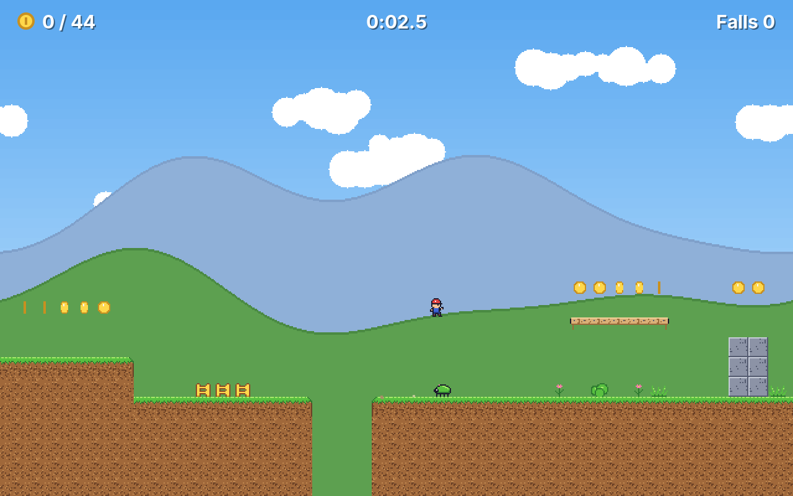
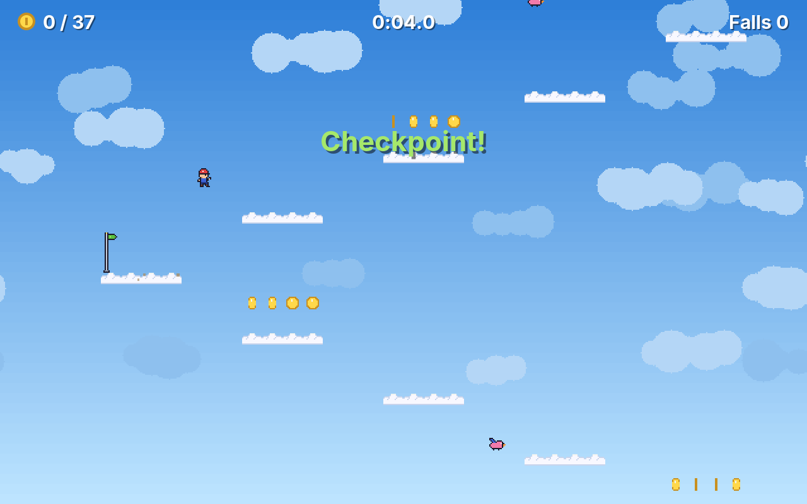
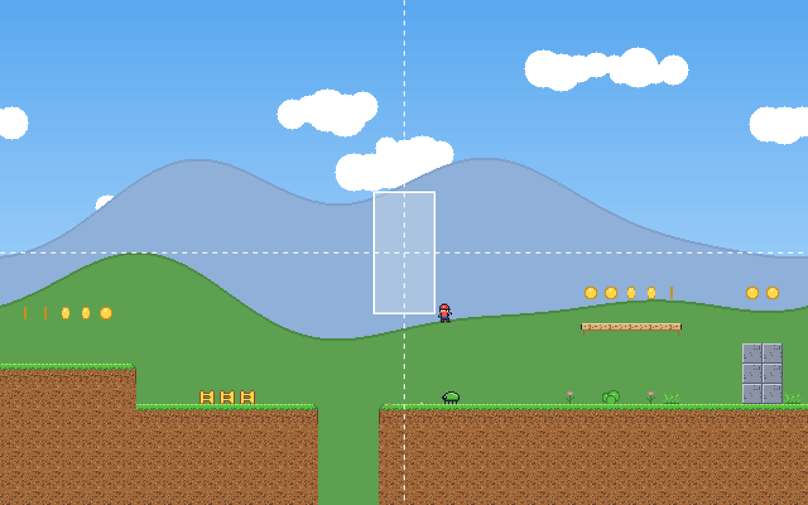
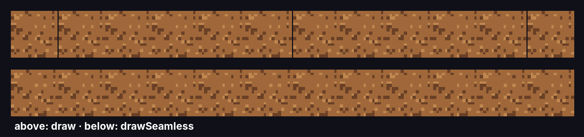
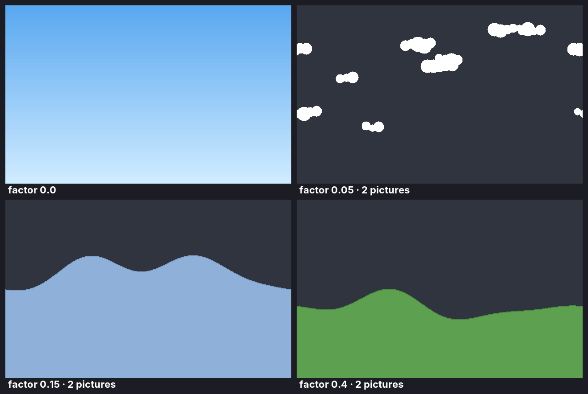
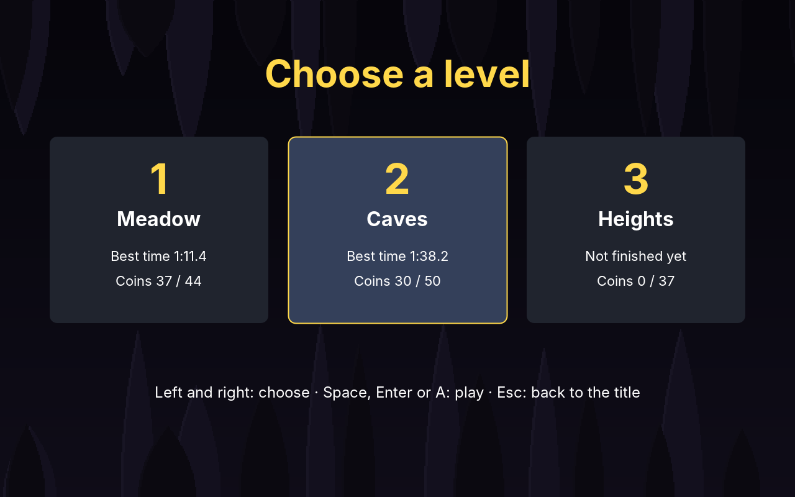
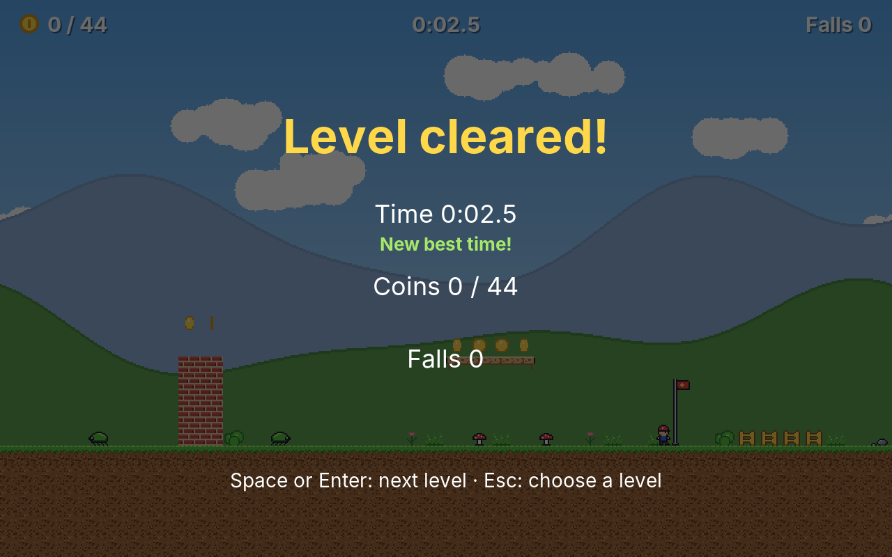
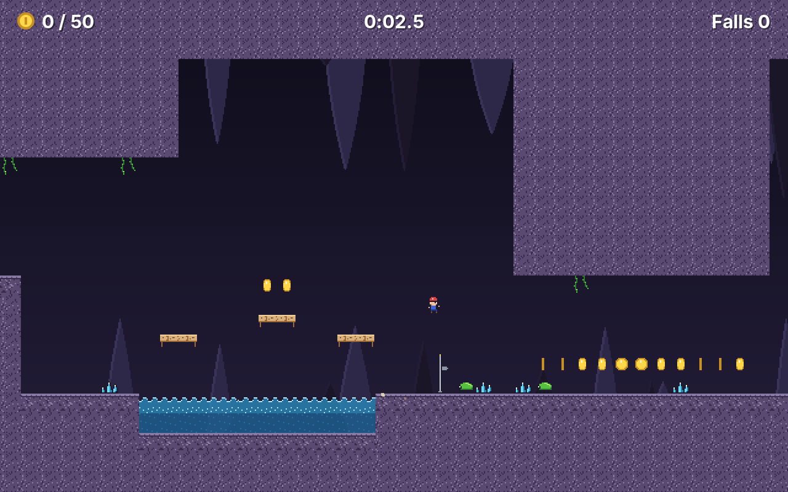

# 27. Jump

Every game so far fitted on one screen. In **Jump** the level is five times as wide as the screen, or three times as high, and the screen shows only the part around the player: a **camera** follows them. The player runs, jumps, falls and stands on things, takes coins, jumps on beetles and birds, and tries to reach the red flag at the end. Three levels, a meadow, caves and a climb into the clouds, were drawn in a level editor, **Tiled**, and the game reads its files.

<figure markdown>
{ width="400" }
{ width="400" }
<figcaption>The meadow (left): the hills behind move slower than the ground, the clouds slower still. The heights (right): a level three screens high, with the camera halfway up.</figcaption>
</figure>

Platformers began on the arcade screen in 1981, scrolled sideways from 1984, and in 1985 one of them sold forty million copies. What made it last was not the graphics but the jump: how high it goes, how much it can be steered, how forgiving it is when a button comes a moment too early or too late. A jump is physics, a little cheating, and many small numbers. This chapter builds all of it, and the camera, and the background, and reads its levels from a real editor.

!!! abstract "What you will learn"
    - **Maps from Tiled**: the TMX format, tilesets, tile classes, animations and objects, read with SAX into records
    - **Gravity and collision with tiles**: moving one axis at a time, without tunnelling through floors, and platforms that hold only from above
    - **A jump that feels right**: its height from physics, a variable height, coyote time and a jump buffer
    - **A camera**: world and screen coordinates, a dead zone, smoothing that does not depend on the frame rate, and the edges of the world
    - **Parallax**: backgrounds that scroll slower than the world
    - **Tiles without gaps** at any scale, and **cheaper sprites**: measured, then halved
    - **Proving a level can be finished**: a search over every jump the player can make
    - **Saving progress** so that no crash can lose it

The complete game is in [amade-jump-game](https://github.com/datazuul/amade-jump-game).

## The rules

1. A level is a grid of tiles of 16 units: ground, wooden **ledges** that hold from above but can be jumped through from below and dropped through with *down*, **spikes**, **water** and **coins**. On the screen of 640 × 400 units, 40 × 25 tiles are visible.
2. The player runs left and right and **jumps**. Holding the button jumps higher, four and a half tiles at most; a tap is a hop.
3. **Coins** are taken by touching them.
4. **Beetles** walk and turn at walls, some also at edges; **birds** fly back and forth. Landing on one from above beats it, and the player bounces off. Touching one in any other way is a fall.
5. Spikes, water, enemies and pits are **falls**. There are no lives: the player starts again at the last **green flag** (a checkpoint) reached, the clock goes on, and the falls are counted.
6. A **spring** throws whoever lands on it nine tiles up.
7. The **red flag** ends the level. Time, coins and falls are shown; the best time and the most coins of each level are saved, and the next level opens.

## Step 1: Levels from the Tiled editor

Maze and Blast kept their boards in text files of letters. That works for a board of 15 × 13; a level of 176 × 25 tiles with two layers and fifty things in it is no longer a text one wants to type. Level designers use editors, and the one most used by small studios and hobbyists is **[Tiled](https://www.mapeditor.org/)**: free, open source, for Linux, Windows and macOS. You paint tiles with the mouse, place things as rectangles, give them names and properties, and save.

Tiled saves a map as **TMX**, an XML format, and a tileset (the picture with all tiles, and what Tiled knows about each tile) as **TSX**, next to it or inside the map:

```xml title="amade-jump-game · levels/level1.tmx (shortened)"
<map version="1.10" orientation="orthogonal" width="176" height="25" tilewidth="16" tileheight="16" infinite="0">
 <properties>
  <property name="name" value="Meadow"/>
  <property name="theme" value="meadow"/>
 </properties>
 <tileset firstgid="1" source="tiles.tsx"/>
 <layer id="1" name="back" width="176" height="25">
  <data encoding="csv">0,0,0,0,0,...</data>
 </layer>
 <layer id="2" name="ground" width="176" height="25">
  <data encoding="csv">...,1,1,1,2,0,0,0,1,1,...</data>
 </layer>
 <objectgroup id="3" name="things">
  <object id="1" type="start" x="48" y="304" width="16" height="16"/>
  <object id="3" type="beetle" x="1088" y="304" width="16" height="16">
   <properties><property name="careful" type="bool" value="true"/></properties>
  </object>
  <object id="11" type="goal" x="2656" y="272" width="16" height="48"/>
 </objectgroup>
</map>
```

```xml title="amade-jump-game · levels/tiles.tsx (shortened)"
<tileset name="tiles" tilewidth="16" tileheight="16" tilecount="32" columns="8">
 <image source="tiles.png" width="128" height="64"/>
 <tile id="0" type="solid"/>
 <tile id="8" type="platform"/>
 <tile id="11" type="spikes"/>
 <tile id="12" type="coin">
  <animation>
   <frame tileid="12" duration="120"/>
   <frame tileid="13" duration="120"/>
   ...
  </animation>
 </tile>
</tileset>
```

A few ideas of the format:

- A **layer** is a grid of numbers, the **gids** (global tile ids). 0 is empty; the tileset that starts at `firstgid` 1 has the gids 1 to 32, a second one would start at 33. Tiled writes the grid as CSV, or as Base64, compressed with zlib or gzip, or (in very old files) as one XML element per tile.
- The top three bits of a gid say whether the tile is **flipped** horizontally, vertically or diagonally. A gid of 2147483649 is tile 1, mirrored.
- Tiles can have a **class** (`type`) and properties, and an **animation**: frames of other tiles with their durations.
- An **object layer** holds rectangles with a class, a name and properties. Tiled leaves their meaning to the game.

The engine's `TiledMap` reads all of that into records. The game never sees XML:

```java title="amade-game-engine · tiled/TiledMap.java"
--8<-- "amade-game-engine/src/main/java/eu/amadeos/gameengine/tiled/TiledMap.java:map"
```

The reader is a SAX handler: it gets the elements one by one as the parser meets them, which is quick and, more importantly, knows the **line** of each one. An error in a level names the file and the line, as `TextData` has done since Swarm, and it is the same exception. Decoding a layer covers the three encodings:

```java title="amade-game-engine · tiled/TmxReader.java"
--8<-- "amade-game-engine/src/main/java/eu/amadeos/gameengine/tiled/TmxReader.java:decode"
```

The gids are parsed as `long` and then cut to `int`: a flipped tile's number is larger than `Integer.MAX_VALUE`, and its bits must survive. `TileLayer.gid` masks the flip bits off, `flips` keeps only them.

Objects need one correction. Tiled places a *tile object* (an object that shows a tile) by its bottom left corner, every other object by its top left. The reader turns them all into boxes with their top left corner:

```java title="amade-game-engine · tiled/TmxReader.java"
--8<-- "amade-game-engine/src/main/java/eu/amadeos/gameengine/tiled/TmxReader.java:object"
```

```java title="amade-game-engine · test/tiled/TiledMapTest.java"
--8<-- "amade-game-engine/src/test/java/eu/amadeos/gameengine/tiled/TiledMapTest.java:test-read"
```

```java title="amade-game-engine · test/tiled/TiledMapTest.java"
--8<-- "amade-game-engine/src/test/java/eu/amadeos/gameengine/tiled/TiledMapTest.java:test-objects"
```

What the engine cannot read, it refuses, and says what to change in Tiled:

```java title="amade-game-engine · test/tiled/TiledMapTest.java"
--8<-- "amade-game-engine/src/test/java/eu/amadeos/gameengine/tiled/TiledMapTest.java:test-errors"
```

!!! note "Which Tiled"
    Tiled 1.9 renamed an object's `type` to `class`; Tiled 1.10 went back to `type` for objects and tiles. The reader takes both. Infinite maps (made of chunks), maps of hexagons or isometric tiles, and object templates are refused.

### From map to rules

The rules want their own tiles, not gids. The tileset's classes say which is which, and `TiledMap.tiles` turns a layer into the `TileMap` of chapter 25, with a function from gid to the game's tile:

```java title="amade-jump-game · domain/Tile.java"
--8<-- "amade-jump-game/src/main/java/eu/amadeos/games/jump/domain/Tile.java:tile"
```

```java title="amade-jump-game · domain/Level.java"
--8<-- "amade-jump-game/src/main/java/eu/amadeos/games/jump/domain/Level.java:read"
```

Only the layer **ground** matters to the rules. Every other tile layer is decoration, and every tile without a class too: flowers, fences, a sign. The level designer can paint whatever they like without the rules noticing.

The tests do not need Tiled. A helper draws small levels as text, `#` for ground, `o` for a coin, `P` for the start, and turns them into the TMX that Tiled would save, so every test goes through the real reader.

## Step 2: Falling and standing

Everything that moves and stands on the ground is a `Body`: a box with a speed. Gravity is an acceleration, so each step it adds to the downward speed, up to a limit, the **terminal speed**, beyond which a fall would be too fast to follow:

```java title="amade-game-engine · physics/Body.java"
--8<-- "amade-game-engine/src/main/java/eu/amadeos/gameengine/physics/Body.java:body"
```

Moving a body through tiles is where many first platformers go wrong. The body falls diagonally onto the corner of a tile: did it hit a wall or land on the floor? Moved in one go, it cannot tell. The answer of every platformer since the 1980s: **one axis at a time**. First sideways, and if a wall is in the way, stop at it. Then up or down, and if the floor is in the way, stand on it. Each move has one answer.

The second trap is speed. A player falling at 480 units a second moves 4 units per step at 120 steps a second, less than a tile, but a bullet or a spring can be faster, and a body that jumps over a floor in one step falls through it: **tunnelling**. So the collider does not look at where the body ends up. It looks at **every row** the feet pass and every column the side passes, the nearest first:

```java title="amade-game-engine · physics/TileCollider.java"
--8<-- "amade-game-engine/src/main/java/eu/amadeos/gameengine/physics/TileCollider.java:collider"
```

Three details:

- **Edges on tile borders.** A body 16 units high whose bottom is at exactly 320 stands *on* row 20; it is not *in* it. `EPSILON` makes an edge that lies on a border belong to the tile before it.
- **Platforms.** A ledge holds the feet only when they come from above: when they enter its row from the row before. Jumping up through it, the head passes; standing on it, *down* (`dropThrough`) lets the player fall.
- **Standing still.** A body that did not move down this step may still stand: `standing` checks the row right under the feet. Without it, a player standing still would not be `onGround` and could not jump.

The collider asks the game what a tile is, through a small interface, so it works with any map. Jump says that left and right of the level are walls, and above and below is air: a pit leads out of the world.

```java title="amade-jump-game · domain/Game.java"
--8<-- "amade-jump-game/src/main/java/eu/amadeos/games/jump/domain/Game.java:world"
```

```java title="amade-game-engine · test/physics/TileColliderTest.java"
--8<-- "amade-game-engine/src/test/java/eu/amadeos/gameengine/physics/TileColliderTest.java:test-land"
```

```java title="amade-game-engine · test/physics/TileColliderTest.java"
--8<-- "amade-game-engine/src/test/java/eu/amadeos/gameengine/physics/TileColliderTest.java:test-axes"
```

```java title="amade-game-engine · test/physics/TileColliderTest.java"
--8<-- "amade-game-engine/src/test/java/eu/amadeos/gameengine/physics/TileColliderTest.java:test-platform"
```

## Step 3: Running and jumping

All the numbers of the feel are in one place. They are the result of playing, changing one, and playing again:

```java title="amade-jump-game · domain/Field.java"
--8<-- "amade-jump-game/src/main/java/eu/amadeos/games/jump/domain/Field.java:physics"
```

**Running** is not a speed but a change of speed. The player accelerates towards the running speed, slows down when the keys are let go, and both happen more slowly in the air: a jump can be steered, but not turned round on the spot.

```java title="amade-jump-game · domain/Player.java"
--8<-- "amade-jump-game/src/main/java/eu/amadeos/games/jump/domain/Player.java:run"
```

**Jumping** sets the upward speed at once. Which speed? The one that reaches the height the levels are built for. Rising at speed *v* against gravity *g*, a body stops after *v*/*g* seconds, at the height *v*² / 2*g*. So the speed for a height *h* is √(2*gh*), and `Field` says "four and a half tiles" instead of a speed found by trying:

```java title="amade-game-engine · test/physics/JumpTest.java"
--8<-- "amade-game-engine/src/test/java/eu/amadeos/gameengine/physics/JumpTest.java:test-height"
```

The test allows half a step's way of difference: the game moves in steps of 1/120 second, and adding up steps is not quite the integral.

Exact physics alone feels wrong, though. Three small kindnesses make a jump feel right, and the engine's `Jump` has all three:

- **A variable height.** Letting go of the button while still rising cuts the rising speed, here to 45 %. A tap is a hop, a held button the full jump. One button, every height.
- **Coyote time.** A player who presses jump a few hundredths of a second *after* running off a ledge still jumps, like the cartoon coyote who keeps running on air until he looks down. The eye sees the feet still at the edge; the rules already let them fall.
- **A jump buffer.** A press a moment *before* landing is kept and carried out on landing. Without it, a press four hundredths of a second too early does nothing, and the game feels deaf.

```java title="amade-game-engine · physics/Jump.java"
--8<-- "amade-game-engine/src/main/java/eu/amadeos/gameengine/physics/Jump.java:jump"
```

Both windows are used up by a jump, so a press cannot jump twice, and a jump in the air does not count as standing.

```java title="amade-game-engine · test/physics/JumpTest.java"
--8<-- "amade-game-engine/src/test/java/eu/amadeos/gameengine/physics/JumpTest.java:test-coyote"
```

A step of the game puts these together in a fixed order: the jump first (it needs to know whether the body stood after the last step), then running, gravity, the move, and then what the body touches:

```java title="amade-jump-game · domain/Game.java"
--8<-- "amade-jump-game/src/main/java/eu/amadeos/games/jump/domain/Game.java:update"
```

## Step 4: Coins, spikes and enemies

Tiles that do something when touched are visited with `forEachCell`, every tile the player's box overlaps. Not every tile is deadly to its edge, though: the spikes are only the lower half of their tile, and water starts below its waves. A player who touches a pixel of a tile they cannot see as dangerous feels cheated:

```java title="amade-jump-game · domain/Game.java"
--8<-- "amade-jump-game/src/main/java/eu/amadeos/games/jump/domain/Game.java:touch"
```

```java title="amade-jump-game · test/domain/GameTest.java"
--8<-- "amade-jump-game/src/test/java/eu/amadeos/games/jump/domain/GameTest.java:test-coins"
```

A taken coin becomes air in the game's tiles but stays in the level's: the next attempt has all coins again.

**Enemies** are bodies too. A beetle walks with the same gravity and the same collider as the player, so it falls into pits and stops at walls without a line of its own for that. A *careful* beetle looks one unit ahead and below its feet and turns at an edge. A bird ignores gravity and flies along a sine, sideways or up and down:

```java title="amade-jump-game · domain/Enemy.java"
--8<-- "amade-jump-game/src/main/java/eu/amadeos/games/jump/domain/Enemy.java:update"
```

The oldest rule of the genre decides who wins when the player touches an enemy: coming down from above, the player does. "From above" means: falling, and in the step before, the feet were no lower than a few units below the enemy's top. The margin makes a landing on the enemy's shoulder count; without it, half the stomps would be falls.

```java title="amade-jump-game · domain/Game.java"
--8<-- "amade-jump-game/src/main/java/eu/amadeos/games/jump/domain/Game.java:stomp"
```

The bounce off a stomped enemy is a jump without the button: `Jump.launch`. Holding the button while landing bounces higher, as it does in the classics, because the launch can be cut like a jump. A spring launches too, but uncut: it always throws nine tiles high.

```java title="amade-jump-game · test/domain/GameTest.java"
--8<-- "amade-jump-game/src/test/java/eu/amadeos/games/jump/domain/GameTest.java:test-stomp"
```

A fall throws the player up and out of the picture through everything, and after a moment they stand at the last green flag again:

```java title="amade-jump-game · test/domain/GameTest.java"
--8<-- "amade-jump-game/src/test/java/eu/amadeos/games/jump/domain/GameTest.java:test-respawn"
```

```java title="amade-jump-game · test/domain/GameTest.java"
--8<-- "amade-jump-game/src/test/java/eu/amadeos/games/jump/domain/GameTest.java:test-goal"
```

All of it reaches the user interface as events, as in Blast:

```java title="amade-jump-game · domain/Event.java"
--8<-- "amade-jump-game/src/main/java/eu/amadeos/games/jump/domain/Event.java:event"
```

## Step 5: Can the level be finished?

A level drawn in an editor can be broken in ways no unit test of the rules finds: a gap one tile too wide, a ledge one tile too high, a coin behind a wall. Playing every level after every change finds them, slowly. A test finds them at once.

The idea is Blast's board check, a breadth-first search, but over **jumps** instead of tiles. A *place* is a column and the row the player stands on. From each place, the search tries every kind of jump the player can make (standing or running, to the left, straight up or to the right, a hop or the full height, steering at once or only on the way down) and every step off an edge, each **played with the game's own rules** in a fresh `Game`. Wherever the player lands is a new place to try from. Every coin taken on the way is noted, and so is the goal:

```java title="amade-jump-game · test/domain/Reach.java"
--8<-- "amade-jump-game/src/test/java/eu/amadeos/games/jump/domain/Reach.java:reach"
```

Enemies are left out: they can be stomped or waited for. The physics are not approximated: the search uses `Game.update`, so a change of `JUMP_HEIGHT` that makes a gap impossible fails the build.

```java title="amade-jump-game · test/domain/LevelTest.java"
--8<-- "amade-jump-game/src/test/java/eu/amadeos/games/jump/domain/LevelTest.java:test-reach"
```

When it fails, the message is the level as text, with every place reached marked `*` and the coins out of reach as `?`. While the levels of this chapter were made, it failed four times: a ledge one tile too high, a gap one tile too wide in the caves, a coin that could only be reached by a jump nobody would try, and a climb in the heights that needed a spring the test did not yet know how to ride (it now steers late).

## Step 6: The camera

The level is 2816 units wide; the screen shows 640. Everything so far lives in **world coordinates**: the player is at *x* = 1700. Drawing needs **screen coordinates**: where on the screen that is. A camera is the difference between the two: the world's position of the screen's top left corner. Drawing the world shifted by it, everything lands in the right place:

```text
screenX = worldX - camera.x()
```

Where should the camera be? The obvious answer, "the player in the middle", is the wrong one: every step of the player shakes the whole world, every jump moves the ground up and down. Two rules make it calm:

- A **dead zone**: a box in the middle of the screen, here 48 × 96 units, in which the player moves without the camera moving at all. Running back and forth a little, or jumping on the spot, leaves the world still.
- **Smoothing**: once the player leaves the dead zone, the camera does not jump after them but closes a part of the distance each second.

{ width="560" }

The smoothing must not depend on the step length, or the camera would move differently at 60 and at 120 steps a second. "Close 99.99 % of the distance in one second" means that after *t* seconds, (1 − 0.9999)^*t* of the distance is left, whatever the steps:

```java title="amade-game-engine · camera/Camera.java"
--8<-- "amade-game-engine/src/main/java/eu/amadeos/gameengine/camera/Camera.java:camera"
```

At the edges of the world the camera stops, and the player walks towards the edge of the screen. A world narrower than the screen is centred.

```java title="amade-game-engine · test/camera/CameraTest.java"
--8<-- "amade-game-engine/src/test/java/eu/amadeos/gameengine/camera/CameraTest.java:test-dead-zone"
```

```java title="amade-game-engine · test/camera/CameraTest.java"
--8<-- "amade-game-engine/src/test/java/eu/amadeos/gameengine/camera/CameraTest.java:test-smoothing"
```

The camera keeps its position from the step before, like the bodies, so drawing can interpolate between steps with `alpha` (chapter 20). A camera that jumps in whole steps while the player is drawn in between makes the player shiver.

The play scene owns the camera. It follows the player in every step, except while they tumble out of the picture after a fall: the camera stays where the fall happened.

```java title="amade-jump-game · ui/game/JumpGame.java"
--8<-- "amade-jump-game/src/main/java/eu/amadeos/games/jump/ui/game/JumpGame.java:play"
```

How far behind the camera stays at a steady run follows from the same formula: the speed divided by the rate, −ln(1 − 0.9999) ≈ 9.2 per second. At 140 units a second, 15 units beyond the dead zone's edge. The test says exactly that:

```java title="amade-jump-game · test/ui/game/JumpGameTest.java"
--8<-- "amade-jump-game/src/test/java/eu/amadeos/games/jump/ui/game/JumpGameTest.java:test-camera"
```

## Step 7: Drawing a level larger than the screen

### Only what the camera sees

A level of 176 × 25 tiles in two layers has 8800 tiles. Of these, 41 × 26 per layer can be seen. The painter works out the first and last column and row the camera sees and draws only those:

```java title="amade-jump-game · ui/game/JumpPainter.java"
--8<-- "amade-jump-game/src/main/java/eu/amadeos/games/jump/ui/game/JumpPainter.java:paint"
```

The painter draws the map, not the rules' tiles: the picture of each tile, and its animation, come from the tileset, which the level designer controls. What a level needs is prepared once: a sprite for each gid, and the frames of each animated one:

```java title="amade-jump-game · ui/game/JumpPainter.java"
--8<-- "amade-jump-game/src/main/java/eu/amadeos/games/jump/ui/game/JumpPainter.java:scenery"
```

### Tiles without gaps

The first version of the painter drew the tiles with `Sprite.draw`, and in a window of 1728 × 1080 pixels a thin dark line ran through the ground every few tiles and flickered while it scrolled. At that size a tile of 16 units is 43.2 pixels wide. The sprite caches one picture of 43 pixels and copies it to the rounded position of each tile: the tiles start at 0, 43.2, 86.4, 129.6, 172.8, rounded 0, 43, 86, 130, 173. Between 86 + 43 = 129 and 130, one column of pixels stays empty.

{ width="700" }

`drawSeamless` rounds both edges of each tile to the nearest pixel and draws the picture exactly that wide: 43 or 44 pixels. Each tile ends where the next one starts. A sprite keeps a few such pictures, one per width:

```java title="amade-game-engine · sprite/Sprite.java"
--8<-- "amade-game-engine/src/main/java/eu/amadeos/gameengine/sprite/Sprite.java:seamless"
```

```java title="amade-game-engine · test/sprite/SpriteTest.java"
--8<-- "amade-game-engine/src/test/java/eu/amadeos/gameengine/sprite/SpriteTest.java:test-seamless"
```

Use `draw` for things that move and `drawSeamless` for things that must meet: tiles, and the copies of a background picture.

### Parallax

Behind the level lies a background in layers: the sky, clouds far away, blue hills, green hills nearer. Each moves by a part of the camera's way, its **factor**: the sky not at all (0), the far clouds a little (0.05), the green hills almost half (0.4), the ground fully (1). The eye reads the different speeds as depth. The effect is called **parallax**; arcade games used it from 1982 on.

{ width="640" }

Each layer is a picture as wide as the screen, repeated side by side as far as the view needs, from a position that wraps round:

```java title="amade-game-engine · camera/Parallax.java"
--8<-- "amade-game-engine/src/main/java/eu/amadeos/gameengine/camera/Parallax.java:parallax"
```

```java title="amade-game-engine · test/camera/ParallaxTest.java"
--8<-- "amade-game-engine/src/test/java/eu/amadeos/gameengine/camera/ParallaxTest.java:test-parallax"
```

A layer may also move up and down by a factor of its own. In the heights, the clouds climb slower than the player, and their picture is drawn tall enough to cover the screen however high the camera goes. The pictures themselves are pixel art drawn in code, one pixel per unit, so they look like the tiles in front of them:

```java title="amade-jump-game · ui/game/Backdrop.java"
--8<-- "amade-jump-game/src/main/java/eu/amadeos/games/jump/ui/game/Backdrop.java:backdrop"
```

The function `add` is the result of the next section.

### Measured, then halved

The [appendix on Java2D](appendix-java2d.md) says: measure first. Jump has `./gradlew benchmark`, which draws each level in a window of 1280 × 800 and of 1920 × 1200 and prints the milliseconds per frame. On the computer this chapter was written on, which draws in software, the first version needed **14 ms** per frame for the meadow at 1920 × 1200. At 60 frames a second there are 16.7 ms for everything. Too close.

The benchmark also measures the background alone, and the background was 11 of the 14 ms. Four pictures the size of the screen, every frame. And every one of them was cached by `Sprite` as a **translucent** picture, because a sprite cannot know what its picture holds. Copying a translucent picture blends every pixel with what lies below: read both, mix, write. The sky has no transparent pixel at all.

So `Sprite` now looks at its picture once, when it first caches it. Every pixel opaque: the cache is **opaque**, and copying it is a plain copy. Every pixel either fully seen or fully transparent, as in pixel art: the cache is a **bitmask**, and copying skips the invisible pixels without blending. Only pictures with half-transparent pixels, or pixel art scaled smoothly (which makes its edges half transparent), are blended:

```java title="amade-game-engine · sprite/Sprite.java"
--8<-- "amade-game-engine/src/main/java/eu/amadeos/gameengine/sprite/Sprite.java:transparency"
```

```java title="amade-game-engine · test/sprite/SpriteTest.java"
--8<-- "amade-game-engine/src/test/java/eu/amadeos/gameengine/sprite/SpriteTest.java:test-transparency"
```

The sky went from 4.2 to 1.2 ms. The hills and clouds did not get faster: a bitmask still tests each pixel, and the hills' pictures were mostly empty sky above the hill and solid hill below it. So `Backdrop.add` cuts each picture into **bands** of rows: rows with nothing in them are left out, rows solid all the way across become an opaque picture, and only the rows in between, where the hill's outline is, are a bitmask. The meadow's hills became two pictures each, a third of the area to test.

The whole frame at 1920 × 1200 went from 14 to 7 ms; on a computer with a graphics card that Java2D uses, much less. The appendix has the rules.

## Step 8: Saving progress

High scores (chapter 10) are a list that can be lost without much harm. Progress cannot: a player who has worked through ten levels and finds the game back at level one after a crash does not play again. So the engine's `SaveFile` writes with more care than anything before it:

- **Never half written.** The new state goes into a temporary file next to the save, is forced onto the disk with `force(true)`, and only then gets the save's name, in one atomic rename. A crash leaves the old file or the new one, never a mixture of both.
- **A backup.** The file before the last save is kept as `progress.save.bak`. If the save itself is damaged, the backup is read: the player loses one level, not all.
- **A checksum.** The last line is a CRC-32 of everything above it. A file cut short is recognised and not read as if it were whole.
- **A version.** The first line names the format's version, so a later game can read, and convert, what an earlier one wrote.

```java title="amade-game-engine · save/SaveFile.java"
--8<-- "amade-game-engine/src/main/java/eu/amadeos/gameengine/save/SaveFile.java:savefile"
```

```java title="amade-game-engine · test/save/SaveFileTest.java"
--8<-- "amade-game-engine/src/test/java/eu/amadeos/gameengine/save/SaveFileTest.java:test-save"
```

The content is plain text, keys and values, sorted, so a person can read it and a diff can compare it. Jump's `Progress` keeps the open levels and, for each level, the best time and the most coins, and saves at once at the goal:

```java title="amade-jump-game · repository/Progress.java"
--8<-- "amade-jump-game/src/main/java/eu/amadeos/games/jump/repository/Progress.java:progress"
```

```java title="amade-jump-game · test/repository/ProgressTest.java"
--8<-- "amade-jump-game/src/test/java/eu/amadeos/games/jump/repository/ProgressTest.java:test-progress"
```

The progress shows on the cards of the level choice, where a level opens once the one before it is finished:

<figure markdown>
{ width="400" }
{ width="400" }
<figcaption>The choice of a level with two finished (left), and the goal (right).</figcaption>
</figure>

```java title="amade-jump-game · ui/game/JumpGame.java"
--8<-- "amade-jump-game/src/main/java/eu/amadeos/games/jump/ui/game/JumpGame.java:choice"
```

```java title="amade-jump-game · test/ui/game/JumpGameTest.java"
--8<-- "amade-jump-game/src/test/java/eu/amadeos/games/jump/ui/game/JumpGameTest.java:test-goal"
```

## Step 9: Everything else

Jump has one player, and any gamepad plays: the buttons of all four pads are bound to the same actions as the keys. The jump is on **A** and **B**, so either thumb position works:

```java title="amade-jump-game · ui/game/JumpGame.java"
--8<-- "amade-jump-game/src/main/java/eu/amadeos/games/jump/ui/game/JumpGame.java:controls"
```

The player's picture follows what the body does: running (four frames, one per seven units run, so the feet match the ground), rising, falling, tumbling, and standing with a blink now and then:

```java title="amade-jump-game · ui/game/JumpPainter.java"
--8<-- "amade-jump-game/src/main/java/eu/amadeos/games/jump/ui/game/JumpPainter.java:player"
```

The events become dust under hard landings, glitter where a coin was, a splash, sounds, and for each theme a looping tune in MML:

```java title="amade-jump-game · ui/game/Effects.java"
--8<-- "amade-jump-game/src/main/java/eu/amadeos/games/jump/ui/game/Effects.java:react"
```

The overlay shows coins, clock and falls, and at the start the level's name:

```java title="amade-jump-game · ui/game/Hud.java"
--8<-- "amade-jump-game/src/main/java/eu/amadeos/games/jump/ui/game/Hud.java:status"
```

{ width="560" }

The pixel art (the player, the beetle and bird, the flags, and the 32 tiles) is drawn as text, a letter per pixel, by `tools/MakeSprites.java`, and saved as two PNG files that the game and Tiled both use. Full screen (F11), the render modes, the frame times (F12), sound and the five languages work as in the earlier games.

## What moved into the engine

| From Jump | Engine package | Why |
|---|---|---|
| Reading TMX and TSX files: layers in every encoding, tilesets, classes, animations, objects | `eu.amadeos.gameengine.tiled.TiledMap`, `TiledObject`, `TiledProperties` | Levels and maps made in an editor: the strategy maps of Part III too |
| A camera with a dead zone and smoothing | `eu.amadeos.gameengine.camera.Camera` | Every world larger than the screen |
| Background layers that scroll slower | `eu.amadeos.gameengine.camera.Parallax` | Depth for every side view |
| Bodies, gravity, moving through tiles one axis at a time, platforms | `eu.amadeos.gameengine.physics.Body`, `TileCollider`, `Solidity` | Everything that falls and stands |
| A jump with variable height, coyote time and a buffer | `eu.amadeos.gameengine.physics.Jump` | Every game that jumps |
| Saves that survive crashes | `eu.amadeos.gameengine.save.SaveFile` | Progress, and Sands' whole game |
| Tiles without gaps; opaque and bitmask caches | `eu.amadeos.gameengine.sprite.Sprite` | Every tile map at every scale; every full-screen picture |

What stays in the game: the tiles and their classes, the levels, the player, beetles and birds, the rules of stomping, springs and checkpoints, the backgrounds, the painter, the sounds and tunes, the progress and the scenes.

## Exercises

1. **A level of your own.** Install Tiled, open `level1.tmx` and add a fourth level: copy the file, change it, add it to `Level.FILES` and the texts. Make it impossible on purpose (a gap of seven tiles) and read what `LevelTest` says.
2. **Look ahead.** The camera shows as much behind a running player as in front. Move the dead zone a little in the direction the player looks, smoothly, so more of what is coming can be seen. Does it feel better or worse?
3. **Moving platforms.** A ledge that flies like a bird and carries the player. Where does the player's speed come from while standing on it, and what must the collider learn?
4. **Wall jumps.** A player sliding down a wall (`hitLeft` or `hitRight` while falling) may jump away from it. Which numbers make it feel right?
5. **Flipped tiles.** Tiled can mirror a tile with **X**. The reader keeps the flip bits; the painter ignores them. Draw flipped tiles mirrored, with a second sprite per flipped tile, made once.
6. **Ghost race.** Record the inputs of the best run of a level with `Replay` (chapter 22) and save them with `SaveFile`. Show the best run as a see-through second player.

---

In the last game of Part II, the player no longer runs and jumps but flies: **Hover Cab**, a cab in the air between rooftops, with jets against gravity, landings that have to be gentle, and passengers who talk.
