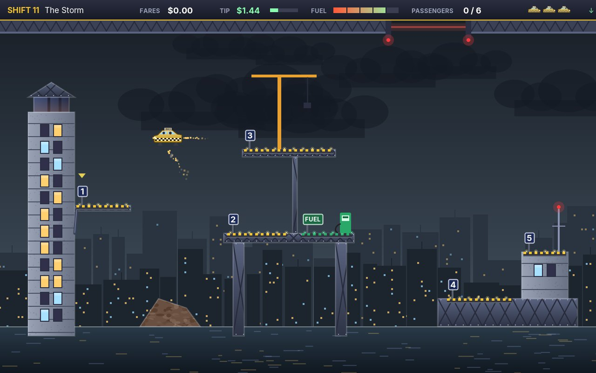
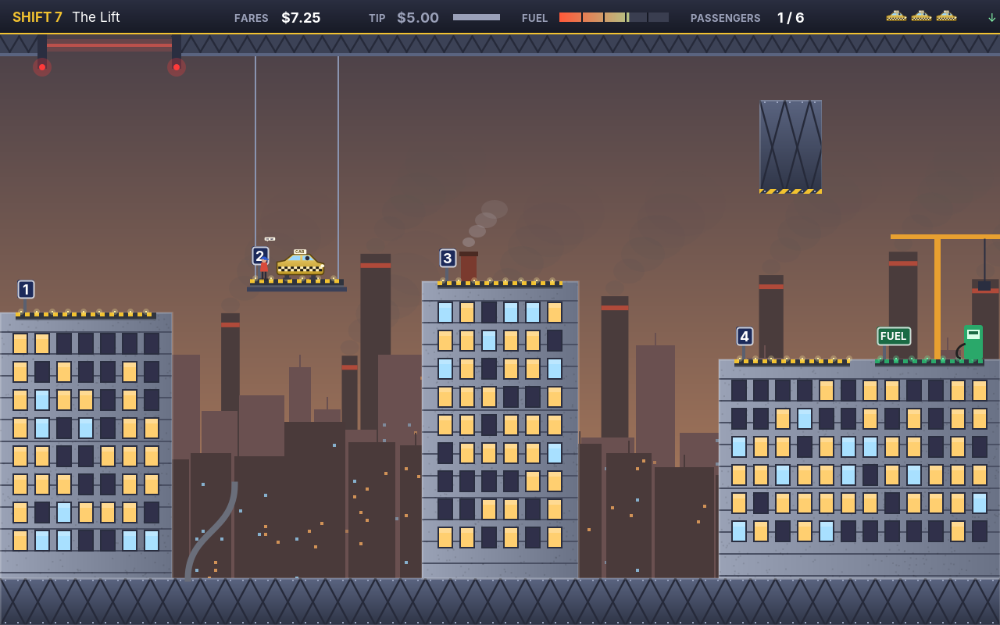
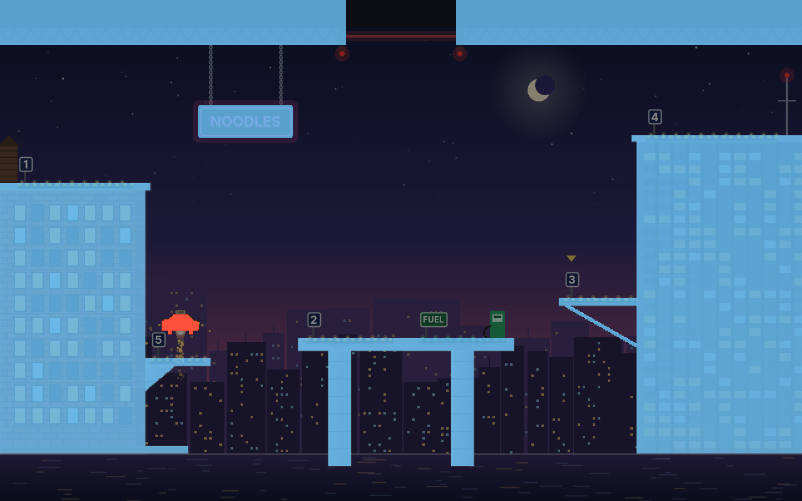
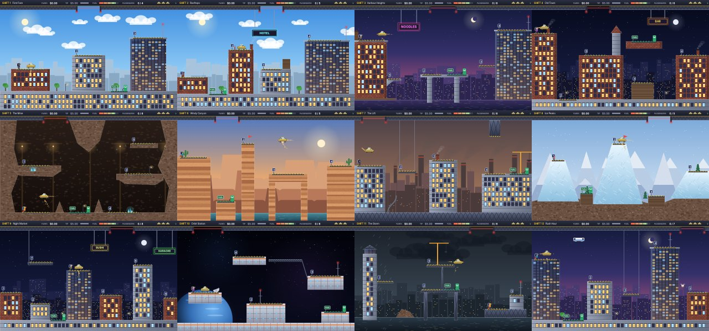
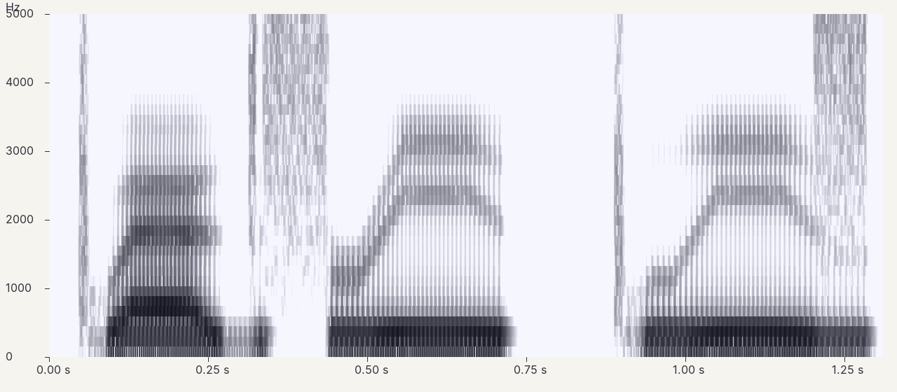
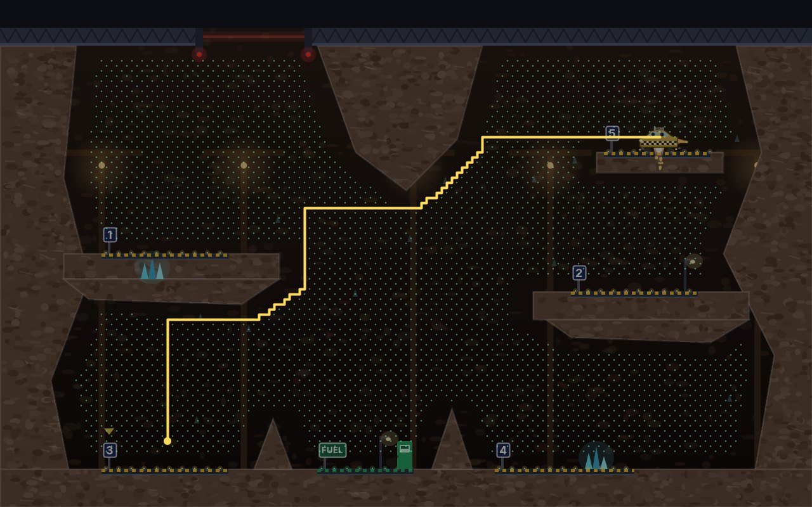
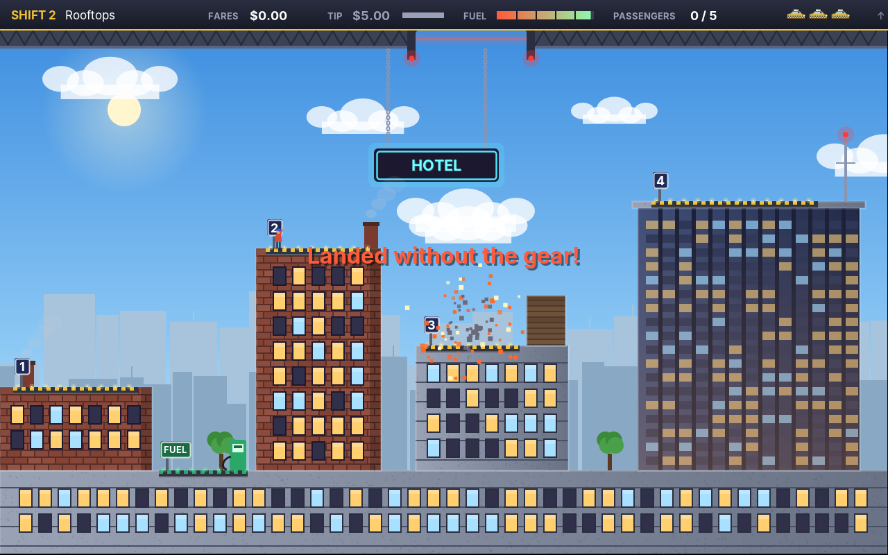
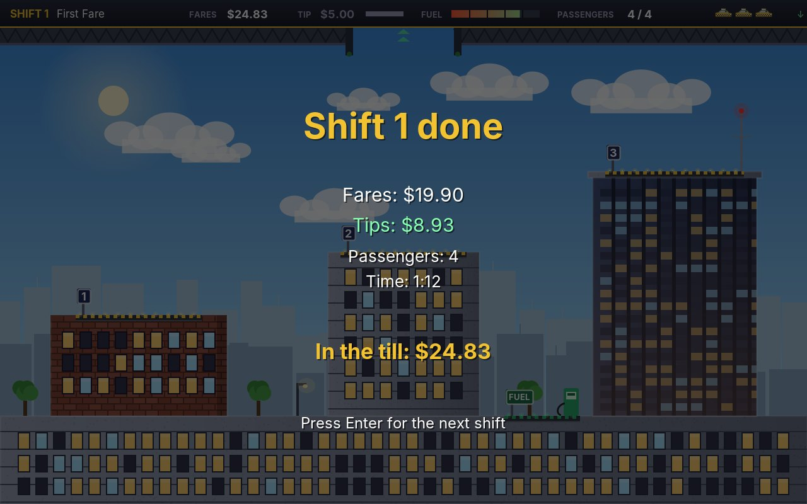
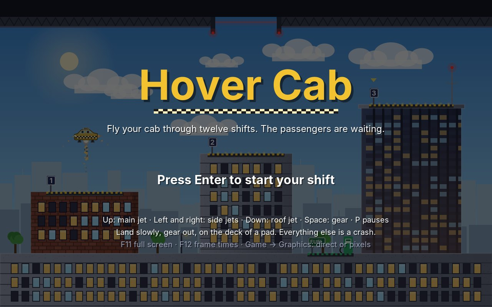

# 28. Hover Cab

In **Hover Cab** the player flies a cab through a city in the air. Nothing holds it up but its jets: one under the cab that lifts it against gravity, two at the sides that steer it, one on the roof that presses it down. A passenger waves on a numbered pad and calls "Hey, cab!"; the player lands next to them, gently, with the gear out, and they get in and say where to: "Pad 3, please!". Land there and they pay the fare and a tip that melts during the ride. The last passenger of a shift wants "Up, please!", the gate in the ceiling opens, and out through it the shift is done.

<figure markdown>
{ width="400" }
{ width="400" }
<figcaption>Harbour Heights at dusk (left), with the noodle bar's sign in the way and the sea below. The storm (right): the wind pushes the cab, and the rain shows how hard.</figcaption>
</figure>

Games of this kind go back to the arcade lunar landers of 1979: a craft, gravity, a little fuel and a flat place to put it down. The home computers of the early 1980s gave it a city and passengers who talked, out loud, through a chip that made speech without a single recording. This chapter makes all of that: the flight, the landing, collisions as exact as the pictures, levels as text, a pilot that proves every level can be flown, and a speech synthesizer, so the passengers talk too.

!!! abstract "What you will learn"
    - **Thrust against gravity**: jets that burn fuel, air that slows the cab, and why a craft needs drag to be steerable
    - **Landing**: soft, hard or a crash, from the speed at touchdown; standing on a lift
    - **Pixel-exact collisions** with bit masks: 64 pixels compared in one instruction
    - **Levels as text** again, now with polygons, beams, signs, lifts and moving vans
    - **Speech synthesis**: how a voice is made of a source and a filter, phonemes, formants, and a tune for the phrase
    - **An autopilot** made of a distance map and jets switched on and off: it flies the title screen and proves that every shift can be flown
    - Preparing expensive things **in the background** before they are needed

The complete game is in [amade-hover-cab-game](https://github.com/datazuul/amade-hover-cab-game).

## The rules

1. The screen is one shift: rooftops, pads, a ceiling with a gate. The cab starts on its start pad with a full tank and the gear out.
2. **Up** fires the main jet, **left** and **right** the side jets, **down** the roof jet. Every jet burns fuel; with an empty tank the cab falls.
3. **Space** moves the gear in or out. With the gear in, the cab is a little faster through the air, but it cannot land.
4. A **landing** needs the gear out, both legs on the deck of a pad, and a slow touchdown. A firm one is allowed, but the passenger complains and the tip loses a dollar. Anything else solid is a **crash**: a wall, a sign, a lift's underside, a moving van, the closed gate, the sea.
5. **Passengers** appear one after the other on their pad and call. Land on their pad, they walk over and get in; land on the pad they name, they pay the **fare** (two dollars and one for every hundred units of distance) and the **tip** (five dollars, melting by twenty cents a second).
6. The green **fuel pad** fills the tank while the cab stands on it, for money.
7. The last passenger wants **up**: the gate opens, and flying through it ends the shift.
8. Three spare cabs at the start, and one more for every hundred dollars earned. Twelve shifts; the money earned enters the high scores.

## Step 1: Jets against gravity

The cab is a `Body` from chapter 27: a box with a speed. Jump gave its bodies a speed when a button was pressed; a cab's jets are different, they **push**. A push is an acceleration, like gravity: as long as the jet burns, the speed changes, a little in every step. The engine's `Thrusters` know the jets of a craft and how hard each pushes:

```java title="amade-game-engine · physics/Thrusters.java"
--8<-- "amade-game-engine/src/main/java/eu/amadeos/gameengine/physics/Thrusters.java:thrusters"
```

How strong should the jets be? The numbers are again in one place:

```java title="amade-hover-cab-game · domain/Field.java"
--8<-- "amade-hover-cab-game/src/main/java/eu/amadeos/games/hovercab/domain/Field.java:physics"
```

The main jet pushes with 1.9 times gravity. Together with gravity, that lifts the cab at 0.9 g, about as fast as it falls without the jet: going up and coming down feel the same. A main jet of exactly 1 g could only hover; one of 3 g would be impossible to hold still. The side jets push with about 1 g, enough to stop the cab from its cruising speed over a third of the screen.

The fuel burned is in proportion to the push, and with less fuel left than a step needs, the jets push only for that part of the step. No jet ever pushes with fuel the tank does not have:

```java title="amade-game-engine · test/physics/ThrustersTest.java"
--8<-- "amade-game-engine/src/test/java/eu/amadeos/gameengine/physics/ThrustersTest.java:test-thrusters"
```

### Why a cab needs air

The first version had jets and gravity and nothing else, and it could not be flown. A tap on the side jet set the cab drifting, and it drifted until the opposite jet stopped it, which needed a tap of exactly the same length. In space that is right; in a city it feels like steering a bar of soap. Real air slows everything that moves through it, and the faster it moves, the more. That is **drag**, and it is one line:

```java title="amade-game-engine · physics/Body.java"
--8<-- "amade-game-engine/src/main/java/eu/amadeos/gameengine/physics/Body.java:drag"
```

`drag(0.2, seconds)` takes away a fifth of the speed each second, whatever the step: (1 − 0.2)^*t* is left after *t* seconds, the same formula as the camera's smoothing in chapter 27. With the gear out, the legs catch more air and the cab slows faster: the gear is a brake too. The orbit station has almost no air, and there the cab drifts nearly as it did in the first version, on purpose.

Air also limits the speed by itself. A side jet that keeps pushing gains less and less, because the faster the cab, the more speed the air takes each second; the speed levels off where the two are equal. Falling, `Field.MAX_FALL` comes first.

A step of the cab adds the pushes in a fixed order: jets, wind, gravity, air:

```java title="amade-hover-cab-game · domain/Game.java"
--8<-- "amade-hover-cab-game/src/main/java/eu/amadeos/games/hovercab/domain/Game.java:push"
```

The wind is a push like the jets, steady, or in gusts that swell and fade with a sine. In the storm the wind blows steadily to the left, and a gust adds up to 55 more: 65 units per second per second against the side jets' 104. Against a gust the player has not much to spare.

## Step 2: Touching down

Moving the cab is simple: by its speed, both axes at once. Jump moved its bodies one axis at a time, because a body in a grid of tiles has to know whether it hit a wall or a floor. A cab does not care: anything it hits is a crash, except one thing, a deck coming from above:

```java title="amade-hover-cab-game · domain/Game.java"
--8<-- "amade-hover-cab-game/src/main/java/eu/amadeos/games/hovercab/domain/Game.java:move"
```

A landing is found before any collision. In this step the cab's bottom crossed the deck's top, it came from above, and both legs are on the deck. Then the speed decides. A cab that comes down at 30 units a second lands; at 120 it breaks its legs. In between is a range where it lands hard. That is not Hover Cab's own idea: every lander, every jump onto a platform with a fall damage, every helicopter game has it. So it is the engine's:

```java title="amade-game-engine · physics/Touchdown.java"
--8<-- "amade-game-engine/src/main/java/eu/amadeos/gameengine/physics/Touchdown.java:touchdown"
```

The sideways speed counts double: a cab that slides onto a deck at 25 units a second tips over sooner than one that sits down at 25. What the game does with each kind of touchdown is its own business:

```java title="amade-hover-cab-game · domain/Game.java"
--8<-- "amade-hover-cab-game/src/main/java/eu/amadeos/games/hovercab/domain/Game.java:touchdown"
```

### Lifts

In *The Lift*, a pad goes up and down. It moves along a cosine, slow at the top and bottom, fast in the middle, and its speed is the derivative, so the two always agree:

```java title="amade-hover-cab-game · domain/Pad.java"
--8<-- "amade-hover-cab-game/src/main/java/eu/amadeos/games/hovercab/domain/Pad.java:lift"
```

{ width="560" }

Landing on a moving deck needs the speed *against the deck*: a cab sinking at 50 onto a deck sinking at 30 lands at 20, softly. A cab standing on a lift is put on its deck in every step; it does not fall and land again sixty times a second.

!!! warning "Half a pixel"
    The lift was the source of the most puzzling bug of this game. Now and then, a cab standing quietly on a lift exploded. The cab's position was rounded to whole pixels for the collision with `Math.round`, the lift's box with `(int)`, which cuts off. At a deck height of 251.6, the cab was rounded to 236 + 16 = 252 at its bottom, the deck to 251: one pixel of overlap, a crash. The fix is to round both the same way, and to accept a landing up to one unit early. Whenever two things are compared in pixels, round them the same way.

## Step 3: Collisions as exact as the pictures

The cab is not a box: it has a cabin on top, a long low body and two thin legs. The scenery is not boxes either: a slanted strut under a balcony, a round neon sign, the jagged walls of a mine. With boxes, a cab would crash into the empty air beside a sign and feel cheated. With circles, as in Rocks, it would be no better. What is needed is to ask, **pixel by pixel**, whether the cab and the scenery have a solid pixel in the same place.

A picture of the cab is 32 × 16 pixels. Comparing pixel by pixel would be 512 tests per step, and the scenery is 640 × 400. Too slow? Not if each pixel is one **bit**. A `long` holds 64 of them, a row of the cab fits in one, and one AND of two longs compares 64 pixels at once:

{ width="640" }

The picture above is Harbour Heights as the rules see it: blue is solid, the rest is air. The engine's `PixelMask` keeps a row as longs, the leftmost pixel in the lowest bit:

```java title="amade-game-engine · collision/PixelMask.java"
--8<-- "amade-game-engine/src/main/java/eu/amadeos/gameengine/collision/PixelMask.java:mask"
```

`painted` is the trick that makes the masks easy to get right: the same shapes that are drawn are filled once more into an image, without antialiasing, and that image becomes the mask. The cab's outline is a path:

```java title="amade-hover-cab-game · domain/CabShape.java"
--8<-- "amade-hover-cab-game/src/main/java/eu/amadeos/games/hovercab/domain/CabShape.java:hull"
```

The painter draws this path in yellow with a checkered band, and `CabShape.mask` fills it, with or without the legs, facing right or left. **What is seen is what collides.** The shift's mask is made in the same way from the shapes of its blocks, polygons, beams and signs:

```java title="amade-hover-cab-game · domain/Shift.java"
--8<-- "amade-hover-cab-game/src/main/java/eu/amadeos/games/hovercab/domain/Shift.java:mask"
```

Comparing the two masks needs one more idea. The cab is at some *x*, rarely a multiple of 64, so each of its rows lies across two longs of the scenery's row. Shifting the cab's long left by the rest of *x* gives the part in the first, shifting it right by 64 minus that gives the part in the second:

```java title="amade-game-engine · collision/PixelMask.java"
--8<-- "amade-game-engine/src/main/java/eu/amadeos/gameengine/collision/PixelMask.java:overlaps"
```

For the cab, that is 16 rows of one or two ANDs: about 30 instructions per step for a collision as exact as the picture. `firstOverlap` also says *where* the first hit is, which the game uses to tell a crash into a deck with the gear in from a crash into a wall:

```java title="amade-hover-cab-game · domain/Game.java"
--8<-- "amade-hover-cab-game/src/main/java/eu/amadeos/games/hovercab/domain/Game.java:collision"
```

Lifts and moving vans are not in the scenery's mask, since they move. For them the cab's mask is asked whether any of its pixels lies in their box: exact on the cab's side, a box on theirs, which is right for their shapes.

```java title="amade-game-engine · test/collision/PixelMaskTest.java"
--8<-- "amade-game-engine/src/test/java/eu/amadeos/gameengine/collision/PixelMaskTest.java:test-mask"
```

!!! note "Java2D without a screen"
    `PixelMask.painted` draws into a `BufferedImage`, which works without a display, on a build server too. That is why the rules may use it: `domain` stays free of the user interface even though its masks are drawn with Java2D.

## Step 4: Shifts as text

Maze, Swarm and Blast kept their boards in text files; Jump moved to Tiled because its levels were grids of tiles. A shift of Hover Cab is no grid. It is a handful of shapes at free positions, and a text file describes it best, one thing per line:

```text title="amade-hover-cab-game · shifts/shift3.txt"
name Harbour Heights
theme dusk
sea 362
gate 276 364
start 2

block brick 0 150 116 212          # the old brick tower
block concrete 0 146 120 6         # its cornice
block concrete 116 286 52 6        # a ledge on its side
poly concrete 116 292 140 292 116 312
block wood 0 356 150 6             # the dock

block concrete 262 276 18 96       # the pier's legs and deck
block concrete 360 276 18 96
block concrete 238 270 172 10

block glass 508 112 132 250        # the glass tower
block concrete 504 108 136 5
block steel 446 238 62 6           # its balcony
beam 452 244 508 276

sign pink 158 84 76 26 NOODLES

pad 1 14 146 92
pad 5 120 286 44
pad 2 244 270 70
fuel 334 270 70
pad 3 450 238 54
pad 4 516 108 104

riders 1>4 5>3 4>2 3>1 2>5 1>up
```

The reader is `TextData` from chapter 24, with a `switch` over the first word of each line. Every mistake names the file and the line: a pad number used twice, a passenger to a pad that does not exist, a gate too narrow for the cab.

```java title="amade-hover-cab-game · domain/Shift.java"
--8<-- "amade-hover-cab-game/src/main/java/eu/amadeos/games/hovercab/domain/Shift.java:read"
```

### The still picture

All of a shift that does not move, the sky, the buildings with their windows, the signs, the pads, is drawn **once** into a picture the size of the screen and kept as an opaque sprite. Every frame copies it in one go; only the cab, the passengers, the lifts, the vans and the weather are drawn anew. Chapter 27 showed why opaque matters: a copy without blending.

```java title="amade-hover-cab-game · ui/game/Scenery.java"
--8<-- "amade-hover-cab-game/src/main/java/eu/amadeos/games/hovercab/ui/game/Scenery.java:sprite"
```

Each look of a block, brick, glass, concrete, steel, rock, ice, has its own painter: bricks in rows, lit and dark windows chosen by a random generator seeded with the block's position, so a building has the same lights every time.

```java title="amade-hover-cab-game · ui/game/Scenery.java"
--8<-- "amade-hover-cab-game/src/main/java/eu/amadeos/games/hovercab/ui/game/Scenery.java:material"
```

A pad has a deck with yellow and black edges, lights, and a sign with its number on a post, so the player can find "pad 3" at a glance:

```java title="amade-hover-cab-game · ui/game/Scenery.java"
--8<-- "amade-hover-cab-game/src/main/java/eu/amadeos/games/hovercab/ui/game/Scenery.java:pad"
```

{ width="720" }

The twelve shifts: two on the rooftops by day, a harbour at dusk, an old town, a mine, a canyon in the wind, a factory with a lift, snowy peaks, a night market, an orbit station with weak gravity and hardly any air, a storm at sea, and the rush hour with a van and a drone crossing the sky.

## Step 5: Passengers, fares and tips

A passenger is a small state machine: *coming* (not yet there), *waiting* on their pad and calling, *boarding* (walking to the cab's door), *riding*, *leaving* at their pad, *gone*. Each state knows what it waits for:

```java title="amade-hover-cab-game · domain/Game.java"
--8<-- "amade-hover-cab-game/src/main/java/eu/amadeos/games/hovercab/domain/Game.java:riders"
```

Two details make it fair. A cab that takes off while the passenger walks over leaves them standing; they walk back to their spot and wait again, without a penalty. And a passenger aboard during a crash is not lost: they wait on their pad for the next cab, with a fresh tip.

The fare is by the straight distance between the pads, the tip by the time the ride took, and a hard landing on the way costs a dollar of it:

```java title="amade-hover-cab-game · domain/Game.java"
--8<-- "amade-hover-cab-game/src/main/java/eu/amadeos/games/hovercab/domain/Game.java:arrive"
```

```java title="amade-hover-cab-game · domain/Field.java"
--8<-- "amade-hover-cab-game/src/main/java/eu/amadeos/games/hovercab/domain/Field.java:money"
```

The test flies a ride on a small shift written for it, a few lines of text in the test itself:

```java title="amade-hover-cab-game · test/domain/GameTest.java"
--8<-- "amade-hover-cab-game/src/test/java/eu/amadeos/games/hovercab/domain/GameTest.java:test-fare"
```

```java title="amade-hover-cab-game · test/domain/GameTest.java"
--8<-- "amade-hover-cab-game/src/test/java/eu/amadeos/games/hovercab/domain/GameTest.java:test-gate"
```

What happens reaches the user interface as events, as in Blast and Jump. A passenger speaking is one of them, with the call and the pad, but without the words: they are the user interface's business.

```java title="amade-hover-cab-game · domain/Event.java"
--8<-- "amade-hover-cab-game/src/main/java/eu/amadeos/games/hovercab/domain/Event.java:event"
```

## Step 6: Passengers who talk

The passengers' calls are the soul of this kind of game. Recordings would be the easy way: six speakers, six phrases, nine numbers, five languages. But this handbook makes its sounds from numbers, so the voices are made from numbers too, by the engine's `Speech`, a **formant synthesizer** of the kind that made the talking arcade machines and home computers of the early 1980s talk.

### How a voice is made

Say "aaa" and then "eee" without changing the pitch. The voice is the same, the vowel changes. That is the **source-filter** idea of speech, worked out in the 1940s and 50s:

- The **source** is the vocal folds in the throat. They let the air from the lungs out in puffs, about 110 times a second for a man, 200 for a woman, 280 for a child: that is the **pitch**. A narrow place in the mouth adds a hiss instead, for an *s* or an *f*.
- The **filter** is the throat and the mouth, a tube that rings at a few frequencies, the **formants**. Moving the tongue and the lips moves them. An *ee* has its second formant high, near 2300 Hz, because the tongue is in front; an *aa* has its first formant high, because the mouth is open.

A vowel is nothing but where its formants are. So a synthesizer needs the puffs, the hiss, a few resonators tuned to the formants, and a table of where the formants of each sound are. The sounds are written in the **ARPAbet**, the alphabet American speech research has used since the 1970s: `k ae1 b` is "cab", and the `1` stresses the vowel.

```java title="amade-game-engine · audio/Phoneme.java"
--8<-- "amade-game-engine/src/main/java/eu/amadeos/gameengine/audio/Phoneme.java:phoneme"
```

The numbers are textbook values, measured on many speakers. A consonant's formants are its **locus**: not something heard in the consonant itself, but where the formants of the vowel next to it seem to come from. A *b* is heard when they rise from low, a *d* when the second one comes from about 1700 Hz.

### The resonator

One formant is one resonator, the two-pole filter of Dennis Klatt's synthesizer of 1980. Each output sample is the input plus the last two outputs, weighted so that a tone at its frequency builds up and other tones die away. Three numbers, worked out from the frequency and the bandwidth:

```java title="amade-game-engine · audio/Speech.java"
--8<-- "amade-game-engine/src/main/java/eu/amadeos/gameengine/audio/Speech.java:resonator"
```

Five of them in a row are the mouth: F1 to F3 move with the phonemes, F4 and F5 stay put and give the voice its colour.

### A phrase

`Speech.say` turns a phrase into a `Sound`, sample by sample:

```java title="amade-game-engine · audio/Speech.java"
--8<-- "amade-game-engine/src/main/java/eu/amadeos/gameengine/audio/Speech.java:say"
```

Three things decide whether it sounds like speech or like a machine trying.

**The formants glide.** A tongue cannot jump from *k* to *ae*; it moves, and the ear listens for that movement more than for the sounds themselves. So the formants are not set per phoneme but pass through **anchors**: a vowel holds its formants through its middle, a diphthong like the *ay* of "five" glides from one vowel to another, a stop sits at its locus while the mouth is closed, so the vowel after it starts from there.

```java title="amade-game-engine · audio/Speech.java"
--8<-- "amade-game-engine/src/main/java/eu/amadeos/gameengine/audio/Speech.java:anchors"
```

**The sources fade.** Each kind of sound wants its own mix of voice, hiss and breath. A *p* is silence, a burst, then breath before the vowel; a *b* is the same with the voice humming through. The levels follow their targets within a few milliseconds instead of switching, or every phoneme would click:

```java title="amade-game-engine · audio/Speech.java"
--8<-- "amade-game-engine/src/main/java/eu/amadeos/gameengine/audio/Speech.java:source"
```

**The phrase has a tune.** Nobody speaks on one note. The voice starts a little high and sinks as the breath runs out, each stressed vowel rises in a small hump, a call starts higher with bigger humps, and a question rises at the end. A little vibrato of 4.5 Hz keeps the voice alive:

```java title="amade-game-engine · audio/Speech.java"
--8<-- "amade-game-engine/src/main/java/eu/amadeos/gameengine/audio/Speech.java:pitch"
```

A picture of the sound shows all of it. This is a **spectrogram** of "Pad 3, please!" in a man's voice: time from left to right, frequency from bottom to top, dark where the sound is loud. The dark bands are the formants. In *p ae d* they rise from the *p*; *th r iy* starts with hiss, and in *r iy* the second formant climbs from 1100 Hz to 2300 as the tongue moves forward; *p l iy z* has the same climb and ends in the hiss of the *z*.

{ width="720" }

### Voices

A voice is four numbers: its pitch, the size of its mouth as a factor on the formants (women's and children's mouths are smaller, so their formants are higher), its pace, and how breathy it is:

```java title="amade-game-engine · audio/Speech.java"
--8<-- "amade-game-engine/src/main/java/eu/amadeos/gameengine/audio/Speech.java:voice"
```

Hover Cab has six kinds of passengers, each with a voice of its own: a woman with a suitcase, a man in a hat, a boy, an old man with a stick, a younger woman, a builder with a deep voice:

```java title="amade-hover-cab-game · ui/game/People.java"
--8<-- "amade-hover-cab-game/src/main/java/eu/amadeos/games/hovercab/ui/game/People.java:voices"
```

The tests check what can be checked of a voice: that the vowels have their formants where the table says, measured with a Goertzel filter (one frequency of a Fourier transform, written in the test), and that a woman's voice is higher than a man's:

```java title="amade-game-engine · test/audio/SpeechTest.java"
--8<-- "amade-game-engine/src/test/java/eu/amadeos/gameengine/audio/SpeechTest.java:test-speech"
```

### Five languages

The words of the speech bubble and the phonemes of the voice both come from the message files. A German passenger calls "He, Taxi!" and sounds like it:

```properties title="amade-hover-cab-game · messages_de.properties (shortened)"
say.pad=Platz {0}, bitte!
voice.pad=p l ae1 t s / {0} , b ih1 t ax !
voice.number.3=d r ay1
```

The ARPAbet was made for English, but its sounds are enough for an accent in German, French, Spanish and Italian. A translator who adds a language writes the phrases twice: once in letters, once in phonemes. A test speaks every phrase in every language, so a mistyped phoneme fails the build.

### Speaking ahead

Speaking "Pad 3, please!" takes the synthesizer 12 to 19 milliseconds, and almost 60 the first time, while Java still compiles the code. A step of the game has 8. Spoken on the loop thread at the moment the passenger calls, the phrase would make the game stutter, every time. So the phrases are spoken **ahead**: when a shift starts, `Voices` hands everything its passengers may say to a thread of its own, at low priority, in the order the passengers come:

```java title="amade-hover-cab-game · ui/game/Voices.java"
--8<-- "amade-hover-cab-game/src/main/java/eu/amadeos/games/hovercab/ui/game/Voices.java:voices"
```

The cache is a `ConcurrentHashMap`, since two threads use it. If the loop asks for a phrase that is not ready yet, `computeIfAbsent` makes it there and then; that costs a stutter but never a missing voice. In practice the first passenger calls a second after the start, and by then the whole shift is spoken.

## Step 7: An autopilot

A shift drawn in a text file can be broken in ways no test of the rules finds: a pad under a beam with no room to land, a passage one unit too narrow for the cab, a corridor blocked by a lift at the wrong moment. Jump proved its levels with a search over every jump. A cab has no jumps, it has a continuous flight. So Hover Cab proves its shifts the most convincing way: something **flies** them, with the game's own rules, through every passenger and out of the gate. The same pilot flies on the title screen.

```java title="amade-hover-cab-game · domain/Autopilot.java"
--8<-- "amade-hover-cab-game/src/main/java/eu/amadeos/games/hovercab/domain/Autopilot.java:steer"
```

### Where to fly

The pilot plans on a grid of cab positions four units apart. A position is open if the cab, three units fatter all round, touches nothing there: the scenery by its mask, a lift or a van by the whole box it sweeps through. The margin is room for mistakes: a pilot that plans to pass a wall at one unit will hit it. From the hover point over the pad it wants, a `DistanceMap` (chapter 25) gives each open position its distance in steps, and from anywhere the next step downhill is a step on a shortest way:

{ width="640" }

The picture shows the mine with the open positions as dots and the planned way from pad 3 to pad 5 in yellow. The way is a staircase, because steps go only up, down, left and right. The cab does not fly the staircase: it looks four steps ahead and flies straight towards that point, which smooths the stairs into slants.

### How fast

The pilot wants a speed: towards the point ahead, as fast as it can still **stop** before the goal. A cab that brakes with *b* from the speed *v* needs *v*² / 2*b* to stop, so with *s* left, *v* = √(2*bs*): fast far away, slow near the goal. The braking it plans with is less than the jets can do, so some is left for surprises, and less again against a strong wind, which eats into the side jets.

A corner needs the same care. The way through the mine turns twice; a cab that arrives at a turn at full speed flies on into the rock. So the pilot also looks for the next **bend** in the way, where the heading over four steps turns by more than sixty degrees, and slows down to take it.

### Which jets

A jet is on or off; the pilot wants a speed. The answer is **bang-bang control**: in each step, fire a jet if that brings the cab's speed after the step nearer the wanted speed than not firing. Main jet against roof jet against neither, left against right against neither. On and off 120 times a second, the jets average out to just the push needed. Simple, and good enough for spacecraft too:

```java title="amade-hover-cab-game · domain/Autopilot.java"
--8<-- "amade-hover-cab-game/src/main/java/eu/amadeos/games/hovercab/domain/Autopilot.java:fly"
```

Over the pad it sinks slowly onto the deck, faster than the deck if the deck is a lift. Below half a tank it fills up first, if the shift has a fuel pad.

The test flies all twelve shifts:

```java title="amade-hover-cab-game · test/domain/AutopilotTest.java"
--8<-- "amade-hover-cab-game/src/test/java/eu/amadeos/games/hovercab/domain/AutopilotTest.java:test-autopilot"
```

While the shifts were made, it failed again and again, and every failure was worth it. Shift 4 had a fuel pad straight above a pad, and the pilot, "over the pad" by its *x*, sank onto the wrong one. Shift 7 had a piston that swept through the only corridor to pad 3. Shift 9 had pad 7 between two beams with no way in. In the storm the cab overshot every pad in a gust until the pilot learned to brake less against the wind. In the mine it flew into the rock at the corners until it learned bends. And the lift crashes of Step 2 were found by the pilot, not by a player.

## Step 8: Everything else

The keys and the gamepad are bound as in the earlier games; the gear is on **Space**, and on a pad on **X** or **Y**:

```java title="amade-hover-cab-game · ui/game/HoverCabGame.java"
--8<-- "amade-hover-cab-game/src/main/java/eu/amadeos/games/hovercab/ui/game/HoverCabGame.java:controls"
```

The play scene makes the game, prepares the voices, starts the tune, and in each step passes the input to the rules and the events to the effects:

```java title="amade-hover-cab-game · ui/game/HoverCabGame.java"
--8<-- "amade-hover-cab-game/src/main/java/eu/amadeos/games/hovercab/ui/game/HoverCabGame.java:play"
```

The effects turn the events into dust under a landing, a shake after a hard one, fire, smoke and sparks after a crash, a splash in the sea, a speech bubble and the voice when a passenger speaks:

```java title="amade-hover-cab-game · ui/game/Effects.java"
--8<-- "amade-hover-cab-game/src/main/java/eu/amadeos/games/hovercab/ui/game/Effects.java:react"
```

The jets leave a trail of exhaust, and each one hums while it fires:

```java title="amade-hover-cab-game · ui/game/Effects.java"
--8<-- "amade-hover-cab-game/src/main/java/eu/amadeos/games/hovercab/ui/game/Effects.java:exhaust"
```

The cab is drawn from `CabShape`'s outline, so the picture and the mask cannot disagree:

```java title="amade-hover-cab-game · ui/game/CabArt.java"
--8<-- "amade-hover-cab-game/src/main/java/eu/amadeos/games/hovercab/ui/game/CabArt.java:cab"
```

The painter copies the still picture and draws what moves on it, and the weather on top: rain slanted by the wind in the storm, snow on the peaks:

```java title="amade-hover-cab-game · ui/game/Painter.java"
--8<-- "amade-hover-cab-game/src/main/java/eu/amadeos/games/hovercab/ui/game/Painter.java:paint"
```

```java title="amade-hover-cab-game · ui/game/Painter.java"
--8<-- "amade-hover-cab-game/src/main/java/eu/amadeos/games/hovercab/ui/game/Painter.java:weather"
```

The top bar shows the shift, the money, the melting tip, the fuel gauge, the passengers and the spare cabs; a speech bubble points at whoever speaks:

```java title="amade-hover-cab-game · ui/game/Hud.java"
--8<-- "amade-hover-cab-game/src/main/java/eu/amadeos/games/hovercab/ui/game/Hud.java:status"
```

```java title="amade-hover-cab-game · ui/game/Hud.java"
--8<-- "amade-hover-cab-game/src/main/java/eu/amadeos/games/hovercab/ui/game/Hud.java:bubble"
```

<figure markdown>
{ width="400" }
{ width="400" }
<figcaption>A crash (left), and the card at the end of a shift (right), with the fares, the tips and the time.</figcaption>
</figure>

{ width="560" }

`./gradlew benchmark` measures every shift: 1 to 2 ms per frame at 1280 × 800 and 2 to 3 ms at 1920 × 1200 on the computer this chapter was written on, drawing in software. The still picture of each shift is what makes it cheap. Full screen (F11, chapter 20), the render modes, the frame times (F12), sound and the five languages work as in the earlier games.

## What moved into the engine

| From Hover Cab | Engine package | Why |
|---|---|---|
| Speech from phonemes: a formant synthesizer with voices, a tune and five resonators | `eu.amadeos.gameengine.audio.Speech`, `Phoneme` | Characters who talk without recordings, in any language |
| Bit masks of pixels, made from shapes or pictures, compared 64 pixels at a time | `eu.amadeos.gameengine.collision.PixelMask` | Collisions as exact as the pictures |
| Jets that push and burn fuel | `eu.amadeos.gameengine.physics.Thrusters` | Every craft that flies against gravity: landers, jetpacks, ships |
| Soft, hard or a crash, from the speed at touchdown | `eu.amadeos.gameengine.physics.Touchdown` | Every landing and every fall with damage |
| Air that slows a body, whatever the step | `eu.amadeos.gameengine.physics.Body.drag` | Everything that flies or floats |

What stays in the game: the cab and its shape, the shifts and their reader, pads, lifts and movers, the passengers and their calls, fares and tips, the autopilot, the scenery, the painter, the voices of the six kinds of passengers, the sounds and tunes, and the scenes.

## Exercises

1. **A shift of your own.** Copy `shift3.txt` to `shift13.txt`, change it, and add it to the list of shifts and the texts. Put a pad where the cab cannot land and read what `AutopilotTest` says.
2. **Say more.** Passengers could comment on a long wait ("Finally!") or a fast ride ("Wow!"). Add a call, its words and its phonemes in five languages, and decide which event says it.
3. **A voice of your own.** Make a robot voice for a passenger in the orbit station: no pitch movement at all, and a buzz instead of puffs. Which parts of `say` change?
4. **Tilt.** The cab is always level. Let the side jets tilt it a few degrees, drawn and in its mask (a rotated `PixelMask` per few degrees, made once). Does landing get harder?
5. **Fuel pads that run dry.** Give the fuel pad a stock that lasts for a few fills per shift. How does the autopilot have to change?
6. **A second autopilot.** The pilot brakes for corners by a rule. Write a pilot that searches over jet inputs instead, a few steps ahead with the real `Game.update`, like Jump's level check. Which one flies better, and which one is faster?

---

Hover Cab ends Part II. In **Part III**, the camera looks down on a map instead of from the side, and the player commands many units with the mouse instead of steering one: first **Towers**, a tower defence, then **Sands**, a real-time strategy game.
