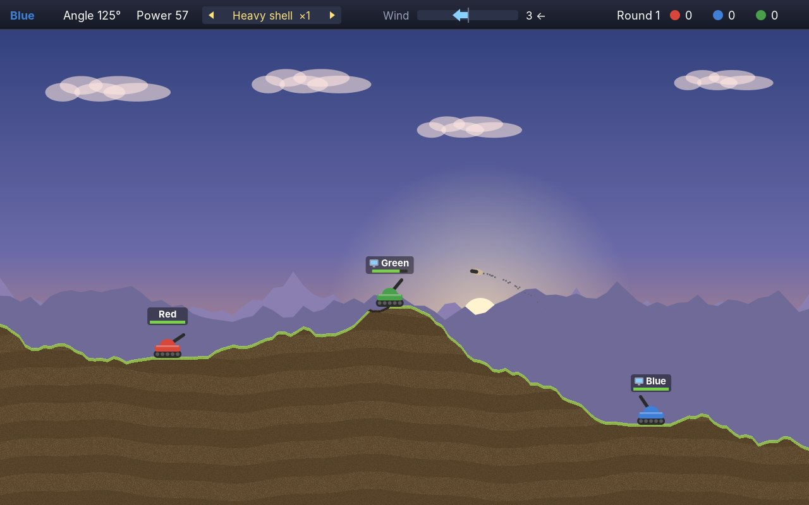
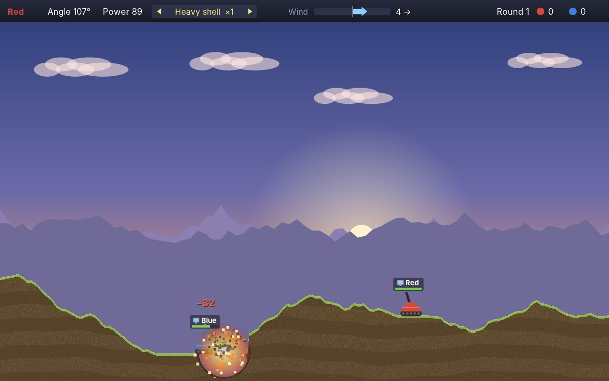
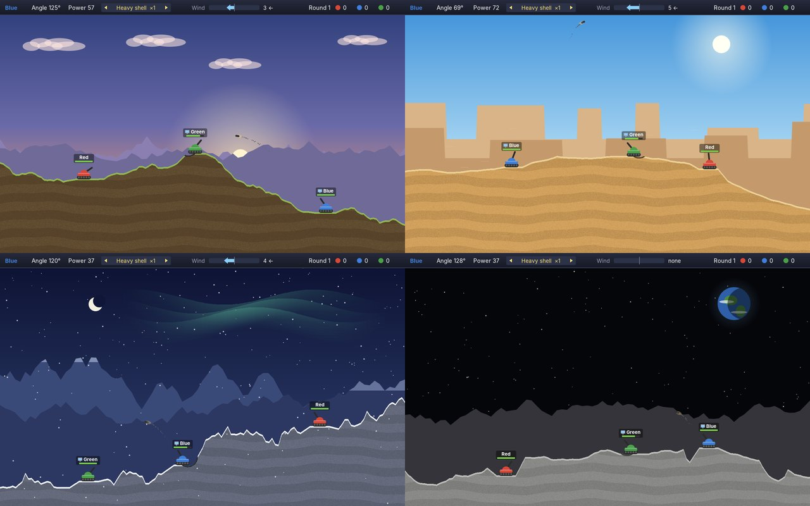
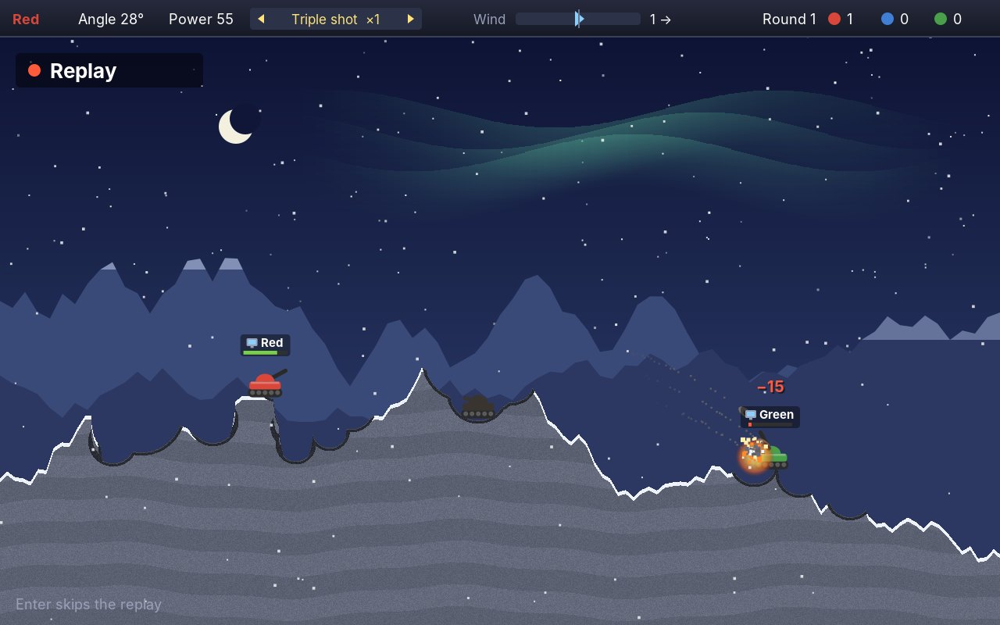
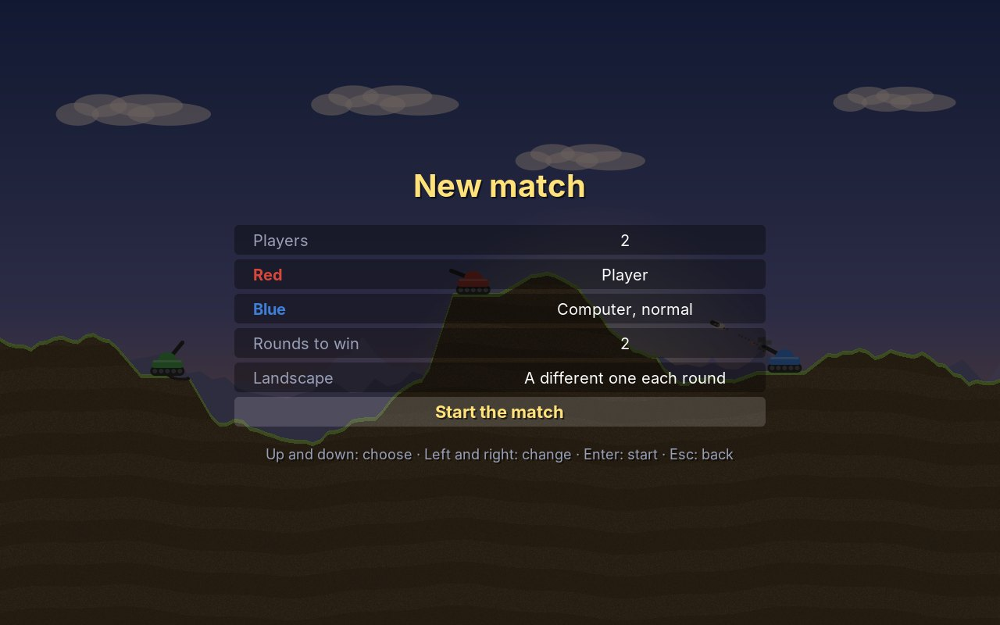
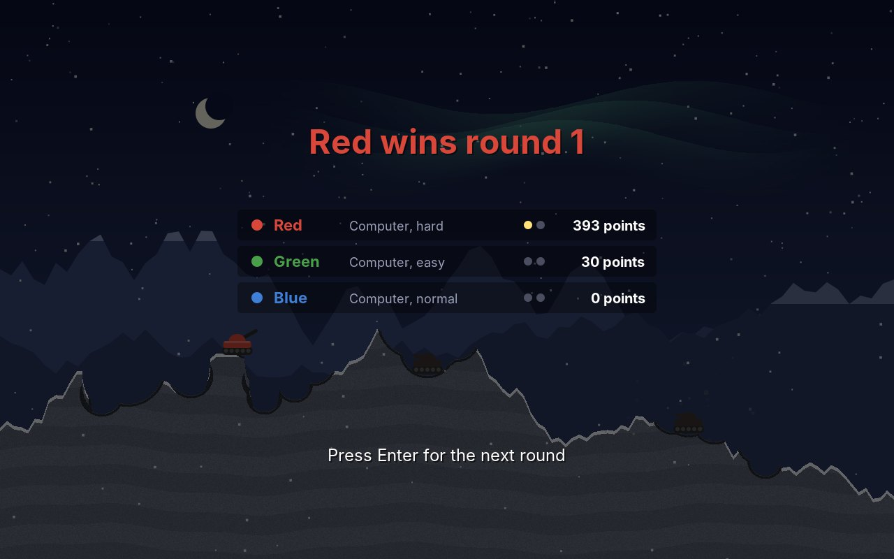
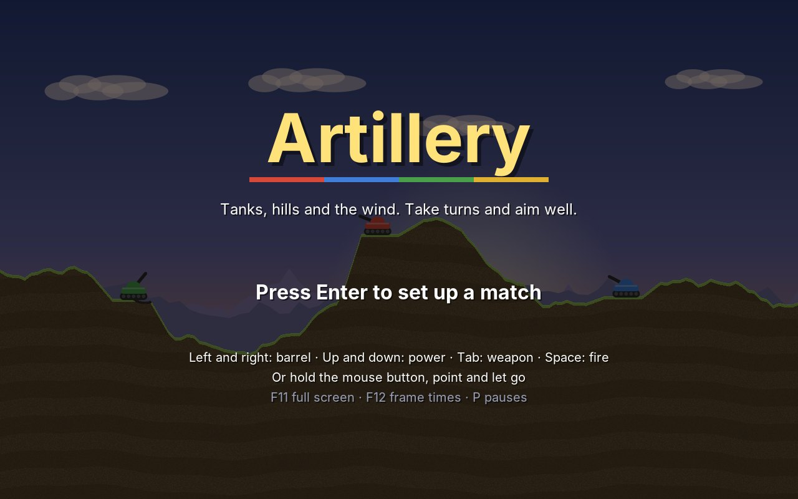

# 29. Artillery

In **Artillery** two to four tanks stand on a landscape of hills and valleys and take turns. The player whose turn it is sets the barrel's angle and the shot's power, looks at the wind, and fires. The shell flies in an arc, the wind pushes it, and where it lands it blasts a crater out of the ground. Earth that loses its support falls down, and a tank whose ground is shot away falls with it. The last tank standing wins the round; whoever first wins enough rounds wins the match.

<figure markdown>
{ width="400" }
{ width="400" }
<figcaption>Three tanks in the alpine valley (left); the dots behind the shell show where it has flown. A heavy shell lands (right): the crater is cut out of the ground, the tank next to it loses 32 points of health.</figcaption>
</figure>

Artillery games are among the oldest computer games: tanks or cannons on a line of hills, an angle, a speed, gravity, and the question whether the shot will clear the hill. They were typed in from magazines on the first home computers, and in the early 1990s they grew into games with many weapons, many players at one keyboard and ground that crumbled. This chapter makes such a game: ground that breaks apart cell by cell, landscapes from random numbers, shells under gravity and wind, a computer opponent that aims by trying shots in its head, and the replay of the shot that decided the round.

!!! abstract "What you will learn"
    - **Destructible ground** as a grid of cells: craters, heaped earth, earth that falls, and drawing only what changed
    - **Landscapes from random numbers** by midpoint displacement, with level places for the tanks
    - **Ballistics**: a shell under gravity and wind, and why it must not jump through a thin hill
    - **Turns**: whose turn it is, who is out, when a round is decided
    - **A computer that aims** by firing shots in thought with the real rules, and a level that is just the size of its mistakes
    - **A replay without a recording**: the battle copied before the shot, fired again with the same aim
    - The **mouse** as a second way to aim, next to the keys and the gamepad

The complete game is in [amade-artillery-game](https://github.com/datazuul/amade-artillery-game).

## The rules

1. Before a match, a card sets it up: two to four players, for each tank a person or the computer at one of three levels, the rounds needed to win (one to five) and the landscape (one of four, or a different one each round).
2. A round starts on a new landscape. The tanks stand on level places spread over it, in a random order; the players take turns, and the first turn moves on by one seat each round.
3. **Left** and **right** turn the barrel by a degree per tap, faster when held; **up** and **down** set the power. **Tab** chooses the weapon, **Space** fires. With the mouse: hold the button, point, and let go.
4. The **wind** pushes every shell. It changes by up to four points each turn, never beyond ten. On the moon there is none, and gravity is weaker.
5. A shell explodes where it touches earth, a tank, or the bottom of the world. It blasts a crater, and every tank within reach of the blast loses health, more the closer it was. A shell that flies off the side of the field is gone.
6. Earth over a hole falls down. A tank whose ground is gone falls too, and a fall deeper than a few units hurts it. A tank without health is a wreck, and a moment later the wreck explodes as well.
7. Four weapons: the **shell**, as many as wanted; the **heavy shell**, a bigger blast; the **triple shot**, three shells fanned out; the **dirt shot**, which heaps up earth instead of blasting it away. Every tank has two of each special weapon per round.
8. One tank left wins the round; none left, nobody wins it. Points: one for each point of damage dealt to others, 50 for a tank destroyed, 100 for a round won. A match won by a person enters the high scores with its points.

## Step 1: Ground that breaks

In every game so far the world was made of things: bricks, walls, tiles, platforms. Something either stood there or it did not. The ground of Artillery is different. A shell takes a round bite out of it wherever it lands, a bite of any size, and the ground keeps the hole. The ground has to be made of small pieces.

The engine's `Ground` is a grid of **cells**, each a byte: 0 for air, any other number for a kind of earth. The game says what the numbers mean; Artillery has soil, a grassy (or sandy, or snowy) top layer, heaped dirt and scorched earth. A cell is half a unit, so the field of 640 × 400 units is 1280 × 800 cells, about a million bytes:

```java title="amade-game-engine · terrain/Ground.java"
--8<-- "amade-game-engine/src/main/java/eu/amadeos/gameengine/terrain/Ground.java:ground"
```

The cells are stored **column after column**, not row after row as an image is. Nearly everything the game asks of the ground runs down a column: where is the surface under this tank, does this column hang over air, which cell falls next. With the cells of a column next to each other in memory, those questions read memory in order, which is what processors are fastest at.

A crater is the cells within a radius set to air. Heaping earth is the opposite, air within a radius set to earth; the scorch around a crater changes the kind of the earth that is there. All three are one loop over the square around the circle:

```java title="amade-game-engine · terrain/Ground.java"
--8<-- "amade-game-engine/src/main/java/eu/amadeos/gameengine/terrain/Ground.java:carve"
```

### Earth that falls

After a crater, earth can hang in the air: the rim of a crater dug from below, the roof of a tunnel, a ledge whose foot was shot away. Each step, `settle` moves every piece of earth that has air under it down by one cell. It walks a column from the bottom up, so a whole run of earth moves together, and it does that `passes` times per step. With two passes a step and 120 steps a second, earth falls at 120 units a second: fast, but slow enough to watch.

```java title="amade-game-engine · terrain/Ground.java"
--8<-- "amade-game-engine/src/main/java/eu/amadeos/gameengine/terrain/Ground.java:settle"
```

Looking at every one of the 1280 columns in every step would be wasted work: nearly all of them rest. The ground keeps a set of **loose** columns, those a crater or a heap touched. `settle` looks only at those, and drops a column from the set once nothing in it moves any more. Between two shots, the set is empty and `settle` costs nothing.

```java title="amade-game-engine · test/terrain/GroundTest.java"
--8<-- "amade-game-engine/src/test/java/eu/amadeos/gameengine/terrain/GroundTest.java:test-ground"
```

!!! note "Not sand"
    Earth here falls straight down, column by column; it does not slide sideways into a slope as sand would. A steep wall left by a crater stays a wall. That keeps the rule simple and the ground predictable, and a player can still dig a tank out of its hole by shooting next to it. Sand that flows is exercise 2.

### Drawing only what changed

The ground also remembers which columns changed since it was last asked, and `takeChanges()` returns them as a range. The picture of the ground is an image with one pixel per cell, kept in the game, and only those columns are painted again. Each cell gets the colour of its kind, a little speckled so it looks like earth and not like a flat colour; the soil gets waving bands; the topmost cell of each run of earth is lighter, so the edge catches the light:

```java title="amade-artillery-game · ui/game/GroundPainter.java"
--8<-- "amade-artillery-game/src/main/java/eu/amadeos/games/artillery/ui/game/GroundPainter.java:paint"
```

The speckle has to be the same for a cell every time it is painted, or the earth around a crater would flicker. So it is not a random number but a **hash** of the cell's column and row: a fixed jumble of the two numbers that looks random but always gives the same answer.

## Step 2: A landscape

A landscape is a line: a height for every x. Hills that look natural have large shapes and small details at once, and a simple way to get both is **midpoint displacement**. Start with the two ends at random heights. Put a point halfway between them, at their average height moved up or down by a random amount. Then do the same for the two halves, with a smaller amount, and again for the quarters, and so on. The first moves make the mountains, the last ones the bumps.

```java title="amade-game-engine · terrain/Landscape.java"
--8<-- "amade-game-engine/src/main/java/eu/amadeos/gameengine/terrain/Landscape.java:generate"
```

How much smaller each move gets is the **roughness**. With 0.5, each halving of the distance halves the move, and the hills are gentle; with 0.7, the small moves are still large, and the line becomes jagged like a ridge of rock. The four landscapes of the game differ in the height of the line, the size of the first move and the roughness, and two of them in gravity and wind:

```java title="amade-artillery-game · domain/Theme.java"
--8<-- "amade-artillery-game/src/main/java/eu/amadeos/games/artillery/domain/Theme.java:themes"
```

`Landscape` has a few more tools for a line: `clamp` keeps it between two heights, `flatten` makes a stretch level, `bump` raises or sinks a smooth hump. The valley gets a deep dip in the middle, the moon a few old craters. Then each tank gets a slot of the field and a place somewhere in the middle of it, and the line is made level there, with a gentler slope on both sides so the shelf is not a step. The seats are shuffled over the slots: otherwise the first player would always stand on the left.

```java title="amade-artillery-game · domain/Battle.java"
--8<-- "amade-artillery-game/src/main/java/eu/amadeos/games/artillery/domain/Battle.java:create"
```

`Landscape.sample` turns the line of 129 heights into a function of x, straight between the points, and `Ground.fill` fills every column from that height down. The layering function decides the kind of each cell from its depth below the surface: the top two and a half units are the top layer, the rest is soil.

<figure markdown>
{ width="640" }
<figcaption>The four landscapes. The alpine valley at sunset, the dunes under a white sun with mesas behind, winter peaks under the northern lights, and the moon with the Earth in its black sky.</figcaption>
</figure>

Behind the ground, each landscape has its sky and far view: the setting sun, mountains with snow on their tops, mesas, the northern lights, the stars. It is drawn with shapes once, into a sprite, and copied in every frame, as Hover Cab's scenery was. It stays still when the ground shakes after a blast:

```java title="amade-artillery-game · ui/game/Backdrop.java"
--8<-- "amade-artillery-game/src/main/java/eu/amadeos/games/artillery/ui/game/Backdrop.java:paint"
```

## Step 3: Shells in the air

A shell is a `Projectile`: a position and a velocity, nothing more. It is fired from the muzzle of the barrel, at an angle and with a speed:

```java title="amade-game-engine · physics/Projectile.java"
--8<-- "amade-game-engine/src/main/java/eu/amadeos/gameengine/physics/Projectile.java:launch"
```

Angles are counted as on a protractor: 0 to the right, 90 straight up, 180 to the left. On the screen, y grows downwards, so "up" is a negative y speed; that minus sign is in `launch` and nowhere else.

In flight, two forces act on the shell, gravity down and the wind sideways. Both are **accelerations**, like the jets of Hover Cab: they change the velocity a little each step. `Ballistics` knows them and moves a shell by one step:

```java title="amade-game-engine · physics/Ballistics.java"
--8<-- "amade-game-engine/src/main/java/eu/amadeos/gameengine/physics/Ballistics.java:ballistics"
```

First the velocity changes, then the shell moves with the new velocity: **semi-implicit Euler**. For a shell under steady forces the order hardly matters; what matters is that every flight, fired or only tried, uses the same one. And then the important part: the shell does not just jump to its new position. A shell at full power moves almost three units in a step, and a ridge of earth can be thinner than that. Checking only where the shell ends up, it could jump right through the ridge. So the step looks at points along the way, half a unit apart, and stops at the first one that is solid. That is the same problem Paddle solved for its ball with a [swept collision](20-paddle.md#swept-collision), solved here by sampling, because the ground is not a box but any shape at all.

What is solid is the game's business. For the battle it is the ground, the tanks that still live and the bottom of the field:

```java title="amade-artillery-game · domain/Battle.java"
--8<-- "amade-artillery-game/src/main/java/eu/amadeos/games/artillery/domain/Battle.java:fly"
```

How fast is a shell? The numbers are in one place again:

```java title="amade-artillery-game · domain/Field.java"
--8<-- "amade-artillery-game/src/main/java/eu/amadeos/games/artillery/domain/Field.java:physics"
```

A shell fired at 45 degrees with speed *v* flies *v*² / *g* far on level ground: 330² / 120 is about 900 units at full power, more than the width of the field. So the power slider covers every distance, and the middle of it is where most shots are. On the moon, gravity is 0.4 of that, and a shell would fly two and a half times as far with the same power. The battle scales the speed by the square root of the gravity, so that the same power reaches the same distance on every landscape and the moon is different only in how high and slow the shells fly.

### A whole flight

`fly` runs the same steps until the shell hits something, leaves the field at a side or the bottom, or runs out of time. Above the top of the field it may come back: a high shot leaves the screen and falls in again. The computer uses `fly` to try shots without firing them (Step 5), and for that to work, a tried shot must land **exactly** where the same shot fired for real lands. It does, because `fly` is nothing but `step` again and again, with the same step size:

```java title="amade-game-engine · physics/Ballistics.java"
--8<-- "amade-game-engine/src/main/java/eu/amadeos/gameengine/physics/Ballistics.java:fly"
```

```java title="amade-game-engine · test/physics/BallisticsTest.java"
--8<-- "amade-game-engine/src/test/java/eu/amadeos/gameengine/physics/BallisticsTest.java:test-ballistics"
```

## Step 4: A turn

A turn has phases. While the player **aims**, nothing moves but the barrel. Then the shells are in **flight**. When they have all landed, the battle **settles**: blasts fade, earth falls, tanks fall with it, wrecks explode. Only when all of that has been quiet for half a second is the turn over, and the next tank aims. Each step of the battle does what its phase allows:

```java title="amade-artillery-game · domain/Battle.java"
--8<-- "amade-artillery-game/src/main/java/eu/amadeos/games/artillery/domain/Battle.java:update"
```

### Aiming

Aiming needs to be quick and exact at once. A tap of the key turns the barrel by exactly one degree, so a player can correct a shot by "two degrees higher"; held for longer than a third of a second, it turns on by itself at 40 degrees a second. The power works the same way. The mouse and the computer do not turn the barrel at all, they set the angle and the power they want; both kinds of input go through the same `Input`:

```java title="amade-artillery-game · domain/Battle.java"
--8<-- "amade-artillery-game/src/main/java/eu/amadeos/games/artillery/domain/Battle.java:aim"
```

```java title="amade-artillery-game · test/domain/BattleTest.java"
--8<-- "amade-artillery-game/src/test/java/eu/amadeos/games/artillery/domain/BattleTest.java:test-aim"
```

### Firing

Firing makes the shells of the weapon at the muzzle, fanned out by four degrees for the triple shot. One of them is **traced**: its path is kept as a row of points, which the screen shows as dots during the tank's next turn. A player sees where the last shot went and can correct it, which is how real gunners aimed too. A barrel buried in a heap of dirt fires into the dirt.

```java title="amade-artillery-game · domain/Battle.java"
--8<-- "amade-artillery-game/src/main/java/eu/amadeos/games/artillery/domain/Battle.java:fire"
```

The weapons are an enum with the size of their blast, their damage, how many shells they fire, and how many a tank has per round:

```java title="amade-artillery-game · domain/Weapon.java"
--8<-- "amade-artillery-game/src/main/java/eu/amadeos/games/artillery/domain/Weapon.java:weapons"
```

### Landing

Where a shell lands, the earth around it is scorched and the crater is carved. Every tank within reach takes damage: the full damage within three units of the centre, less further away, nothing at the edge of the blast. The shooter is credited with the damage it did to others, which becomes its points. A shell of dirt only heaps up earth:

```java title="amade-artillery-game · domain/Battle.java"
--8<-- "amade-artillery-game/src/main/java/eu/amadeos/games/artillery/domain/Battle.java:land"
```

```java title="amade-artillery-game · test/domain/BattleTest.java"
--8<-- "amade-artillery-game/src/test/java/eu/amadeos/games/artillery/domain/BattleTest.java:test-hit"
```

### What follows

Then the consequences, one step at a time. A wreck explodes after a third of a second and can destroy a neighbour, whose wreck explodes too. The ground settles. Each tank looks at the highest earth under its tracks; if that is lower than the tank, the tank falls, with gravity, and when it lands, a fall deeper than eight units costs health. The damage of a fall goes to the shooter's account as well: digging the ground out from under a tank is a fair way to hurt it.

```java title="amade-artillery-game · domain/Battle.java"
--8<-- "amade-artillery-game/src/main/java/eu/amadeos/games/artillery/domain/Battle.java:aftermath"
```

### Whose turn

Who comes next is the engine's `TurnOrder`: the players in their order, a test for "still in play", and the current one. `next()` skips the players who are out; the round is `decided()` when one or none is left. It knows nothing about tanks, so a card game or a board game can use it as well:

```java title="amade-game-engine · turn/TurnOrder.java"
--8<-- "amade-game-engine/src/main/java/eu/amadeos/gameengine/turn/TurnOrder.java:turns"
```

```java title="amade-game-engine · test/turn/TurnOrderTest.java"
--8<-- "amade-game-engine/src/test/java/eu/amadeos/gameengine/turn/TurnOrderTest.java:test-turns"
```

At the end of each turn the wind changes, by a random amount of up to four points. A wind that jumped from anything to anything would make every shot a lottery; a wind that drifts lets a player learn from the last shot and still has to be watched:

```java title="amade-artillery-game · test/domain/BattleTest.java"
--8<-- "amade-artillery-game/src/test/java/eu/amadeos/games/artillery/domain/BattleTest.java:test-wind"
```

## Step 5: The computer aims

How does a computer aim at a tank behind a hill, against the wind? The physics of a shell without wind on level ground has a formula; with wind, a hill in the way and a target higher than the gun, the formula becomes a puzzle. But the computer does not need a formula. It has the rules. It can **fire shots in thought**: copy the shell, fly it with `Ballistics.fly` over the real ground, and see where it lands. Do that for many angles and powers, and keep the one that lands nearest the target.

Trying every angle from 5 to 175 degrees in steps of a degree, and every power in steps of one, would be 17,000 flights. The engine's `ShotSolver` is cleverer: it tries a coarse grid first, every fourth degree and every fifth point of power, then looks closer around the best of those, with half the steps, and closer again, five times:

```java title="amade-game-engine · ai/ShotSolver.java"
--8<-- "amade-game-engine/src/main/java/eu/amadeos/gameengine/ai/ShotSolver.java:solver"
```

That is about five hundred flights, about ten milliseconds. The search could miss a good shot that lies between two points of the coarse grid and is surrounded by bad ones, but shots are forgiving: a slightly different angle lands slightly elsewhere, so a good shot is never alone.

```java title="amade-game-engine · test/ai/ShotSolverTest.java"
--8<-- "amade-game-engine/src/test/java/eu/amadeos/gameengine/ai/ShotSolverTest.java:test-solver"
```

The `Trial` the game hands the solver fires a shell with the battle's own speed, from the muzzle for that angle, through the battle's own `solid`: the same ground and the same tanks as a real shot. The computer first searches the angles towards its target; only if nothing good is found there, a hill in the way, does it search over its own head as well:

```java title="amade-artillery-game · domain/Computer.java"
--8<-- "amade-artillery-game/src/main/java/eu/amadeos/games/artillery/domain/Computer.java:plan"
```

```java title="amade-artillery-game · test/domain/ComputerTest.java"
--8<-- "amade-artillery-game/src/test/java/eu/amadeos/games/artillery/domain/ComputerTest.java:test-computer"
```

### A level is the size of a mistake

A computer that finds the perfect shot and fires it would win every game in two turns. It has to make mistakes, the right size of mistakes. After finding the best aim, `plan` adds a random error to the angle and the power, drawn from a **normal distribution**: mostly small, sometimes large, never the same. The easy computer is off by about three degrees and guesses the wind instead of reading it; the hard one by less than a degree. That is the whole difference between the levels, apart from whom they aim at: the easy computer picks a target at random, the normal one the nearest tank, the hard one the weakest.

The sizes were found by letting computers play against each other, as in [Paddle](20-paddle.md#tuning-by-self-play): with these errors, against a tank that does not shoot back, a hard computer needs about three shots to destroy it, a normal one about six, an easy one about sixteen, and a person who corrects their shot from the dots beats the easy one and has a fair game against the normal one.

### Looking like a player

The plan is made in a moment, but a tank that fires at once looks like a machine. `steer` turns the computer's plan into input over time: it thinks for a while, picks its weapon, turns the barrel at the speed a held key would, sets the power, holds still for a moment, and fires.

```java title="amade-artillery-game · domain/Computer.java"
--8<-- "amade-artillery-game/src/main/java/eu/amadeos/games/artillery/domain/Computer.java:steer"
```

The title screen lets three computers of different levels fight on the landscapes one after another. And a test lets them play rounds on every landscape and checks that every round ends: no tank stuck in a hole it cannot shoot out of, no landscape where nobody can reach anybody.

```java title="amade-artillery-game · test/domain/ComputerTest.java"
--8<-- "amade-artillery-game/src/test/java/eu/amadeos/games/artillery/domain/ComputerTest.java:test-everywhere"
```

## Step 6: The decisive shot, again

When a round is decided, the shot that decided it is shown once more, slower. Snake recorded its input to replay a whole game ([chapter 47](47-data-and-saving.md#a-game-as-its-input-replay)). Artillery needs only one shot, and it has something simpler: the battle can **copy** itself. Just before a shot is fired, the battle keeps a copy of itself as it was, and the aim of the shot. If the turn destroys a tank, that copy is the decisive one. The replay takes the copy, fires with the same angle and power, and lets the rules run:

```java title="amade-artillery-game · ui/game/ArtilleryGame.java"
--8<-- "amade-artillery-game/src/main/java/eu/amadeos/games/artillery/ui/game/ArtilleryGame.java:replay"
```

For this to show the same shot, the battle must be **deterministic**: the same state and the same input give the same result, to the last cell of earth. The battle's random numbers come from its own `SeededRandom`, which is copied with it. And the rules must always take the same steps. The replay runs at 0.4 of the real speed, but the rules may not take steps of 0.4 × 1/120 seconds: shorter steps put the sample points of a flight elsewhere, and the shell could touch the ground a cell earlier. So the replay collects time and takes whole steps of 1/120 when enough has gathered; only the drawing between two steps uses the fraction.

```java title="amade-artillery-game · test/domain/BattleTest.java"
--8<-- "amade-artillery-game/src/test/java/eu/amadeos/games/artillery/domain/BattleTest.java:test-replay"
```

{ width="560" }

!!! tip "Copying instead of recording"
    A copy of the state is the simplest replay there is, when the state is small. A battle is a million bytes of ground and a few tanks; copying it once per shot costs a millisecond. For a whole match, or a strategy game with thousands of units, a recording of the input is smaller, and a copy of the start is still needed for it to begin from.

## Step 7: A match

A match is rounds until someone has won enough of them. It makes each round's battle, on the chosen landscape or the next of the four, with the next seat beginning, and it counts:

```java title="amade-artillery-game · domain/Match.java"
--8<-- "amade-artillery-game/src/main/java/eu/amadeos/games/artillery/domain/Match.java:round"
```

Each round's battle gets its random numbers from the match's `SeededRandom` with `fork()`, so a match from the same seed is the same match, round after round, as long as the players do the same.

Before a match, a card sets it up. Up and down choose a row, left and right change it; the mouse clicks a row to choose it and clicks again to change it. The setup is kept in the settings, so the next match starts as the last one did:

```java title="amade-artillery-game · ui/game/ArtilleryGame.java"
--8<-- "amade-artillery-game/src/main/java/eu/amadeos/games/artillery/ui/game/ArtilleryGame.java:setup"
```

<figure markdown>
{ width="400" }
{ width="400" }
<figcaption>The card before a match (left), over the computers fighting on the title screen. The end of a round (right): who won it, and the rounds and points so far.</figcaption>
</figure>

## Step 8: Everything else

The keys and the gamepad are bound as in the earlier games. Players take turns at one screen, so any gamepad drives the tank whose turn it is:

```java title="amade-artillery-game · ui/game/ArtilleryGame.java"
--8<-- "amade-artillery-game/src/main/java/eu/amadeos/games/artillery/ui/game/ArtilleryGame.java:controls"
```

The play scene asks the person or the computer for the input of the tank whose turn it is. With the mouse, a person holds the button, and the barrel follows the pointer: the angle is the direction from the tank to the pointer, the power its distance. A guide line shows both. Letting go fires.

```java title="amade-artillery-game · ui/game/ArtilleryGame.java"
--8<-- "amade-artillery-game/src/main/java/eu/amadeos/games/artillery/ui/game/ArtilleryGame.java:play"
```

The effects turn the battle's events into fire, smoke and flying clods at a blast, a clank when a tank is hit, a rising damage number, a thud when a tank lands from a fall, and the picture shaking after a big blast:

```java title="amade-artillery-game · ui/game/Effects.java"
--8<-- "amade-artillery-game/src/main/java/eu/amadeos/games/artillery/ui/game/Effects.java:react"
```

A falling shell whistles. The sound is made when the shell passes the top of its arc, and it lasts as long as the shell still needs to reach the ground (but between 0.3 and 2 seconds), worked out from its speed and the height left: from the top of the arc, it falls with *y* = *v*·*t* + *g*·*t*²/2, solved for *t*. The tone falls from high to low, and the blast follows the end of the whistle:

```java title="amade-artillery-game · ui/game/Effects.java"
--8<-- "amade-artillery-game/src/main/java/eu/amadeos/games/artillery/ui/game/Effects.java:whistle"
```

The painter draws the backdrop, the ground, the dots of the last shot, the tanks, the aim guide, the shells, the blasts and the particles, and over all of it the weather: falling snow on the winter peaks, sand blowing with the wind over the dunes. A blast is a radial gradient that swells and fades:

```java title="amade-artillery-game · ui/game/Painter.java"
--8<-- "amade-artillery-game/src/main/java/eu/amadeos/games/artillery/ui/game/Painter.java:paint"
```

```java title="amade-artillery-game · ui/game/Painter.java"
--8<-- "amade-artillery-game/src/main/java/eu/amadeos/games/artillery/ui/game/Painter.java:blast"
```

The tanks are drawn with shapes: tracks with wheels, a hull, a round turret and the barrel at its angle, in the seat's colour, or dark and burnt as a wreck:

```java title="amade-artillery-game · ui/game/TankArt.java"
--8<-- "amade-artillery-game/src/main/java/eu/amadeos/games/artillery/ui/game/TankArt.java:tank"
```

The bar at the top shows whose turn it is, the angle, the power, the weapon and how many are left, the wind as an arrow, and the rounds won so far:

```java title="amade-artillery-game · ui/game/Hud.java"
--8<-- "amade-artillery-game/src/main/java/eu/amadeos/games/artillery/ui/game/Hud.java:status"
```

{ width="560" }

`./gradlew benchmark` lets four computers fight on every landscape and measures the frames: 4 to 5 ms per frame at 1280 × 800 and 10 to 12 ms at 1920 × 1200 on the computer this chapter was written on, drawing in software. Most of it is the ground: an image of a million cells scaled to the window, with transparency for the sky behind it. Full screen (F11, chapter 20), the render modes, the frame times (F12), sound and the five languages work as in the earlier games.

## What moved into the engine

| From Artillery | Engine package | Why |
|---|---|---|
| Ground as a grid of cells: craters, heaps, earth that falls, the columns that changed | `eu.amadeos.gameengine.terrain.Ground` | Every game with ground that can be dug or blasted: diggers, worms, mining games |
| Landscapes by midpoint displacement, flattened, bumped, sampled | `eu.amadeos.gameengine.terrain.Landscape` | Hills for side views, height maps for any game that needs land |
| A projectile under gravity, wind and drag that samples its way, and whole flights | `eu.amadeos.gameengine.physics.Projectile`, `Ballistics` | Cannons, catapults, thrown grenades, arrows; flights in thought for aiming |
| A coarse search, refined around the best | `eu.amadeos.gameengine.ai.ShotSolver` | Any aim with two numbers: angle and power, angle and spin, direction and strength |
| Turns in order, skipping those who are out | `eu.amadeos.gameengine.turn.TurnOrder` | Every game played in turns: board and card games, turn-based strategy |

What stays in the game: the battle and its phases, the tanks, the weapons, the landscapes and their shelves, the points, the computer's choice of target and its levels, the match, the setup card, the replay scene, the painters, the sounds and tunes, and the scenes.

## Exercises

1. **A weapon of your own.** Add a rolling shell that does not explode on the ground but rolls downhill for a second first. Which phase does it belong to, and what does `Computer.aim` have to learn about it?
2. **Sand that flows.** Earth in `Ground.settle` falls straight down. Let a cell that rests on earth slide down a slope instead, to the left or right below it, if that is air. Do it in a copy of `Ground` in the game first. Does the order in which the columns are visited show in the result?
3. **A parachute.** Give each tank one parachute per round that saves it from fall damage. Where in `aftermath` does it go, and how does the player see that it was used?
4. **A wind that shows.** The wind is a number and an arrow. Add a flag on each tank, waving in the wind, and smoke that drifts with it. Which of them helps a player more?
5. **A smarter computer.** The hard computer aims at the weakest tank. Let it also look at what is left after the shot: if a tank stands on a thin ledge, a shot under it might do more than a hit. Use a copy of the battle to try it.
6. **Faster ground.** The ground image has a million cells and transparency. Measure with `./gradlew benchmark`, then try drawing the sky and the ground into one opaque picture that is repainted only where the ground changed. What does it cost when a crater is blasted, and what does it save in every other frame?

---

Artillery ends Part II. In **Part III**, the camera looks down on a map instead of from the side, and the player commands many units with the mouse instead of steering one: first **Towers**, a tower defence, then **Sands**, a real-time strategy game.
