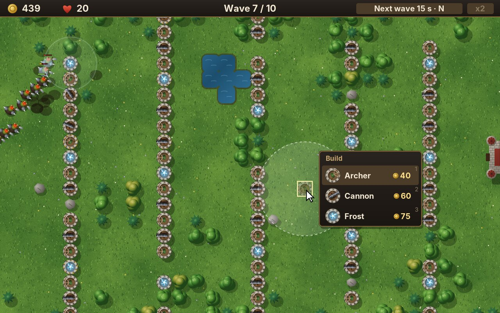
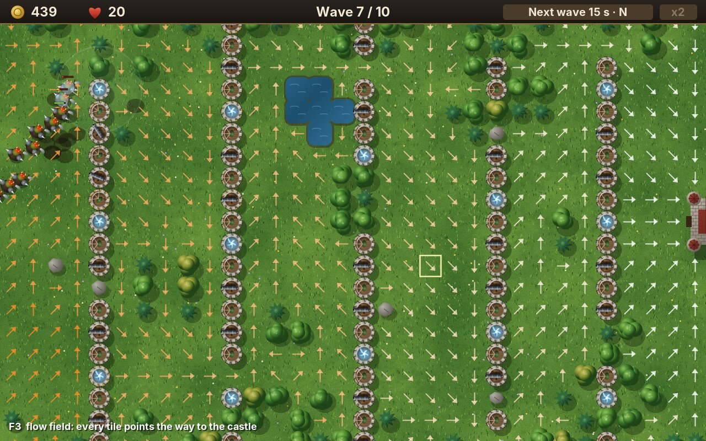
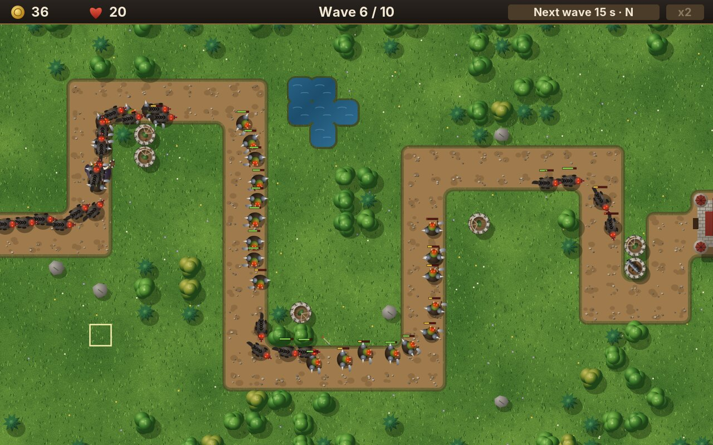
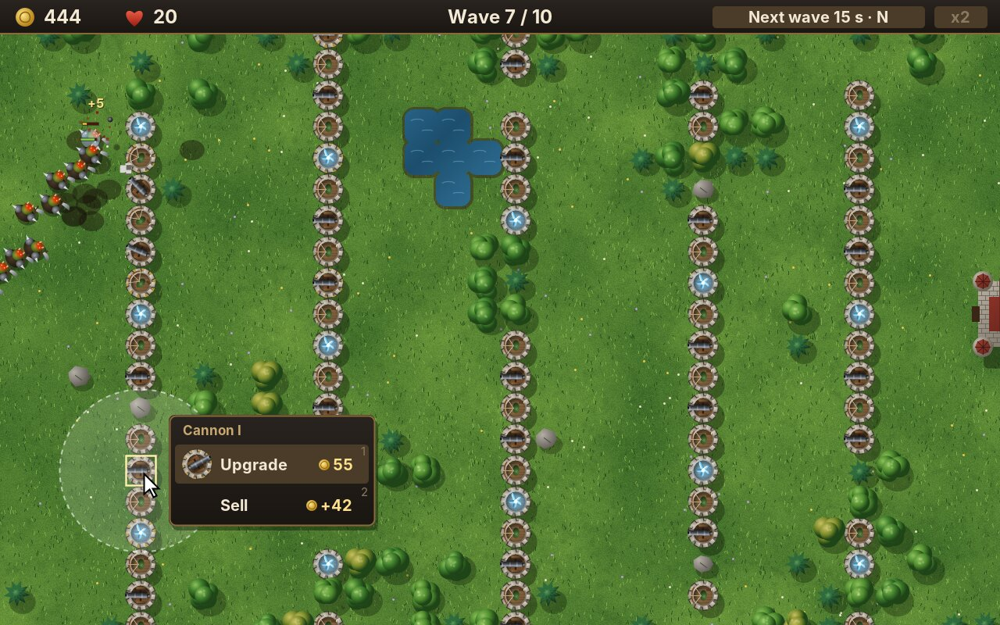
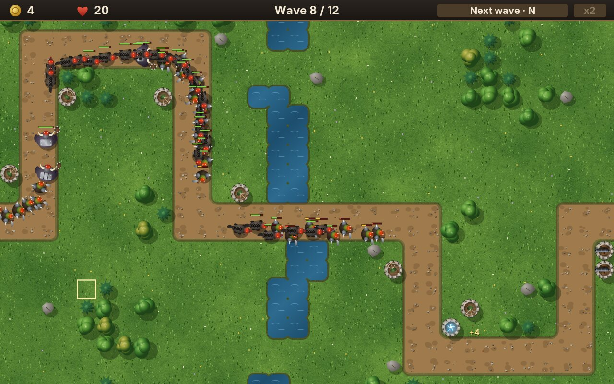
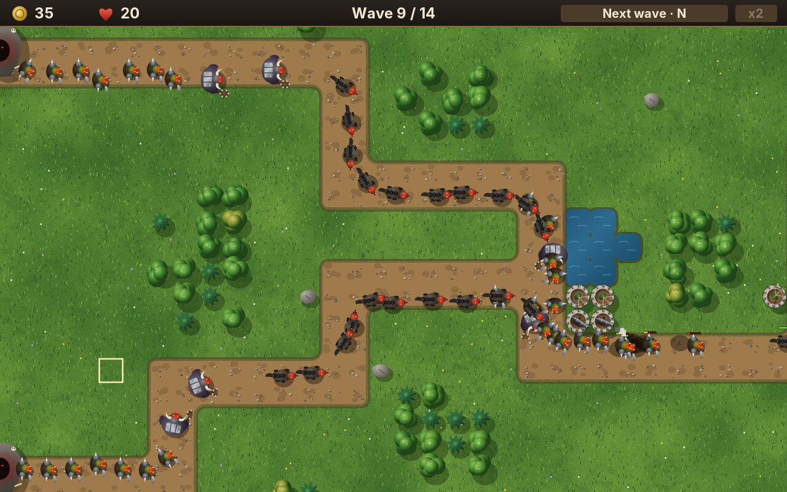
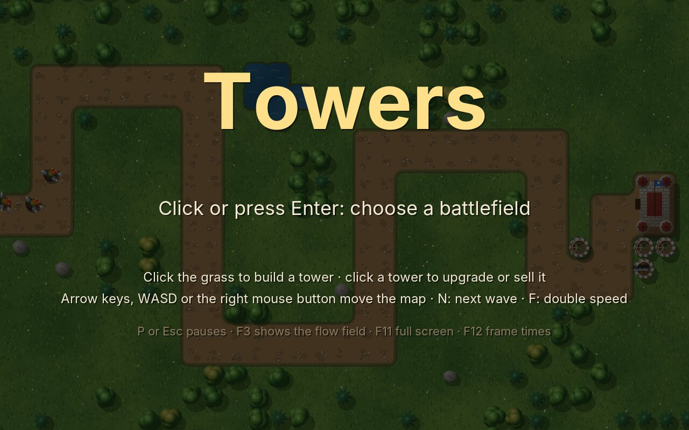
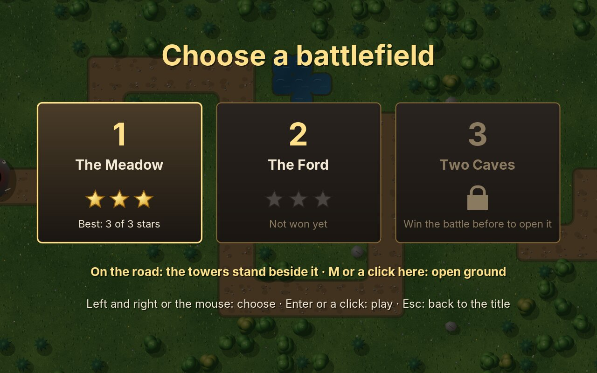

# 30. Towers

In every game so far the player steered one thing: a paddle, a ship, a snake, a jumping figure. In **Towers** they steer nothing. Orcs, dire wolves and trolls come out of their lairs and march on the castle, and the player builds towers that shoot at them: archers, cannons and frost towers. By default the enemies keep to a road and the towers stand beside it. The game has a second way to play, though, and that is the one this chapter is built around: **open ground**. There the road is grass like any other, the enemies walk the shortest way to the castle, and every tower the player builds stands in that way and makes it longer. The towers are the maze. The one rule that holds it all together is that a tower may never close the last way.

<figure markdown>
{ width="400" }
{ width="400" }
<figcaption>The meadow in the seventh wave (left): five walls of towers with gaps at alternate ends, and nothing on the grass to show the way: only the enemies walking it. The same with F3 (right): every tile points the way to the castle, white near it, orange far away.</figcaption>
</figure>

Tower defence grew out of custom maps for strategy games around 2002, and its two schools have been arguing since: games with a fixed road, where towers stand beside it, and games with open ground, where the player builds the maze. The first is the more common; Towers has both, one switch apart. The second is the harder to make, because the computer must find the way for every enemy again whenever a tower is built, and must say *no* before a tower closes it. This chapter makes that cheap with one idea, the **flow field**, and moves the game from the keyboard to the **mouse**.

!!! abstract "What you will learn"
    - **Flow fields**: one search from the goal gives every tile its way, for any number of units
    - **Placing without blocking**: a trial search before every tower, and why it is fast enough
    - **The mouse in a world larger than the screen**: screen and world coordinates through the camera, dragging, the edges of the screen
    - **Menus over the game**: a build menu beside the tile, by mouse and by keys
    - **Units and towers as data files**: blocks of properties, stages that inherit from each other, typos found
    - **Aiming**: turning turrets, leading the target, a burst that hits everything near it
    - **The ground**: drawn once, in squares, each when the camera first sees it
    - **Turned sprites**: 32 directions cached once

The complete game is in [amade-towers-game](https://github.com/datazuul/amade-towers-game).

## The rules

1. A battlefield is a grid of tiles of 20 units: grass, a road, trees, rocks and water. It is larger than the screen of 640 × 400; the bar at the top takes 22 of those, the view shows 32 × 19 tiles.
2. Enemies come out of one or more **lairs** in **waves** and walk to the **castle**. Each one that gets there costs lives: an orc or a wolf one, a troll three. When no lives are left, the castle falls.
3. **Towers** stand on grass, one per tile. An **archer** shoots arrows, fast and far. A **cannon** throws a ball that bursts where its target will be and hurts everything around it. A **frost** tower sends out a wave of cold that slows every enemy near it. Each tower can be upgraded twice and sold for 70 % of what it cost.
4. **On the road**, the default, enemies keep to the road, and towers stand on the grass beside it. **On open ground**, enemies walk the shortest way over grass and road alike, and trees, rocks, water and towers are in their way. A tower that would leave a lair, or an enemy already on its way, without any way to the castle is **refused**. The choice of a battlefield switches between the two.
5. Beaten enemies bring gold. Between two waves there is a pause; calling the next wave early brings a gold piece for each second of it left.
6. When the last wave is beaten, the battle is won: three stars for keeping 90 % of the lives, two for half, one otherwise. The stars are saved, and the next battlefield opens.

## Step 1: The flow field

In Maze (chapter 25) four ghosts each searched for their way with A*, many times a second. Towers has two hundred enemies on the map at the end of a level. Two hundred A* searches every time a tower is built would still be possible; two hundred every step would not. And they are all the same search: every enemy goes to the same castle.

So turn it round. Search once, **from the castle outwards**, and write into every tile how far it is from the castle and which neighbour is one step nearer. That is a **flow field**: a field of arrows, like the one on the right above. An enemy anywhere on the map looks at the tile it stands on and walks towards the neighbour the arrow points at. It needs no search of its own, and the field is the same for one enemy and for a thousand.

```java title="amade-game-engine · path/FlowField.java"
--8<-- "amade-game-engine/src/main/java/eu/amadeos/gameengine/path/FlowField.java:flowfield"
```

Units walk in eight directions, so the search has two step lengths: 10 to a side, 14 diagonally (10 × √2, rounded). With steps of different lengths, breadth-first search is not enough: the queue must give out the tile nearest to the castle first. That is **Dijkstra's algorithm**, which is breadth-first search with a priority queue, or A* without a target to aim at:

```java title="amade-game-engine · path/FlowField.java"
--8<-- "amade-game-engine/src/main/java/eu/amadeos/gameengine/path/FlowField.java:search"
```

Two details:

- **No cut corners.** A diagonal step is allowed only when both tiles beside it are open too. Otherwise an orc would squeeze between two towers that touch at their corners.
- **The arrow points back.** The search reaches a tile *from* its neighbour nearer the castle. The way from that tile is to that neighbour: the opposite direction.

```java title="amade-game-engine · test/path/FlowFieldTest.java"
--8<-- "amade-game-engine/src/test/java/eu/amadeos/gameengine/path/FlowFieldTest.java:test-distances"
```

A unit is not on a tile's middle; it is somewhere in its tile. `heading` gives the direction from where it is to the middle of the next tile. The comment explains why that never leads through a closed tile, and why a unit may aim a little to the side of the middle, so that a crowd walks beside each other instead of in a single file. The test lets fifty units walk a winding field with random offsets and checks every step:

```java title="amade-game-engine · path/FlowField.java"
--8<-- "amade-game-engine/src/main/java/eu/amadeos/gameengine/path/FlowField.java:heading"
```

```java title="amade-game-engine · test/path/FlowFieldTest.java"
--8<-- "amade-game-engine/src/test/java/eu/amadeos/gameengine/path/FlowFieldTest.java:test-heading"
```

A tile no way leads from keeps the distance `UNREACHABLE`. That is how the game will know that a tower closes the way:

```java title="amade-game-engine · test/path/FlowFieldTest.java"
--8<-- "amade-game-engine/src/test/java/eu/amadeos/gameengine/path/FlowFieldTest.java:test-blocked"
```

How much cheaper is one field than a search per unit? The test counts the tiles each one looks at:

```java title="amade-game-engine · test/path/FlowFieldTest.java"
--8<-- "amade-game-engine/src/test/java/eu/amadeos/gameengine/path/FlowFieldTest.java:test-many"
```

The field looks at every open tile once, 200 here. A* looks at fewer per search, because it aims at the castle, but it searches for each unit. For 200 units, the field wins by more than thirty times.

## Step 2: Towers make the maze

The game keeps one flow field, from all the castle's tiles at once, and searches it again after every change of the map: a tower built, a tower sold. Units walk where the ground lets them and no tower stands:

```java title="amade-towers-game · domain/Ground.java"
--8<-- "amade-towers-game/src/main/java/eu/amadeos/games/towers/domain/Ground.java:ground"
```

```java title="amade-towers-game · domain/Game.java"
--8<-- "amade-towers-game/src/main/java/eu/amadeos/games/towers/domain/Game.java:way"
```

The `trail` is the way from each lair to the castle, following the arrows. The rules do not need it, and nothing draws it (Step 7 says why): the simple builder of the tests and of the title screen puts its towers beside it.

### May a tower stand here?

Before a tower is built, the game asks whether the way stays open. The question is answered by the same search, once more, with the tile closed as if the tower stood there. Every lair must still reach the castle, and so must every enemy already on the map: an orc that a tower walls into a corner would stand there for ever.

```java title="amade-towers-game · domain/Game.java"
--8<-- "amade-towers-game/src/main/java/eu/amadeos/games/towers/domain/Game.java:placement"
```

One search of a battlefield of 40 × 24 tiles is quick, so asking on every click is no problem. The mouse asks more often than that: the tile under it is marked red where no tower may stand, in every frame. So the answer is kept, together with the map's `version` and the game's time, and given again until one of them changes.

```java title="amade-towers-game · test/domain/GameTest.java"
--8<-- "amade-towers-game/src/test/java/eu/amadeos/games/towers/domain/GameTest.java:test-block"
```

### On the road

The road is one more class of tile in the Tiled map, and one more question to `Ground`: may a unit walk here, may a tower stand here, and the answer now depends on how the battle is fought. On the road, units walk on road tiles only and towers stand on grass only; on open ground, the road is grass:

```java title="amade-towers-game · domain/Ground.java"
--8<-- "amade-towers-game/src/main/java/eu/amadeos/games/towers/domain/Ground.java:ground"
```

Nothing else changes. The flow field is searched over the tiles a unit may enter, so on the road it simply finds the way *along* the road, round its corners, from every lair. A tower can never stand on a road tile, so it can never close the way, and the trial search of `placement` always says yes. The same rules, the same field, the same walking, two different games:

```java title="amade-towers-game · test/domain/GameTest.java"
--8<-- "amade-towers-game/src/test/java/eu/amadeos/games/towers/domain/GameTest.java:test-road"
```

A map's road must lead from every lair to the castle, with its tiles side by side: a unit does not cut corners, so two road tiles that touch only at a corner do not join. `Level.read` checks it with one more flow field and rejects the map otherwise, as it rejects a castle that covers no tile. The roads of the three battlefields are two tiles wide, so that a crowd can walk beside each other.

{ width="560" }

### Walking

Each step, a unit looks at the arrow of its tile and walks towards the next tile's middle, a little to one side: each unit has its own offset, drawn once when it leaves the lair. It turns towards where it walks at a limited speed, so that the picture does not jump between the eight directions:

```java title="amade-towers-game · domain/Game.java"
--8<-- "amade-towers-game/src/main/java/eu/amadeos/games/towers/domain/Game.java:walk"
```

When a tower is built in front of a walking orc, the orc does nothing special. The field has changed, and in the next step the arrow of its tile points somewhere else. Every unit on the map takes the new way at once, which is what makes building in front of a running wave worth trying.

```java title="amade-towers-game · test/domain/GameTest.java"
--8<-- "amade-towers-game/src/test/java/eu/amadeos/games/towers/domain/GameTest.java:test-walk"
```

A step of the game, in its order:

```java title="amade-towers-game · domain/Game.java"
--8<-- "amade-towers-game/src/main/java/eu/amadeos/games/towers/domain/Game.java:update"
```

### Through each other

Watch a wave for a while and a wolf catches up with a troll and walks right through it. Nothing in `walk` knows about other units: each one follows the field on its own, as if the others were not there. That is a choice, and tower defence games make it in three ways:

- **Overlap.** Units are ghosts to each other. A fast one passes a slow one, and a crowd can stand on one spot. Most tower defence games do this, Bloons TD and Kingdom Rush among them. It costs nothing, the way of each unit is exactly the way of the field, and crowds bunch up, which rewards bursts and frost.
- **Volume.** Each unit has a body, and bodies push each other apart. Strategy games and the tower defence maps made in them work this way, because their units collide anyway. A troll in a narrow gap now holds up the wolves behind it: traffic jams become part of the game, and the game needs rules so that a jam never freezes for good.
- **One per cell.** On a grid, a unit may only step into a free cell. It waits or steps aside when the next one is taken: a board game more than a crowd.

Towers overlaps, for four reasons. The flow field stays the whole truth about where a unit walks, so every test of walking and building stays exact. A cannon burst or a frost ring in a bunch of enemies is the reward the player builds for, and pushing would spread the bunch. The waves were balanced with units that never wait for each other, and jams behind a troll would change every level's difficulty. And the eye forgives it: each unit walks a little to one side (the offset above), so most of the time a crowd looks like a crowd and not like one sprite. Exercise 7 tries the other way.

## Step 3: Units, towers and waves as data

Swarm (chapter 24) read its flight paths from text files with `TextData`: lines of words, comments after `#`, errors with the file and the line. Towers has three kinds of things with many numbers each, and those numbers are what a tower defence game is made of: an archer that costs 40 or 45 changes the whole game. They belong in files where they can be changed without compiling, and where the game designer can read them:

```text title="amade-towers-game · data/towers.txt (shortened)"
tower archer
  shot arrow
  cost 40
  range 3.0
  reload 0.75
  damage 9
  speed 14
  turn 10
  upgrade archer-2

tower archer-2 like archer
  cost 45
  range 3.3
  reload 0.6
  damage 14
  upgrade archer-3
```

The engine's `Catalog` reads such files: **blocks** that begin with a kind and a name (`tower archer`), and **properties** below them. A block can be `like` another one before it and takes over all its properties; its own lines replace them. The second stage of the archer says only what changes.

```java title="amade-game-engine · data/Catalog.java"
--8<-- "amade-game-engine/src/main/java/eu/amadeos/gameengine/data/Catalog.java:read"
```

The game asks a block for its properties by name: a number, a whole number, a word, each with or without a value to fall back on. Every property it asks for is noted. At the end, `finish` looks for a property the game never asked for. That is either a typo (`rnage 3`) or a property that has gone out of use, and both should not pass in silence. A typo in a data file that is ignored is the worst kind of bug: the game runs, the tower has its default range, and nobody knows why.

```java title="amade-game-engine · data/Catalog.java"
--8<-- "amade-game-engine/src/main/java/eu/amadeos/gameengine/data/Catalog.java:catalog"
```

```java title="amade-game-engine · test/data/CatalogTest.java"
--8<-- "amade-game-engine/src/test/java/eu/amadeos/gameengine/data/CatalogTest.java:test-errors"
```

Reading the units is a few lines. The towers need a little more: the stages are found from the `upgrade` lines, so `archer-3` knows it is the third stage of the archer, and a circle of upgrades or an upgrade to a tower that does not exist is an error at its line:

```java title="amade-towers-game · domain/Rules.java"
--8<-- "amade-towers-game/src/main/java/eu/amadeos/games/towers/domain/Rules.java:units"
```

```java title="amade-towers-game · domain/Rules.java"
--8<-- "amade-towers-game/src/main/java/eu/amadeos/games/towers/domain/Rules.java:towers"
```

A wave is one line: groups of a unit, how many, and the seconds between two of them. Each level makes its waves a little tougher than the one before, by a factor of the health, and on the road tougher still by a factor of its own, `road`: there no maze makes the enemies' way longer, so the same towers have less time to shoot:

```java title="amade-towers-game · domain/Rules.java"
--8<-- "amade-towers-game/src/main/java/eu/amadeos/games/towers/domain/Rules.java:waves"
```

```java title="amade-towers-game · test/domain/RulesTest.java"
--8<-- "amade-towers-game/src/test/java/eu/amadeos/games/towers/domain/RulesTest.java:test-typo"
```

The battlefields come from Tiled, as in Jump: the tile layer **ground** with the classes `tree`, `pine`, `rock` and `water`, and the object layer **things** with one `castle` and one or more `lair`s.

```java title="amade-towers-game · domain/Level.java"
--8<-- "amade-towers-game/src/main/java/eu/amadeos/games/towers/domain/Level.java:read"
```

## Step 4: Aiming and shooting

A tower has a turret that turns. In each step it looks for its target: of all enemies in range, the one with the **shortest way left** to the castle. That is not the nearest to the tower, but the most dangerous one, and the flow field already knows each enemy's distance. The turret turns towards it at its own speed (a cannon turns slowly, an archer fast) and fires only when it points at it, within 0.2 radians, and has reloaded:

```java title="amade-towers-game · domain/Game.java"
--8<-- "amade-towers-game/src/main/java/eu/amadeos/games/towers/domain/Game.java:act"
```

An **arrow** flies after its target and hits it; it is fast enough that nobody sees it bend. If the target falls first, the arrow lands where it was. A **cannon ball** is slow and does not steer. It is aimed at where the target **will be** when the ball lands. The target walks on at its speed while the ball flies; how far, depends on how long the ball flies, which depends on how far it goes. Two guesses are enough: the first takes the flight time to where the target is now, the second the flight time to the first guess.

```java title="amade-towers-game · domain/Game.java"
--8<-- "amade-towers-game/src/main/java/eu/amadeos/games/towers/domain/Game.java:fire"
```

Where the ball lands, it bursts, and everything the burst reaches is hit, the target or not. "Reaches" counts the enemy's size too: a troll is hit by a burst whose edge touches its shoulder.

```java title="amade-towers-game · domain/Game.java"
--8<-- "amade-towers-game/src/main/java/eu/amadeos/games/towers/domain/Game.java:burst"
```

```java title="amade-towers-game · test/domain/GameTest.java"
--8<-- "amade-towers-game/src/test/java/eu/amadeos/games/towers/domain/GameTest.java:test-archer"
```

```java title="amade-towers-game · test/domain/GameTest.java"
--8<-- "amade-towers-game/src/test/java/eu/amadeos/games/towers/domain/GameTest.java:test-cannon"
```

```java title="amade-towers-game · test/domain/GameTest.java"
--8<-- "amade-towers-game/src/test/java/eu/amadeos/games/towers/domain/GameTest.java:test-frost"
```

### Gold, waves and the end

The first wave comes after 30 seconds, every later one 15 seconds after the last enemy of the one before has left its lair. The player may call a wave early, and is paid for it:

```java title="amade-towers-game · domain/Game.java"
--8<-- "amade-towers-game/src/main/java/eu/amadeos/games/towers/domain/Game.java:call"
```

```java title="amade-towers-game · test/domain/GameTest.java"
--8<-- "amade-towers-game/src/test/java/eu/amadeos/games/towers/domain/GameTest.java:test-gold"
```

```java title="amade-towers-game · test/domain/GameTest.java"
--8<-- "amade-towers-game/src/test/java/eu/amadeos/games/towers/domain/GameTest.java:test-end"
```

Everything that happens reaches the user interface as events, as in Blast and Jump:

```java title="amade-towers-game · domain/Event.java"
--8<-- "amade-towers-game/src/main/java/eu/amadeos/games/towers/domain/Event.java:event"
```

### Can every level be won?

Jump proved with a search that each level can be finished. A tower defence level has too many ways to play for a search, but a test can play it: a simple player that spends its gold once a second, mostly on archers, sometimes a cannon or a frost tower, each on the free tile near the trail that covers the most of the way or makes it longest, and upgrades when it has ten towers.

```java title="amade-towers-game · test/domain/Defender.java"
--8<-- "amade-towers-game/src/test/java/eu/amadeos/games/towers/domain/Defender.java:defender"
```

```java title="amade-towers-game · test/domain/LevelTest.java"
--8<-- "amade-towers-game/src/test/java/eu/amadeos/games/towers/domain/LevelTest.java:test-won"
```

The simple player builds no maze; it only puts towers beside the way. If it wins, a player who thinks wins too. When a number in `units.txt` makes the trolls too strong, this test fails before anyone has played. A simpler cousin of it, `Autobuild`, builds the towers of the battle behind the title screen.

## Step 5: The mouse in the world

Until now the mouse was a pointer on a screen of fixed size: the paddle of Bricks, the aim in Rocks. In Towers it points into a **world** larger than the screen, below a bar, through a camera that moves.

The engine's `Mouse` has done the first conversion since chapter 21: from the window's pixels to the canvas's logical units, whatever the window's size, the black bars and the render mode. It collects what the Swing thread sees and hands it to the game loop once per step, like the keyboard: moved, pressed, released, held, inside the canvas or not.

```java title="amade-game-engine · input/Mouse.java"
--8<-- "amade-game-engine/src/main/java/eu/amadeos/gameengine/input/Mouse.java:mouse"
```

The second conversion is the camera's: from the screen into the world. The camera of chapter 27 knew where it stood in the world; now it also knows where its view stands on the screen, below the bar (`placedAt(0, 22)`). A point of the screen is in the world at the camera's position plus its place in the view:

```java title="amade-game-engine · camera/Camera.java"
--8<-- "amade-game-engine/src/main/java/eu/amadeos/gameengine/camera/Camera.java:to-world"
```

```java title="amade-game-engine · test/camera/CameraTest.java"
--8<-- "amade-game-engine/src/test/java/eu/amadeos/gameengine/camera/CameraTest.java:test-world"
```

`worldX` uses the camera after the last step, where the rules are, not the picture drawn between two steps. The difference is a fraction of a step, less than a unit; using the picture's position would let a click land on another tile than the one the rules think of.

In Jump the camera followed the player. In Towers there is nobody to follow: the player moves the camera. `moveBy` does it as far as the edges allow, and must be called in every step, also with 0, 0, so that the position before the step is kept for drawing in between:

```java title="amade-game-engine · camera/Camera.java"
--8<-- "amade-game-engine/src/main/java/eu/amadeos/gameengine/camera/Camera.java:move"
```

The play scene moves it three ways: by the arrow keys, by the mouse at the edge of the screen, and by dragging the map with the right or middle button held, the way strategy games do. A drag moves the map by exactly as far as the mouse moved, so the point under the mouse stays under it. A click on the bar is the bar's; a click on the map is on a tile:

```java title="amade-towers-game · ui/game/TowersGame.java"
--8<-- "amade-towers-game/src/main/java/eu/amadeos/games/towers/ui/game/TowersGame.java:input"
```

The top edge does not scroll: the bar is there, and a mouse on its buttons should not move the map. A camera that moves closes an open menu, which would otherwise point at a tile that has moved away.

## Step 6: Menus over the game

A click on grass opens the **build menu** beside the tile: a row per tower, with its picture, name and price. A click on a tower opens its menu: upgrade, with the price of the next stage, or sell. These menus are not Swing menus. They are drawn by the game, over the game, in the game's style, and they work in full screen.

{ width="560" }

The engine's `OverlayMenu` is such a menu. It is given the part of the screen it may cover, and opens beside the box of the thing it is about: to its right, or to its left when there is no room, and moved up or down to stay inside.

```java title="amade-game-engine · menu/OverlayMenu.java"
--8<-- "amade-game-engine/src/main/java/eu/amadeos/gameengine/menu/OverlayMenu.java:open"
```

```java title="amade-game-engine · test/menu/OverlayMenuTest.java"
--8<-- "amade-game-engine/src/test/java/eu/amadeos/gameengine/menu/OverlayMenuTest.java:test-place"
```

A row can be shown and not chosen: a tower the player cannot pay for is grey, its price red. The mouse highlights the row under it; a click chooses it; a click outside closes the menu, as every menu does. The keys work as well: **up** and **down** move the highlight past the rows that cannot be chosen, **Enter** chooses, and **1**, **2**, **3** choose a row directly, so the player who knows the menu never needs to aim:

```java title="amade-game-engine · menu/OverlayMenu.java"
--8<-- "amade-game-engine/src/main/java/eu/amadeos/gameengine/menu/OverlayMenu.java:input"
```

```java title="amade-game-engine · test/menu/OverlayMenuTest.java"
--8<-- "amade-game-engine/src/test/java/eu/amadeos/gameengine/menu/OverlayMenuTest.java:test-choose"
```

The menu holds values of any type `T`. Towers gives it orders: build this tower, upgrade, sell. A sealed interface of records, and a `switch` carries them out:

```java title="amade-towers-game · ui/game/TowersGame.java"
--8<-- "amade-towers-game/src/main/java/eu/amadeos/games/towers/ui/game/TowersGame.java:menus"
```

When the rules refuse a tower, the player is told why, in a short line over the map that fades: not enough gold, an enemy stands there, or the tower would close the last way.

```java title="amade-towers-game · test/ui/game/TowersGameTest.java"
--8<-- "amade-towers-game/src/test/java/eu/amadeos/games/towers/ui/game/TowersGameTest.java:test-build"
```

```java title="amade-towers-game · test/ui/game/TowersGameTest.java"
--8<-- "amade-towers-game/src/test/java/eu/amadeos/games/towers/ui/game/TowersGameTest.java:test-refuse"
```

How the menu looks is a `Style`: colours, fonts, and a picture before each detail, here a coin before the price. The default is dark wood and brass, readable over any map.

```java title="amade-game-engine · menu/OverlayMenu.java"
--8<-- "amade-game-engine/src/main/java/eu/amadeos/gameengine/menu/OverlayMenu.java:style"
```

## Step 7: Drawing the battlefield

Towers is not pixel art. Its pictures were drawn as vector shapes with Java2D, from a mockup made before any rules existed: grass of soft noise, trees as clusters of shaded circles, towers seen from above with brass bands for their stages, orcs with shoulders and a weapon. `Art` holds all of these drawings, and `Pictures` turns them into sprites, drawn once at the size of the screen and copied after that (chapter 21).

```java title="amade-towers-game · ui/game/Pictures.java"
--8<-- "amade-towers-game/src/main/java/eu/amadeos/games/towers/ui/game/Pictures.java:pictures"
```

### Turned sprites

A turret turns smoothly, an orc turns where it walks. Turning a picture while drawing it (`g.rotate` before `drawImage`) works, but it is slow, and the turned copy is blurred a little. So `Rotations` draws the picture 32 times, each turned by 11.25° more, and draws the nearest one. At the size of a turret no eye sees the steps.

```java title="amade-game-engine · sprite/Rotations.java"
--8<-- "amade-game-engine/src/main/java/eu/amadeos/gameengine/sprite/Rotations.java:rotations"
```

```java title="amade-game-engine · test/sprite/RotationsTest.java"
--8<-- "amade-game-engine/src/test/java/eu/amadeos/gameengine/sprite/RotationsTest.java:test-rotations"
```

The painter draws, from the ground up: the ground, scorch marks of bursts, the flow field if it is shown, the shadows of towers and enemies, the enemies, the towers, then the **trees over all of them**, so that an orc walking past a tree disappears under its crown. Then health bars, shots, effects and the marks of the mouse.

```java title="amade-towers-game · ui/game/TowersPainter.java"
--8<-- "amade-towers-game/src/main/java/eu/amadeos/games/towers/ui/game/TowersPainter.java:paint"
```

```java title="amade-towers-game · ui/game/TowersPainter.java"
--8<-- "amade-towers-game/src/main/java/eu/amadeos/games/towers/ui/game/TowersPainter.java:tower"
```

A cannon ball flies in an arc, but the rules move it in a straight line over the ground. The arc is only drawn: the ball higher by a parabola of how far it has flown, its shadow on the ground below.

```java title="amade-towers-game · ui/game/TowersPainter.java"
--8<-- "amade-towers-game/src/main/java/eu/amadeos/games/towers/ui/game/TowersPainter.java:shot"
```

The flow field is drawn with F3 as one small arrow sprite per tile, in eight directions and eight shades:

```java title="amade-towers-game · ui/game/TowersPainter.java"
--8<-- "amade-towers-game/src/main/java/eu/amadeos/games/towers/ui/game/TowersPainter.java:flow"
```

### The ground

The ground of a battlefield is the most expensive picture: noise for the grass, ponds with their banks, rocks, the shadows of trees, the lairs and the castle, and the road. The road is the union of its tiles' squares, which has sharp corners, rounded by a trick from image processing: grown by a few units and shrunk again, which rounds the inner corners (a **closing**), then shrunk and grown again, which rounds the outer ones (an **opening**). Growing a shape by *r* is adding the outline drawn with a pen 2*r* wide; shrinking it is taking that outline away:

```java title="amade-towers-game · ui/game/Art.java"
--8<-- "amade-towers-game/src/main/java/eu/amadeos/games/towers/ui/game/Art.java:road"
```

On open ground there is no road, and no path either: the grass is plain, and the way shows only in where the enemies walk, and in the arrows of F3. An earlier version of this game drew a trodden trail along the current way, which moved with every tower. It looked like a road, though, and a road says "the enemies keep to me", which on open ground is not true. Maze games mostly leave the ground plain, as Desktop Tower Defense and Fieldrunners do, and let the player read the way from the crowd; others draw the way as a line or arrows. Towers keeps the arrows for F3.

So the ground never changes, and it is drawn once and then only copied. For the meadow, 36 × 22 tiles, one picture of the whole map would do. `Terrain` cuts the ground into **squares of 8 × 8 tiles** anyway, each a sprite of its own, because a map may be much larger than the screen: a sprite drawn in code is drawn when it is first shown, so a square the camera does not see is neither drawn nor copied:

```java title="amade-towers-game · ui/game/Terrain.java"
--8<-- "amade-towers-game/src/main/java/eu/amadeos/games/towers/ui/game/Terrain.java:terrain"
```

Drawing a square is the same for any square: the part of the grass, the ponds, the road, the rocks and shadows, all of them clipped to the square by the sprite. The tiles one beyond its edge are drawn as well, so that a pond or a road that crosses the edge continues into the next square without a seam:

```java title="amade-towers-game · ui/game/Terrain.java"
--8<-- "amade-towers-game/src/main/java/eu/amadeos/games/towers/ui/game/Terrain.java:draw"
```

In each frame, `render` copies the squares the camera sees:

```java title="amade-towers-game · ui/game/Terrain.java"
--8<-- "amade-towers-game/src/main/java/eu/amadeos/games/towers/ui/game/Terrain.java:render"
```

Every pixel of a square is covered: the grass is everywhere. Chapter 27 taught `Sprite` to look at a picture's pixels and cache it opaque if none is transparent. A picture *drawn* in code is drawn into a transparent cache, though, and the sprite cannot know in advance that nothing will stay transparent. `opaque()` is the promise, and with it a square is copied as a plain copy, without blending:

```java title="amade-game-engine · sprite/Sprite.java"
--8<-- "amade-game-engine/src/main/java/eu/amadeos/gameengine/sprite/Sprite.java:opaque"
```

`./gradlew benchmark` measures it, as in Jump: on the computer this chapter was written on, which draws in software, a frame takes between 1.7 and 3.6 ms, depending on the battlefield, at 1280 × 800 and at 1920 × 1200.

<figure markdown>
{ width="400" }
{ width="400" }
<figcaption>The ford (left), where the road crosses the river. Two caves (right): two lairs, and two roads that meet before the castle.</figcaption>
</figure>

## Step 8: Everything else

The battle runs at double speed with **F**, by running the step of the rules twice:

```java title="amade-towers-game · ui/game/TowersGame.java"
--8<-- "amade-towers-game/src/main/java/eu/amadeos/games/towers/ui/game/TowersGame.java:play"
```

The bar shows gold, lives and the wave, and the two buttons the mouse can press:

```java title="amade-towers-game · ui/game/Hud.java"
--8<-- "amade-towers-game/src/main/java/eu/amadeos/games/towers/ui/game/Hud.java:bar"
```

The events become dust where a tower is built, smoke at a cannon's muzzle, bursts with scorch marks that fade over twenty seconds, rings of frost, a floating "+5" over a beaten enemy, sounds, and a march in MML. Sounds are throttled: twenty archers shooting in the same step play one bow, not twenty.

```java title="amade-towers-game · ui/game/Effects.java"
--8<-- "amade-towers-game/src/main/java/eu/amadeos/games/towers/ui/game/Effects.java:react"
```

The progress is saved with `SaveFile` (chapter 27): the battlefields open and the most stars won on each. The choice of a battlefield shows them, and can be played with the mouse or with the keys:

<figure markdown>
{ width="400" }
{ width="400" }
<figcaption>The title (left), with `Autobuild` defending the meadow behind it. The choice (right).</figcaption>
</figure>

```java title="amade-towers-game · ui/game/TowersGame.java"
--8<-- "amade-towers-game/src/main/java/eu/amadeos/games/towers/ui/game/TowersGame.java:choice"
```

```java title="amade-towers-game · test/ui/game/TowersGameTest.java"
--8<-- "amade-towers-game/src/test/java/eu/amadeos/games/towers/ui/game/TowersGameTest.java:test-won"
```

The keys are bound as in the earlier games and can be changed in the settings file:

```java title="amade-towers-game · ui/game/TowersGame.java"
--8<-- "amade-towers-game/src/main/java/eu/amadeos/games/towers/ui/game/TowersGame.java:controls"
```

`./gradlew art` draws the tileset picture for Tiled and the program's icon from the same vector drawings as the game, so the editor shows trees where the game has trees. Full screen (F11), the render modes, the frame times (F12), sound and the five languages work as in the earlier games.

## What moved into the engine

| From Towers | Engine package | Why |
|---|---|---|
| One search from the goal for every unit, in eight directions without cutting corners | `eu.amadeos.gameengine.path.FlowField` | Many units with one goal: Sands' harvesters and armies |
| Blocks of properties in text files, `like`, typos found | `eu.amadeos.gameengine.data.Catalog` | Every game with units, buildings or items |
| A menu drawn over the game, beside the thing it is about, by mouse and keys | `eu.amadeos.gameengine.menu.OverlayMenu` | Every command given on the map |
| Mouse released, mouse inside the canvas | `eu.amadeos.gameengine.input.Mouse` | Dragging, scrolling at the edge |
| Screen to world and back, a view below a bar, a camera the player moves | `eu.amadeos.gameengine.camera.Camera` | Every map the mouse points into |
| 32 turned copies of a picture | `eu.amadeos.gameengine.sprite.Rotations` | Everything seen from above that turns |
| Drawn sprites cached opaque | `eu.amadeos.gameengine.sprite.Sprite` | Every ground drawn in code |

What stays in the game: the ground and its classes, the road and open ground, the rules of building, walking, aiming and gold, the units, towers and waves, the battlefields, the art, the terrain in squares, the painter, the sounds and tunes, the progress and the scenes.

## Exercises

1. **Short cuts.** On the road, let wolves (and only wolves) leave it and cross open grass. Each kind of unit then needs a flow field of its own: how many fields does the game keep, and when is each searched again?
2. **A tower of your own.** Add a fourth kind to `towers.txt`: a **poison** tower whose shot hurts a little every second for a few seconds. Which properties does it need, which lines of `Game`, and what does `finish` say before you have written them?
3. **Flying units.** Bats fly straight to the castle over towers, trees and water. They need no flow field, or a second one: which is simpler, and which lets a frost tower still matter?
4. **The longest maze.** Write a test that builds, with a fixed amount of gold, the maze that makes the way from the lair to the castle the longest. Is a greedy builder (always the tile that lengthens the way most) good enough?
5. **Sell back the maze.** Selling a tower opens the way again, and every enemy takes the shorter way at once. Is that a trick players will use, and should the rules allow it?
6. **A minimap.** Draw the whole battlefield small in a corner, the towers as dots, the view as a box. A click on it moves the camera there. You will need it in the next chapter.
7. **Group flow.** Two hundred orcs on one way walk through each other. Give each a little push away from its neighbours (the spatial grid of chapter 24 finds them) and see how a crowd forms in a gap, and how a troll in it now holds up the wolves behind it. Does LevelTest still win every level?

---

Towers is the first chapter of Part III. Its enemies all want the same thing, and the player commands no one. In **Sands**, a real-time strategy game, the player selects their own units with the mouse and sends each group somewhere else, the map is dark where nobody has looked, and a computer opponent builds its own base.
