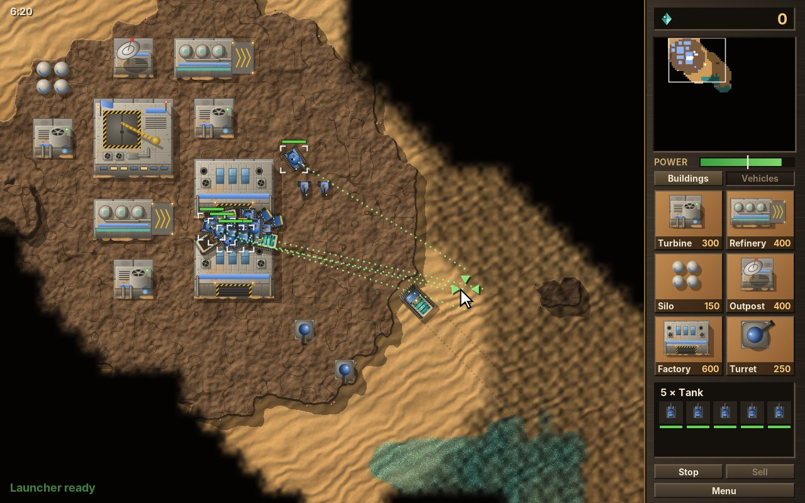
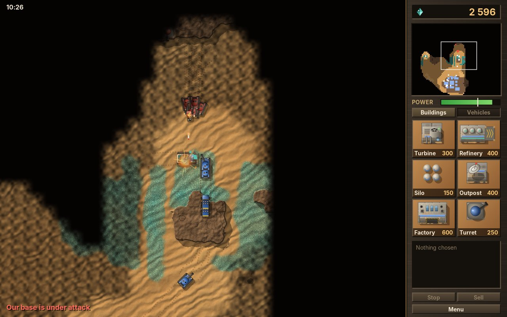
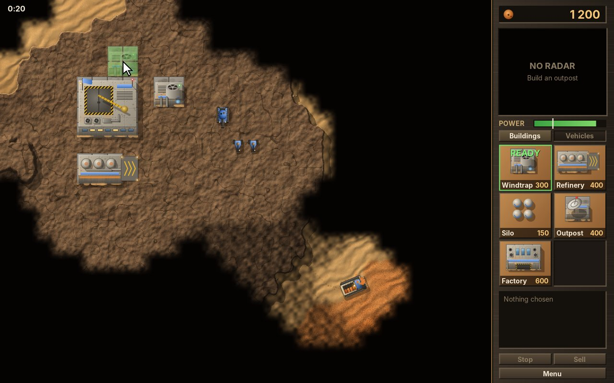
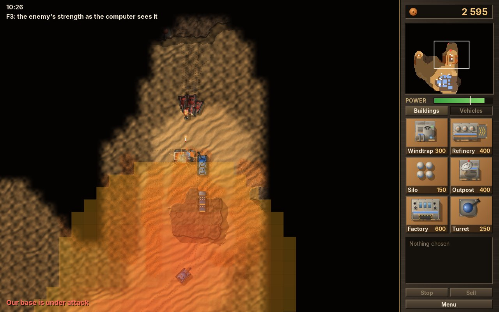
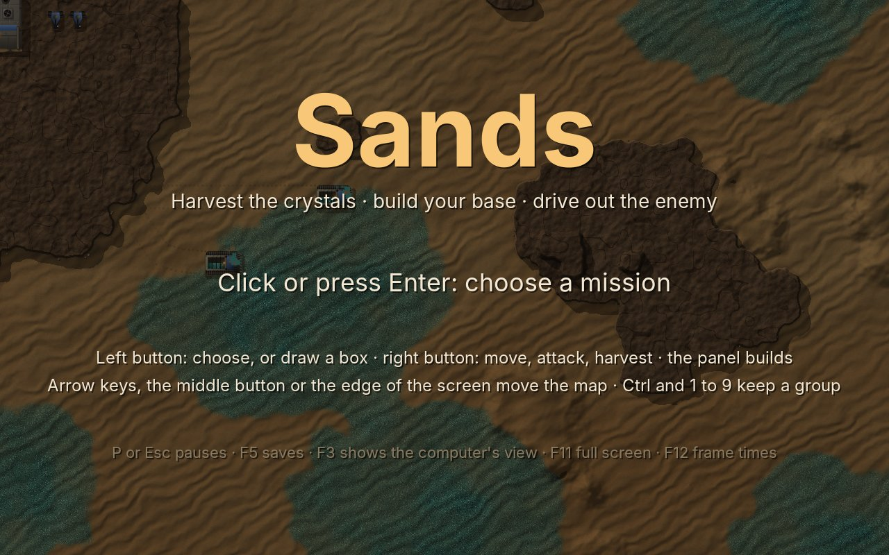
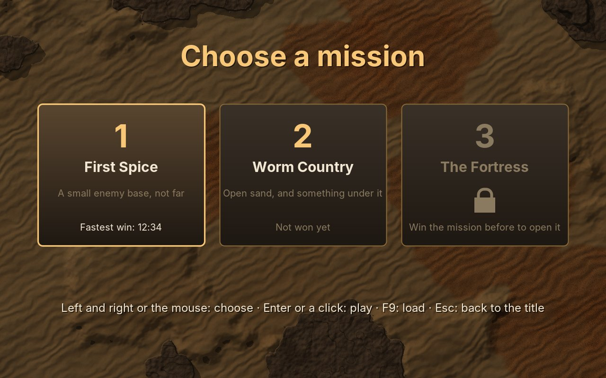

# 31. Sands

Towers (chapter 30) gave the player a mouse and a map larger than the screen, but nothing to command: the enemies walked on their own, and the towers stood still. **Sands** hands over an army. Two houses share a desert planet, each with a construction yard on a plateau of rock. Harvesters gather the crystal that lies in the sand, a refinery turns it into credits, and the credits pay for wind turbines, a factory, turrets and vehicles: fast trikes, tanks with turning turrets, launchers whose rockets burst and hurt everything around them. The computer plays the other house by the same rules: it builds its base, harvests, defends and attacks in growing waves. Whoever loses the last building has lost. On the open sand of the later missions, a burrower hunts whatever drives there.

<figure markdown>
{ width="400" }
{ width="400" }
<figcaption>A base after six minutes (left): five tanks chosen by a box and sent to the sand, each to a slot of its own, the dotted lines their orders. A fight at the foot of the rock (right): red tanks attack, a launcher burns. Beyond what blue's units see, the map is dim or black.</figcaption>
</figure>

The early 1990s set the rules that real-time strategy has followed since: harvest, build, produce, command groups with the mouse, explore a map hidden in the dark. Each of these is a small piece of engine, and Sands is the game where they all come together. It is the largest game of this handbook, and the first in which the computer does not only move enemies but plays: it decides what to build, where, and whom to attack.

!!! abstract "What you will learn"
    - **Choosing units**: a click, a box, Shift to add, Ctrl and a number for a group that is kept
    - **Group moves**: a slot for each unit, the slots shared out without crossing, one flow field per order and a cache for them
    - **Fog of war**: three states per tile, circles of sight, soft edges drawn from 81 pictures, enemy buildings remembered as ghosts
    - **The minimap**: one pixel per tile, painted only where it changed
    - **An economy**: credits with a store, production paid while it runs, power that slows everything down
    - **A computer opponent**: a building plan, a place for each building, and an influence map that finds the weakest spot
    - **Saving a whole game**: hundreds of things in a save file, numbers exact to the bit, and a loaded battle that goes on exactly as it would have
    - **A ground drawn on other threads**: dunes, rock and crystal, worked out pixel by pixel, in squares, while the game runs

The complete game is in [amade-sands-game](https://github.com/amadeos-eu/amade-sands-game).

## The rules

1. A map is 64 × 64 tiles of 16 units: sand, dunes (slower to drive on), rock, cliffs (closed to everything) and crystal, a little or a lot. The view shows 32 × 25 tiles; the panel on the right takes 128 of the 640 units.
2. Each house starts with a **construction yard**, a little money and a few vehicles. The yard builds one building at a time; when it is ready, the player puts it on rock, near a building of their own, where nothing stands. A building costs credits, and they are paid **while it is built**: without money, the work waits.
3. **Wind turbines** make power; every other building uses it. With too little power, the yard and the factory work at half speed, the turrets reload slowly, and the outpost's minimap goes dark.
4. A **refinery** comes with a **harvester**, brought by an airlifter. A harvester drives to the crystal, fills its hopper, drives home and unloads; the crystal becomes credits. Refineries and **silos** store credits; what they cannot hold is lost.
5. The **factory** makes trikes, tanks and launchers, five in a row at most. **Turrets** guard the base. A building can be sold for half its price.
6. A side sees what its vehicles and buildings see. What it saw once stays on the map, dimmed, with the enemy's buildings as they were when it last looked.
7. The **burrower** appears after a while on the missions that have one. It hunts vehicles on the sand, harvesters first, and swallows them whole. It cannot reach rock.
8. A side without buildings has lost. The fastest win of each mission is kept, and winning opens the next.

## Step 1: Choosing and commanding

Every game so far knew at each moment which thing the player steers. Here the player says it, with the mouse, and the convention for it has not changed since the nineties: a click picks one vehicle, a drag opens a box and picks all in it, Shift adds to the choice, Ctrl and a number keep it as a group that the number alone calls back. The engine's `Selection` keeps what is picked and the nine groups:

```java title="amade-game-engine · select/Selection.java"
--8<-- "amade-game-engine/src/main/java/eu/amadeos/gameengine/select/Selection.java:selection"
```

The picked things are kept in a `LinkedHashSet`: no thing twice, and the order of picking, so that the panel shows the first picked first. `keepOnly` is called after every step with "is it still alive?". A tank that blows up leaves the choice and every group at once, and nobody has to remember to take it out.

```java title="amade-game-engine · test/select/SelectionTest.java"
--8<-- "amade-game-engine/src/test/java/eu/amadeos/gameengine/select/SelectionTest.java:test-groups"
```

The difference between a click and a box is a few units of mouse movement. A hand that clicks moves the mouse a little, and that must stay a click and not become a box of two pixels that picks nothing. `BoxSelect` is that arithmetic:

```java title="amade-game-engine · select/BoxSelect.java"
--8<-- "amade-game-engine/src/main/java/eu/amadeos/gameengine/select/BoxSelect.java:box"
```

`release` returns a sealed `Result`, so the game's `switch` over it must name both cases, and Java checks that it does. The game asks the world what lies under a click or inside a box, and only the player's own vehicles are picked. A click on an enemy vehicle in sight, or on a building, shows it in the panel with its health instead; an enemy is looked at, never chosen, so no order can reach it:

```java title="amade-sands-game · ui/game/SandsGame.java"
--8<-- "amade-sands-game/src/main/java/eu/amadeos/games/sands/ui/game/SandsGame.java:release"
```

The right button is the order. What it means depends on what is under the mouse and on who is chosen, and one button doing the right thing is much of what makes such a game pleasant: an enemy is attacked, a harvester sent to the crystal harvests, a harvester sent to a refinery goes home to unload, everything else drives there. Ctrl turns a move into a hunt, in which the vehicles fight whatever they meet on the way.

```java title="amade-sands-game · ui/game/SandsGame.java"
--8<-- "amade-sands-game/src/main/java/eu/amadeos/games/sands/ui/game/SandsGame.java:command"
```

## Step 2: A group on the move

Towers had one goal for every enemy, the castle, and one flow field for it. Here every order has a goal of its own, and a group of five tanks sent to one tile raises two questions that one walking orc never did: where does each tank stop, since five cannot stand on one tile? And how do they get there without driving into each other?

### A slot for each

The answer to the first is a **slot** for each unit: the open tiles nearest the target, found by a breadth-first search from it, so that a slot is never behind a wall from the target. A click on a rock still sends the group next to it:

```java title="amade-game-engine · path/Formation.java"
--8<-- "amade-game-engine/src/main/java/eu/amadeos/gameengine/path/Formation.java:slots"
```

Which unit takes which slot matters more than it seems. Give the slot at the front to the tank at the back, and the two cross each other's way just before they arrive, and jostle. The best assignment, the one with the least driving in total, is a known problem with a known answer (the Hungarian method), but it is a page of tricky code. The **greedy** assignment is five lines and nearly as good for a dozen units: take the closest pair of a unit and a slot, then the closest of what is left, and so on.

```java title="amade-game-engine · path/Formation.java"
--8<-- "amade-game-engine/src/main/java/eu/amadeos/gameengine/path/Formation.java:assign"
```

```java title="amade-game-engine · test/path/FormationTest.java"
--8<-- "amade-game-engine/src/test/java/eu/amadeos/gameengine/path/FormationTest.java:test-assign"
```

### One field for the group

The way there is a flow field again, but now the field depends on the order. Searching a new field for each unit would give every unit the same field five times; searching one field per group is the idea. The game asks a `FieldCache`, which searches each goal once and keeps the field while the map stays as it is. Two groups sent to the same place share it, and the harvesters, who all drive home to the same refinery, share theirs for the whole game. A building that goes up or comes down changes the map: then `invalidate` forgets every field, and each is searched again when it is next needed.

```java title="amade-game-engine · path/FieldCache.java"
--8<-- "amade-game-engine/src/main/java/eu/amadeos/gameengine/path/FieldCache.java:cache"
```

The cache keeps only the 32 fields used last: an access-ordered `LinkedHashMap` that drops its eldest entry does that in one method. A player who clicks all over the map would otherwise fill the memory with fields nobody follows any more.

The game's `move` puts it together: slots, the assignment, and one tile for the whole group's field, `way`:

```java title="amade-sands-game · domain/Game.java"
--8<-- "amade-sands-game/src/main/java/eu/amadeos/games/sands/domain/Game.java:move"
```

### Driving

Each vehicle then follows the group's field until it is near the goal, and drives straight to its own slot for the last tiles. "Straight" needs a test: may it drive in a line from here to there, or is a cliff in between? `clearLine` walks the line through the grid tile by tile, as a ray is traced through a grid in a 3D renderer, and refuses to cut a corner:

```java title="amade-game-engine · path/Formation.java"
--8<-- "amade-game-engine/src/main/java/eu/amadeos/gameengine/path/Formation.java:line"
```

A vehicle turns before it drives, as a tank does, and drives slower the further it points off its way. A vehicle that means to move but hardly does is stuck, usually behind others who already stand in the slots near it, and gives up after a while near its goal:

```java title="amade-sands-game · domain/Game.java"
--8<-- "amade-sands-game/src/main/java/eu/amadeos/games/sands/domain/Game.java:drive"
```

The slots keep the group apart at the end. On the way, nothing does yet: five tanks following one field converge on the same tiles. So after all vehicles have moved, those that overlap push each other apart, through the spatial grid of chapter 24. Moving ones yield more than those that stand, and a harvester at work hardly at all, so a column that passes it does not shove it off its crystal:

```java title="amade-sands-game · domain/Game.java"
--8<-- "amade-sands-game/src/main/java/eu/amadeos/games/sands/domain/Game.java:separate"
```

```java title="amade-sands-game · test/domain/GameTest.java"
--8<-- "amade-sands-game/src/test/java/eu/amadeos/games/sands/domain/GameTest.java:test-group"
```

The test counts the searches, too: six tanks, one order, one field.

## Step 3: Fog of war

A strategy game is a game of what you do not know. Each side has a `FogOfWar` of its own, and every tile is in one of three states: **unseen**, black, nobody of this side has ever been there; **seen**, someone looked once but nobody looks now, the ground is known but not what moves on it; **visible**, someone sees it now.

```java title="amade-game-engine · fog/FogOfWar.java"
--8<-- "amade-game-engine/src/main/java/eu/amadeos/gameengine/fog/FogOfWar.java:fog"
```

Three small ideas make it cheap enough for a hundred vehicles in every step:

- **Visible is a step number.** Instead of clearing a whole array of "visible" flags at the start of every step, the fog counts its steps and writes the current one into each tile that someone looks at. A tile is visible if its number is the current step. `begin` is one addition.
- **Circles are kept.** The tiles within a radius are worked out once per radius, as offsets from the middle, and every look of that radius walks the same list. No square roots in the step.
- **A version.** The fog counts every change of a tile's state. The minimap and the fog's picture are worked out again only when the version has changed.

What a side has seen goes into the save file as one bit per tile; what it sees now needs no saving, because the next step looks again:

```java title="amade-game-engine · fog/FogOfWar.java"
--8<-- "amade-game-engine/src/main/java/eu/amadeos/gameengine/fog/FogOfWar.java:save"
```

The game looks in every step, for both sides, with every vehicle and every building. A building looks from its middle, a little further than its sight, so that a large one sees as far from its edges as a small one. And it remembers what it saw: an enemy building that comes into sight becomes a **ghost**, its kind and place, which stays on the map after the units have driven on. Only when the side sees the place again and the building is gone does the ghost go. That is how a player finds the enemy base once and can send an army there later.

```java title="amade-sands-game · domain/Game.java"
--8<-- "amade-sands-game/src/main/java/eu/amadeos/games/sands/domain/Game.java:look"
```

```java title="amade-sands-game · test/domain/GameTest.java"
--8<-- "amade-sands-game/src/test/java/eu/amadeos/games/sands/domain/GameTest.java:test-ghosts"
```

### Soft edges

Drawn tile by tile, the fog would be a staircase of black squares at the edge of everything a unit sees. The `FogPainter` gives each **corner** of a tile a state instead, the darkest of the four tiles that meet there, and shades the tile smoothly from corner to corner. Three states at four corners make 3⁴ = 81 kinds of tile, and that is all there will ever be. Each is drawn once as a sprite, at the size of the screen, and only copied after that: the trick of the turned sprites of chapter 30, used for darkness.

```java title="amade-game-engine · fog/FogPainter.java"
--8<-- "amade-game-engine/src/main/java/eu/amadeos/gameengine/fog/FogPainter.java:painter"
```

```java title="amade-game-engine · fog/FogPainter.java"
--8<-- "amade-game-engine/src/main/java/eu/amadeos/gameengine/fog/FogPainter.java:shade"
```

Two details took some looking. Taking the *darkest* tile at each corner means that the fog reaches half a tile into what is visible, and never the other way: nothing that stands on a hidden tile shows through a soft edge. And the black tiles in the middle of the shroud are not drawn as 81 pictures but as long rectangles, one per run of tiles in a row, which is much faster. The first version filled them in the world's coordinates, and at most sizes of the window a line of pixels showed between the black and the soft tiles next to it: the rectangle and the sprite rounded their edges to the screen's pixels in different ways. `fill` now rounds the rectangle exactly as `Sprite.drawSeamless` rounds a sprite, and the lines are gone. The appendix collects this rule with the others.

## Step 4: The minimap

The panel shows the whole map, small: 64 × 64 tiles in a box of 90 × 90 units. Drawing 4,096 little rectangles in every frame would cost more than the battlefield. The `Minimap` keeps an image of exactly one pixel per tile, and the game paints a pixel only when its tile changes, which is seldom: the fog lifts, crystal is harvested. In every frame the image is copied, scaled with hard edges, and the things that move are dotted over it.

```java title="amade-game-engine · minimap/Minimap.java"
--8<-- "amade-game-engine/src/main/java/eu/amadeos/gameengine/minimap/Minimap.java:minimap"
```

A click on it moves the camera there, a drag scrolls, and the right button sends the chosen vehicles: the minimap converts between its box and the world, as the camera converts between the screen and the world.

```java title="amade-game-engine · minimap/Minimap.java"
--8<-- "amade-game-engine/src/main/java/eu/amadeos/gameengine/minimap/Minimap.java:convert"
```

The game paints the minimap after every step in which the fog's or the crystal's version has changed, and draws the buildings, ghosts and vehicles over it. It shows nothing at all without an **outpost** with power: in the classic strategy games the radar is a building you have to earn.

```java title="amade-sands-game · ui/game/Hud.java"
--8<-- "amade-sands-game/src/main/java/eu/amadeos/games/sands/ui/game/Hud.java:minimap"
```

## Step 5: Crystals, credits and power

### Harvesting

A harvester is a vehicle with a task of its own. On crystal it takes in a little in every step, and the tile loses what it takes; full, it drives home; on the pad of the refinery it unloads. Without crystal under it, it looks for the nearest field from where it last harvested, so it goes back to the same field until it is empty:

```java title="amade-sands-game · domain/Game.java"
--8<-- "amade-sands-game/src/main/java/eu/amadeos/games/sands/domain/Game.java:harvest"
```

```java title="amade-sands-game · domain/Game.java"
--8<-- "amade-sands-game/src/main/java/eu/amadeos/games/sands/domain/Game.java:unload"
```

```java title="amade-sands-game · test/domain/GameTest.java"
--8<-- "amade-sands-game/src/test/java/eu/amadeos/games/sands/domain/GameTest.java:test-harvest"
```

The money goes into `Credits`, which know how much they can hold. A limit to the store is a rule with a purpose: it makes the player spend instead of saving up for ever, and build silos when the harvesters bring more than the refineries hold.

```java title="amade-game-engine · economy/Credits.java"
--8<-- "amade-game-engine/src/main/java/eu/amadeos/gameengine/economy/Credits.java:credits"
```

### Paying while it is made

In the classic strategy games, a tank is not paid when it is ordered but while the factory works on it: 300 credits over 14 seconds is a little more than 21 credits a second. Without money, the work stands still and waits; with half the power, it goes at half the speed. That keeps the game moving, because the player can order something with nearly no money and watch it grow as the harvesters come in. `Production` is that queue:

```java title="amade-game-engine · economy/Production.java"
--8<-- "amade-game-engine/src/main/java/eu/amadeos/gameengine/economy/Production.java:production"
```

The difficulty is that credits are whole and the payment per step is not: 21 credits a second at 120 steps a second is less than a fifth of a credit per step. So the queue pays a whole credit as soon as the work reaches it, and lets the work grow only as far as it has been paid. No credit, no progress, and never a fraction of a credit shown in the panel.

```java title="amade-game-engine · test/economy/ProductionTest.java"
--8<-- "amade-game-engine/src/test/java/eu/amadeos/gameengine/economy/ProductionTest.java:test-pay"
```

An order can be taken back, and what was paid for it comes back with it. A building that is ready is kept in the queue until it is placed, and while it waits, the yard builds nothing else:

```java title="amade-game-engine · economy/Production.java"
--8<-- "amade-game-engine/src/main/java/eu/amadeos/gameengine/economy/Production.java:cancel"
```

```java title="amade-sands-game · test/domain/GameTest.java"
--8<-- "amade-sands-game/src/test/java/eu/amadeos/games/sands/domain/GameTest.java:test-produce"
```

### Where a building may stand

On rock, on no other building, under no vehicle, and near a building of the same side: that last rule makes a base grow from its yard instead of appearing anywhere on the map, and it is what makes the outpost on the far side of the rock a decision.

```java title="amade-sands-game · domain/Game.java"
--8<-- "amade-sands-game/src/main/java/eu/amadeos/games/sands/domain/Game.java:placement"
```

```java title="amade-sands-game · test/domain/GameTest.java"
--8<-- "amade-sands-game/src/test/java/eu/amadeos/games/sands/domain/GameTest.java:test-place"
```

While the player looks for the place, the building's footprint follows the mouse, green or red, tile by tile:

{ width="560" }

```java title="amade-sands-game · ui/game/SandsPainter.java"
--8<-- "amade-sands-game/src/main/java/eu/amadeos/games/sands/ui/game/SandsPainter.java:placing"
```

## Step 6: The things as data

Vehicles, buildings, missions and the computer's plan are four text files in the format of chapter 24, read by the `Catalog` of chapter 30. A tank:

```text
unit tank
  health 320
  armour 0.35
  speed 1.8
  sight 4
  size 0.36
  cost 300
  seconds 14
  needs factory
  weapon gun
  range 4
  damage 34
  reload 1.6
  shot 16
  turret yes
```

A weapon is a few lines inside the vehicle's or the building's block, so a turret and a tank read their guns the same way:

```java title="amade-sands-game · domain/Rules.java"
--8<-- "amade-sands-game/src/main/java/eu/amadeos/games/sands/domain/Rules.java:weapon"
```

`needs` names buildings, and the rules check that they exist; what a side may build follows from what it has:

```java title="amade-sands-game · domain/Game.java"
--8<-- "amade-sands-game/src/main/java/eu/amadeos/games/sands/domain/Game.java:available"
```

## Step 7: Fighting

A vehicle's task decides what it does in a step. The interesting one is the one with nothing to do: an idle armed vehicle stands **guard**. It chases an enemy that comes into sight, but no further than a leash from where it stands, and then drives back. Without the leash, a tank guarding a refinery follows a trike across the map and leaves the refinery to the next attack.

```java title="amade-sands-game · domain/Game.java"
--8<-- "amade-sands-game/src/main/java/eu/amadeos/games/sands/domain/Game.java:behave"
```

```java title="amade-sands-game · domain/Game.java"
--8<-- "amade-sands-game/src/main/java/eu/amadeos/games/sands/domain/Game.java:guard"
```

A shell follows its target and always hits; a rocket flies to a point near its target, chosen when it is fired, and bursts there. A rocket can miss a trike that drives on, and hits everything near where it bursts, so launchers are strong against groups and weak against fast single vehicles:

```java title="amade-sands-game · domain/Game.java"
--8<-- "amade-sands-game/src/main/java/eu/amadeos/games/sands/domain/Game.java:fire"
```

```java title="amade-sands-game · domain/Game.java"
--8<-- "amade-sands-game/src/main/java/eu/amadeos/games/sands/domain/Game.java:shots"
```

Being hit tells the side, now and then, where it is attacked, which the panel says and the computer acts on; and an idle vehicle that is shot at fires back:

```java title="amade-sands-game · domain/Game.java"
--8<-- "amade-sands-game/src/main/java/eu/amadeos/games/sands/domain/Game.java:hurt"
```

```java title="amade-sands-game · test/domain/GameTest.java"
--8<-- "amade-sands-game/src/test/java/eu/amadeos/games/sands/domain/GameTest.java:test-fight"
```

### The burrower

The burrower is the one thing on the map that belongs to nobody. It smells vehicles on the sand, harvesters at twice the distance, for they shake the ground; it turns towards its prey at a limited rate, so a fast trike can outrun it on a curve; it turns away from rock. A vehicle in its mouth is gone. Then it dives, and comes up again far from everyone after a while.

```java title="amade-sands-game · domain/Game.java"
--8<-- "amade-sands-game/src/main/java/eu/amadeos/games/sands/domain/Game.java:burrower"
```

```java title="amade-sands-game · test/domain/GameTest.java"
--8<-- "amade-sands-game/src/test/java/eu/amadeos/games/sands/domain/GameTest.java:test-burrower"
```

### One step

All of it in order: production, the computer's thoughts once a second, the vehicles, pushing apart, the turrets, the shots, the airlifters, the burrower, the dead, the fog, and whether someone has won:

```java title="amade-sands-game · domain/Game.java"
--8<-- "amade-sands-game/src/main/java/eu/amadeos/games/sands/domain/Game.java:update"
```

## Step 8: The computer opponent

The computer plays by exactly the rules the player plays by. It has no money the player could not have, no units, no faster factory; it calls `build`, `place`, `produce`, `move` and `hunt` as the panel and the mouse do. A `Commander` thinks once a second, not in every step: a decision a second is quick enough for a strategy game, and it costs nothing.

```java title="amade-sands-game · domain/Commander.java"
--8<-- "amade-sands-game/src/main/java/eu/amadeos/games/sands/domain/Commander.java:think"
```

### What to build

The order of its buildings is a list in `commander.txt`: turbine, refinery, outpost, factory, turbine, refinery, silo, turbine, factory. It builds the first one of which it has fewer than the list names up to there. So a building it loses is simply the first missing one again, and the plan heals itself; and before a building that would use more power than it has, it builds a turbine.

```java title="amade-sands-game · domain/Commander.java"
--8<-- "amade-sands-game/src/main/java/eu/amadeos/games/sands/domain/Commander.java:next"
```

### Where to put it

Of all the tiles where the building may stand, it takes the one nearest the yard, with a free tile all round so that the vehicles can still pass between the buildings; a turret instead stands at the side of the base that faces the enemy. Trying every tile of the map is a few thousand calls of `placement`, once for each building: cheap.

```java title="amade-sands-game · domain/Commander.java"
--8<-- "amade-sands-game/src/main/java/eu/amadeos/games/sands/domain/Commander.java:spot"
```

### Whom to attack: the influence map

When the time has come and its army is large enough, the computer attacks, each time with more vehicles. The question is where. An **influence map** answers it without looking at single units: every armed vehicle and turret of the enemy spreads its strength around it, full on its own tile and less further away, and added up the map shows where the enemy is strong. The enemy building with the least strength on it is the one defended worst.

```java title="amade-game-engine · ai/InfluenceMap.java"
--8<-- "amade-game-engine/src/main/java/eu/amadeos/gameengine/ai/InfluenceMap.java:influence"
```

```java title="amade-sands-game · domain/Commander.java"
--8<-- "amade-sands-game/src/main/java/eu/amadeos/games/sands/domain/Commander.java:attack"
```

F3 shows the map as the computer last saw it, over the battlefield:

{ width="560" }

The strength of a weapon is its damage per second, and its reach a little more than its range. That is a guess, and it is meant to be one: an opponent that knows exactly where to strike is no fun, and one that attacks the strongest point is no opponent. Influence maps are as old as strategy games and still in use, because what they decide can be **seen**, as above, which no other kind of game AI offers so simply.

The test lets the computer play mission 1 alone for eight minutes and checks that it has built a base, harvested and attacked:

```java title="amade-sands-game · test/domain/GameTest.java"
--8<-- "amade-sands-game/src/test/java/eu/amadeos/games/sands/domain/GameTest.java:test-computer"
```

On the title screen it plays against itself, on both sides, at double speed.

## Step 9: Saving the whole game

Jump (chapter 27) saved progress: a handful of numbers. A running battle is a few hundred things, each with a dozen values, many of them in lists: vehicles, buildings, shots in the air, airlifters, both production queues of both sides, the fog, the ghosts, the crystal on every tile, the computer's plans, and the random numbers. The engine's `SaveFile` holds keys and values; a `Snapshot` gives the lists names it can hold and a person can read:

```text
unit.count=41
unit.0.kind=harvester
unit.0.x=212.5
unit.0.task=HARVEST
unit.1.kind=tank
```

```java title="amade-game-engine · save/Snapshot.java"
--8<-- "amade-game-engine/src/main/java/eu/amadeos/gameengine/save/Snapshot.java:snapshot"
```

The goal is not "close enough". A loaded battle must go on **exactly** as the saved one would have, step for step, or the test below cannot be written, and any bug in saving hides behind "the battle went a little differently". Three things make that possible:

- **Numbers to the bit.** `Double.toString` writes the shortest text that reads back as exactly the same double. Not `%.2f`, not `%.6f`.
- **The random numbers.** The rockets scatter by random numbers. The generator of chapter 22 is SplitMix64, whose whole state is one `long`; saved with the game, it lets the loaded game draw the very numbers the saved one would have drawn next.
- **Nothing derived.** What follows from other values (the walls of buildings on the map, the power made and used, the storage, the flow fields) is not saved but worked out again after loading. What is not saved cannot be saved wrong.

```java title="amade-game-engine · random/SeededRandom.java"
--8<-- "amade-game-engine/src/main/java/eu/amadeos/gameengine/random/SeededRandom.java:state"
```

The game's `Archive` writes and reads it all:

```java title="amade-sands-game · domain/Archive.java"
--8<-- "amade-sands-game/src/main/java/eu/amadeos/games/sands/domain/Archive.java:write"
```

```java title="amade-sands-game · domain/Archive.java"
--8<-- "amade-sands-game/src/main/java/eu/amadeos/games/sands/domain/Archive.java:read"
```

And the test that the design aims at: a battle of five minutes with both sides played by the computer, saved, loaded, and both run on for two more minutes. Their save files must be the same, value for value:

```java title="amade-sands-game · test/domain/GameTest.java"
--8<-- "amade-sands-game/src/test/java/eu/amadeos/games/sands/domain/GameTest.java:test-save"
```

When this test fails, it names the first key that differs, and that is nearly always the field someone forgot to save.

## Step 10: Drawing the desert

### The ground

The ground of Bricks or Towers was tiles with a little noise. A desert needs more: dunes with ripples that catch the light, rock with cracks and the shadows of cliffs, scree at the foot of the rock, and crystals that glint teal in the hollows. `Terrain` works out every pixel on its own, from noise and the tiles of the map, with light from the top left. That takes a second or two for a whole map, too long for the start of a mission and much too long for a frame.

So it is done on other threads, in squares of 8 × 8 tiles. A square shows the plain colours of its tiles until its picture is ready, and the player, who looks at the base first, never sees that. Each square keeps two pictures: its ground without crystal, and the colour the crystal would have on each pixel, both lit already. When harvesting changes the crystal under a square by a step, the two are mixed again, which is quick, and also done on another thread.

```java title="amade-sands-game · ui/game/Terrain.java"
--8<-- "amade-sands-game/src/main/java/eu/amadeos/games/sands/ui/game/Terrain.java:update"
```

```java title="amade-sands-game · ui/game/Terrain.java"
--8<-- "amade-sands-game/src/main/java/eu/amadeos/games/sands/ui/game/Terrain.java:mix"
```

A picture made on another thread is handed over through an `AtomicReference`, and the game's thread takes it at the start of a frame: a worker never draws on a picture the game is showing, and no lock is needed. The first version had a grid of faint squares in the dunes. The height of the ground stepped at every tile's middle, and the light showed the step; the heights are now eased between the middles, with a smooth step, and the grid is gone.

### The things

The buildings, vehicles in 32 directions, the harvester with five fillings of its hopper, the burrower, explosions in eight pictures at three sizes: all are drawn once from vector shapes when the window opens, at the size of the screen, and copied after that. `Pictures` holds them:

```java title="amade-sands-game · ui/game/Pictures.java"
--8<-- "amade-sands-game/src/main/java/eu/amadeos/games/sands/ui/game/Pictures.java:pictures"
```

A building is made of blocks with a roof, walls in the light and in the shadow, and a shadow on the ground, all from one method:

```java title="amade-sands-game · ui/game/Art.java"
--8<-- "amade-sands-game/src/main/java/eu/amadeos/games/sands/ui/game/Art.java:block"
```

The battlefield is drawn in layers, ground first, the fog over everything that moves, the marks of the player's choice over the fog:

```java title="amade-sands-game · ui/game/SandsPainter.java"
--8<-- "amade-sands-game/src/main/java/eu/amadeos/games/sands/ui/game/SandsPainter.java:paint"
```

### The panel, and a frame time measured

The first benchmark of the finished game said 17 to 22 milliseconds a frame at 1920 × 1200, without a graphics card: too slow. The profiler (Java Flight Recorder, `-XX:StartFlightRecording`) said where: 70 % of each frame went into the **panel**, not the battlefield. Its background, its tabs, buttons and build cells were filled with gradients in every frame, and a gradient is drawn pixel by pixel in software. None of it changes from one frame to the next. Drawn once into sprites, `faces`, and copied after that, the frame took 11 to 14 milliseconds. The lesson of chapter 21 again, and the reason the appendix starts with it: measure first, and then look at what you would not have suspected.

On a wide screen the canvas widens, as in [Towers](30-towers.md#a-wider-screen-a-wider-view), up to 1024 units, and the battlefield gets all of the extra width. The panel is laid out for 640 and stays as it is: it is drawn moved to the right edge (`g.translate(width - 640, 0)`), and the mouse is moved back by as much before the panel's buttons, cells and minimap are asked whether they were clicked. Not one of its rectangles needed to change:

??? example "Test: the panel at the right edge"
    ```java title="amade-sands-game · test/ui/game/SandsGameTest.java"
    --8<-- "amade-sands-game/src/test/java/eu/amadeos/games/sands/ui/game/SandsGameTest.java:test-wide"
    ```

## Step 11: Everything else

- **Events.** The rules say what happened in a step as a list of records, as since chapter 26: fired, hit, burst, destroyed, collapsed, ready, placed, deployed, under attack, the burrower rose, the burrower ate. `Effects` turns them into explosions, smoke, wrecks and sounds, but only where the player sees them, or for the player's own side: the player must not hear a battle in the fog.
- **Messages.** The same events become the line at the bottom of the map: *Construction complete*, *Our base is under attack*, *Harvester swallowed by the burrower*.
- **Music.** A slow desert tune in MML (chapter 24), and short ones for winning and losing.
- **Scenes.** Title (the computer against itself), the choice of a mission, the battle, the pause (continue, save, load, leave), the result with the numbers of both sides.

<figure markdown>
{ width="400" }
{ width="400" }
<figcaption>The title (left), over a battle the computer plays against itself, and the choice of a mission (right): the first won, the second open, the third locked.</figcaption>
</figure>

```java title="amade-sands-game · ui/game/Effects.java"
--8<-- "amade-sands-game/src/main/java/eu/amadeos/games/sands/ui/game/Effects.java:react"
```

## What moved into the engine

| Package | What | For |
|---|---|---|
| `select` | `Selection`, `BoxSelect` | choosing units by click and box, groups on the number keys |
| `path` | `Formation` (slots, their assignment, a clear line), `FieldCache` | moving groups, a flow field per order |
| `fog` | `FogOfWar`, `FogPainter` | what each side sees, with soft edges |
| `minimap` | `Minimap` | the map in a corner, painted per tile |
| `economy` | `Credits`, `Production` | money with a store, queues paid while they run |
| `ai` | `InfluenceMap` | where a side is strong, for the computer's decisions |
| `save` | `Snapshot` | a whole game as keys and values, exact |
| `random` | `SeededRandom.state` and `resume` | random numbers that go on after loading |

Each of them is a page or two, each has its tests, and none of them knows of crystal or tanks: the economy game of [chapter 32](32-colony.md) uses the minimap as it is, next to goods of its own.

## Exercises

1. **Repair.** Damaged buildings are repaired for credits while the player holds a button. What does that mean for `Production`, which knows only orders with a fixed price? Is repair an order?
2. **Formation shapes.** The slots are a blob around the target. Give the group a line facing the way it drives, the launchers behind the tanks. Where in `Formation` does that go, and what does `assign` need to know?
3. **A smarter harvest.** The computer's harvesters drive to the nearest crystal even where the player's tanks wait. Use the influence map to send them to the safest field instead.
4. **Fog for the computer.** The computer's attack sees the player's buildings through the fog (`weakest` looks at all of them). Give it only what its own fog has seen, its ghosts, and watch it scout.
5. **Replays.** The battle is exact from a save; the inputs are few (orders, builds). Record the orders with their step numbers, as Snake recorded keys (chapter 22), and play a whole battle back from the start.
6. **A third house.** `Side` has two values. What would three houses need: in the fog, in the influence map, in `judge`?
