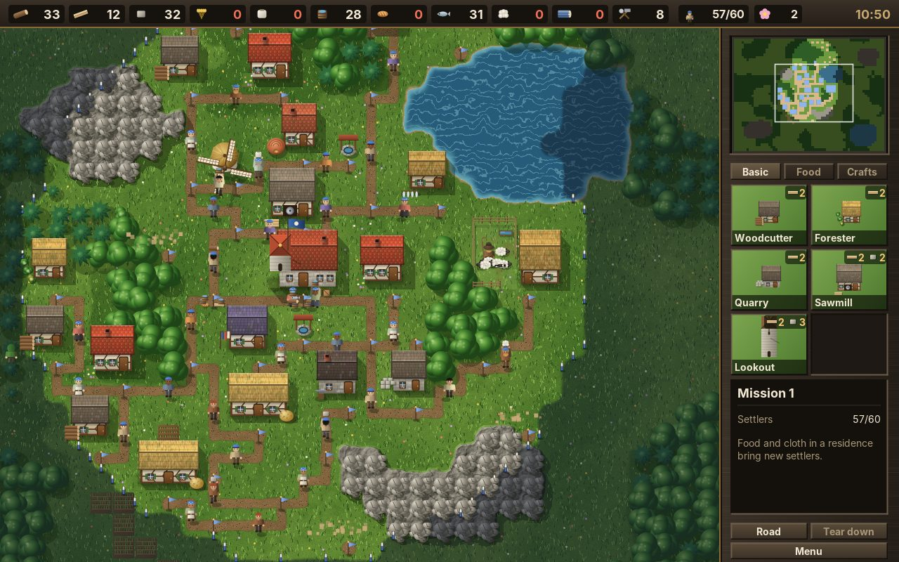
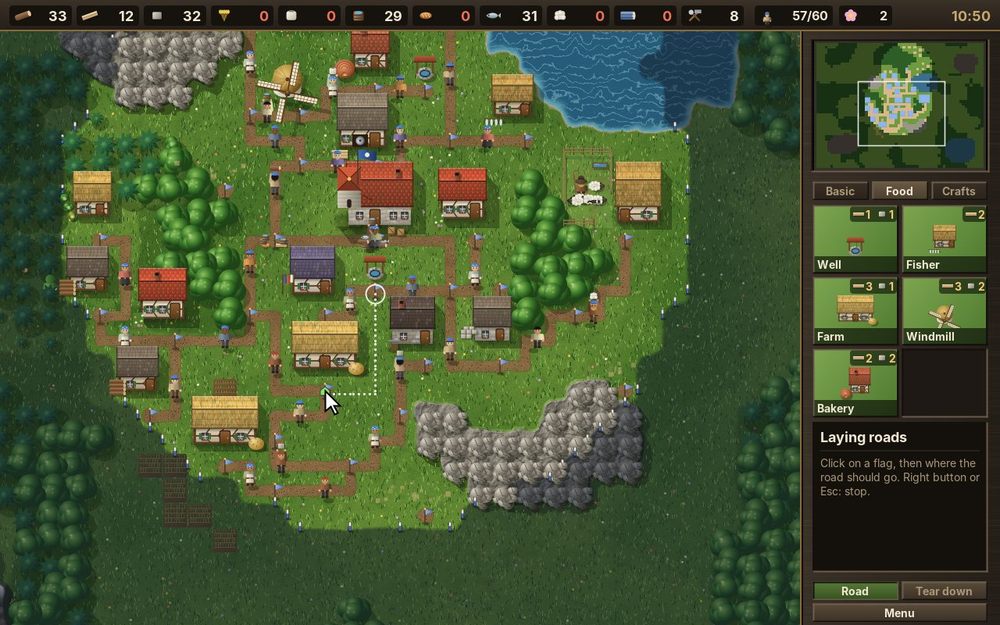
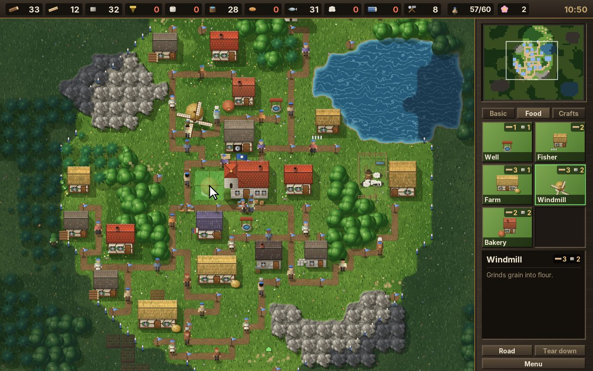
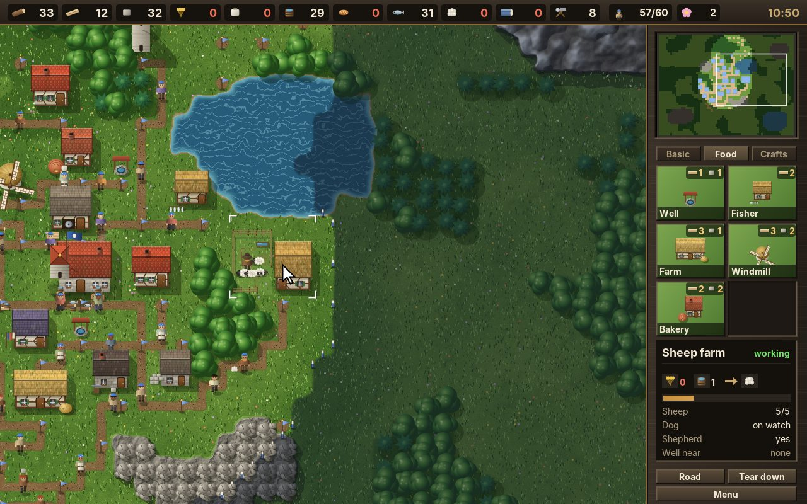
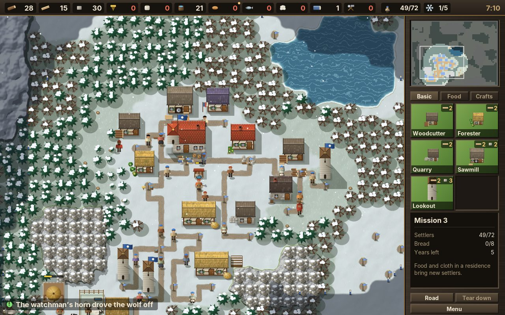
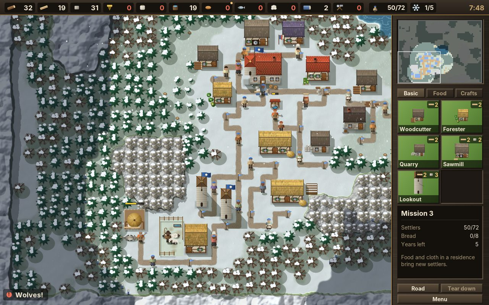
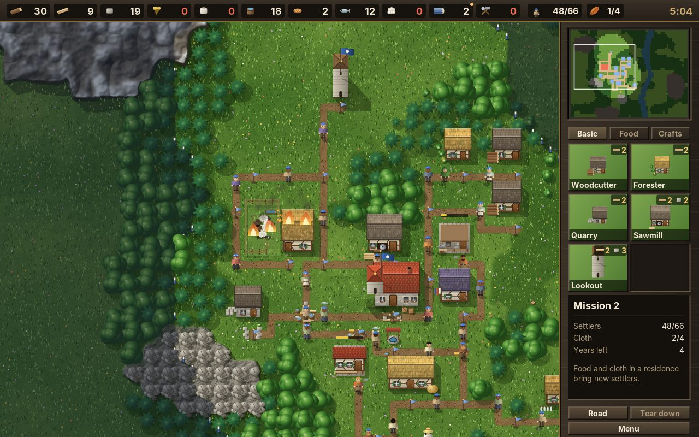
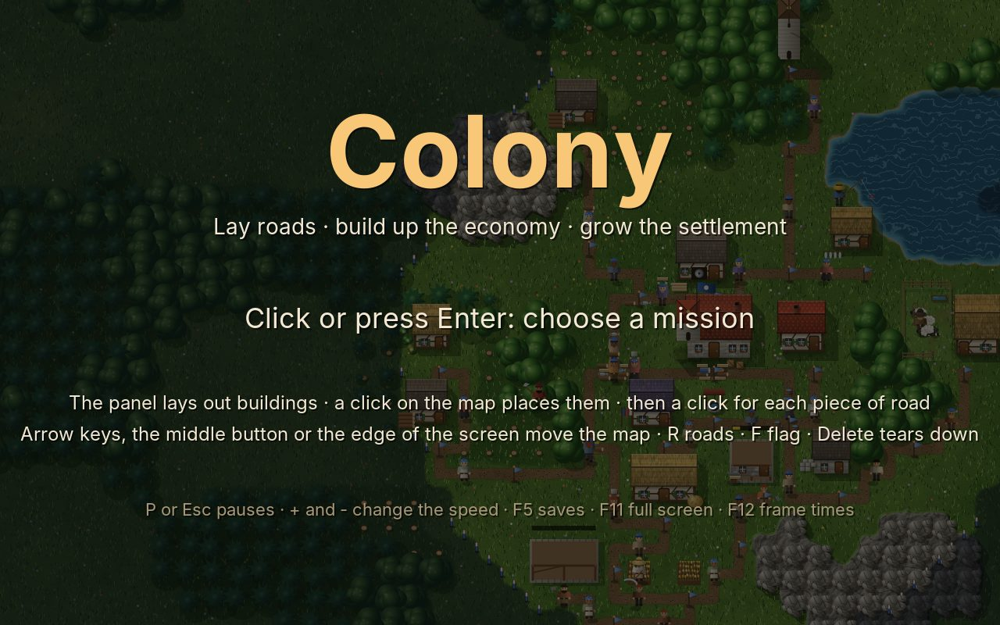
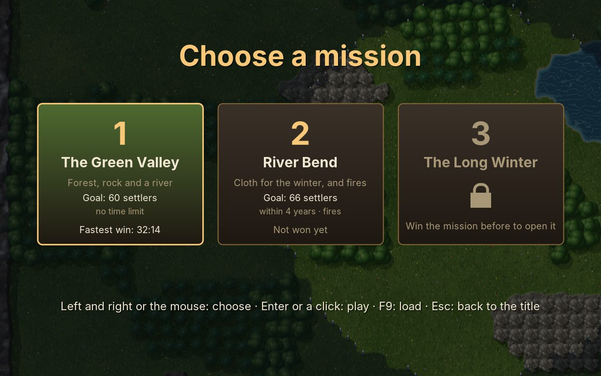

# 32. Colony

Sands (chapter 31) had an economy of one good: crystal became credits, and credits paid for everything. **Colony** is a game about the economy itself. A green valley, a storehouse and a few dozen settlers: the player lays out houses and links them with roads, flag to flag, and every piece of road gets a carrier who takes the goods from one flag to the next. Woodcutters fell trees and foresters plant new ones, the quarry breaks stone, the sawmill turns logs into planks. Farms grow grain, the windmill grinds it, the bakery bakes bread; the sheep farm turns grain and water into wool, the weaver makes cloth. Bread or fish and cloth, brought to a residence, make a new settler, and tools from the toolmaker turn settlers into workers. Lookout towers move the border out. Nobody fights, but the year turns: winter stops the fields, houses catch fire in the summer heat, and wolves come for the sheep.

<figure markdown>
{ width="400" }
{ width="400" }
<figcaption>Mission 1 after eleven minutes (left): 57 of 60 settlers, the storehouse with its flag in the middle, the windmill, the sheep farm at the lake, a road from every door. Laying a road (right): from the flag at the white ring, the dotted line shows the shortest way to the tile under the mouse; one click lays it.</figcaption>
</figure>

Settlement games are built from a few ideas that look simple and are not: goods that travel on a network of roads in short hops, each hop with a person of its own; buildings that ask for what they need instead of being sent it; people who are made from goods and become workers through tools; and a border that grows. Each of them is a small piece of engine, and Colony needs nearly all of the engine there is besides. It is the first game in this handbook whose difficulty lies not in quick hands or in an opponent, but in the shape of what the player builds.

!!! abstract "What you will learn"
    - **A road network**: flags and the roads between them, a road split in two by a new flag, the next road on the shortest way, searched once per goal and kept until the network changes
    - **Carriers**: one person per road, a ware carried one hop at a time, and what happens when the next flag is full
    - **Demand instead of orders**: buildings ask, the storehouses answer twice a second, every ware knows where it is going
    - **Goods and recipes**: a stock with limits, a recipe that takes bread *or* fish, workers made by tools
    - **The land**: a border made of claims, a year of seasons, sheep that graze on their own
    - **Trouble without combat**: fire and the well, wolves, the dog and the watchman's horn
    - **A computer that builds**: a plan in a text file, places scored by what the worker needs, a tower when there is no room
    - **Roads with the mouse**: a building laid out, the road following the mouse from its flag, click by click

The complete game is in [amade-colony-game](https://github.com/datazuul/amade-colony-game).

## The rules

1. A map is up to 64 × 64 tiles of 16 units: grass, forest, rock, water and mountains. The view shows 32 × 24 tiles; the panel on the right takes 128 of the 640 units, the goods bar at the top 20.
2. The settlement starts with a **storehouse**, some goods and 48 settlers living in it. The land within a radius of the storehouse is the settlement's; everything is built inside the border.
3. A building is chosen in the panel and laid out on free land, with room for its **flag** below the door. A **builder** walks there from the storehouse, the goods it costs (planks, stone) are carried to it, and the house rises as far as the goods brought allow.
4. **Roads** run from flag to flag, one tile at a time. Each road has one **carrier**, who walks it back and forth and takes one ware at a time to the other flag. A flag holds eight wares; a long road gets faster when a flag in its middle makes two roads of it.
5. Houses ask for what goes in and put what they make out at their flag. What nobody needs goes to the nearest storehouse. Woodcutters, quarry workers, fishers and farmers need **tools** before they take the job.
6. A **residence** turns bread or fish, and cloth, into a new settler. A **lookout tower** claims the land around it, and its watchman's horn drives wolves away.
7. A year has four seasons. In **winter** the fields do not grow. On missions with **fire**, a house catches fire now and then, more often in summer; a well nearby puts it out, else the house burns down. On missions with **wolves**, they come for the sheep in autumn and winter; the dog drives off one, then needs a rest.
8. Each mission has a goal: a number of settlers, sometimes with goods in the storehouses, sometimes within a number of years. The fastest win of each mission is kept, and winning opens the next.

## Step 1: Roads from flag to flag

In Sands, a harvester drove the whole way from the crystal to the refinery. That is fine for a few vehicles, but a settlement moves hundreds of goods, and the convention of the genre is a different one: a road joins two flags and no more, a ware travels in hops from flag to flag, and each hop is one carrier's work. A network of roads is a graph: the flags are its nodes, the roads its edges, and a road's length is its number of steps. The engine's `RoadNetwork` keeps it:

```java title="amade-game-engine · road/RoadNetwork.java"
--8<-- "amade-game-engine/src/main/java/eu/amadeos/gameengine/road/RoadNetwork.java:network"
```

A road is a list of cells, the first one its first flag's, the last one its second flag's. Two maps answer the questions the mouse asks: `flagAt`, which flag stands on a tile, and `roadAt`, which road runs over it. The cells of the flags are not in `roadAt`, so "a road runs here" always means "a flag can be put here". `connect` checks everything a road must be: steps from cell to cell, no crossing of another road, from its first flag to its second.

```java title="amade-game-engine · road/RoadNetwork.java"
--8<-- "amade-game-engine/src/main/java/eu/amadeos/gameengine/road/RoadNetwork.java:connect"
```

The player's most useful move with a road is to put a flag in its middle: a road of twelve steps carries one ware every 24 steps of walking, two roads of six carry twice as many. `split` makes two roads of one, and the cells of the old road are cut at the new flag:

```java title="amade-game-engine · road/RoadNetwork.java"
--8<-- "amade-game-engine/src/main/java/eu/amadeos/gameengine/road/RoadNetwork.java:split"
```

```java title="amade-game-engine · test/road/RoadNetworkTest.java"
--8<-- "amade-game-engine/src/test/java/eu/amadeos/gameengine/road/RoadNetworkTest.java:test-split"
```

### The next road

A ware at a flag wants to know one thing: which road do I take next? The way to its goal is a shortest path on the graph of flags, and since the roads have lengths, the search is Dijkstra's, not the breadth-first search of the flow fields (chapter 30). There are many wares, but few goals: the houses and the storehouses. So the search runs **from the goal outwards**, once, and gives every flag at once its distance to the goal and the road it takes. `next` is then a lookup in a map. The searches are kept for 64 goals, the least used dropped first, and all of them are forgotten when the network changes:

```java title="amade-game-engine · road/RoadNetwork.java"
--8<-- "amade-game-engine/src/main/java/eu/amadeos/gameengine/road/RoadNetwork.java:next"
```

Ties are broken by the flag number and the road number, never by the order of a hash map. This is the rule of chapter 31 again: a game that is to be saved and loaded and go on exactly as before must not depend on anything Java does not promise.

```java title="amade-game-engine · test/road/RoadNetworkTest.java"
--8<-- "amade-game-engine/src/test/java/eu/amadeos/gameengine/road/RoadNetworkTest.java:test-next"
```

## Step 2: Carriers

A carrier belongs to one road. They walk there from the storehouse, wait in the middle, and look at the two flags: is a ware waiting at one of them whose next road is this one? Then they walk to it, pick it up, carry it to the other flag and put it down. If that flag is the door of the house the ware is meant for, it goes into the house. The four tasks are a small state machine:

```java title="amade-colony-game · domain/Game.java"
--8<-- "amade-colony-game/src/main/java/eu/amadeos/games/colony/domain/Game.java:carrier"
```

Three details make it work:

- **A ware is reserved** while a carrier walks to it, so that the carrier of the other road at the same flag does not walk there too. When the carrier arrives, they ask again whether the ware still wants this road: a new road may have made another way shorter in the meantime.
- **A full flag** holds eight wares. A carrier who finds it full does not wait for room, because the carrier of the next road may be waiting for room at *this* carrier's flag, and the two would wait for each other for ever. Instead they swap: their ware is put down, and a ware that waits there for the way back is taken along. Without a ware to swap, they wait.
- **The question "is this my road?"** is one line: `roads.next(ware.flag, to.flag())`, the lookup of Step 1.

<figure markdown>
{ width="400" }
{ width="400" }
<figcaption>A windmill being laid out (left): the green mark under the mouse says it may stand there, and the panel shows what it costs and what it does. The sheep farm, chosen (right): the shepherd and the dog in the fenced pasture, the panel with what goes in (grain, water), what comes out (wool), how far the work is, the sheep, the dog on watch.</figcaption>
</figure>

## Step 3: Demand: who needs what

Who decides where a ware goes? The obvious design, a house that makes planks and sends them to whoever might need them, puts the decision in the wrong place. Colony turns it round: every building says **what it wants**, and the ware is sent to the nearest building that wants it. A site wants what it costs, less what it has and what is on the way; a house wants what goes into its recipe, up to how many it keeps at the door:

```java title="amade-colony-game · domain/Game.java"
--8<-- "amade-colony-game/src/main/java/eu/amadeos/games/colony/domain/Game.java:demand"
```

The words "and what is on the way" matter more than any other in the economy. Without them, a sawmill that wants two logs asks again in every round until the first two arrive, and twenty logs set out for it. `come` counts each ware that sets out for a building, and arriving counts it back.

A ware made in a house is given a goal at once: the nearest building on the roads that wants it, or, if none does, the nearest storehouse.

```java title="amade-colony-game · domain/Game.java"
--8<-- "amade-colony-game/src/main/java/eu/amadeos/games/colony/domain/Game.java:route"
```

Twice a second, the storehouses look at what is missing. Wares whose goal can no longer be reached (the road was torn down, the house burned) get a new one. Buildings that want goods get them from the nearest storehouse that has them. And people are sent out: a carrier to every road without one, a builder to every site, a worker to every house that is ready. The buildings take turns being first, so that with few planks in the store no site is always served first and the others never:

```java title="amade-colony-game · domain/Game.java"
--8<-- "amade-colony-game/src/main/java/eu/amadeos/games/colony/domain/Game.java:dispatch"
```

Why twice a second and not in every step? The game runs 120 steps a second, and nothing in a settlement needs an answer within a hundred-and-twentieth of a second: a carrier takes seconds to walk a road. Asking less often costs nothing the player can see and saves most of the work. It is also the moment the computer thinks (Step 7).

The step of the whole game is short, because each part has its own method:

```java title="amade-colony-game · domain/Game.java"
--8<-- "amade-colony-game/src/main/java/eu/amadeos/games/colony/domain/Game.java:update"
```

## Step 4: Goods and recipes

What a house holds is a `Stock`: a count for each kind of good, kept in an `EnumMap`, with a limit if the house sets one. It is the smallest class of this chapter, and it is used everywhere: the storehouses, the sites, every house's inputs.

```java title="amade-game-engine · economy/Stock.java"
--8<-- "amade-game-engine/src/main/java/eu/amadeos/gameengine/economy/Stock.java:stock"
```

What a house makes of it is a `Recipe`: a list of inputs, the good it makes, and how long that takes. Each input is a **set** of goods, any one of which will do. The residence needs "bread or fish" and "cloth": `[{BREAD, FISH}, {CLOTH}]`. In the data file that is written `needs bread|fish cloth`. `take` takes one good for each input, or nothing at all; a recipe never takes half of what it needs:

```java title="amade-game-engine · economy/Recipe.java"
--8<-- "amade-game-engine/src/main/java/eu/amadeos/gameengine/economy/Recipe.java:recipe"
```

```java title="amade-game-engine · test/economy/StockTest.java"
--8<-- "amade-game-engine/src/test/java/eu/amadeos/gameengine/economy/StockTest.java:test-recipe"
```

`Stock` and `Recipe` know nothing of the goods of Colony. They take any `enum`, as `Production` of chapter 31 did, and a game about steel and coal uses them as they are. A house then does the same thing in every step: if it is not making anything, has room at its door and has a worker, it takes what its recipe needs and starts; when the time is up, a good is made and put out at the flag. The residence's "good" is a settler. The sheep farm works faster with more sheep, and stops without any:

```java title="amade-colony-game · domain/Game.java"
--8<-- "amade-colony-game/src/main/java/eu/amadeos/games/colony/domain/Game.java:house"
```

The goods and the buildings are data. `buildings.txt` gives each building its tab in the panel, its size, its cost, its work, its recipe and its radius, and the README explains every word. A `Good` is an `enum` with the colour it has on the minimap and in the goods bar:

```java title="amade-colony-game · domain/Good.java"
--8<-- "amade-colony-game/src/main/java/eu/amadeos/games/colony/domain/Good.java:good"
```

```java title="amade-colony-game · domain/Rules.java"
--8<-- "amade-colony-game/src/main/java/eu/amadeos/games/colony/domain/Rules.java:buildings"
```

## Step 5: Builders and workers

A site is a building that is not done. A builder walks there and works, but only **as far as the goods brought allow**: with half the planks there, the house stands half. This one rule makes the game readable: a site that stops growing is waiting for goods, and the player sees it without opening a panel.

```java title="amade-colony-game · domain/Game.java"
--8<-- "amade-colony-game/src/main/java/eu/amadeos/games/colony/domain/Game.java:builder"
```

When the house is done, the storehouse sends a settler to work there. A woodcutter, a quarry worker, a fisher or a farmer needs tools first: the settler takes a set of tools from the store and becomes a worker. Without tools, the house waits, and the panel says so. That is the second way people matter in Colony. Settlers are not only a score; idle ones are the workforce, and tools turn them into workers.

The workers who go out (woodcutter, forester, quarry worker, fisher, farmer, shepherd) look for the nearest work within the radius of their house that nobody else has taken: a grown tree, a free tile for a sapling, a rock with stone left, water with fish, a field to sow or reap. They walk there with A* (chapter 25), work, and walk back with what they got:

```java title="amade-colony-game · domain/Game.java"
--8<-- "amade-colony-game/src/main/java/eu/amadeos/games/colony/domain/Game.java:set-out"
```

The place the worker chose is kept in `spot` and counted as taken. Two woodcutters next to each other would otherwise walk to the same tree, and one of them would come back with nothing.

## Step 6: The land and the year

### The border

The settlement owns the land within a radius of its storehouse and of each lookout tower. Where two circles overlap, the land is owned twice; a tower that burns down must give back its land, but not the land the storehouse still holds. The engine's `Territory` counts **claims** per tile, not owners: a tile is inside while its count is above zero.

```java title="amade-game-engine · tile/Territory.java"
--8<-- "amade-game-engine/src/main/java/eu/amadeos/gameengine/tile/Territory.java:territory"
```

```java title="amade-game-engine · test/tile/TerritoryTest.java"
--8<-- "amade-game-engine/src/test/java/eu/amadeos/gameengine/tile/TerritoryTest.java:test-territory"
```

The circle is `dc² + dr² ≤ r² + r`, not `r²`. With `r²` alone, a circle of tiles has single tiles sticking out at the top, bottom, left and right; the `+ r` rounds it. A building may stand only where every tile and its flag are inside:

```java title="amade-colony-game · domain/Game.java"
--8<-- "amade-colony-game/src/main/java/eu/amadeos/games/colony/domain/Game.java:placement"
```

### Seasons

A year is four seasons of given lengths, from `missions.txt`: mission 3 has a winter of 170 seconds against 90 in mission 1. `Seasons` counts the time and answers which season and which year it is. `update` returns how many seasons began during the step, so that the game can say "Winter" exactly once:

```java title="amade-game-engine · time/Seasons.java"
--8<-- "amade-game-engine/src/main/java/eu/amadeos/gameengine/time/Seasons.java:seasons"
```

```java title="amade-game-engine · test/time/SeasonsTest.java"
--8<-- "amade-game-engine/src/test/java/eu/amadeos/gameengine/time/SeasonsTest.java:test-seasons"
```

Seasons know nothing of snow or harvest; the game decides what they mean. In winter, fields and trees do not grow, and a farmer has nothing to reap. Autumn is the warning, and the message line says so: *Autumn: the harvest ends soon*. A settlement that has no bread and fish in the store at the start of winter makes no settlers until spring.

<figure markdown>
{ width="400" }
{ width="400" }
<figcaption>Mission 3 in winter (left): snow on the ground, the trees and the rocks, the roads trodden into slush. Wolves (right): the message at the bottom left, the sheep farm at the edge of the forest, two towers nearby whose watchmen blow the horn.</figcaption>
</figure>

### Grazing

Sheep are not workers and have no task; they graze. Each one walks to a spot in the pasture, stands there for one to four seconds, and walks to the next. When a wolf comes, they run away from it, faster. The engine's `Wander` is that behaviour, for anything that idles around a home: sheep, chickens, villagers on a square.

```java title="amade-game-engine · motion/Wander.java"
--8<-- "amade-game-engine/src/main/java/eu/amadeos/gameengine/motion/Wander.java:wander"
```

The spot is drawn evenly from the circle, which needs the square root: an angle and a radius drawn without it put half of the spots in the inner quarter of the circle, and the sheep would crowd in the middle.

```java title="amade-game-engine · test/motion/WanderTest.java"
--8<-- "amade-game-engine/src/test/java/eu/amadeos/gameengine/motion/WanderTest.java:test-wander"
```

## Step 7: Fire and wolves

Colony has no enemy who builds, but it has trouble that comes on its own. Both are made so that the player can **prepare** for them, which is the difference between pressure and bad luck.

**Fire.** Now and then a house catches fire, every 150 seconds or so in summer and every 450 in the other seasons, the first never before five minutes. A well with a worker within eight tiles puts it out in five seconds. Without one, the house burns for 25 seconds and is gone, with what was in it, and leaves ashes where nothing can be built for a minute. The computer builds what burned again; the player must do it themselves.

```java title="amade-colony-game · domain/Game.java"
--8<-- "amade-colony-game/src/main/java/eu/amadeos/games/colony/domain/Game.java:fire"
```

**Wolves.** On missions with wolves, they leave their dens in autumn and winter for the nearest pasture, two at a time in winter. The dog at the sheep farm drives one away, then needs twelve seconds of rest. A tower near the pasture blows its horn at the next one. A wolf that gets through takes a sheep. New lambs come every 45 seconds while the herd is smaller than five, so a lost sheep is a slower farm, not a lost one.

```java title="amade-colony-game · domain/Game.java"
--8<-- "amade-colony-game/src/main/java/eu/amadeos/games/colony/domain/Game.java:wolves"
```

<figure markdown>
{ width="400" }
<figcaption>The sheep farm on fire in mission 2, after five minutes: flames on the roof and in the pasture, and a red mark on the minimap. The only well is too far away; unless one is built and manned within reach, the farm is gone in 25 seconds.</figcaption>
</figure>

## Step 8: The computer builds

In Sands the computer played against the player. Here it plays alone, on the title screen and in the tests, and that second use is the more important one. `GameTest` lets the computer play mission 1 from the start and asks that it is won within fifteen minutes. If someone changes a number in `buildings.txt` and the economy stalls (too little stone for the toolmaker, a residence that waits for cloth for ever), the build fails:

```java title="amade-colony-game · test/domain/GameTest.java"
--8<-- "amade-colony-game/src/test/java/eu/amadeos/games/colony/domain/GameTest.java:test-computer"
```

The computer is simple on purpose. It builds in the order of `plan.txt`, waits until the storehouses have what the next building costs, and never has more than two sites at a time. When it finds no place three times in a row, it builds a lookout tower first: no room means too little land.

```java title="amade-colony-game · domain/Overseer.java"
--8<-- "amade-colony-game/src/main/java/eu/amadeos/games/colony/domain/Overseer.java:think"
```

Where a building goes is a score for every free place inside the border: near the storehouse, and near what its worker needs. A woodcutter wants trees within its radius, a quarry rock, a fisher water, a farm free land; a forester wants to be near a woodcutter; a tower wants to be **far** from the storehouse, where it gains the most land.

```java title="amade-colony-game · domain/Overseer.java"
--8<-- "amade-colony-game/src/main/java/eu/amadeos/games/colony/domain/Overseer.java:score"
```

The road from the new flag goes to the nearest flag that already leads to the storehouse, and is then cut in the middle, where a flag fits, until no piece is longer than six steps; each piece gets a carrier of its own:

```java title="amade-colony-game · domain/Overseer.java"
--8<-- "amade-colony-game/src/main/java/eu/amadeos/games/colony/domain/Overseer.java:connect"
```

The computer wins mission 1 in about eleven minutes. A player who plans well is faster.

## Step 9: Laying out and roads with the mouse

The panel has three tabs of buildings, each cell with its picture and its cost. A click on a cell picks a building, and the next click on the map lays it out where the marks were green. The interesting part is the road. A new building with a flag that leads nowhere is useless, so the game goes straight on to the road: from the new flag, the shortest way to the tile under the mouse is shown as a dotted line, green where it may be laid and red where it may not.

```java title="amade-colony-game · ui/game/ColonyGame.java"
--8<-- "amade-colony-game/src/main/java/eu/amadeos/games/colony/ui/game/ColonyGame.java:planning"
```

The way is found by A* over the free tiles inside the border, so the line bends around houses and trees by itself:

```java title="amade-colony-game · domain/Game.java"
--8<-- "amade-colony-game/src/main/java/eu/amadeos/games/colony/domain/Game.java:route-road"
```

A click lays the piece of road the line shows and goes on from its end, until the road meets a flag or a road that is already there. Then laying stops, because the building is connected. Each piece is checked by `canPave` and laid by `pave`. A road that ends on another road splits it there, and a road that ends on free land puts a new flag there:

```java title="amade-colony-game · domain/Game.java"
--8<-- "amade-colony-game/src/main/java/eu/amadeos/games/colony/domain/Game.java:pave"
```

```java title="amade-colony-game · ui/game/ColonyGame.java"
--8<-- "amade-colony-game/src/main/java/eu/amadeos/games/colony/ui/game/ColonyGame.java:click"
```

The test plays exactly that with a mouse: the woodcutter from the first cell of the panel, a click on the map, a click on the storehouse's flag, and a carrier on the new road a second later:

```java title="amade-colony-game · test/ui/game/ColonyGameTest.java"
--8<-- "amade-colony-game/src/test/java/eu/amadeos/games/colony/ui/game/ColonyGameTest.java:test-lay-out"
```

A click on a house, a flag or a road shows it in the panel: the recipe with what is there and what is missing, how far the work is, whether a worker or tools are missing, the sheep and the dog, the wares waiting at a flag, the carrier of a road. The panel answers the question every settlement game asks all the time: *why is nothing happening here?*

```java title="amade-colony-game · ui/game/Hud.java"
--8<-- "amade-colony-game/src/main/java/eu/amadeos/games/colony/ui/game/Hud.java:building-info"
```

## Step 10: Saving the settlement

Chapter 31 saved a battle with `Snapshot`, exact to the bit. A settlement has more lists but the same kinds of things: buildings with their stock, flags, roads, wares with their goals, people with their task and the path they walk, trees, fields, fish, sheep with their spot, wolves, the seasons and the random numbers. `Archive` writes them all and reads them back:

```java title="amade-colony-game · domain/Archive.java"
--8<-- "amade-colony-game/src/main/java/eu/amadeos/games/colony/domain/Archive.java:write"
```

The flags and roads keep their numbers, because wares and carriers refer to them. `RoadNetwork` therefore has `connect` and `addFlag` with a given number, and `restore` sets its counters, so that the next new flag after loading gets the number it would have got without saving. The searches of Step 1 are not saved: they are worked out again the first time they are needed.

```java title="amade-colony-game · domain/Archive.java"
--8<-- "amade-colony-game/src/main/java/eu/amadeos/games/colony/domain/Archive.java:read"
```

The test is the one of chapter 31: the computer plays mission 3 for eight minutes, through fire and wolves; the game is saved and loaded; both run on for three minutes, and their save files must be the same.

```java title="amade-colony-game · test/domain/GameTest.java"
--8<-- "amade-colony-game/src/test/java/eu/amadeos/games/colony/domain/GameTest.java:test-archive"
```

## Step 11: Drawing the valley

### The ground, summer and winter

The ground is drawn as in Sands: every pixel worked out from noise and the tiles of the map, in squares of 8 × 8 tiles, on other threads. A square keeps its ground without roads, and the roads and the border are mixed in again when they change: roads as trodden dirt, the land outside the border dimmed.

```java title="amade-colony-game · ui/game/Terrain.java"
--8<-- "amade-colony-game/src/main/java/eu/amadeos/games/colony/ui/game/Terrain.java:update"
```

New is winter. The slow drawing of the ground also works out **how much snow each pixel takes**: much on open grass, less under the trees and on steep rock, none on water. Mixing then makes two pictures of each square, summer and winter. At the end of autumn the winter picture fades in over the summer one, and in spring it fades out; a frame draws at most two pictures per square, and no pixel is worked out again.

```java title="amade-colony-game · ui/game/Terrain.java"
--8<-- "amade-colony-game/src/main/java/eu/amadeos/games/colony/ui/game/Terrain.java:mix"
```

```java title="amade-colony-game · ui/game/Terrain.java"
--8<-- "amade-colony-game/src/main/java/eu/amadeos/games/colony/ui/game/Terrain.java:render"
```

### Houses and people

Fifteen buildings, each with its site, all drawn from vector shapes when the window opens: half-timbered walls, roofs of tiles, slate or thatch, the windmill whose sails turn while it grinds, the sheep farm with its fence. One method draws every house from its walls, roof and windows; the special ones add their parts:

```java title="amade-colony-game · ui/game/Houses.java"
--8<-- "amade-colony-game/src/main/java/eu/amadeos/games/colony/ui/game/Houses.java:building"
```

A settlement game is watched more than played, and people are what the eye follows. `Folk` gives every person a look: shirt, legs or skirt, skin, hair, a beard, an apron, and **headwear by job**: the carrier's cap, the woodcutter's knitted cap, the farmer's straw hat, the baker's white toque, the shepherd's felt hat. Every worker who goes out carries the tool of their trade: an axe, a spade, a pick, a rod, a scythe, a crook. Carriers get one of twelve looks by their number, so the crowd on the roads is not twelve copies of one person.

```java title="amade-colony-game · ui/game/Folk.java"
--8<-- "amade-colony-game/src/main/java/eu/amadeos/games/colony/ui/game/Folk.java:look"
```

```java title="amade-colony-game · ui/game/Pictures.java"
--8<-- "amade-colony-game/src/main/java/eu/amadeos/games/colony/ui/game/Pictures.java:pictures"
```

The settlement is drawn in layers: the ground; then everything that stands, sorted by its foot, so that a person behind a house is hidden by it and one in front of it is not; then smoke and sparks; then the marks of what the player is doing.

```java title="amade-colony-game · ui/game/ColonyPainter.java"
--8<-- "amade-colony-game/src/main/java/eu/amadeos/games/colony/ui/game/ColonyPainter.java:paint"
```

## Step 12: Everything else

- **Events.** The rules say what happened as records, as since chapter 26: built, made, settled, a season began, a house burning, doused, burned, wolves, barked, a sheep taken, a lamb born, a road paved. `Effects` turns them into smoke, sparks, snowflakes and sounds; the message line at the bottom of the map shows the ones the player must know about.
- **The minimap.** The engine's `Minimap` (chapter 31): one pixel per tile, the roads, the houses and the border on it, white in winter. It is painted again every half second, and only when something changed.
- **Wide screens.** As in Sands, the canvas widens up to 1024 units, the valley gets the extra width, and the panel is drawn moved to the right edge, with the mouse moved back for its clicks ([chapter 31](31-sands.md#the-panel-and-a-frame-time-measured)). The goods bar along the top grows with the screen; its background is a cached face, kept once per width.
- **Music.** An easy tune in MML in three-four time over a walking bass, and short ones for winning and losing.
- **Scenes.** Title (over a settlement the computer builds), the choice of a mission (each card with a preview of its map), the mission, the pause (continue, save, load, leave), the result with the settlers, the houses built, the goods made, the road laid, and what fire and wolves took.

<figure markdown>
{ width="400" }
{ width="400" }
<figcaption>The title (left), over a settlement the computer builds, and the choice of a mission (right): each with its goal, its years, and whether there are fires and wolves.</figcaption>
</figure>

```java title="amade-colony-game · ui/game/Effects.java"
--8<-- "amade-colony-game/src/main/java/eu/amadeos/games/colony/ui/game/Effects.java:react"
```

## What moved into the engine

| Package | What | For |
|---|---|---|
| `road` | `RoadNetwork` | flags and the roads between them, split by a new flag, the next road on the shortest way |
| `economy` | `Stock`, `Recipe` | goods counted by kind with limits, what a house makes of them, with alternatives |
| `time` | `Seasons` | a year of seasons of any length, which one began |
| `tile` | `Territory` | land claimed in circles, overlapping, given back |
| `motion` | `Wander` | something that grazes around a home and flees |

None of them knows of sheep or planks. The city builder that came next, Town (chapter 33), needed other parts after all: its services reach in circles that overlap and add up, which `Territory` does not count, so it got a `Coverage` of its own.

## Exercises

1. **Donkeys.** On a busy road, the carrier is the bottleneck. Give a road a second carrier, a donkey bred on a farm, when more than four wares wait at its flags. What does the carrier's state machine need to know about the other one?
2. **Priorities.** Every site is served in turn. Let the player give one building priority: its demand is answered first. Where in `dispatch` does that go?
3. **Roads that wear in.** A road that carries much becomes a paved road, and carriers walk it faster. Count the wares per road. What changes in `RoadNetwork`, and what only in the game?
4. **A second storehouse.** The game already sends goods to the nearest storehouse. Add it to the panel, and watch the wares stop crossing the whole map. Which goods should go to which store?
5. **Trade.** A market at the edge of the map buys cloth and sells tools. Is it a building with a recipe, or something else?
6. **Seasons in `Stock`.** Bread keeps, fish does not. Let fish spoil in summer: one fish less in every store each minute. Is that a job for `Stock`, for `Seasons`, or for the game?
