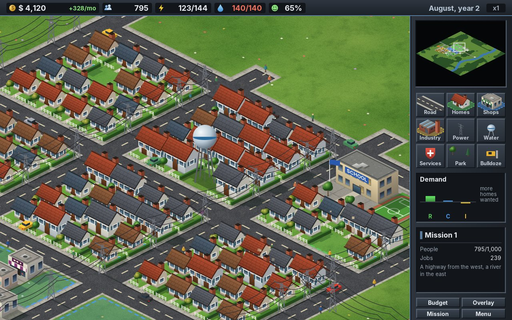
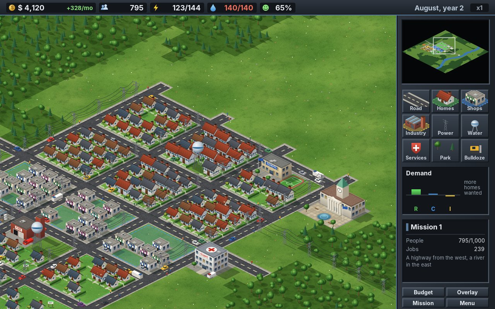
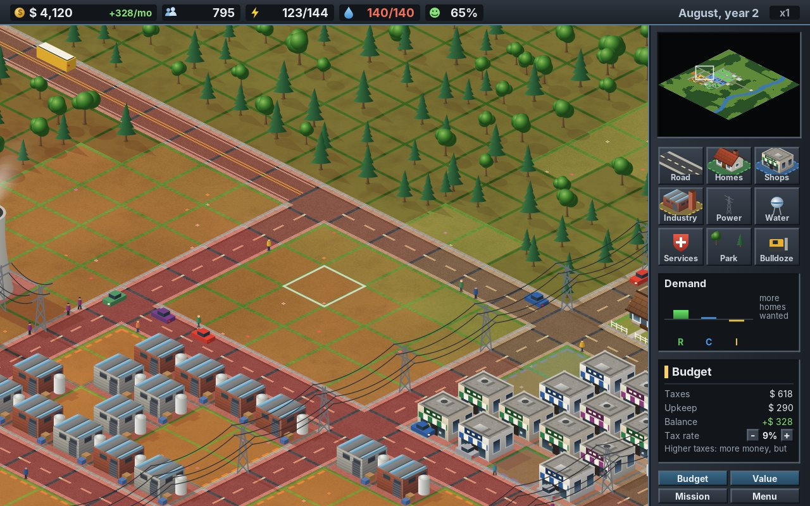
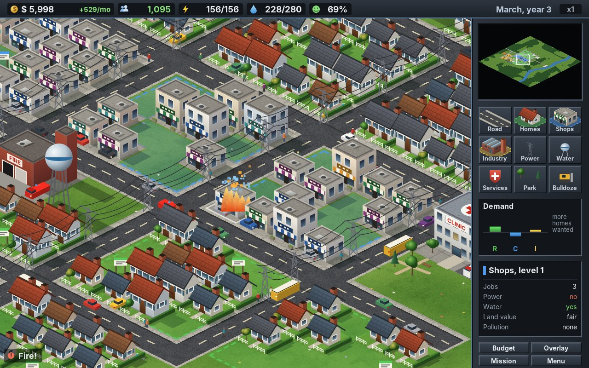
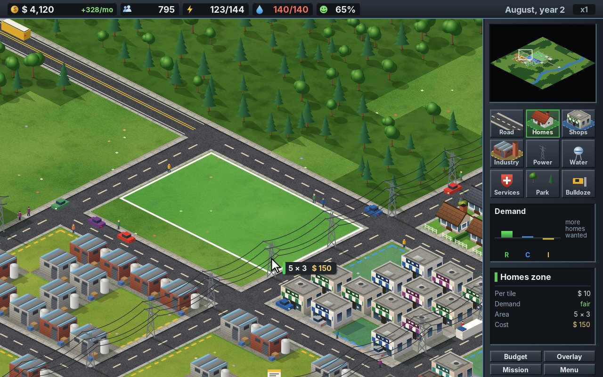
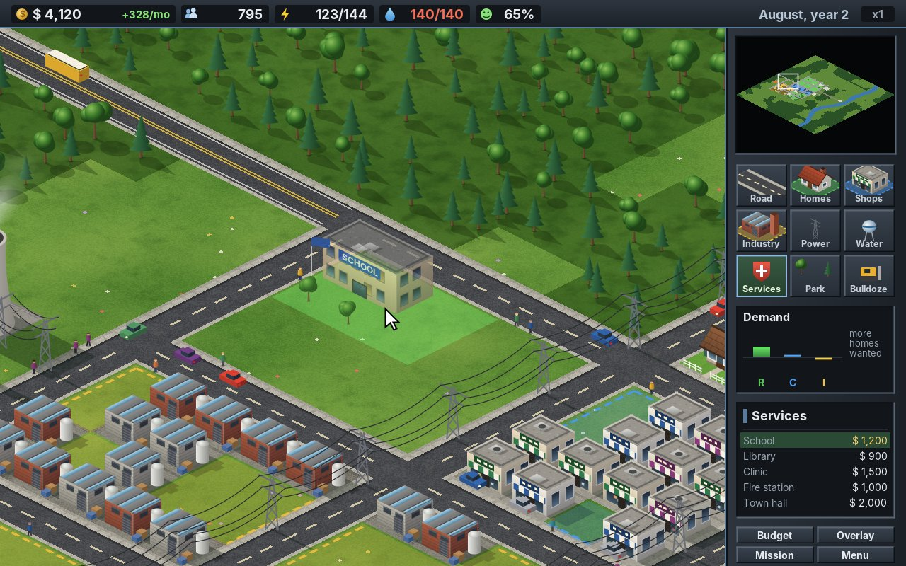
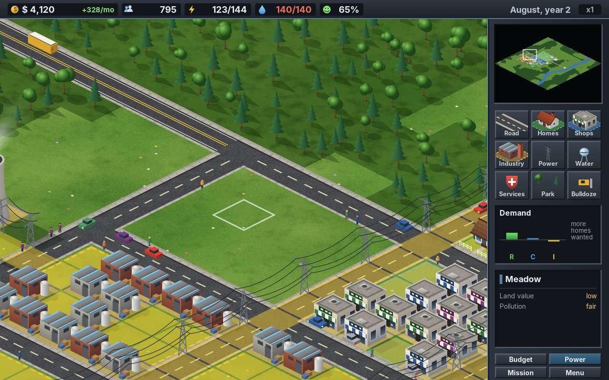
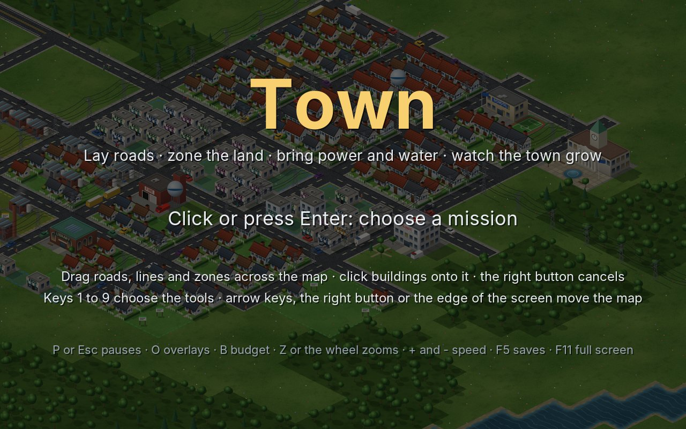
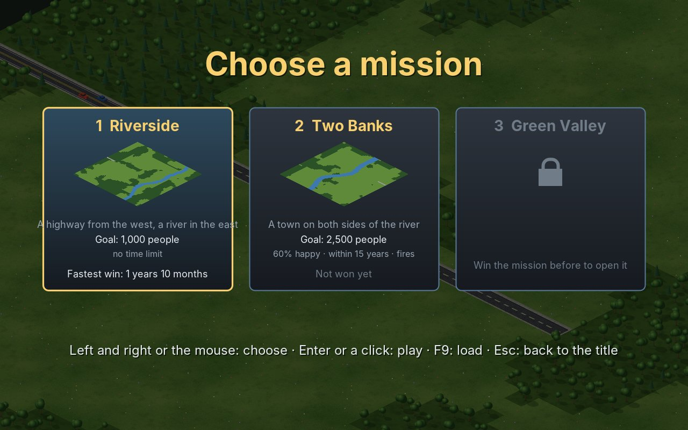

# 33. Town

Colony (chapter 32) was a game about goods: every plank was carried, every loaf had a way to go. **Town** turns the camera and the economy around. The player no longer builds houses but *says where houses may stand*: a highway, a river and green land; roads from the highway, zones for homes, shops and industry, power and water, and the town grows by itself, lot by lot, where people want to live and work. Homes need jobs and shops, shops need people, industry starts a town but its smoke lowers the land value around it. Coal plants and wind turbines make the power, a pump house on the shore and water towers bring the water; schools, a library, a clinic, a fire station, the town hall and parks make people happier and the land worth more. Taxes pay for the upkeep, and the budget must hold.

<figure markdown>
{ width="400" }
{ width="400" }
<figcaption>Mission 1 after a year and a half (left): row houses on lawns, the water tower, the school with its sports field, cars on both lanes and people on the pavements. The wheel shows the same district from further away (right): the town hall on its plaza, the clinic, shops on blue lots.</figcaption>
</figure>

It is also the first game in this handbook that is drawn **isometric**: the map is still a grid of square tiles, but the player looks at it from a corner and from above, so every tile becomes a diamond and every house shows two walls and its roof. That is a step for the engine more than for the game. A flat map is drawn tile after tile, row after row; an isometric one needs a projection that turns the world into a picture and the mouse back into the world, an order in which buildings of different sizes cover each other correctly, a minimap turned like the view, and a way to draw a big map that is quick enough for a large window.

!!! abstract "What you will learn"
    - **The isometric projection**: a flat, square world turned into a picture of diamonds, walls and roofs drawn through transforms, the mouse back to its tile
    - **Drawing order**: the painter's algorithm for things of any size, a sort on footprints instead of rows
    - **Zones instead of buildings**: the player says where, demand decides when, and a lot grows, waits or falls back
    - **Networks of tiles**: power that flows from plants through lines and buildings, served from the nearest load outward
    - **Reach**: services and water towers that serve a circle, and land value made from what is near
    - **Demand, mood and the budget**: three numbers that pull on each other, taxes that push everything
    - **A view that zooms**, and a ground that is painted only where it changed

The complete game is in [amade-town-game](https://github.com/datazuul/amade-town-game).

## The rules

1. A map is 64 × 64 tiles of 16 units: meadow, forest, water and a **highway** that comes in from the edge. The view shows the map in a picture of diamonds 32 units wide and 16 high; the panel on the right takes 128 of the 640 units, the bar at the top 20.
2. **Roads** are dragged from tile to tile. Only roads joined to the highway bring people. A road over water is a bridge; it must run straight.
3. **Zones** are dragged as rectangles: homes (R), shops (C) or industry (I). A zoned tile is a **lot**. A lot grows a building when its zone is wanted, a road joined to the highway is within two tiles, and power reaches it. From the second level it needs water; homes reach the third only near a school. Each level holds more people or jobs.
4. **Power** comes from coal plants (much, with smoke) and wind turbines (a little, clean). It flows through power lines, zones and buildings that touch along an edge. When there is not enough, the lots furthest from the plants go dark.
5. **Water** comes from pump houses on the shore and reaches the lots within the circle of a water tower. When there is too little, some lots go dry, always the same ones.
6. **Services** (school, library, clinic, fire station, town hall) and **parks** serve a circle. They make people happier and the land worth more; smoke makes it worth less. A lot without power or water for two months falls back a level.
7. **Demand** for each zone moves every month: people come for jobs, shops and industry come for people, high taxes put everyone off, a happy town draws people. The **budget** is taxes on people and jobs against the upkeep of roads, lines and buildings.
8. On missions with **fire**, a lot catches fire now and then and may set its neighbours alight. A fire station in reach sends its truck; otherwise the building burns down and leaves rubble.
9. Each mission has a goal: a number of people, sometimes with a share of them happy and a number of years. Below -$5,000 the mission is lost. The fastest win of each mission is kept, and winning opens the next.

## Step 1: The isometric view

A flat map is drawn by looking down on it: a tile at column `c`, row `r` is a square at `(c · 16, r · 16)`. The isometric view looks at the same map from the corner where `x` and `y` are largest, from above at an angle. A tile becomes a diamond twice as wide as high, the classic 2:1 of city builders: one step along `x` goes half a tile right and a quarter tile down in the picture, one step along `y` half a tile left and a quarter tile down.

The important decision is what *not* to change: **the rules stay flat**. A tile is still 16 units a side, `x` still runs along the columns, a building still stands at a column and a row. Only the drawing turns the world. The engine's `IsoProjection` does the turning, in both directions:

```java title="amade-game-engine · iso/IsoProjection.java"
--8<-- "amade-game-engine/src/main/java/eu/amadeos/gameengine/iso/IsoProjection.java:projection"
```

`pictureX` and `pictureY` take a point of the world, with a height above the ground, to the *picture*, the plane in which the whole map is drawn; the camera then moves over that picture like over any big world. The height is in the picture's units, so a wall of 20 is 20 units tall on the screen however large the tiles are. The way back, `worldX` and `worldY`, works for points on the ground, and that is all the mouse needs: the tile under the mouse is `col` and `row` of the picture point under it.

```java title="amade-game-engine · test/iso/IsoProjectionTest.java"
--8<-- "amade-game-engine/src/test/java/eu/amadeos/gameengine/iso/IsoProjectionTest.java:test-projection"
```

### Walls and roofs through transforms

Drawing a house point by point through `pictureX` and `pictureY` works, but it is tedious: every window becomes four projected corners. The projection is also an affine map, so it can be put on the graphics as a transform. `ground(h)` turns the plane at height `h` into the picture: a rectangle of 16 × 16 drawn under it comes out as a diamond, a roof drawn as a rectangle comes out as the roof seen from above. `frontWall` and `sideWall` turn the plane of a wall: the game draws the wall as if it faced the viewer, with its windows, its door and its bricks, and Java2D shears all of it into place.

```java title="amade-game-engine · iso/IsoProjection.java"
--8<-- "amade-game-engine/src/main/java/eu/amadeos/gameengine/iso/IsoProjection.java:transforms"
```

That is how every building of the game is drawn: a box is two walls and a roof, each drawn flat through its transform. One method draws a whole building, walls with rows of windows, a door, a flat or gabled roof:

```java title="amade-town-game · ui/game/Art.java"
--8<-- "amade-town-game/src/main/java/eu/amadeos/games/town/ui/game/Art.java:building"
```

### Only what the view shows

A flat map draws the tiles from the first visible column and row to the last. In an isometric picture the visible part of the map is a diamond cut by the view's rectangle, and a tall building whose foot lies below the view can still reach into it. `visible` works out the range of columns and rows to look at, with a margin of rows below for the tallest tower:

```java title="amade-game-engine · iso/IsoProjection.java"
--8<-- "amade-game-engine/src/main/java/eu/amadeos/gameengine/iso/IsoProjection.java:visible"
```

## Step 2: What covers what

On a flat map, nothing covers anything. In the isometric view, a house covers the lawn behind it, a tree covers the street behind it, a car disappears behind a factory. The painter's algorithm draws everything from back to front, and for things of one tile "back" is easy: a smaller `x + y` is further back. A building of three tiles by two breaks that rule. A tree on the tile behind its right end has a larger `x + y` than the building's middle, and sorted by `x + y` it would be drawn over the building's wall.

The engine's `DepthSort` sorts on **footprints**, rectangles of the ground: A lies behind B if A ends before B begins along `x`, or along `y`. That relation only orders things that touch in the picture, so the sort compares only things whose boxes in the picture overlap, found by a sweep along the picture's `x`, and draws them in topological order, the nearest `x + y` first among those that are free:

```java title="amade-game-engine · iso/DepthSort.java"
--8<-- "amade-game-engine/src/main/java/eu/amadeos/gameengine/iso/DepthSort.java:sort"
```

```java title="amade-game-engine · test/iso/DepthSortTest.java"
--8<-- "amade-game-engine/src/test/java/eu/amadeos/gameengine/iso/DepthSortTest.java:test-sort"
```

Town puts everything that stands into one sort each frame: the lots with their buildings, the plants and services, trees, pylons, cars, people, rubble and the zone signs. A building with several parts, a factory with its chimney, is one item, its parts ordered inside its own picture. Flat things, lawns, car parks, the yard of the coal plant, are not sorted at all: they are drawn with the ground, before everything that stands.

```java title="amade-town-game · ui/game/TownPainter.java"
--8<-- "amade-town-game/src/main/java/eu/amadeos/games/town/ui/game/TownPainter.java:things"
```

## Step 3: Zones, lots and growth

In Colony the player built every house. In a city builder the player only zones land, and the town decides what grows. A zoned tile is a lot of level 0, empty land with a sign. The rules visit every lot once a month, in eight slices so the work is spread over the month, and decide: grow, wait, or fall back.

```java title="amade-town-game · domain/Game.java"
--8<-- "amade-town-game/src/main/java/eu/amadeos/games/town/domain/Game.java:grow"
```

Each condition is something the player can see and fix: no road to the highway (the sign stays empty), no power (a crossed-out bolt blinks over the lot), no water from the second level (a crossed-out drop), not enough land value for the next level, no school for tall homes. The chance to grow rises with demand, so a wanted zone fills quickly and a zone nobody wants fills slowly or not at all. A lot that lacks power or water for two months falls back; a zone that is badly over-built falls back too, now and then. The random numbers come from the game's seeded random, so a town grows the same way every time it is played the same way.

Zoning is a rectangle dragged with the mouse. The rules keep what can be zoned, free land or an empty lot of another zone, and the cost per tile:

```java title="amade-town-game · domain/Game.java"
--8<-- "amade-town-game/src/main/java/eu/amadeos/games/town/domain/Game.java:zone"
```

Roads are dragged too, from tile to tile, along the columns first and then the rows. Only roads joined to the highway count: a flood from the highway along the roads marks them once per survey, and a lot looks for a marked road within two tiles.

```java title="amade-town-game · domain/Game.java"
--8<-- "amade-town-game/src/main/java/eu/amadeos/games/town/domain/Game.java:roads"
```

## Step 4: Power through the town

Power is a network. A coal plant puts 120 MW into it, every lot and building takes some out, and in between it flows through power lines and through everything else that is built: zones and buildings that touch along an edge carry it to each other. A block of homes therefore needs one line to it, not a line to every house; a strip of meadow between two blocks needs a line across it.

The engine's `SupplyGrid` solves such a network. Tiles that carry are conductors; sources put an amount in, loads take an amount out. `solve` finds the networks, groups of conductors that touch along an edge, and serves the loads of each network in the order a flood from its sources reaches them, until the sources run dry:

```java title="amade-game-engine · tile/SupplyGrid.java"
--8<-- "amade-game-engine/src/main/java/eu/amadeos/gameengine/tile/SupplyGrid.java:grid"
```

Serving from the nearest load outward is a decision about what the player sees. A town that builds more than its plant can feed loses power **at the far end**, in the newest streets, where the player is looking anyway, and not here and there at random. A load is served wholly or not at all, so a lot is lit or dark, never dim.

```java title="amade-game-engine · test/tile/SupplyGridTest.java"
--8<-- "amade-game-engine/src/test/java/eu/amadeos/gameengine/tile/SupplyGridTest.java:test-grid"
```

Once a slice the game surveys the whole town: which roads reach the highway, the power network, the water, the reach of the services, pollution and land value. For a map of 64 × 64 tiles that is a few thousand small loops, nothing against a frame.

```java title="amade-town-game · domain/Game.java"
--8<-- "amade-town-game/src/main/java/eu/amadeos/games/town/domain/Game.java:survey"
```

## Step 5: Reach, water and land value

Water towers, schools, the library, the clinic, the fire station, the town hall and parks all serve a **circle**. The engine's `Coverage` adds the circles: a tile knows how many places reach it, and how close the nearest one is, as a strength from 1 on the place itself down to almost 0 at the edge of its reach.

```java title="amade-game-engine · tile/Coverage.java"
--8<-- "amade-game-engine/src/main/java/eu/amadeos/gameengine/tile/Coverage.java:coverage"
```

A strength cannot be taken back out of a sum, so the game does not keep the coverage up to date place by place: it clears it and adds every place again in each survey. That is the simplest correct thing, and for a few dozen places it costs nothing.

Water is the tower's circle and the pumps' supply. When the pumps give less than the lots in reach of the towers ask for, a share of the lots goes dry, and it is always the same ones: each tile has a fixed number between 0 and 1, and those whose number lies above the share go without. Lots that went dry at random in every survey would flicker between wet and dry and never grow.

Land value is made from what is near: parks most, then school, town hall, clinic, library and fire station, a little for the riverside, minus the smoke.

```java title="amade-town-game · domain/Game.java"
--8<-- "amade-town-game/src/main/java/eu/amadeos/games/town/domain/Game.java:appraise"
```

Smoke comes from industrial lots, more with every level, and from the coal plant, falling off with the distance; forests swallow some of it.

```java title="amade-town-game · domain/Game.java"
--8<-- "amade-town-game/src/main/java/eu/amadeos/games/town/domain/Game.java:pollute"
```

## Step 6: Demand, mood and the budget

Three numbers, one per zone, from -1 to 1, decide what the town wants. They pull on each other: homes are wanted when there are jobs for more people, shops when there are people to buy, industry when there are people to work and, because industry also sells out of town, from the start. That last part is what starts a town at all: with no people, nobody wants shops or homes, but industry is wanted, and its jobs then call for homes.

```java title="amade-town-game · domain/Game.java"
--8<-- "amade-town-game/src/main/java/eu/amadeos/games/town/domain/Game.java:demand"
```

Each number moves halfway to its new value every month, so demand does not jump when a block grows at once. Taxes above the usual 9 % push every zone down, and a happy town pulls people in. How happy the people are is worked out from what reaches their homes: services, parks, clean air, power, water, enough jobs and fair taxes, each weighed by how many people live on the lot.

```java title="amade-town-game · domain/Game.java"
--8<-- "amade-town-game/src/main/java/eu/amadeos/games/town/domain/Game.java:mood"
```

At the end of a month the budget is drawn up: taxes on people and jobs, upkeep for every road, line and building. Then fires, advice and whether the mission is over:

```java title="amade-town-game · domain/Game.java"
--8<-- "amade-town-game/src/main/java/eu/amadeos/games/town/domain/Game.java:month"
```

<figure markdown>
{ width="400" }
<figcaption>The budget in the panel, with the tax rate and its buttons, over the land-value overlay: red near the coal plant and the industry, green in the homes around the school and the parks.</figcaption>
</figure>

**Advice** is a city builder's way of teaching: the town says what it lacks. A town without a road to the highway, without power, without water, with homes but no jobs, with smoke over the homes, with the money running low: each has its hint, shown in the message line: at most one a month, the most urgent first, and the same one not again within a year.

## Step 7: Fire and the truck

On missions with fire, a lot catches fire now and then. Halfway through, the fire reaches for the lots next door. A fire station in reach sends its truck, and the truck puts the fire out a few seconds later; without one, the building burns down and leaves rubble for two months.

```java title="amade-town-game · domain/Game.java"
--8<-- "amade-town-game/src/main/java/eu/amadeos/games/town/domain/Game.java:fires"
```

The rules only say that a truck was sent. The drawing sends a real one: a red truck leaves the station, finds its way along the roads with a breadth-first search, and drives with a siren to the fire, where it parks until the fire is out. The town's traffic is the same idea without a goal: cars, buses and lorries, one for every 25 people, drive the roads on the right lane, turning at random at crossings, and come in from the highway.

```java title="amade-town-game · ui/game/Traffic.java"
--8<-- "amade-town-game/src/main/java/eu/amadeos/games/town/ui/game/Traffic.java:drive"
```

People walk on the pavements, one for every 12 people, up to 120. A walker goes from corner to corner of the road tiles, a metre in from the edge: on along the pavement, round the corner of a block, to the touching corner of the next road tile, and now and then across the street. A corner is pavement unless the roads on both its sides and the road between them meet there; the highway has none.

```java title="amade-town-game · ui/game/Walkers.java"
--8<-- "amade-town-game/src/main/java/eu/amadeos/games/town/ui/game/Walkers.java:pavement"

--8<-- "amade-town-game/src/main/java/eu/amadeos/games/town/ui/game/Walkers.java:next"
```

The test lets the computer build a town and then follows the walkers for twenty seconds: none of them may leave the street or step into the middle of the road.

```java title="amade-town-game · WalkersTest.java"
--8<-- "amade-town-game/src/test/java/eu/amadeos/games/town/ui/game/WalkersTest.java:test-walkers"
```

<figure markdown>
{ width="400" }
{ width="400" }
<figcaption>A shop on fire in the middle of the town (left), the fire truck on its way from the station at the left edge. Zoning homes (right): a rectangle of 5 × 3 dragged next to a road, its size and cost beside the mouse.</figcaption>
</figure>

## Step 8: The computer builds

The title screen shows a town the computer builds, and `GameTest` lets it build mission 1 until it is won. As in Colony the plan is a text file, one step every few seconds, as a player would make them with the mouse: lay a road, zone a block, build a plant, run a line, build a pump. A step the town cannot pay for waits until the money is there.

```java title="amade-town-game · domain/Planner.java"
--8<-- "amade-town-game/src/main/java/eu/amadeos/games/town/domain/Planner.java:update"
```

That makes the plan a test of the balance. If a change to demand, growth or the budget makes mission 1 stall, the town no longer reaches 1,000 people within two years and the build fails:

```java title="amade-town-game · test/domain/GameTest.java"
--8<-- "amade-town-game/src/test/java/eu/amadeos/games/town/domain/GameTest.java:test-plan"
```

## Step 9: Dragging with the mouse

Every tool is either dragged or clicked. Roads, power lines, zones and the bulldozer are dragged: the left button goes down on a tile, the mouse moves, and the painter shows the path or rectangle with its cost; letting go builds it. Buildings are clicked: the building follows the mouse, its middle under it, green where it fits and red where not.

```java title="amade-town-game · ui/game/TownGame.java"
--8<-- "amade-town-game/src/main/java/eu/amadeos/games/town/ui/game/TownGame.java:press"
```

The tile under the mouse goes through two conversions: from the screen to the picture by the camera, then from the picture to the world by the projection.

```java title="amade-town-game · ui/game/TownGame.java"
--8<-- "amade-town-game/src/main/java/eu/amadeos/games/town/ui/game/TownGame.java:input"
```

<figure markdown>
{ width="400" }
{ width="400" }
<figcaption>A school following the mouse (left), see-through over the meadow, its footprint green where it fits; the panel lists what the Services tool builds, with prices. The power overlay (right): yellow where power reaches, the lines along the side streets, the coal plant and two wind turbines at the left.</figcaption>
</figure>

## Step 10: A view that zooms

The preview of this game was drawn close up, with houses large enough to see their windows and fences; a city builder also needs the whole district at a glance. Town has two zooms, close up (as the game begins) and twice as far, switched with the mouse wheel or **Z**.

The engine's `Mouse` learned the wheel for it: `wheel()` is the number of notches turned between the last two polls, positive towards the player.

The camera did not have to learn anything. It works in the picture's units, so a zoomed view is simply **a camera with a smaller view, drawn scaled up**: at zoom 2 the camera shows 256 × 190 units of the picture, and the graphics are scaled by 2 before the town is drawn. The mouse is divided by the zoom before the camera converts it. To keep the point under the mouse in place, the new camera is centred so that point lands where the mouse is:

```java title="amade-town-game · ui/game/TownGame.java"
--8<-- "amade-town-game/src/main/java/eu/amadeos/games/town/ui/game/TownGame.java:zoom"
```

```java title="amade-town-game · test/ui/game/TownGameTest.java"
--8<-- "amade-town-game/src/test/java/eu/amadeos/games/town/ui/game/TownGameTest.java:test-zoom"
```

Because every sprite scales itself once to its size on the screen ([chapter 42](42-sprites.md#pictures-sprite)), the close view is not a blown-up picture: the houses are drawn again, at twice the resolution, the first time they are shown that large.

## Step 11: Drawing the town

### The ground

The ground is computed pixel by pixel, as in Sands and Colony, but here every tile is a diamond. Each floor (meadow, forest, water, lawn, paving, concrete, yard, rubble) is drawn as tile pictures of 34 × 18 units, a little larger than the diamond so neighbours overlap without a gap. Noise that repeats every 8 tiles makes the tiles seamless: tile `(c, r)` uses picture `(c mod 8, r mod 8)`, so 64 pictures per floor cover the whole map without a visible pattern.

```java title="amade-town-game · ui/game/Pictures.java"
--8<-- "amade-town-game/src/main/java/eu/amadeos/games/town/ui/game/Pictures.java:floor"
```

On top come the roads, one picture for each combination of neighbours (16 for streets, 16 for the highway), river banks and corners of pavement. All shadows are one path, filled once under the ground transform, so where two shadows overlap the ground is not darker. A tree's shadow has its shape: the trunk's from the foot along +x, then a round crown's, or for a conifer a shadow that narrows to the point of its tip.

```java title="amade-town-game · ui/game/TownPainter.java"
--8<-- "amade-town-game/src/main/java/eu/amadeos/games/town/ui/game/TownPainter.java:shadows"
```

### A ground that is painted only where it changed

The first benchmark of the town was too slow: 23 ms a frame at 1920 × 1200, of which the ground took 8 and the shadows 6. Each frame drew more than a thousand tile pictures and filled a path of thousands of shadows, though in most frames nothing of it had changed. The engine's new `ScrollingLayer` keeps such a layer as one picture of the view in screen pixels:

```java title="amade-game-engine · sprite/ScrollingLayer.java"
--8<-- "amade-game-engine/src/main/java/eu/amadeos/gameengine/sprite/ScrollingLayer.java:layer"
```

While the view stands still and the world does not change, a frame copies one opaque image. When the view moves, the picture is shifted by whole pixels with `copyArea`, and only the strips that came into view are painted. When the ground changes, the game passes another **key**, and the whole view is painted again. Town folds every tile's floor, road, line, zone, lot and building into that key: a few thousand multiplications per frame, much cheaper than finding out what changed.

```java title="amade-town-game · ui/game/TownPainter.java"
--8<-- "amade-town-game/src/main/java/eu/amadeos/games/town/ui/game/TownPainter.java:paint"
```

The layer puts the view at whole screen pixels, so the rest of the town is drawn at `ScrollingLayer.snap`ped positions too; otherwise a house would slide half a pixel against its lawn while the view scrolls. With the layer, a frame takes 12 ms at 1920 × 1200 while the view moves and less while it stands.

### Lots and buildings

Every lot has four looks for each level of each zone, chosen by its tile so a street is not a row of copies: cottages and row houses with hedges, apartment blocks; a corner shop, shops with flats above them, offices and a glass tower; workshops with tanks, a brick factory with its chimney, a works with a banded stack. All of them are drawn from boxes, gabled roofs, windows and awnings through the projection's transforms. The order inside a picture matters as much as between pictures: a chimney stands on the far slope of its roof, so it is drawn before the near slope, which hides its foot, and its top again after the ridge's line.

A lot's front faces +y, but its street may run along any side. A car parked in the garden, or a lorry in the yard, would then stand behind a fence or between two houses with no way out. So the lots that park one are drawn twice, with the car and a drive through a gap in the fence, and without, and the painter takes the first only where a road runs along the front.

```java title="amade-town-game · ui/game/Lots.java"
--8<-- "amade-town-game/src/main/java/eu/amadeos/games/town/ui/game/Lots.java:home"
```

Power lines are pylons with wires that sag between them. A pylon on every tile of a long line looked like a fence, so a straight run gets one on every other tile, and the wires span two tiles:

```java title="amade-town-game · ui/game/TownPainter.java"
--8<-- "amade-town-game/src/main/java/eu/amadeos/games/town/ui/game/TownPainter.java:pylons"
```

## Step 12: Everything else

- **The minimap.** The engine's `DiamondMinimap`: the picture of the projection, scaled down, so it is turned like the view, the camera's view is a plain box on it, and a click on it is a point of the picture to move the camera to. One pixel per tile, drawn through a transform that turns each pixel into a little diamond.
- **The panel.** Nine tools with little isometric pictures, the demand for each zone as three bars, and a box that explains the tool, the tile under the mouse, the budget with the tax rate, or the mission.
- **Overlays.** **O** colours the map by power, water, land value or pollution.
- **Events.** Grew, declined, built, laid, fire, truck, doused, burned, milestone, advice, month, over. `Effects` turns them into dust, smoke from chimneys, steam from the cooling tower, sparks and sounds; the message line shows the ones the player must know about.
- **Music.** A street tune in F major, and short ones for winning and losing.
- **Scenes.** Title (over a town the computer builds), the choice of a mission (each card with a diamond preview of its map), the mission, the pause (continue, save, load, leave), the result with people, jobs, happiness, buildings and fires. After a win, **C** keeps building the same town.

<figure markdown>
{ width="400" }
{ width="400" }
<figcaption>The title (left), over a town the computer builds, and the choice of a mission (right): each with a diamond preview of its map, its goal, the share of happy people, the years, and whether there are fires.</figcaption>
</figure>

```java title="amade-town-game · ui/game/Effects.java"
--8<-- "amade-town-game/src/main/java/eu/amadeos/games/town/ui/game/Effects.java:react"
```

## What moved into the engine

| Package | What | For |
|---|---|---|
| `iso` | `IsoProjection` | the world turned into an isometric picture and the mouse back, transforms for the ground and the walls, the tiles in view |
| `iso` | `DepthSort` | the order of drawing for things of any size, from their footprints |
| `iso` | `DiamondMinimap` | the minimap of an isometric map, turned like the view |
| `tile` | `SupplyGrid` | a network of tiles that carries power or water from sources to loads, nearest first |
| `tile` | `Coverage` | how many places reach a tile, and how strongly, in circles |
| `sprite` | `ScrollingLayer` | a layer that is painted only where the view moved or the world changed |
| `input` | `Mouse.wheel` | the notches the wheel turned |

None of them knows of zones or taxes. `IsoProjection` and `DepthSort` work for any isometric game, a strategy game or a role-playing game; `SupplyGrid` carries water through pipes as well as power; `ScrollingLayer` keeps any ground that rarely changes, flat or isometric.

## Exercises

1. **Three zooms.** Add a zoom of 3 for a really close look. What does the ground layer cost then, and why does the benchmark of zoom 2 already tell you?
2. **Turning the view.** Many city builders turn the map by 90°. What must change in `IsoProjection`, and what in `DepthSort`? Which of the game's pictures can stay as they are?
3. **Water pipes.** Replace the towers' circles by pipes under the streets, carried by a second `SupplyGrid`. Where does the water network differ from the power network?
4. **Density by the player.** Let the player zone light or dense homes, and let dense homes grow only near a school and with high land value. What does the rule of growth need, and what the panel?
5. **Commuters.** Count for each home the jobs within a distance along the roads, with a `DistanceMap` from the job lots. Let demand for homes depend on jobs nearby instead of jobs anywhere.
6. **A smarter key.** The ground's key is worked out over the whole map in every frame. Give the game a counter that goes up whenever a tile changes, and use it as the key. What must every method that changes a tile do then?
