# 50. The Seal of the Templars

**The Seal of the Templars** is a point-and-click adventure. On the night of 12 October 1307 the squire Aimery has to get the last page of the Temple's accounts with the Crown out of the Paris Temple before the King's men arrive. Today, the book restorer Maria Vogt finds that page in the binding of a medieval psalter, and with it a debt the King of France never paid. The player walks the two of them through painted rooms, looks at things, picks them up, uses them on other things and talks to people, choosing what to say.

<figure markdown>
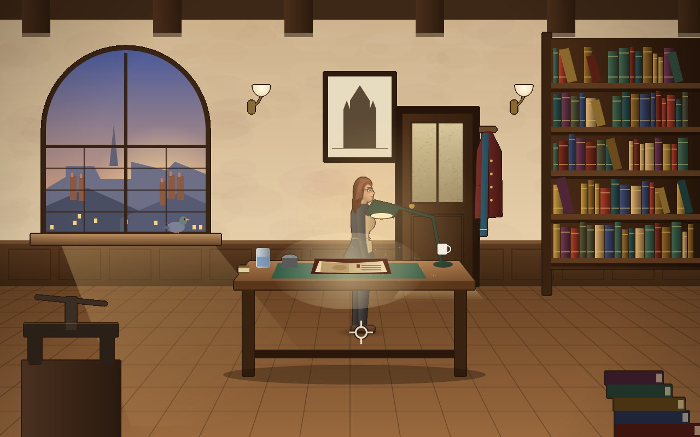{ width="400" }
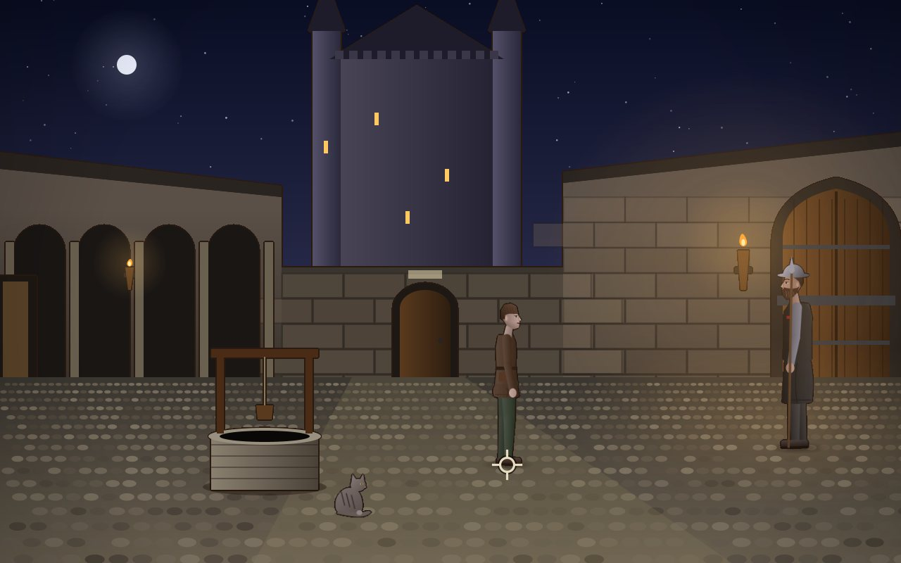{ width="400" }
<figcaption>Maria at her workbench in the evening (left). Aimery's courtyard on the night before the arrests (right): the great tower, the well, the stable cat, and Brother Raoul at the gate.</figcaption>
</figure>

Games of this kind grew out of the text adventures of the 1970s, where one typed "open door" and read what happened. In the 1980s the words got pictures, then a pointer, and the typed verbs became a row of buttons. By the 1990s the row of buttons was gone too: one clicked on a thing, and the game knew what to do with it. This chapter builds such a game. Unlike every game before it, it has no score and no timer; what the player wins is the next scene of a story.

!!! abstract "What you will learn"
    - **A story as data**: rooms, people and scripts in text files, the Java code only plays them
    - How one click becomes **walking there, turning, and acting**
    - **People as hotspots**: who is clicked when someone stands in front of a door
    - **Painting rooms in code**: layers with an ink line, light, and a tint for the people
    - **People drawn from a description**: one skeleton, a `Look` and a `Pose`, from the side, the front and behind
    - **Puzzles that are tested**: a test that plays the whole story with clicks
    - **Hints**: a notebook that knows the next goal
    - Texts in five languages that **fit the screen**
    - A **quiz** that starts over without punishing, and an **epilogue** that tells history from invention

The complete game is in [amade-templar-game](https://github.com/amadeos-eu/amade-templar-game). The engine parts it uses are described in [chapter 49](49-adventure.md); this chapter tells how a game is built on them.

## The rules

1. The **left button** walks to a point. On a thing it walks there and uses it; on a person it talks to them; on a door it goes through.
2. The **right button** looks at a thing or a person.
3. At the top of the screen is the **inventory**. A click on an item takes it in hand; a click on a thing in the room then uses the item on it, a click on another item combines the two. The right button puts the item back.
4. In a **conversation**, the player picks one of the lines at the bottom. Some lines are said only once, some only appear when something has happened.
5. **N** opens the notebook with the next goal; a second **N** adds a hint.
6. A click, **Esc** or **.** ends a line that is being spoken.
7. The game **saves itself** in every new room; **F5** saves, **F9** continues.
8. Nothing can be lost and nobody dies: every puzzle can be solved from every state of the game.

The last rule is a decision, not a rule of the genre. Some early adventures let the player throw away the one thing needed at the end, and the player only found out hours later. Here the scripts never take an item that is still needed, and a test proves that the story can be finished.

## The history

The game takes its history seriously, and so does this chapter, because a game teaches whether it wants to or not.

The **Order of the Temple** was founded in Jerusalem around 1120 to protect pilgrims. Within a century it had houses all over Europe, and its strongrooms were the safest of their time: a pilgrim could pay money in Paris and draw it in Acre. For a hundred years the kings of France kept their treasury in the **Paris Temple**. King **Philip IV** was deep in debt; he had arrested the Lombard bankers in 1291 and driven out the Jews in 1306, keeping what they owned. On **Friday, 13 October 1307**, at dawn, his men arrested every Templar in France, with sealed orders opened everywhere at the same hour. In 1312 the Pope dissolved the order, and in March 1314 the last Grand Master, **Jacques de Molay**, was burned on a small island in the Seine, which later became part of the Pont Neuf; a plaque marks the place today. The tower of the Temple stood until 1808; where it stood is now the Square du Temple.

That a burning Molay **cursed** the King and the Pope, who both died that year, is a **legend**. One chronicler says only that Molay called on God to judge them; the curse "unto the thirteenth generation" was written centuries later. Treasure, ciphers and the Holy Grail are legends too. In the game, the people who tell legends are a treasure hunter with a live stream and a tour guide, and Maria answers both with what is known.

Invented are Maria, Aimery, Brother Gérard, the collector Hélène de Vaucresson and the page itself. A **chirograph** is real: the same text written twice on one skin and cut apart through a word, so that the two halves fit only each other. The game's page is one half. Where the other half went is the next act.

## Step 1: The story as data

An adventure is mostly writing. A room has twenty things to look at, each with a sentence, often in five languages; a conversation has a dozen lines. If all that were Java code, every changed comma would be a change to the program. So the whole story is data, read by the engine's [`adventure` package](49-adventure.md), and the game's Java code only plays it.

The story file says which rooms there are, who the player is in each, who else stands where, and which scripts belong to the story:

```text title="amade-templar-game · story.txt"
--8<-- "amade-templar-game/src/main/resources/eu/amadeos/games/templar/story.txt"
```

The hero changes with the room: in the rooms of 1307 the player is Aimery, in today's rooms Maria. The inventory is shared, so the scripts take the prologue's things away before Maria wakes up in her workshop.

A room file describes one room: its floor as a polygon with holes, how people shrink towards the back, where they arrive, what can be clicked and where to stand for it, and which painted parts people walk behind:

```text title="amade-templar-game · rooms/workshop.txt"
--8<-- "amade-templar-game/src/main/resources/eu/amadeos/games/templar/rooms/workshop.txt"
```

<figure markdown>
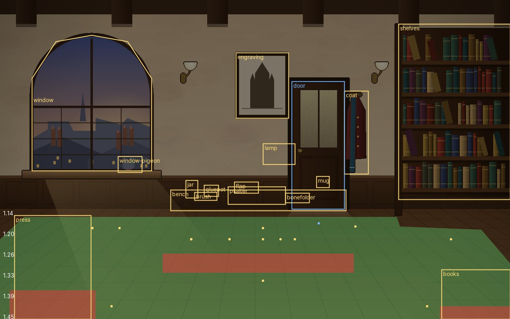{ width="600" }
<figcaption>What the room file says, drawn over the picture: the floor in green, the holes in red, the hotspots in yellow, the door in blue, and the depth scale on the left. The dots are the places to stand.</figcaption>
</figure>

A hotspot is a rectangle or a polygon, and the place to stand is part of it. That is the first thing to get right in a room: if the place to stand for the psalter is behind the workbench, Maria walks round the bench before she touches the book. The tool for that is a picture like the one above, which `./gradlew screenshots` draws for the workshop.

Then the scripts. One block per thing and verb, written as a play:

```text title="amade-templar-game · scripts/workshop.txt"
--8<-- "amade-templar-game/src/main/resources/eu/amadeos/games/templar/scripts/workshop.txt:bonefolder"
```

This is the first puzzle of Act 1. The pastedown of the psalter, the parchment glued inside the cover, bulges as if something lies under it. Maria cannot lift it dry, because the seven-hundred-year-old paste would tear it. She has to dip the paste brush in the water jar, soften the paste with the damp brush, and then lift the pastedown with her bone folder. Each step is a block: `on use brush jar`, `on use damp-brush psalter`, `on use bonefolder psalter`. The flag `softened` connects them. The flag `goal` tells the notebook what Maria wants next.

!!! note "Puzzles from the craft"
    The puzzles of this game come from what the people do. Maria is a restorer, so she softens old paste with distilled water and lifts paper with a bone folder, the way restorers do. Aimery seals a page with warm wax, as clerks did in 1307. A player who knows nothing about either learns a little; a player who knows the craft finds it right. That is easier to write, too, than puzzles that need a rubber chicken.

A conversation is a dialog of options, each a block of its own. Monsieur Lefort reads the page only after his coffee, and once he has read it, new questions appear:

```text title="amade-templar-game · scripts/reading.txt"
--8<-- "amade-templar-game/src/main/resources/eu/amadeos/games/templar/scripts/reading.txt:lefort"
```

`once` takes the line away after it was chosen, `if has page` shows it only while Maria carries the page, `if lefort == 1` only after he saw it. The rest of the reading room asks for Lefort's own cup (in the rack by the coffee machine), the coin in Maria's coat, and the number of deniers in a pound, from the conversion tables on his desk: twelve deniers to the sou, twenty sous to the pound, 240.

### Every name once

Scripts are written per thing, not per room: `on look window` answers a right click on any hotspot called `window`. When the courtyard got a window too, a right click on it answered with the roofs of the Marais, seven hundred years too early. So hotspot names must be unique in the whole story, and a test says so:

```java title="amade-templar-game · domain/StoryTest.java"
--8<-- "amade-templar-game/src/test/java/eu/amadeos/games/templar/domain/StoryTest.java:unique"
```

The same test class checks that every text a script says exists, that every item has a name and a look, and that every door leads to a room and a spot. A story of eight script files and six hundred texts has many places for a typing error, and each one would show up only when a player got there.

## Step 2: From a click to an action

A click on the psalter means: walk to the place in front of it, turn towards it, and then run the script for "use psalter". Walking takes time, and the player may click somewhere else meanwhile, which cancels the walk and with it the action. So the action is not run at once but handed to the walk, to be run on arrival:

```java title="amade-templar-game · domain/Adventure.java"
--8<-- "amade-templar-game/src/main/java/eu/amadeos/games/templar/domain/Adventure.java:click"
```

Looking needs no walk: one can see the engraving from anywhere in the room, so Maria only turns her head. `Interaction.trigger` from the engine decides the words of the trigger: `look engraving`, `use psalter`, `use bonefolder psalter`, `talk lefort`, `exit door`. If the scripts have a block for it, it runs; otherwise Maria says one of the default lines, "Nothing special." or "That doesn't work."

While a script plays, the game is **busy** and clicks only end the line being spoken. The player watches a cutscene; then the pointer is theirs again.

### People in front of things

A room file knows only things. The people of a room come from the story file, they walk, and the player clicks on them too. So a person is turned into a hotspot every time the mouse asks: a rectangle as high as the person at their depth, and a place to stand beside them, on the side where the hero is. People are asked before the things of the room, the nearest first, because someone standing in front of a door covers it:

```java title="amade-templar-game · domain/Adventure.java"
--8<-- "amade-templar-game/src/main/java/eu/amadeos/games/templar/domain/Adventure.java:people"
```

On the Pont Neuf this is a puzzle, not a detail. Hélène's driver stands right in front of the plaque Maria wants to read, and a click on the plaque is a click on him. He moves for no words. But the pigeons on the statue are hungry, and since the Square du Temple, Maria has half a sandwich.

## Step 3: Painting rooms in code

Every game in this book draws its pictures in code, and so does this one, although the pictures are bigger than ever: a room is a painting of 640 × 400 logical pixels, painted at twice that size so it stays sharp on a large screen. Each room is a class in `ui.art.rooms` that paints walls, floor and furniture with Java2D: gradients for light, a few hundred random strokes for plaster or stone, the books of a shelf one by one with a seeded random, so they look the same in every game.

<figure markdown>
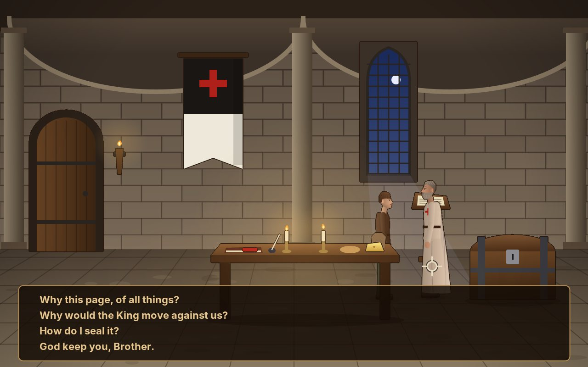{ width="400" }
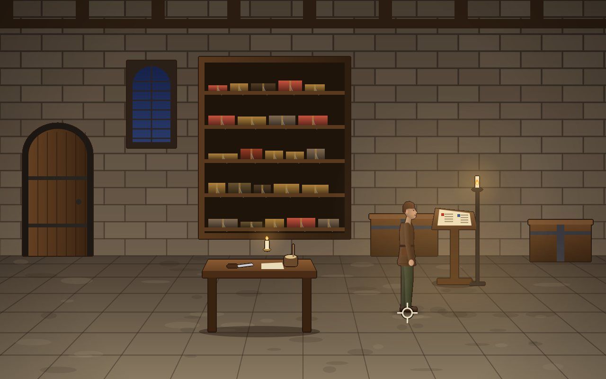{ width="400" }
<figcaption>The prologue: Brother Gérard's chamber, with the order's black-and-white banner (left), and the library with its chained books and the psalter on the lectern (right).</figcaption>
</figure>

What makes it look painted rather than drawn by a program is a line. Hand-drawn adventures outline every object with dark ink. The game gets that line by drawing each object on a transparent layer of its own, then putting a slightly larger dark copy of the object's shape underneath:

```java title="amade-templar-game · ui/art/Ink.java"
--8<-- "amade-templar-game/src/main/java/eu/amadeos/games/templar/ui/art/Ink.java:layer"
```

`outline` grows the solid pixels of the layer by a disc of the line's width, first along each row, then down the columns, and colours what grew in a very dark brown. Soft things, a glow or a translucent shadow, are not solid enough to get a line, so light stays light.

A room has three kinds of pictures. The **background** is painted once. The **layers** are the parts people walk behind, like the workbench or the well, each with its baseline from the room file. The **props** are things that can disappear, like the bone folder Maria picks up or Kev's sandwich on the bench; a prop has the name of its hotspot, so `hide bonefolder` takes both away. Over all of that, every frame, come the **lights**: candle flames that flicker, lamps that glow, and in the Pont Neuf the reflections in the river.

The room view sorts everything that stands on the floor by its baseline, people by where their feet are, and draws it from the back to the front:

```java title="amade-templar-game · ui/game/RoomView.java"
--8<-- "amade-templar-game/src/main/java/eu/amadeos/games/templar/ui/game/RoomView.java:draw"
```

Painting a room takes a moment, more than a frame may take. So all rooms are painted in the background when the game starts, the first room first, by a thread of low priority. A room needed before it is ready is waited for, behind the fade from the room before, which almost never happens.

## Step 4: People drawn from a description

An adventure needs people: this one has a dozen, from a Templar treasurer to a tourist with a cap, plus a cat and some pigeons. Drawing each by hand, in every pose and from three sides, would be a book of its own. So every person is a description, a `Look`, drawn by one class, `Figure`, on one skeleton:

```java title="amade-templar-game · ui/art/Cast.java"
--8<-- "amade-templar-game/src/main/java/eu/amadeos/games/templar/ui/art/Cast.java:maria"
```

A look gives the height, the build, whether the body is a woman's or a man's, the colours of skin, hair, clothes and shoes, the hair style, the beard, the garment over the clothes (an apron, a coat, a habit), and extras: glasses, a scarf, a cap, a selfie stick, an umbrella. Maria outdoors is the same look `wearing` her coat and scarf.

<figure markdown>
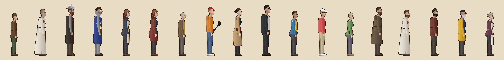{ width="700" }
<figcaption>The cast at their heights: Aimery, Brother Gérard, Brother Raoul, a King's man, Maria in her apron and in her coat, Monsieur Lefort, Kev, Hélène, the driver, the tour guide and two tourists.</figcaption>
</figure>

The skeleton is a person 118 pixels tall, about seven heads: hips at 60, knees at 32, shoulders at 96. Proportions like these are what makes a figure look like an adult instead of a doll, so they are fixed, and a look only scales and widens them. The body is built of **tapered limbs**, each a rounded shape from a wide end to a narrow one, lit from the upper left. The torso is a smooth closed curve through a dozen points (a Catmull-Rom curve, which passes through every point it is given), so a woman's figure gets its bust, waist, hips and seat by moving points, not by drawing more shapes.

```java title="amade-templar-game · ui/art/Figure.java"
--8<-- "amade-templar-game/src/main/java/eu/amadeos/games/templar/ui/art/Figure.java:draw"
```

A `Pose` is a set of angles: how far the body leans, how much it crouches, the angles of both hips, knees, shoulders and elbows, and where the head looks. Standing is one pose. Walking is a pose computed from the phase of the step: the legs swing like pendulums half a cycle apart, the knee bends most just after the foot leaves the floor, and the arms swing against the legs.

```java title="amade-templar-game · ui/art/Pose.java"
--8<-- "amade-templar-game/src/main/java/eu/amadeos/games/templar/ui/art/Pose.java:walk"
```

Animations such as `reach` (over a table), `pickup` (from the floor), `point` or `phone` are poses blended from standing to a target and back, over the time the script waits for them.

A figure seen from the side looks right; looking left is the same picture mirrored. From the **front** and from **behind** the body is drawn differently, with both arms and legs side by side: Maria walks towards the player when she enters through a door at the back, and away when she leaves through it. The engine's `Actor` says which view to use: the side views win until a way runs more than twice as much up or down as across.

### Drawn once, kept

Drawing a figure with its ink line takes a millisecond or two; a room with five people, at sixty frames a second, would spend the whole frame on that. So every picture of a person, for each look, view, pose and frame, is drawn once into an image and kept:

```java title="amade-templar-game · ui/art/Sprites.java"
--8<-- "amade-templar-game/src/main/java/eu/amadeos/games/templar/ui/art/Sprites.java:draw"
```

A walk cycle has ten frames, an animation twelve. The frame of a walk comes from the distance walked, not from the time, so the feet keep in time with the floor at every depth and every speed: `stride / (height × 0.78)`, the length of two steps of a person of that height. The images are drawn two and a half times larger than they are shown at full depth, so a figure in the front of a room is still sharp.

The room's light goes into the image too. Every room has a **tint**: warm for candlelight, blue for the night in the courtyard. Multiplied into the colours of a figure, it puts the people into the room instead of on top of it.

## Step 5: A test that plays the game

Adventure games are known for puzzles that cannot be solved: a door that opens only if one talked to someone first, but the talk was not offered; an item taken away by a script and never given back. Such mistakes are found by playing, and nobody plays the whole game after every change. A test can:

```java title="amade-templar-game · domain/PlaythroughTest.java"
--8<-- "amade-templar-game/src/test/java/eu/amadeos/games/templar/domain/PlaythroughTest.java:settle"
```

`settle` lets the game run in steps of a thirtieth of a second and clicks every line away, until the player may act again or a dialog waits. On top of that, `use`, `use item thing`, `combine` and `choose` click as a player would, on the middle of a hotspot or on a person. The whole prologue then reads like a walkthrough:

```java title="amade-templar-game · domain/PlaythroughTest.java"
--8<-- "amade-templar-game/src/test/java/eu/amadeos/games/templar/domain/PlaythroughTest.java:prologue"
```

The test plays on through the workshop, the reading room, the Square du Temple and the Pont Neuf, to the last card of Act 1, and then through the four scenes of Act 2 to its end screen. Other tests check the dead ends that should be dead ends: the chamber door stays shut until the page is sealed, the street waits until Lefort has read the page, the metro waits until Maria knows where to go. One test checks that Maria's inventory holds only her phone when she wakes up in her workshop, so nothing from 1307 is carried into today.

The test also found mistakes nobody had seen in the pictures. The driver stands in front of the plaque, and the test clicked on the plaque and got the driver's dialog. That was right, people are asked first, and it became part of the puzzle.

## Step 6: Hints

A player stuck in an adventure has two choices: try everything with everything, or give up. A walkthrough on the internet spoils the rest. The game gives a third one: **N** opens Maria's notebook with what she wants to do next, in her words, and a second **N** adds a hint.

<figure markdown>
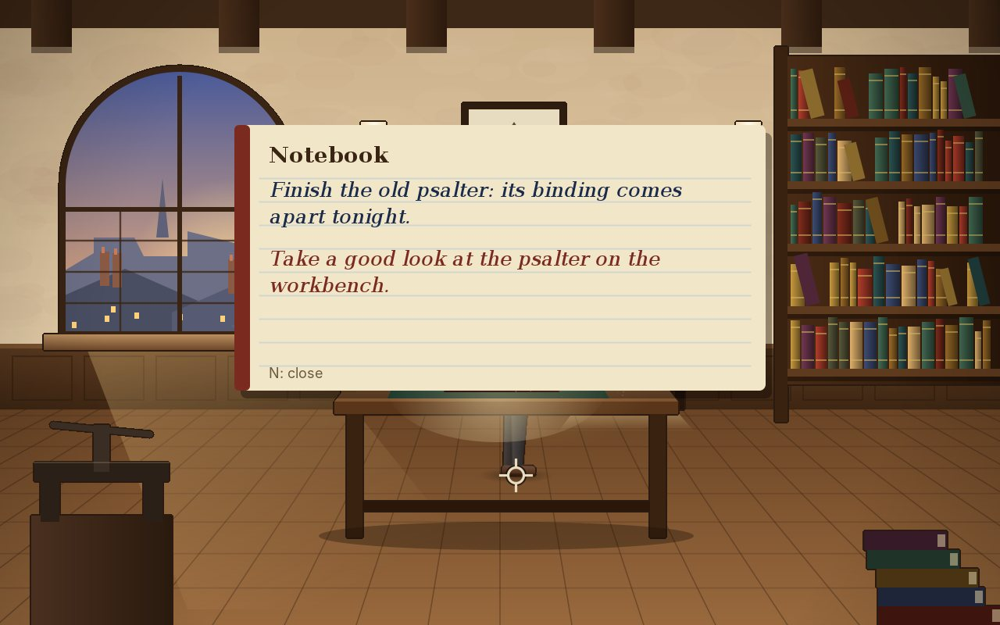{ width="500" }
<figcaption>The notebook in the workshop: the goal in blue, the hint in red. A third N closes it.</figcaption>
</figure>

The notebook knows nothing about puzzles. The scripts set the flag `goal` to a number whenever the story moves on, and the notebook shows `goal.<number>` and `hint.<number>` from the texts. The numbers are grouped by scene: 1 to 9 the prologue, 10 to 13 the workshop, 20 to 23 the reading room, 30 to 33 the square, 40 and 41 the bridge, 50 to 52 the prison cart, 60 to 63 the harbour, 70 to 75 the café, 80 and 81 the quay, 90 to 94 the Charola, 100 to 106 the archive, 110 to 112 the cloister. Because goals are only texts, a writer can make the hints gentler or plainer without touching a line of code.

## Step 7: Everything else

<figure markdown>
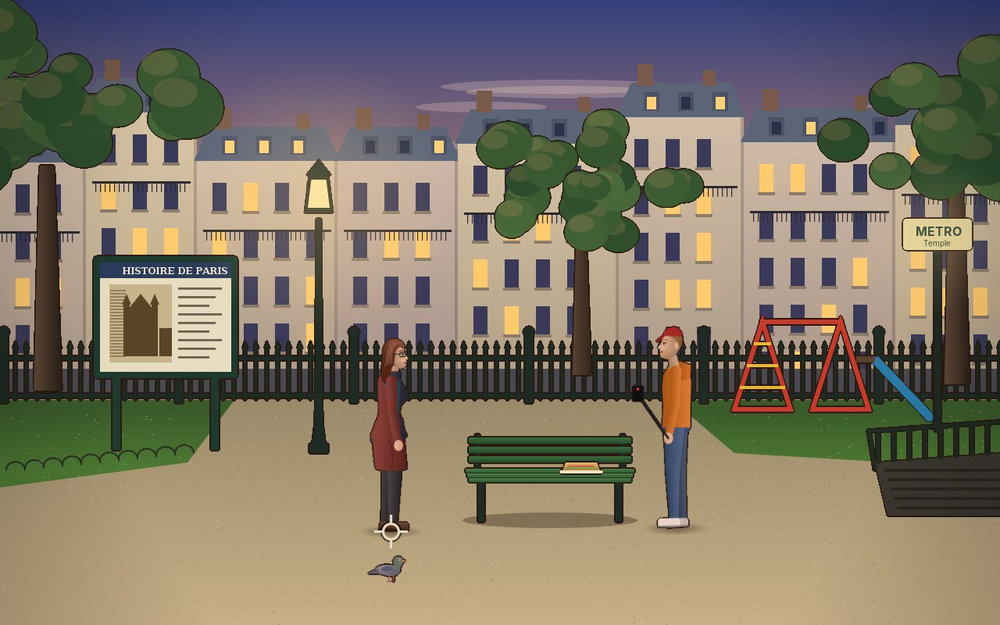{ width="400" }
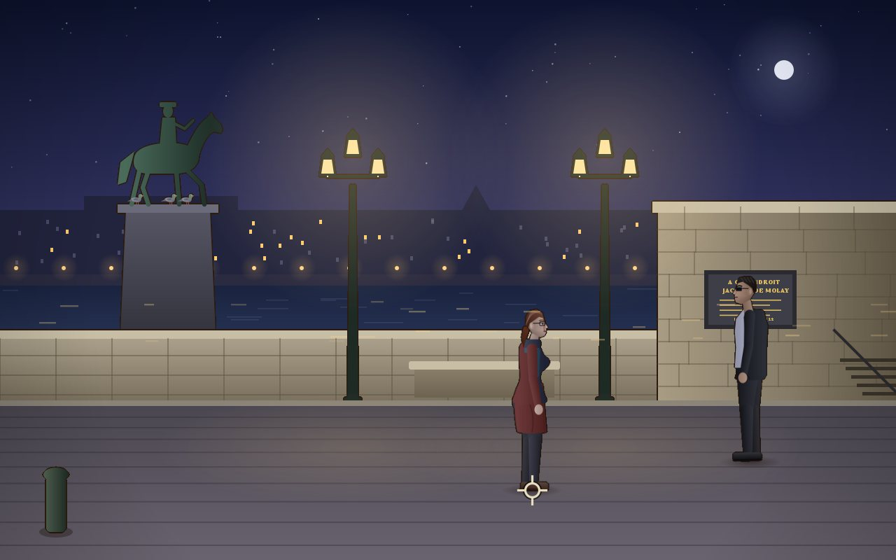{ width="400" }
<figcaption>The Square du Temple at dusk, where the Templars' tower stood (left), and the Pont Neuf at night, with Henri IV, the pigeons and the plaque by the steps (right).</figcaption>
</figure>

**Title cards.** Between the scenes a card says where and when: "Paris, 12 October 1307", "Friday, 13 October 1307". The first part of a card is the heading, the rest a line below it. In German, French or Spanish that line is a third longer than in English, so it is broken into lines that fit the screen with `SpokenText.wrap`, the same as the speech.

**Five languages.** Every sentence is a key in `messages.properties` and its German, French, Spanish and Italian files, about six hundred keys each. `TranslationCheck` from amade-commons makes sure that no language misses a key, and a second test that no two entries of the Game menu share a mnemonic letter in any language. Lefort says "Non" in every language: he is a Parisian archivist, and the French words are part of him.

**Saving.** An adventure's state is small: the room, where the hero stands and looks, the inventory, the flags, which hotspots are hidden, and where the people stand. It goes into a [`Snapshot`](47-data-and-saving.md) when the hero enters a room and when the player presses F5. A game is saved only while nothing plays, so a saved game never starts in the middle of a cutscene.

**Sound.** A few short sounds, made in code like those of the earlier games: doors, paper, the coffee machine, a coin, wax and seal, the cat, the pigeons, Kev's camera, the alarm at the gate, and a chord when something is discovered. Scripts play them with `sound paper`.

**Room pictures for designing.** `./gradlew shot -Proom=reading/workshop-door -Pargs="out.png 3 1 330 330"` starts the game in a room, waits three seconds and clicks with the left button at (330, 330); `-Plang=de` does it in German. Most of the rooms were designed with this command and an image viewer.

## Step 8: Act 2, La Rochelle

<figure markdown>
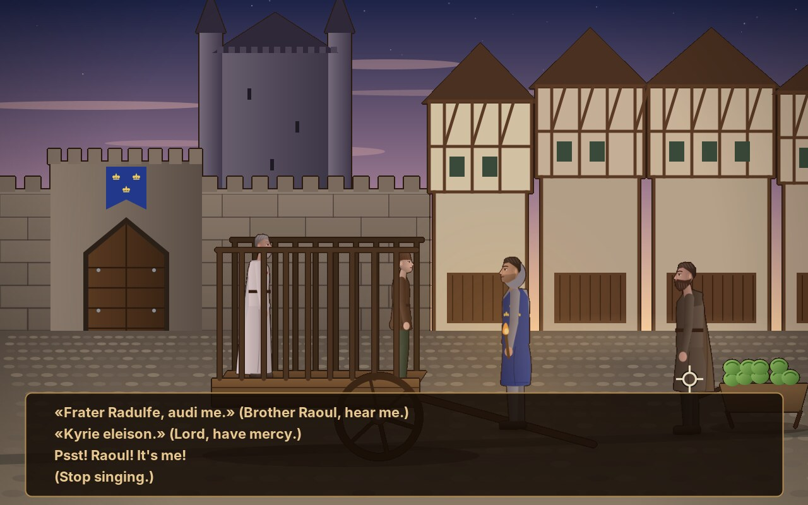{ width="400" }
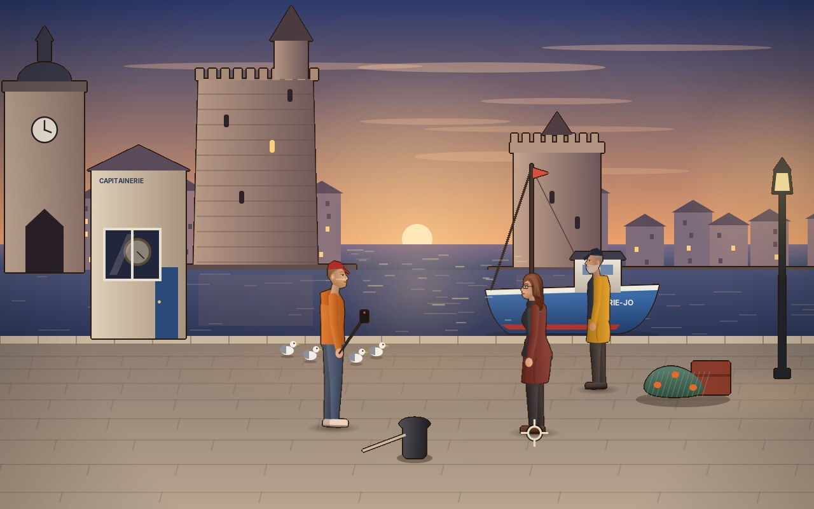{ width="400" }
<figcaption>Aimery in the prison cart, singing to Brother Raoul in Latin under the soldier's nose (left). Maria and Kev at the old harbour, with the two towers, the fisherman and his boat (right).</figcaption>
</figure>

<figure markdown>
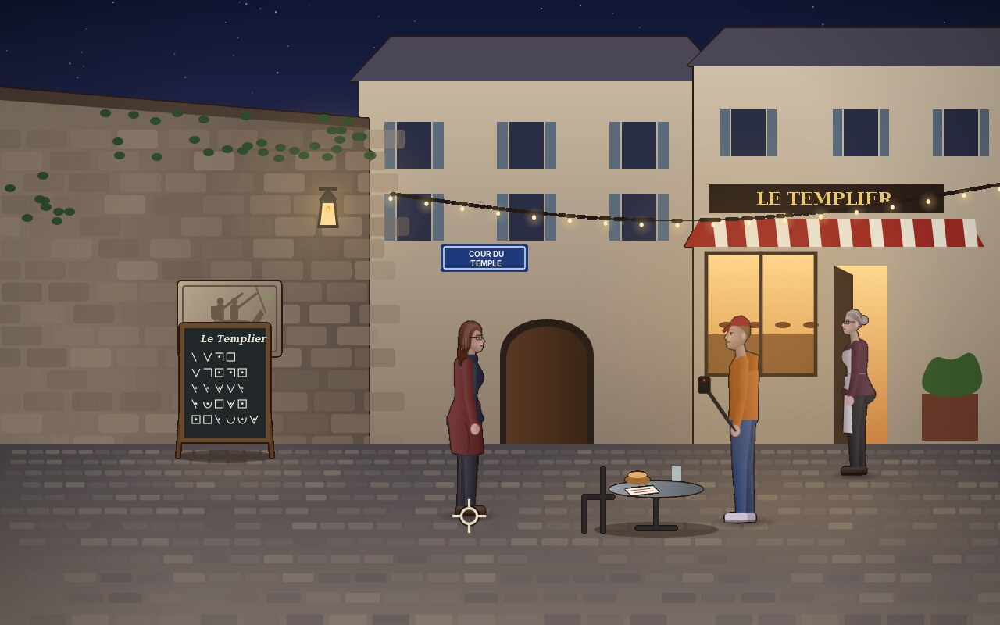{ width="400" }
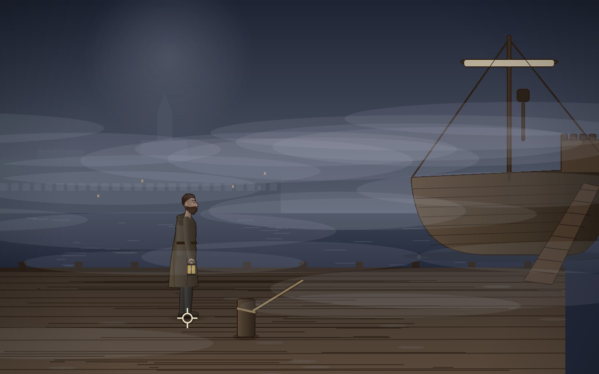{ width="400" }
<figcaption>The café Le Templier in the Cour du Temple, with its chalkboard and the old relief behind it (left). Brother Raoul on the quay in the fog, with a lantern and the ship that waits for a signal (right).</figcaption>
</figure>

Act 2 has four scenes, and two of them are flashbacks. The first act ends with Maria on the Pont Neuf. The story then jumps back to the morning of 13 October 1307: Aimery sits in a prison cart in the Rue du Temple, and Brother Raoul, dressed as a carter, stands a few steps away. A soldier walks beside the cart. Aimery must tell Raoul where the page is, but every word in French is heard. In Latin, sung like a psalm, the soldier hears only a prisoner praying. Then Maria and Kev are in La Rochelle. A fisherman at the old harbour knows where the Templars' houses stood, if Maria can read his barometer for him. In the Cour du Temple, Madame Morin's café has a chalkboard written in a code the Templars used, and behind the board an old relief hides a loose stone. Under it lies a lead token from Tomar. The second flashback shows the quay on the night after the arrests: Raoul signals a ship in the fog and gives the page's secret to its captain. Back in the café, the token tells Maria where the ship went. The act ends there: Act 3 is in **Tomar**.

**Another hero, another pocket.** In a flashback the player plays Aimery or Raoul, and Maria's things must not travel to 1307. The cart's `enter` block takes them from the inventory and remembers each in a flag; the harbour gives them back.

``` title="scripts/cart.txt"
--8<-- "amade-templar-game/src/main/resources/eu/amadeos/games/templar/scripts/cart.txt:handover"
```

**A counting flag as danger.** Each French word in the cart adds one to `suspicion`. At three the soldier chases Raoul off, but he comes back after a moment, and the psalm starts over. The player loses time, never the game, as in every scene of this story.

``` title="scripts/cart.txt"
--8<-- "amade-templar-game/src/main/resources/eu/amadeos/games/templar/scripts/cart.txt:suspicion"
```

**Two things in any order.** The fisherman tells the forecast only when Maria has read the barometer *and* asked him about the Templars. A dialog option takes one condition, so both scripts check the other half and set a third flag, `can-forecast`, which the option asks for. Whichever comes last opens the way.

**Hiding things to show others.** Moving the chalkboard hides the hotspot `chalkboard` and shows `moved-board`; lifting the stone hides `relief` and shows `hollow` and `loose-stone`. The room's `props` are tied to the hotspots, so the picture changes with them, and the notebook's goals move on with `set goal`.

The playthrough test plays the cart scene like this:

``` title="PlaythroughTest.java"
--8<-- "amade-templar-game/src/test/java/eu/amadeos/games/templar/domain/PlaythroughTest.java:cart"
```

## Step 9: Act 3, Tomar, and the end

<figure markdown>
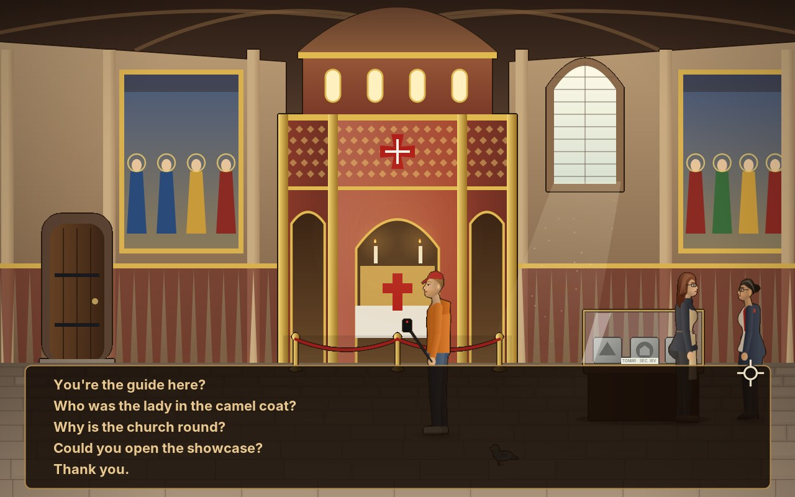{ width="400" }
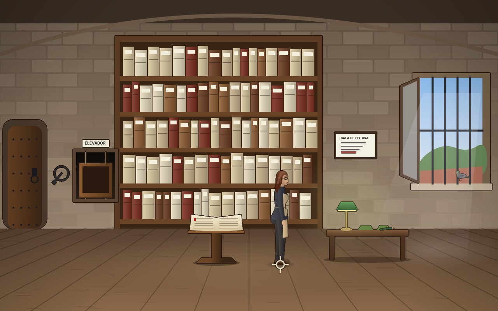{ width="400" }
<figcaption>Dona Inês by her showcase in the Charola, the Templars' round church at Tomar (left). The archive in the tower, with the window open and the pigeon on the sill (right).</figcaption>
</figure>

<figure markdown>
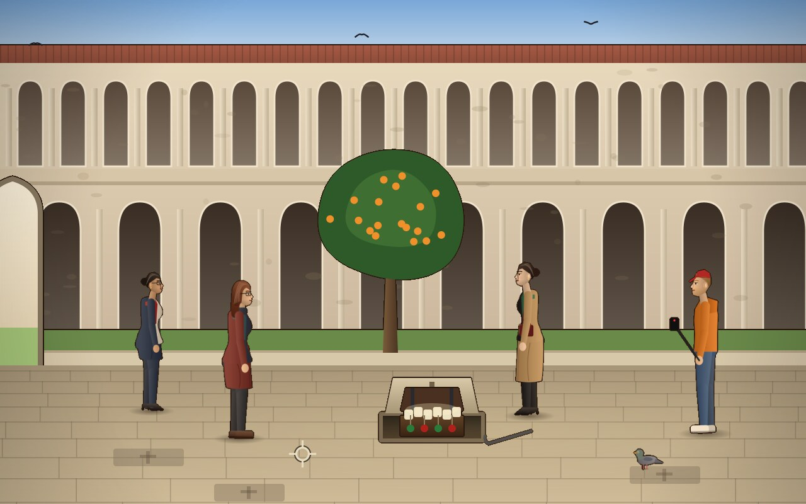{ width="400" }
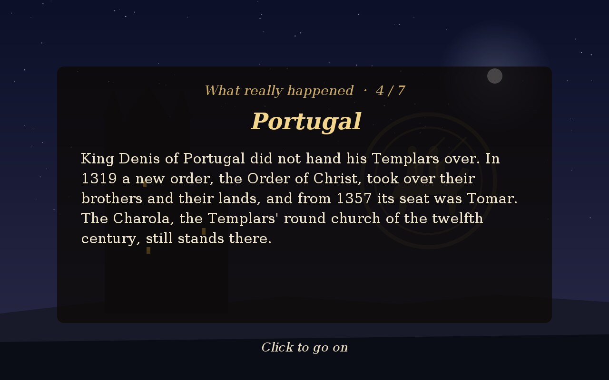{ width="400" }
<figcaption>The cloister, where Hélène has lifted the slab with the cross (left). One page of the epilogue (right).</figcaption>
</figure>

The last act plays in the Convent of Christ at Tomar, the seat of the order that took over the Templars of Portugal. In the Charola, the round church, a showcase holds stone moulds for pilgrims' tokens, and one of them has the shape of Maria's token from La Rochelle. Dona Inês, the guide, opens it only for someone who knows the Templars. The mould leads to the archive in the tower, where the other half of the chirograph lies under the pastedown of a register, as the first half did in the psalter. Maria joins the halves, reads the last line aloud, "a chest in the cloister, under the stone with the cross", and Hélène, who was listening at the door, locks her in. Maria gets out with a pencil, a café napkin, a pastry from the book lift, and the pigeon, which Kev cannot help filming. In the cloister the chest is open, and it holds no gold, only the King's own promises to pay. The two halves of the chirograph prove what they add up to.

**Questions that start over.** Dona Inês asks three questions; the answers are things the player has already seen. A counting flag `quiz` says which question is being asked, and each option belongs to one question. A right answer moves the flag on, a wrong one sets it back to 0 and closes the questions. Nothing is lost; the player only has to start again.

``` title="scripts/charola.txt"
--8<-- "amade-templar-game/src/main/resources/eu/amadeos/games/templar/scripts/charola.txt:quiz"
```

The questions are a dialog of their own, opened from inside Dona Inês's dialog with `dialog quiz`. `exit` in the questions closes only them, and her own options come back, because the engine keeps open dialogs on a stack.

**One person, three rooms.** Dona Inês, Kev, Hélène and the pigeon appear in all three rooms. Each room has its own person in `story.txt`, `ines`, `ines-archive` and `ines-cloister`, because a person stands in one room. `Cast.of` gives them all the same look, and the speech colour of `kev-cloister` is Kev's, found by the part before the dash.

The playthrough test plays the Charola like this:

``` title="PlaythroughTest.java"
--8<-- "amade-templar-game/src/test/java/eu/amadeos/games/templar/domain/PlaythroughTest.java:charola"
```

**The epilogue.** When the flag `finished` is set, the game shows "The End" and then seven pages of *What really happened*: the arrests, the trial and Chinon, the end of the order, Portugal, the legends, chirographs, and what the game made up. Each page is a heading and a text from the language files, wrapped to the width of a panel with `SpokenText.wrap`.

``` title="TemplarGame.java"
--8<-- "amade-templar-game/src/main/java/eu/amadeos/games/templar/ui/game/TemplarGame.java:epilogue"
```

## What moved into the engine

| From The Seal of the Templars | Engine package | Why |
|---|---|---|
| Floors as polygons with holes, and the shortest way over them | `eu.amadeos.gameengine.adventure.WalkArea` | Every painted room people walk through |
| Smaller and slower towards the back | `eu.amadeos.gameengine.adventure.DepthScale` | Every room seen at a slant |
| People who walk a way and turn where it bends | `eu.amadeos.gameengine.adventure.Actor` | Every character, whatever it looks like |
| Rooms as data: hotspots, exits, spots, layers | `eu.amadeos.gameengine.adventure.Room`, `Hotspot` | Rooms written by a designer, not a programmer |
| Look, use, talk, leave with two buttons | `eu.amadeos.gameengine.adventure.Interaction` | The same click rules in every adventure |
| What the hero carries, what the story remembers | `eu.amadeos.gameengine.adventure.Inventory`, `Flags` | The whole state of a story, ready to save |
| Scripts, cutscenes and conversations | `eu.amadeos.gameengine.adventure.Script`, `ScriptRunner` | Stories written as plays, in text files |
| Words over the head, and how long they stay | `eu.amadeos.gameengine.adventure.SpokenText`, `ReadingTime` | Speech without balloons or recordings |

What stays in the game: the story, its rooms and scripts, the painters of the rooms, the figures and their looks, poses and sprites, the animals, the items, the notebook, the title screen, the sounds, and the scenes.

## Exercises

1. **A thing to look at.** Give the workshop a calendar on the wall: a hotspot in `rooms/workshop.txt`, a `look` and a `use` block in `scripts/workshop.txt`, and its texts in five languages. Run `StoryTest`. What does it say before you add the texts?
2. **A wrong answer that helps.** When the player answers "Twenty" to Lefort's question, he says "Non, non." Let him add a hint the second time, using a counting flag (`add wrong 1`, `if wrong == 2`).
3. **A new person.** Put a student reading at one of the tables of the reading room: a `Look` in `Cast`, a person in `story.txt`, a dialog with two options. She could know where the Temple stood, so Maria can learn it from her or from the board on the square.
4. **Verbs.** Some players like the old row of verbs. Add *Look*, *Use*, *Talk* and *Take* as buttons at the bottom; the chosen verb replaces what `Interaction.trigger` decides. Which scripts have to change, and why?
5. **Walking speed.** A double click on a door could make Maria walk faster, or leave the room at once, as many adventures do. Where in `Adventure.click` does that go?
6. **A playthrough for every path.** `PlaythroughTest` plays one way through the story. Write a test that tries every dialog option at least once and still finishes the act.

---

*The Seal of the Templars* opens Part V. Its story is complete: a prologue, three acts, two flashbacks and an epilogue, in fourteen rooms, built on one engine package and about three and a half thousand lines of script.
