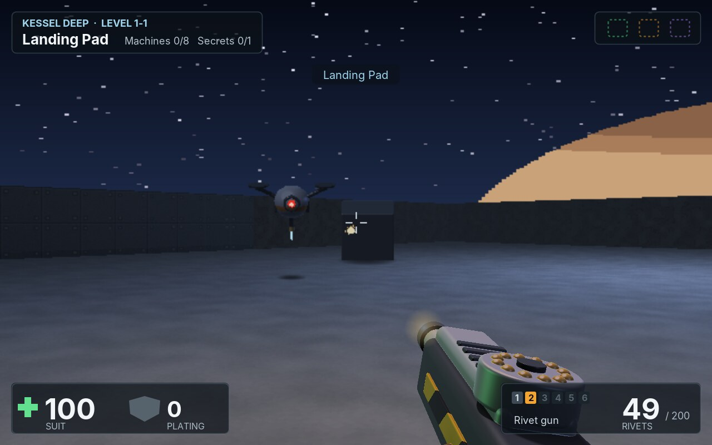
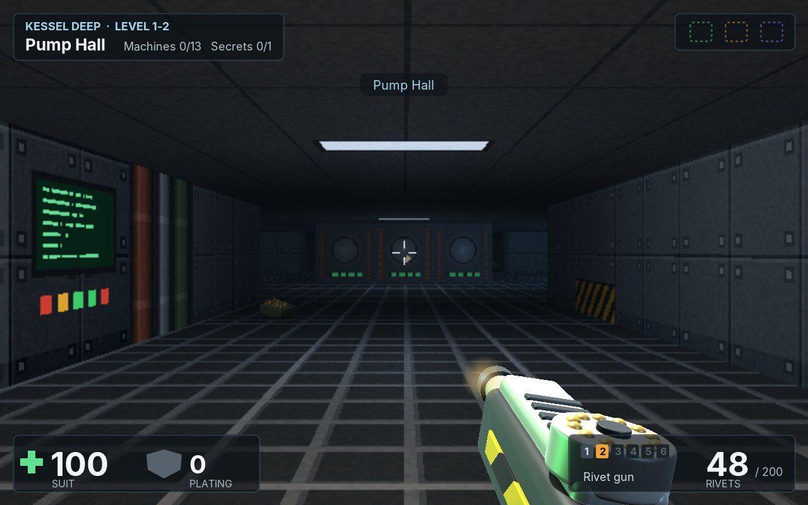
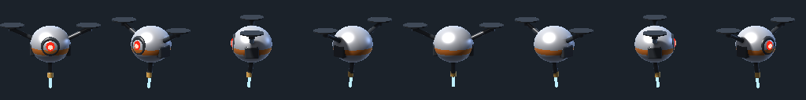
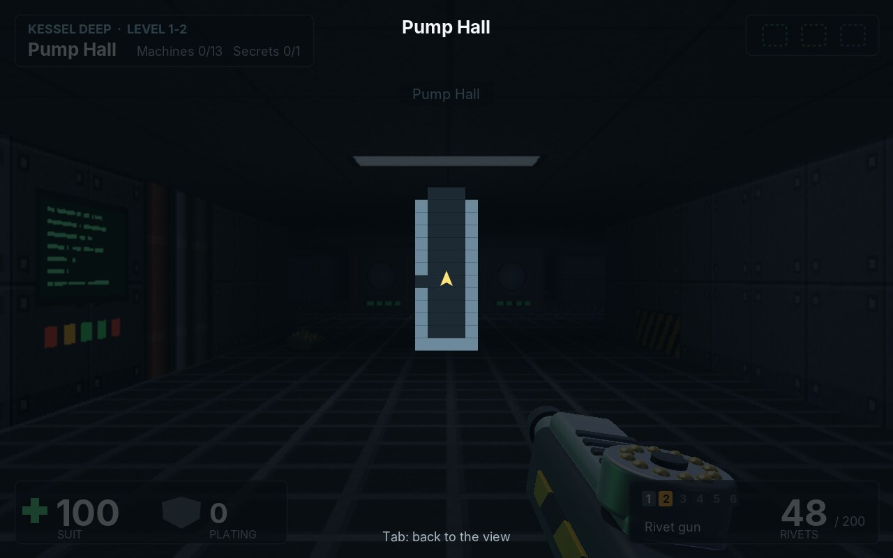
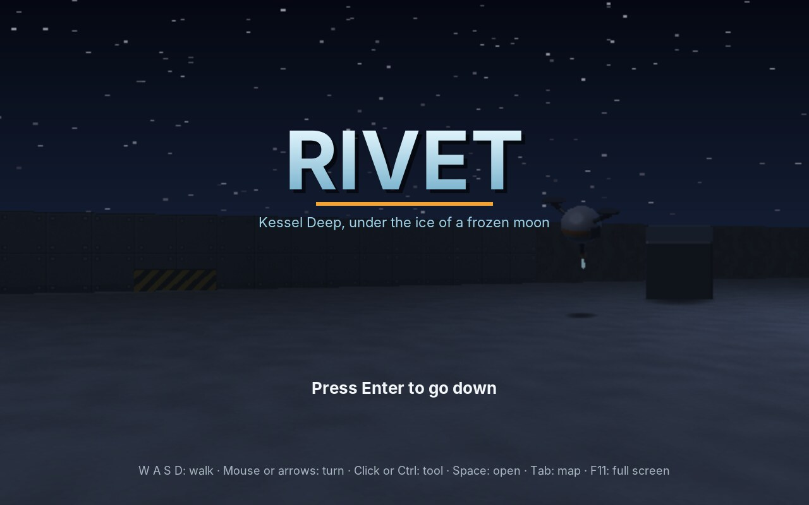
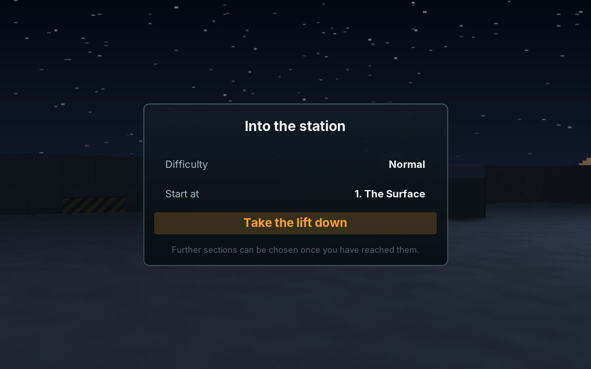

# 60. Rivet

In **Rivet** the player looks through the eyes of an engineer. Kessel Deep is a mine under the ice of a frozen moon, and the control system called the Foreman has turned its machines against the crew. The engineer goes down level by level, from the landing pad on the surface through pump halls, ice shafts and workshops to the Foreman's core, with the tools of the trade for weapons: an ice pick, a rivet gun, a scatter riveter, an arc welder, a plasma cutter and blasting charges.

<figure markdown>
{ width="400" }
{ width="400" }
<figcaption>A welder drone over the snow of the landing pad, with the giant planet low over the wall (left); a rivet has just been fired. The pump hall of level 1-2 (right): the ceiling lamp lights the floor around it, the console on the left glows by itself.</figcaption>
</figure>

Every game so far was flat: seen from the side, from above, or at an angle from above. This one is seen from inside. The first games that did this, in the early 1990s, ran on computers without any 3D hardware, and they did it with a trick: the world is a flat map of square cells, every wall is as high as every other, and the player only ever looks straight ahead, never up or down. Under those rules, one ray per column of the screen is enough to draw the world. That trick is the **raycaster**, and it is the first part of the engine's new `raycast` package. The second part makes the machines solid: they are 3D models, described by distances instead of triangles, rendered once from eight sides when the game starts.

!!! abstract "What you will learn"
    - **Raycasting**: a grid of cells, one ray per column, walls whose height comes from their distance, without the fisheye
    - **Floors, ceilings and an open sky**, drawn row by row
    - **Light and fog**: lamps baked into a light map with their shadows, flashes on top for one frame, and texels that glow by themselves
    - **Sliding doors and secret walls**, as thin walls in the middle of a cell
    - **Walking and turning with the mouse**: sliding along walls, and a mouse that never reaches the edge of the screen
    - **Billboards**: pictures that always face the eye, chosen from eight directions so the thing looks solid
    - **Models from distance functions**: spheres, boxes and rods joined into machines, rendered by marching rays, with soft shadows and highlights
    - **The tool in the hand**, a perspective picture lit by the room
    - **Hitscan shots**, machines that see, hear and chase through doors, and an automap

The complete game is in [amade-rivet-game](https://github.com/amadeos-eu/amade-rivet-game).

## The rules

1. A run starts on the card: the **difficulty** (easy, normal, hard) and the **section** to start in. There are three sections of three levels each: the Surface, the Shafts and the Core. A section can be chosen once it has been reached.
2. **W A S D** walk and step sideways, the **mouse** or the arrow keys turn, **Shift** runs. **Click** or **Ctrl** uses the tool in hand, **1** to **6**, **Q** or the wheel choose another. **Space** opens doors and works the lift. **Tab** shows the map.
3. The suit has **health** (100) and **plating** (up to 100). Plating takes a third of every hit until it is used up.
4. The tools need ammunition: rivets for the rivet gun and the scatter riveter, battery cells for the welder, gas for the plasma cutter, and the charges themselves. The ice pick needs nothing. A tool that runs empty is swapped for the best one that still works.
5. Machines notice the engineer when they see them ahead, close by, or when they hear a shot. Machines near one that has noticed join it. They chase along the shortest way, and open doors on their way, but not locked ones.
6. Locked doors need the access chip of their colour: green, amber or violet. Some walls give way when used: those are the secrets, worth 50 points.
7. The **lift** ends a level. Every machine has its points; the bonus is 2 points for each second under the level's par time and 100 for a level left without machines.
8. If the suit gives up, the level can be tried again, with what the engineer had when it began. In the last level, the Foreman holds the violet chip of the last door.

## Step 1: A world of cells

The world of a raycaster is a `GridMap`: a grid of square cells, one unit wide. A cell is a **wall**, with a texture on all four sides, or it is **open**, with a floor texture and a ceiling texture. A ceiling of `null` is open sky. An open cell can hold a door. That is all the map knows about shapes: no slopes, no stairs, no rooms above rooms.

```java title="amade-game-engine · raycast/GridMap.java"
--8<-- "amade-game-engine/src/main/java/eu/amadeos/gameengine/raycast/GridMap.java:gridmap"
```

Most of it is plain storage. The interesting part is `cast`, which comes in Step 2; the questions every game asks of its map are answered with it: does a body fit here (`blocks`), can one point see another (`sees`).

A level of Rivet is a text file, like the mazes of chapter 25 but with more letters: walls of several kinds, open floor, lamps in the ceiling, doors, machines, pickups, the start and the lift. Above the map, a few lines set the name, the direction the player looks at the start, the par time, the fog, the light that is everywhere and a few extra lamps:

```text title="amade-rivet-game · levels/1-1.txt"
--8<-- "amade-rivet-game/src/main/resources/eu/amadeos/games/rivet/levels/1-1.txt"
```

The underscores on the left are the yard of the landing pad, under the sky. The `@` is the start, `d` and `c` are machines, `x` and `y` crates and canisters, `-` and `|` doors, `g` a door with a green lock, `s` a secret door, `,` and `:` lamps, `X` the lift. `World.build` turns the letters into the map, the lamps, the doors and the things on it:

```java title="amade-rivet-game · domain/World.java"
--8<-- "amade-rivet-game/src/main/java/eu/amadeos/games/rivet/domain/World.java:build"
```

The domain does not know what a texture looks like. It asks `Surfaces` for the texture of a letter, and the game's `Textures` paints them with Java2D when the game starts: riveted panels, hazard stripes, pipes, consoles, ice, rock, stacked crates.

## Step 2: One ray per column

The picture is 640 × 400 pixels. For each of the 640 columns, the raycaster sends one ray from the eye across the map and asks where it hits a wall. A wall far away looks small, a wall nearby large: the height of the wall's slice in that column is the zoom divided by the distance. Draw the slice, centred on the middle of the picture, with the column of the texture where the ray hit, and the column is done.

### Following a ray

How do we find the first wall on a ray? Stepping along it in small steps would be slow and could miss the corner of a cell. The ray crosses the grid lines of the map in a fixed pattern: the vertical lines one after the other, a fixed distance apart along the ray, and the horizontal lines the same, with a different distance. `cast` keeps the distance to the next vertical line and to the next horizontal line, always takes the nearer one, steps into the cell behind it and looks whether that cell is a wall. That is the **DDA** (digital differential analyser) of Amanatides and Woo; it visits exactly the cells the ray passes, and nothing else:

```java title="amade-game-engine · raycast/GridMap.java"
--8<-- "amade-game-engine/src/main/java/eu/amadeos/gameengine/raycast/GridMap.java:cast"
```

The ray also reports **which side** of the cell it hit (a face looking east or west, or one looking north or south) and **where** on the face, `u`, from 0 to 1. `u` picks the column of the texture. The side is used for a cheap kind of lighting: faces looking north or south are drawn a little darker, so two walls meeting at a corner never have the same brightness and the corner shows.

```java title="amade-game-engine · test/raycast/GridMapTest.java"
--8<-- "amade-game-engine/src/test/java/eu/amadeos/gameengine/raycast/GridMapTest.java:test-cast"
```

### Without the fisheye

The rays of the columns all start at the eye but point in different directions. If the slice height came from the true distance along each ray, a flat wall straight ahead would bulge: its middle is nearer to the eye than its ends, so the middle would be drawn higher. That is the **fisheye**, and a real camera does not show it, because a picture is flat: what counts is how far a point is **in front of** the camera, not how far from it.

The trick is in the directions. The ray of a column is the camera's direction plus a part of the **camera plane**, a vector at right angles to it: `dir + plane · c`, where `c` runs from -1 at the left edge to 1 at the right. These vectors are not of length one; the ray of the edge column is longer than the middle one. And `cast` measures the distance in lengths of the direction vector. Measured that way, a wall at the same distance in front of the camera is at the same distance on every ray, and the fisheye is gone without a single cosine:

```java title="amade-game-engine · raycast/Raycaster.java"
--8<-- "amade-game-engine/src/main/java/eu/amadeos/gameengine/raycast/Raycaster.java:walls"
```

The length of the camera plane sets the field of view. `ZOOM` is 1.2: one unit at distance one is 1.2 times the picture's height, 480 pixels, and the plane is half the width divided by that, 320 / 480. The field of view is twice the angle whose tangent that is: about 68 degrees. Each column also remembers its distance in `depth`; the things in the world need it in Step 6.

```java title="amade-game-engine · test/raycast/RaycasterTest.java"
--8<-- "amade-game-engine/src/test/java/eu/amadeos/gameengine/raycast/RaycasterTest.java:test-raycaster"
```

!!! info "Behind the scenes: why no up and down"
    The camera of a raycaster can turn left and right but not look up or down: the horizon is always the middle row. Walls are then always upright on the screen, so a wall is a column of pixels and one ray per column is enough. Looking up and down would tilt the walls, and every pixel would need its own ray. The first games of this kind aimed up and down for the player instead, and so does Rivet: a shot hits whatever is in its line on the map, whatever its height (Step 9).

## Step 3: Floor, ceiling and sky

Below the walls is the floor, above them the ceiling. They cannot be drawn by columns, because along a column the distance changes with every pixel. Along a **row** it does not: every pixel of a row below the horizon looks at the floor at the same distance in front of the camera. That distance follows from the height of the eye and the number of rows below the horizon, by the same rule as a wall's height, turned round. So the raycaster draws the floor and ceiling first, row by row: it works out where the row's leftmost pixel meets the floor, how far the meeting point moves from one pixel to the next, and walks along, reading the floor texture of whatever cell the point is in. The walls are drawn over it afterwards.

```java title="amade-game-engine · raycast/Raycaster.java"
--8<-- "amade-game-engine/src/main/java/eu/amadeos/gameengine/raycast/Raycaster.java:floor"
```

A cell without a ceiling shows the **sky**: a panorama wrapped once round the horizon, picked by the angle of the column, so it turns with the view and does not move as the player walks. Rivet's sky is a field of stars and the giant planet the moon circles, painted once into a picture 1024 pixels wide.

Which cells are outdoors is the level's business. The yard of the landing pad is the underscores, but the cells of a crate or a machine standing in the yard are letters, and they need sky too, or a slab of ceiling floats over every crate. `World.outdoors` counts a cell as outdoors if it is an underscore, or if most of its neighbours are; doors and lamps never are.

## Step 4: Light and fog

A room lit evenly looks like a drawing. Rivet's rooms are dark with pools of light under the lamps, corners in shadow, consoles that glow, and a muzzle flash that lights the walls for a moment. Three things make that: a light map, glowing texels and fog.

### The light map

Lighting every pixel by every lamp would cost far too much. Light changes slowly across a room, so the `LightMap` keeps one colour per **cell**, worked out once when the level starts: the ambient light, plus each lamp that **sees** the centre of the cell, fading with distance. A lamp behind a wall does not reach, so walls cast shadows. Between cell centres the light is mixed, so it fades smoothly across the floor instead of in squares:

```java title="amade-game-engine · raycast/LightMap.java"
--8<-- "amade-game-engine/src/main/java/eu/amadeos/gameengine/raycast/LightMap.java:lightmap"
```

```java title="amade-game-engine · test/raycast/LightMapTest.java"
--8<-- "amade-game-engine/src/test/java/eu/amadeos/gameengine/raycast/LightMapTest.java:test-lightmap"
```

Short lights come on top: the muzzle of a tool, a plasma bolt flying down a corridor, an explosion. `flash` adds one for this frame only, and `beginFrame` takes the last frame's flashes away. A flash only touches the few cells in its reach, so a dozen of them a frame cost nothing. Rivet's `Effects` add them from what is happening:

```java title="amade-rivet-game · ui/game/Effects.java"
--8<-- "amade-rivet-game/src/main/java/eu/amadeos/games/rivet/ui/game/Effects.java:flashes"
```

### Glow and fog

Every texel of a `Texture` has, beside its colour, a **glow** between 0 and 1. A glowing texel ignores the light of the room and shines with its own colour: the text on a console, the lamp in the ceiling, the eye of a drone. A texture is made from a picture and a glow mask of the same size, white where it glows.

Far things fade into the **fog**, a colour and a density per level: a cold blue haze in the ice shafts, almost black in the core. The fog hides the far end of a long corridor, which looks right underground and spares the eye a mess of tiny distant pixels. Light, glow and fog meet in one small function that every pixel goes through:

```java title="amade-game-engine · raycast/Raycaster.java"
--8<-- "amade-game-engine/src/main/java/eu/amadeos/gameengine/raycast/Raycaster.java:shade"
```

## Step 5: Doors and secrets

A `Door` stands in an open cell. It is a thin wall through the **middle** of the cell, running either from west to east or from north to south, and opening slides it sideways into the wall beside it. `cast` handles it as a special case: when the ray enters a door's cell, it works out where it crosses the door's middle line, and if the door has slid away there, the ray goes on. The door is set back half a cell from the walls around it, which gives it depth; the sides of the walls in the opening show the door's frame texture.

```java title="amade-game-engine · raycast/Door.java"
--8<-- "amade-game-engine/src/main/java/eu/amadeos/gameengine/raycast/Door.java:door"
```

A door closes by itself after a few seconds, but not while something stands in its cell: `GridMap.updateDoors` asks the game. A **secret door** is an ordinary door whose face is a wall texture and which stays open: it looks like the wall beside it until it moves. Using a door is a ray of 1.3 units from the eye; it either hits a door, which opens if the engineer has its chip, or the lift's switch, which ends the level.

## Step 6: Walking and turning

The engineer is a circle of radius 0.25 on the map. `Mover.slide` moves a circle by a step and stops it at walls, first along x, then along y. A step that runs into a wall at an angle keeps the part along the wall: the engineer **slides** along it instead of stopping dead. That one detail makes running through corridors feel smooth. The step is cut into pieces no longer than half the radius, so even a fast body cannot jump through the corner of a wall:

```java title="amade-game-engine · raycast/Mover.java"
--8<-- "amade-game-engine/src/main/java/eu/amadeos/gameengine/raycast/Mover.java:mover"
```

### The mouse

The arrow keys turn at a fixed speed, which is fine for walking and too slow for a fight. A shooter is played with the mouse: move it to the right and the view turns to the right, as far as the mouse moves. The game needs **how far** the mouse moved, not where it is, and the mouse must never reach the edge of the screen, or the turning would stop there.

Java cannot lock the pointer, so `MouseLook` does it by hand. While the look is **captured**, the pointer is hidden, and after every move a `Robot` puts it back into the middle of the canvas. The distance from the middle is the movement. The move the robot makes produces an event too, and that one must not count; `MouseLook` remembers where it put the pointer and ignores the event that reports it.

```java title="amade-game-engine · input/MouseLook.java"
--8<-- "amade-game-engine/src/main/java/eu/amadeos/gameengine/input/MouseLook.java:mouselook"
```

The pointer is captured only while a level is played: on the cards and in the pause it is free, to click a menu. Some desktops do not allow a program to move the pointer (some Wayland compositors); there, `MouseLook` falls back to the differences between positions, which works until the pointer reaches the edge of the screen.

Keys, mouse and gamepad become one `Input` per step, as in every game since Blast:

```java title="amade-rivet-game · ui/game/RivetGame.java"
--8<-- "amade-rivet-game/src/main/java/eu/amadeos/games/rivet/ui/game/RivetGame.java:input"
```

## Step 7: Things in the world

Walls are the world; machines, pickups, crates and sparks are **things in** it. A raycaster draws them as **billboards**: flat pictures that always face the eye. A billboard stands at a point on the map, has a size, and its bottom is `lift` above the floor:

```java title="amade-game-engine · raycast/Billboard.java"
--8<-- "amade-game-engine/src/main/java/eu/amadeos/gameengine/raycast/Billboard.java:billboard"
```

After the walls, the raycaster sorts the billboards from far to near and draws them like a wall slice: its width and height are its size divided by its distance. Each column of a billboard is drawn only if the billboard is nearer than the wall in that column, which is what `depth` remembered: a machine half round a corner shows only its visible half. Texels whose alpha is below half are holes. A soft dark ellipse on the floor under each thing keeps it from floating:

```java title="amade-game-engine · raycast/Raycaster.java"
--8<-- "amade-game-engine/src/main/java/eu/amadeos/gameengine/raycast/Raycaster.java:billboards"
```

### Eight sides

A flat picture that always faces the eye looks flat: walk round a machine and it turns with you. The cure is to have **several pictures** of the thing, one from each side, and to show the one for the side the eye sees. `Views` holds them, by animation frame and direction. Which direction is shown depends on two angles: the way the thing faces, and the way from the thing to the eye. Their difference, rounded to the nearest of eight directions, picks the picture:

```java title="amade-game-engine · raycast/Views.java"
--8<-- "amade-game-engine/src/main/java/eu/amadeos/gameengine/raycast/Views.java:views"
```

```java title="amade-game-engine · test/raycast/ViewsTest.java"
--8<-- "amade-game-engine/src/test/java/eu/amadeos/gameengine/raycast/ViewsTest.java:test-views"
```

{ width="640" }

`Viewport` makes the billboards of a frame from the world: each machine with its picture, its facing, the frame of its walk or attack, and a white flash when it is hit; pickups slowly turning; crates and canisters; projectiles; and the sparks, puffs and explosions of the effects, pulled a little towards the eye so a spark on a wall is not hidden in it:

```java title="amade-rivet-game · ui/game/Viewport.java"
--8<-- "amade-rivet-game/src/main/java/eu/amadeos/games/rivet/ui/game/Viewport.java:billboards"
```

```java title="amade-rivet-game · ui/game/Viewport.java"
--8<-- "amade-rivet-game/src/main/java/eu/amadeos/games/rivet/ui/game/Viewport.java:render"
```

## Step 8: Models from distances

Where do eight pictures of each machine, in each frame, come from? Drawing them by hand is a lot of work, and drawing them consistently from eight sides is harder still. Rivet builds each machine as a **3D model** and lets the engine render the pictures.

The models are not made of triangles. They are made of **signed distance functions**: for a point in space, a function says how far it is from the surface of a shape, negative inside. A sphere is the distance from the centre minus the radius. A rounded box, a rod with round ends, a cylinder, a ring and a cone have formulas just as short. `Sdf` has them:

```java title="amade-game-engine · raycast/model/Sdf.java"
--8<-- "amade-game-engine/src/main/java/eu/amadeos/gameengine/raycast/model/Sdf.java:sdf"
```

Shapes are combined with plain arithmetic. Two shapes together are the **smaller** of their distances; a hole is the larger of the shape and the negated hole; `smoothUnion` joins two with a fillet. A shape is moved by moving the point the other way: `sphere(x - 1, y, z, 0.5)` is a ball at x = 1. Mirroring is `Math.abs(x)`: a drone with two arms describes one of them. A `Model` reports each part with a number that names its material, and the nearest part wins:

```java title="amade-game-engine · raycast/model/Model.java"
--8<-- "amade-game-engine/src/main/java/eu/amadeos/gameengine/raycast/model/Model.java:model"
```

Here is the welder drone: a ball with a stripe, a red eye in a ring, two arms with rotors, and a torch underneath whose flame grows in the frame before it fires.

```java title="amade-rivet-game · ui/game/Models.java"
--8<-- "amade-rivet-game/src/main/java/eu/amadeos/games/rivet/ui/game/Models.java:drone"
```

### Marching rays

To render a model, the `ModelRenderer` sends a ray through every pixel. It cannot work out where the ray meets the surface with a formula: the model is any combination of shapes. But the distance function says something useful at every point: there is no surface **closer** than this. So the ray can safely step forward by that distance, ask again, step again, and so on. Far from the model the steps are long, near it they become short, and when the distance is almost zero the ray has arrived. That is **sphere tracing**, or ray marching.

At the surface, the renderer needs the **normal**, the direction the surface faces. It is the direction in which the distance grows fastest, found by asking the distance a tiny step away along each axis. With the normal come the lights: each lamp's light by the angle it falls in, a **soft shadow** (a ray marched towards the lamp: the closer it passes the model, the darker), **occlusion** in creases (the surface a little way out along the normal should be that far from the model; if it is closer, something is in the way and less ambient light gets in), a highlight on shiny metal, and a cool **rim** along the outline that separates the machine from a dark background:

```java title="amade-game-engine · raycast/model/ModelRenderer.java"
--8<-- "amade-game-engine/src/main/java/eu/amadeos/gameengine/raycast/model/ModelRenderer.java:trace"
```

That is far too slow for every frame: up to 160 steps per pixel, and each step asks every part of the model. It does not need to be fast. `views` renders a model once per frame and direction, all of them in parallel on every processor core, and the raycaster only copies the result. A machine of 128 × 128 pixels, two frames from eight sides, takes a fraction of a second.

### At the start, and from the cache

All of Rivet's pictures, five machines, scrap, pickups, crates and the six tools, take about 13 seconds to render on four cores. That happens on a thread of its own while the title shows the landing pad and a progress bar; the game can start when the bar is full. The pictures are then written to the cache directory (`~/.cache/amadeos/rivet`), and the next start reads them in under two seconds. `Art.VERSION` is part of the directory's name: raise it when a model changes, and the old pictures are left behind.

```java title="amade-rivet-game · ui/game/RivetGame.java"
--8<-- "amade-rivet-game/src/main/java/eu/amadeos/games/rivet/ui/game/RivetGame.java:art"
```

!!! warning "Pitfall: the model is asked from many threads"
    `Model.part` keeps the nearest part so far in a field, and the renderer asks the same model from all cores at once. A plain field would mix up the threads' answers and give machines with stray pieces of the wrong colour. `Model` keeps that state in a `ThreadLocal`, one per thread.

## Step 9: The tool in the hand

The tool in the engineer's hand is not a billboard: it does not stand in the world, it is held in front of the camera, low on the right, and it must look three-dimensional from exactly one side. `ModelRenderer.picture` renders a model in **perspective**, as a camera sees it, at a `Placement`: a position in front of the camera and three turns. The picture covers only the lower right of the view, where the tool is, so the camera's axis does not pass through its middle: the second form of `picture` says where the axis meets the picture, which may be outside it:

```java title="amade-game-engine · raycast/model/ModelRenderer.java"
--8<-- "amade-game-engine/src/main/java/eu/amadeos/gameengine/raycast/model/ModelRenderer.java:picture"
```

Each tool has two pictures: at rest and firing, the firing one lit by a point lamp at its muzzle. They are rendered at twice the resolution of the view, so the tool stays sharp when the view is enlarged:

```java title="amade-rivet-game · ui/game/Art.java"
--8<-- "amade-rivet-game/src/main/java/eu/amadeos/games/rivet/ui/game/Art.java:tool"
```

In the game, the picture is tinted by the light where the engineer stands: dark in a dark corridor, warm under an amber lamp. Tinting the picture every frame would be costly, so the light is rounded to tenths and each tint is kept once made. The tool bobs as the engineer walks, kicks back when it fires, and drops out of view and comes back up when the engineer changes tools. A radial gradient at the muzzle is the flash; the welder draws a crackling arc to where it touches:

```java title="amade-rivet-game · ui/game/Viewport.java"
--8<-- "amade-rivet-game/src/main/java/eu/amadeos/games/rivet/ui/game/Viewport.java:tool"
```

## Step 10: Shooting

A rivet flies so fast that it is simpler to say it arrives at once. A **hitscan** shot is a line from the eye: what does it meet first, a wall or a target? `Hitscan.shoot` casts a ray for the wall, then looks at every target, a circle on the map, and keeps the nearest one in front of the wall. Height does not count: a shot at a drone floating above a crawler hits whichever is nearer.

```java title="amade-game-engine · raycast/Hitscan.java"
--8<-- "amade-game-engine/src/main/java/eu/amadeos/gameengine/raycast/Hitscan.java:hitscan"
```

Rivet's six tools are five ways to use that. The **ice pick** is a hitscan of 1.3 units. The **rivet gun** fires one rivet with a little spread, the **scatter riveter** seven at once with a wide one. The **arc welder** is a short hitscan every 0.08 seconds while the trigger is held. The **plasma cutter** fires a projectile, a bolt that flies and can be seen coming. A **blasting charge** is thrown, slides to a halt and goes off after a moment, hurting everything it sees within its blast, the engineer included. Every shot makes **noise** that wakes the machines within its reach:

```java title="amade-rivet-game · domain/World.java"
--8<-- "amade-rivet-game/src/main/java/eu/amadeos/games/rivet/domain/World.java:fire"
```

## Step 11: Machines

Each machine is a small state machine, as the ghosts of chapter 25 were: **idle**, **chase**, **wind-up** before an attack, **pain** for a moment when hit, and **dead**. An idle machine watches. It notices the engineer when it sees them well ahead of it and within most of its sight, or close by whatever way it faces; or when it hears a shot, or when a machine nearby notices first. In the first one and a half seconds of a level, no machine notices anything: a player who starts a level in sight of a sentry deserves a moment to look round.

```java title="amade-rivet-game · domain/World.java"
--8<-- "amade-rivet-game/src/main/java/eu/amadeos/games/rivet/domain/World.java:machines"
```

```java title="amade-rivet-game · test/domain/WorldTest.java"
--8<-- "amade-rivet-game/src/test/java/eu/amadeos/games/rivet/domain/WorldTest.java:test-wake"
```

A machine that sees the engineer walks straight at them, or stops at its own distance: a drone keeps three and a half units away and fires sparks, a loader throws blocks of ice. A machine that does not see them follows a **flow field**, the distance map of chapter 30, worked out from the engineer's cell twice a second, downhill to where the engineer is. On its way it opens doors, as the engineer does, except those with a lock. The five machines differ in numbers more than in code:

```java title="amade-rivet-game · domain/MachineKind.java"
--8<-- "amade-rivet-game/src/main/java/eu/amadeos/games/rivet/domain/MachineKind.java"
```

The Foreman does not move. It fires fans of five bolts and, once it is awake, launches drones from its core, never more than six at a time. When it goes dark, it leaves the violet chip.

## Step 12: What the player sees and hears

As in Artillery, the world reports what happened in a step as **events**, and `Effects` turns them into sounds, sprites, messages, muzzle flashes, the hit marker, the screen shaking, and the red arc at the edge of the view that shows where a hit came from:

```java title="amade-rivet-game · ui/game/Effects.java"
--8<-- "amade-rivet-game/src/main/java/eu/amadeos/games/rivet/ui/game/Effects.java:react"
```

The sounds are made by the engine's synthesizer from tones and noise, a different voice for each machine; the music is in MML, a quiet loop for each section. The HUD draws on the overlay layer, at the screen's full sharpness over the pixel view: the level and its counts, the chips found, the suit and the plating, the tool and its ammunition:

```java title="amade-rivet-game · ui/game/Hud.java"
--8<-- "amade-rivet-game/src/main/java/eu/amadeos/games/rivet/ui/game/Hud.java:play"
```

### The map

**Tab** shows the map of the level, turned so that up is the way the engineer looks. It shows only what the engineer has **seen**: every fifth of a second, `Viewport` marks the cells within seven units that the eye can see, and a wall counts as seen when the open cell in front of it, on the eye's side, is. Doors are drawn in the colour of their lock:

```java title="amade-rivet-game · ui/game/Hud.java"
--8<-- "amade-rivet-game/src/main/java/eu/amadeos/games/rivet/ui/game/Hud.java:map"
```

{ width="560" }

The scenes are the familiar ones: the title, where the landing pad turns slowly behind the name while the pictures are made; the card; the level; the pause; the card at the lift; the fall; the end of the run. A level's scene steps the world, the effects and the fall:

```java title="amade-rivet-game · ui/game/RivetGame.java"
--8<-- "amade-rivet-game/src/main/java/eu/amadeos/games/rivet/ui/game/RivetGame.java:play"
```

<figure markdown>
{ width="400" }
{ width="400" }
<figcaption>The title (left) and the card before a run (right).</figcaption>
</figure>

`./gradlew benchmark` plays each of the nine levels, turning on the spot so every column changes from frame to frame, and measures the frames: 7 to 9 ms per frame for the 640 × 400 view and 8 to 12 ms at 1280 × 800 on a four-core computer without a graphics card. The view is always drawn at 640 × 400 by the raycaster, whatever the window's size; what grows with the window is only the scaling and the overlay. That is why the game's default render mode is **pixels**: the raycaster's picture is enlarged by whole factors, and the view keeps its crisp, square pixels.

## What moved into the engine

| From Rivet | Engine package | Why |
|---|---|---|
| A grid of walls, floors, ceilings and doors, rays through it by DDA, walking with sliding along walls, hitscan shots | `eu.amadeos.gameengine.raycast` (`GridMap`, `Door`, `Mover`, `Hitscan`) | Every first-person game on a grid: shooters, dungeon crawlers, mazes seen from inside |
| The view: one ray per column, floor and ceiling by rows, sky, fog, billboards hidden by walls | `raycast` (`Raycaster`, `Camera`, `Billboard`, `Views`, `Texture`) | The same |
| Light baked per cell with shadows, flashes for one frame, glowing texels | `raycast` (`LightMap`, `Texture`) | Dark rooms with pools of light, in any game on a grid of cells |
| Models from distance functions, rendered by marching rays from several sides or in perspective | `raycast.model` (`Sdf`, `Model`, `Material`, `ModelRenderer`) | 3D-looking sprites for any game, rendered at the start instead of drawn by hand |
| Turning with the mouse, with the pointer kept in the middle | `input.MouseLook` | Every game that steers with the mouse rather than pointing |

What stays in the game: the levels and their letters, the textures, the models of the machines, pickups and tools, the tools and their numbers, the machines and how they see, hear and chase, the run, the points and the bonus, the pictures' cache, the HUD, the map, the sounds and tunes, and the scenes.

## Exercises

1. **A new machine.** Design a machine of your own from distance functions: perhaps a spider that climbs out of the ice. Give it a `MachineKind`, a model with a walking cycle, and a letter in the level files. What does it do that the five others do not?
2. **Looking up and down.** Move the horizon up and down with the mouse's vertical movement (shear the view rather than tilting it). What has to change in `floorAndCeiling`, in the walls, and in `project`? Why does it look wrong when the horizon moves far?
3. **Different heights.** Give some cells a floor half a unit lower, a pit. What does the raycaster need to know about the cells behind a step to draw them?
4. **Dynamic lamps.** A lamp that flickers or switches off when a machine is destroyed. `flash` covers one frame; how would you change the baked light of a few cells without baking the whole level again?
5. **Sixteen sides.** Render the machines from 16 directions instead of 8. How much longer does the start take, how big is the cache, and can you see the difference while playing?
6. **A level of your own.** Write a tenth level as a text file: a section of corridors and one great hall with a loader in it. Where do you put the lamps so the loader is seen before it throws?

---

Rivet opens **Part VI**, *Three Dimensions*. The engine can now draw a world from the inside and give its things a solid shape. What the next games in this part add to it will be told in their chapters, and, as always, in Part IV and the [glossary](appendix-glossary.md).
