# 61. Cruise

**Cruise** is a drive with no goal. The road runs through larch valleys and sunflower plains, along a coast with lighthouses, through a red canyon and its tunnels, over a pass with chalets and cowbells, through a neon city at night, and on into two dreams: fields of giant mushrooms under floating lanterns, and a road above the clouds. The sun goes down and comes up again, rain comes and goes, and there is always a truck ahead to overtake. For those who want a goal after all, there is a race against the computer or against a second player at the same keyboard.

<figure markdown>
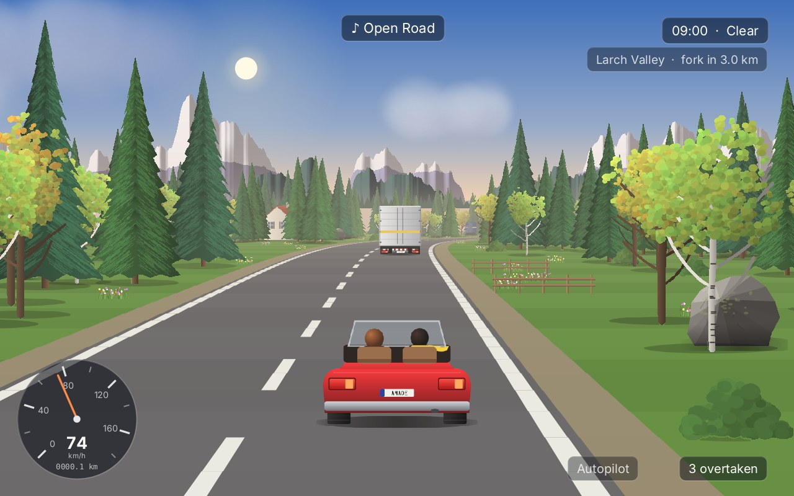{ width="400" }
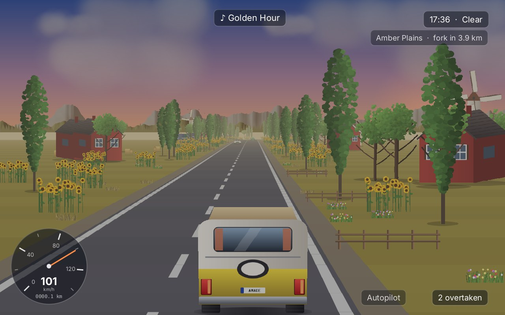{ width="400" }
<figcaption>Larch Valley at nine in the morning, in the open Roadster (left), and Amber Plains at the golden hour, in the Wanderer camper van (right). The landscape is made while the car drives; no two journeys are the same.</figcaption>
</figure>

Rivet (chapter 60) drew a world from the inside with rays through a grid. Cruise uses an older trick, the one the arcade road games of the 1980s ran on: the road is a row of short **segments**, each projected onto the screen as a horizontal band, and a curve is not a turn in the world but a sideways push that grows from segment to segment. No ray is cast, no wall is tested; the picture is painted from far to near, and what is near covers what is far. It is cheap enough to draw hundreds of trees, and it looks like speed. That trick is the engine's new `drive` package.

!!! abstract "What you will learn"
    - **A road of segments** that is endless: built ahead while the car drives, forgotten behind it
    - **The pseudo-3D projection**: curves as added-up pushes, hills as heights, the painter's algorithm
    - **Sprites at every size**: copies scaled and tinted in steps, under one shared memory budget
    - **Driving** with a pull outwards in curves, grass that slows, walls that stop; **traffic** that keeps its distance and overtakes
    - **A world made on the way**: regions in stints, sections with cliffs, houses, tunnels and lakes, forks where the player chooses
    - **Time of day and weather**: light, golden hour, night with headlights, rain and fog that change the distance one sees
    - **An autopilot** that drives like a player, and a **race** with one or two players on a split screen
    - **Life at the roadside**: deer, flocks of birds, a train, boats, a whale in the sky
    - **Sound made in code**: engines through five gears, the sound of each landscape, beds in the mixer
    - **A radio**: the game's own tunes, a playlist of the player's music, tracker modules through a native library
    - **Measuring and speeding up** a Java2D frame of a thousand pictures

The complete game is in [amade-cruise-game](https://github.com/amadeos-eu/amade-cruise-game).

## The rules

1. The title shows a car driving by itself. **Journey** starts the endless drive, **Race** the race setup, **Garage** chooses the car and its colour.
2. **Up** is the gas, **down** the brake, **left** and **right** steer. On grass the car slows down; against a cliff or a wall of houses it stops short.
3. A car ahead in the same lane is **overtaken** when the player passes it; the count is shown. Touching a car breaks nothing: it holds the player's car back.
4. Every four to six kilometres the road forks: a **fork sign** names two regions, and the lane the car keeps to under the sign chooses the next one. The display at the top right says how far the fork still is.
5. **C** lets the car drive itself, **P** saves a photo, **J** shows the journal: the regions found, the kilometres, the cars overtaken.
6. **Ctrl+R** silences the music, **R** changes the station, **N** plays the next track.
7. A **race** is a route of six to ten kilometres against five computer cars that drive *Relaxed*, *Keen* or *Fierce*. Two players share the keyboard (the second with **W A S D**), each with half of the screen. Whoever crosses the finish first wins.

## Step 1: A road of segments

A `Road` is a row of `Segment`s, each `Road.SEGMENT` (200) units long, which the game calls a metre. A segment knows how much the road bends on it (`curve`), how high its far end lies (`y`), how it looks, and what stands beside it:

```java title="amade-game-engine · drive/Segment.java"
--8<-- "amade-game-engine/src/main/java/eu/amadeos/gameengine/drive/Segment.java:segment"
```

The road itself only adds segments at its far end and drops them at its near end. Each segment keeps its number for as long as it lives, so the road can run for hundreds of kilometres while only a few kilometres of it exist at any time:

```java title="amade-game-engine · drive/Road.java"
--8<-- "amade-game-engine/src/main/java/eu/amadeos/gameengine/drive/Road.java:road"
```

Segments are not added one by one but in **sections**: so many segments that bend so much and climb so high. A `RoadBuilder` eases each section in and out, the curve along a sine and the climb along a cosine, so any section can follow any other without a kink:

```java title="amade-game-engine · drive/RoadBuilder.java"
--8<-- "amade-game-engine/src/main/java/eu/amadeos/gameengine/drive/RoadBuilder.java:builder"
```

The tests check both promises, that a section starts and ends smoothly and that an endless road keeps its size:

```java title="amade-game-engine · test/drive/RoadTest.java"
--8<-- "amade-game-engine/src/test/java/eu/amadeos/gameengine/drive/RoadTest.java:test-builder"
--8<-- "amade-game-engine/src/test/java/eu/amadeos/gameengine/drive/RoadTest.java:test-endless"
```

## Step 2: The projection

The eye is a `RoadCamera`: where it is along the road (`z`), across it (`x`, in road half-widths), how high, how wide it sees (`depth`), and where the horizon of a flat road lies:

```java title="amade-game-engine · drive/RoadCamera.java"
--8<-- "amade-game-engine/src/main/java/eu/amadeos/gameengine/drive/RoadCamera.java:camera"
```

Projecting is one division. A point `dz` ahead of the eye and `dx` beside it lands `dx · depth / dz` from the middle of the view; the same holds for its height. So the near and the far edge of a segment become two horizontal lines, and the road between them a trapezoid. The curve is the trick: each segment is pushed sideways by the sum of the curves of the segments before it, and that sum grows from segment to segment, so the far road swings out to the side the way a bend looks:

```java title="amade-game-engine · drive/RoadRenderer.java"
--8<-- "amade-game-engine/src/main/java/eu/amadeos/gameengine/drive/RoadRenderer.java:project"
```

`RoadRenderer.render` then paints the projected segments **from far to near**: for each one the grass across the whole width, the shoulder, the kerbs, the asphalt and the lines, then the walls, the scenery and the cars standing on it. What is nearer is painted later and covers what is behind it; a hilltop hides the road beyond without any test of visibility (the painter's algorithm):

```java title="amade-game-engine · drive/RoadRenderer.java"
--8<-- "amade-game-engine/src/main/java/eu/amadeos/gameengine/drive/RoadRenderer.java:render"
```

```java title="amade-game-engine · drive/RoadRenderer.java"
--8<-- "amade-game-engine/src/main/java/eu/amadeos/gameengine/drive/RoadRenderer.java:segment"
```

Grass and asphalt change their shade every three segments. These stripes are what makes the speed visible: at 100 km/h, more than nine of them pass under the car every second. A `RoadLook` holds the colours of one landscape, and two looks can be mixed, so one region melts into the next:

```java title="amade-game-engine · drive/RoadLook.java"
--8<-- "amade-game-engine/src/main/java/eu/amadeos/gameengine/drive/RoadLook.java:mix"
```

A test draws a straight road and a bend and checks where the asphalt lands:

```java title="amade-game-engine · test/drive/RoadRendererTest.java"
--8<-- "amade-game-engine/src/test/java/eu/amadeos/gameengine/drive/RoadRendererTest.java:test-view"
```

<figure markdown>
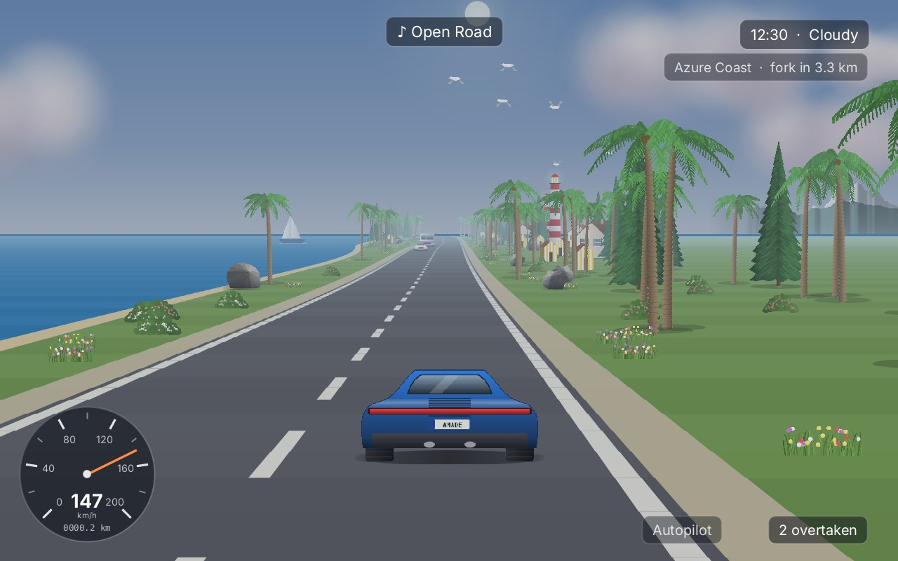{ width="400" }
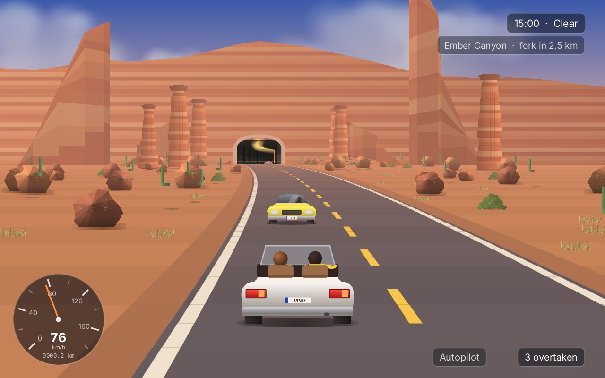{ width="400" }
<figcaption>Azure Coast with the sea on the left (left): water is a band of the segment beside the shoulder. Ember Canyon (right): the tunnel ahead is a row of segments with walls and a ceiling, and its portal is drawn on the first of them.</figcaption>
</figure>

## Step 3: Walls, tunnels and things beside the road

A segment can have a `Wall` on either side: the cliff of a canyon, a row of houses, the wall of a tunnel. A row of houses and a tunnel wall stand at a fixed distance from the centre and face the road; they are drawn as a quad from the segment's near to its far end, windowed like a street or tiled like a tunnel. Two tunnel walls with `tunnel` set get a ceiling between them, and the first segment of a tunnel its portal:

```java title="amade-game-engine · drive/Wall.java"
--8<-- "amade-game-engine/src/main/java/eu/amadeos/gameengine/drive/Wall.java:wall"
```

```java title="amade-game-engine · drive/RoadRenderer.java"
--8<-- "amade-game-engine/src/main/java/eu/amadeos/gameengine/drive/RoadRenderer.java:wall"
```

### A cliff is a body, not a curtain

A cliff drawn the same way, a banded sheet at a fixed distance, looks like a curtain hung beside the road: nothing in the picture says that there is rock behind it. Four things say it, and none of them needs a third dimension in the data. They all follow from the number of the segment and the wall's seed:

- **It steps.** `offsetAt` gives the wall's distance from the road at every segment: smooth noise cut into a few flat steps. For a long stretch the face runs along the road, then within one segment it jumps a few metres back into a niche, or forward into a buttress.
- **It has heads.** `heightAt` is cut into steps in the same way: flat tops of different heights instead of a fringe.
- **It has a second step.** Further from the road and always higher stands a second wall of the same rock, `backOffsetAt` and `backHeightAt`. It shows above the first one and moves more slowly, as distant things do.
- **Its bands break.** The layers are thick and thin, and every few segments a fault shifts them up or down.

```java title="amade-game-engine · drive/Wall.java"
--8<-- "amade-game-engine/src/main/java/eu/amadeos/gameengine/drive/Wall.java:cliff"
```

The renderer still draws one quad per layer and segment, but from the wall's distance at the segment's near end to its distance at the far end. Where the rock steps towards the road, that quad stands almost across the view: the end of a buttress. It takes other light than the face along the road, lit on one side of the canyon and shaded on the other, and that difference is what the eye reads as a corner. The corner behind it, where the niche ends, gets a dark line, and a slope of scree lies against the foot.

```java title="amade-game-engine · drive/RoadRenderer.java"
--8<-- "amade-game-engine/src/main/java/eu/amadeos/gameengine/drive/RoadRenderer.java:cliff"
```

Because every piece is computed from the same wall and the numbers of its two ends, the pieces of neighbouring segments meet exactly. The first version of the game gave every segment a wall of its own with a slightly different distance; between those pieces a line of sky showed, one pixel wide. One wall for the whole gorge is both simpler and right. A cliff `between` two segments rises out of the ground at its ends and sinks into it again.

A second step doubles the pieces, and most of them are far away, where a segment is a pixel wide. There one piece stands for two or four segments (`pieces`): the pieces begin at even segments or at every fourth, whatever the camera does, so nothing jumps while the car moves. With that a frame in a gorge takes about a millisecond longer than with the curtain: 17 instead of 16 ms at 1920 × 1200 without a graphics card.

```java title="amade-game-engine · test/drive/WallTest.java"
--8<-- "amade-game-engine/src/test/java/eu/amadeos/gameengine/drive/WallTest.java:test-wall"
```

```java title="amade-game-engine · test/drive/RoadRendererTest.java"
--8<-- "amade-game-engine/src/test/java/eu/amadeos/gameengine/drive/RoadRendererTest.java:test-cliff"
```

<figure markdown>
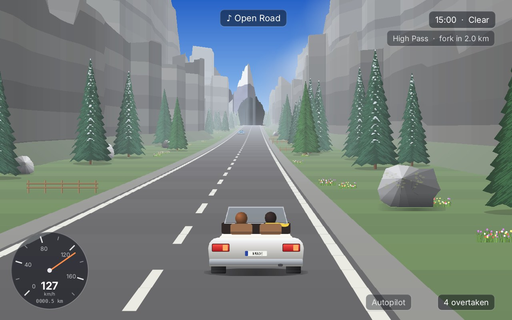{ width="400" }
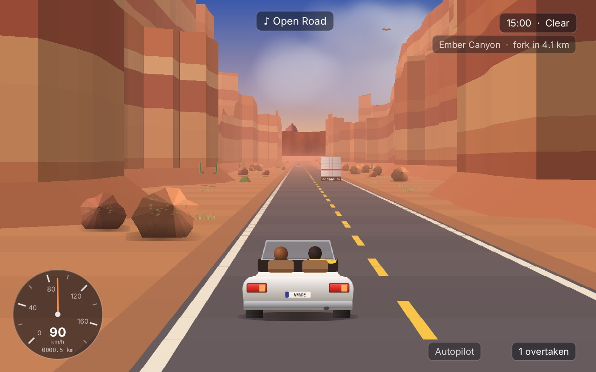{ width="400" }
<figcaption>Rock on both sides: the ends of the buttresses catch other light than the faces, the second step shows above the first, and trees and boulders stand in the niches.</figcaption>
</figure>

Trees, rocks, houses, signs are `Scenery`: a `RoadSprite` at an offset from the centre and a place along the segment.

```java title="amade-game-engine · drive/Scenery.java"
--8<-- "amade-game-engine/src/main/java/eu/amadeos/gameengine/drive/Scenery.java:scenery"
```

```java title="amade-game-engine · drive/RoadRenderer.java"
--8<-- "amade-game-engine/src/main/java/eu/amadeos/gameengine/drive/RoadRenderer.java:scenery"
```

A tree is drawn at every size, from a few pixels in the fog to half the screen as the car passes it, faded by the distance and darkened at night. Scaling a picture of 600 by 900 pixels down to 30 by 45 for each of a few hundred trees in every frame would take far too long, and scaling it by large factors in one go makes the leaves shimmer. So `RoadSprite` keeps **finished copies**: scaled in fixed widths, each about a fifth wider than the one before, and tinted in sixteen steps of fog and eight of light. A frame takes the copy just wider than it needs and draws it a little smaller:

```java title="amade-game-engine · drive/RoadSprite.java"
--8<-- "amade-game-engine/src/main/java/eu/amadeos/gameengine/drive/RoadSprite.java:sprite"
--8<-- "amade-game-engine/src/main/java/eu/amadeos/gameengine/drive/RoadSprite.java:copy"
```

All sprites share one budget of pixels for their copies. When it is spent, the copy used longest ago goes, whichever sprite it belongs to. A budget per sprite would be simpler, but the game has 74 prop pictures and 160 car pictures; a few hundred copies each would fill gigabytes.

```java title="amade-game-engine · test/drive/RoadSpriteTest.java"
--8<-- "amade-game-engine/src/test/java/eu/amadeos/gameengine/drive/RoadSpriteTest.java:test-copies"
```

## Step 4: Driving and traffic

A `Car` is anything that drives on the road: the player's, a truck to overtake, a car coming the other way, a rival in the race, and, as we will see, a deer. `z` is where its back is, `x` where its middle is across the road, `speed` how fast it goes:

```java title="amade-game-engine · drive/Car.java"
--8<-- "amade-game-engine/src/main/java/eu/amadeos/gameengine/drive/Car.java:car"
```

`Driving` moves the player's car. Gas speeds it up, less and less the closer it comes to its top speed; steering moves it across, faster at speed; and the curve under it pushes it outwards with the square of its speed, so a bend taken too fast carries it onto the grass, where it slows down:

```java title="amade-game-engine · drive/Driving.java"
--8<-- "amade-game-engine/src/main/java/eu/amadeos/gameengine/drive/Driving.java:driving"
```

The three cars of the garage are three sets of these numbers: the Roadster in the middle, the Kestrel sports coupé faster and quicker to steer, the Wanderer camper van slow and soft.

```java title="amade-game-engine · test/drive/DrivingTest.java"
--8<-- "amade-game-engine/src/test/java/eu/amadeos/gameengine/drive/DrivingTest.java:test-driving"
```

`Traffic` moves the cars that drive themselves. Each keeps to its lane at the speed it likes; behind a slower car it slows down to keep its distance, and if it is one that overtakes and the other lane is clear far enough ahead, oncoming cars included, it pulls out, passes and pulls back in. A car the player steers is not moved here, but the others see it:

```java title="amade-game-engine · drive/Traffic.java"
--8<-- "amade-game-engine/src/main/java/eu/amadeos/gameengine/drive/Traffic.java:update"
```

```java title="amade-game-engine · test/drive/TrafficTest.java"
--8<-- "amade-game-engine/src/test/java/eu/amadeos/gameengine/drive/TrafficTest.java:test-follow"
--8<-- "amade-game-engine/src/test/java/eu/amadeos/gameengine/drive/TrafficTest.java:test-overtake"
```

What happens when the player's car touches another is the game's business. Cruise is relaxing, so nothing breaks: running into the back of a car leaves the player behind it at its speed, and brushing a car that comes the other way takes most of the speed and pushes the player back into the lane:

```java title="amade-cruise-game · domain/Driver.java"
--8<-- "amade-cruise-game/src/main/java/eu/amadeos/games/cruise/domain/Driver.java:step"
--8<-- "amade-cruise-game/src/main/java/eu/amadeos/games/cruise/domain/Driver.java:settle"
```

The `TrafficPlan` keeps the road busy. New cars appear 280 to 420 metres ahead, far out in the fog, so nobody sees them appear; each region has its own mix (tractors in the plains, buses and coupés in the city, campers on the coast) and its own number of cars per kilometre, and the setting *Quiet*, *Normal* or *Busy* scales it:

```java title="amade-cruise-game · domain/TrafficPlan.java"
--8<-- "amade-cruise-game/src/main/java/eu/amadeos/games/cruise/domain/TrafficPlan.java:plan"
```

The cars of the traffic are homages with names of their own: a little round *Bubble*, a boxy *Tenda* with a canvas roof, a red *Rosso* coupé, a *Compact*, trucks, buses, campers and tractors. None of them carries the name or the badge of a real maker.

## Step 5: A world made on the way

The `World` builds the road ahead of the player and dresses it. It is a chain of **stints**, four to six and a half kilometres of one `Region` each: two to four minutes, long enough to settle in a landscape and short enough that the next one comes. Within a stint the road comes in sections, and the region's rules decide each one: how sharply it bends, how much it climbs, and whether it runs between cliffs, through a row of houses, through a tunnel or along a lake:

```java title="amade-cruise-game · domain/World.java"
--8<-- "amade-cruise-game/src/main/java/eu/amadeos/games/cruise/domain/World.java:section"
```

A gorge is one cliff on each side for the whole section, twice as long as other sections, and one gorge in three has rock on one side only:

```java title="amade-cruise-game · domain/World.java"
--8<-- "amade-cruise-game/src/main/java/eu/amadeos/games/cruise/domain/World.java:cliffs"
```

Then every new segment is dressed: walls for the feature, water for the coast, and the region's props, each with its own density, distance from the road and chance of being mirrored. Beside a cliff a prop stands before the scree, wherever the rock is at that segment: so trees and boulders fill the niches.

```java title="amade-cruise-game · domain/World.java"
--8<-- "amade-cruise-game/src/main/java/eu/amadeos/games/cruise/domain/World.java:dress"
```

```java title="amade-cruise-game · test/domain/WorldTest.java"
--8<-- "amade-cruise-game/src/test/java/eu/amadeos/games/cruise/domain/WorldTest.java:test-gorge"
```

Each step of the game, the world follows the player. It builds ahead, forgets what lies far behind (in a race behind the last car, not the first), and reports what happened: a fork passed and the region chosen, a new region reached. The journey shows a card with the name of each new region; the journal remembers it.

```java title="amade-cruise-game · domain/World.java"
--8<-- "amade-cruise-game/src/main/java/eu/amadeos/games/cruise/domain/World.java:update"
```

A stint ends at a fork. A small display under the clock names the region and the kilometres to the fork (`forkAhead`), so the driver knows that the land will change and when. A sign over the road names two regions, and the lane the car keeps to when it passes under it chooses the next. Until then the world does not build beyond the end of the stint: it does not know yet which region comes. The props of both regions are drawn on a thread of their own while the player drives towards the sign, so the new trees are ready when the road needs them.

Everything comes from the seed and the choices: the same seed and the same forks give the same road with the same trees in the same places. A seed can be a word, typed in the settings:

```java title="amade-cruise-game · domain/Seeds.java"
--8<-- "amade-cruise-game/src/main/java/eu/amadeos/games/cruise/domain/Seeds.java:seed"
```

<figure markdown>
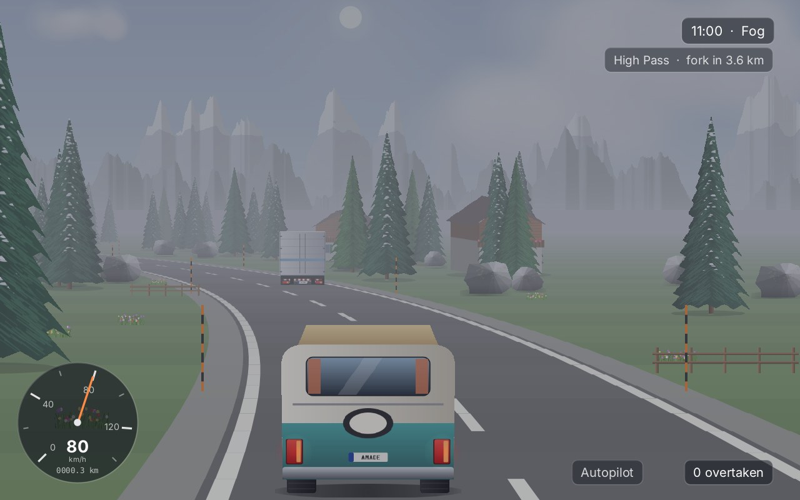{ width="400" }
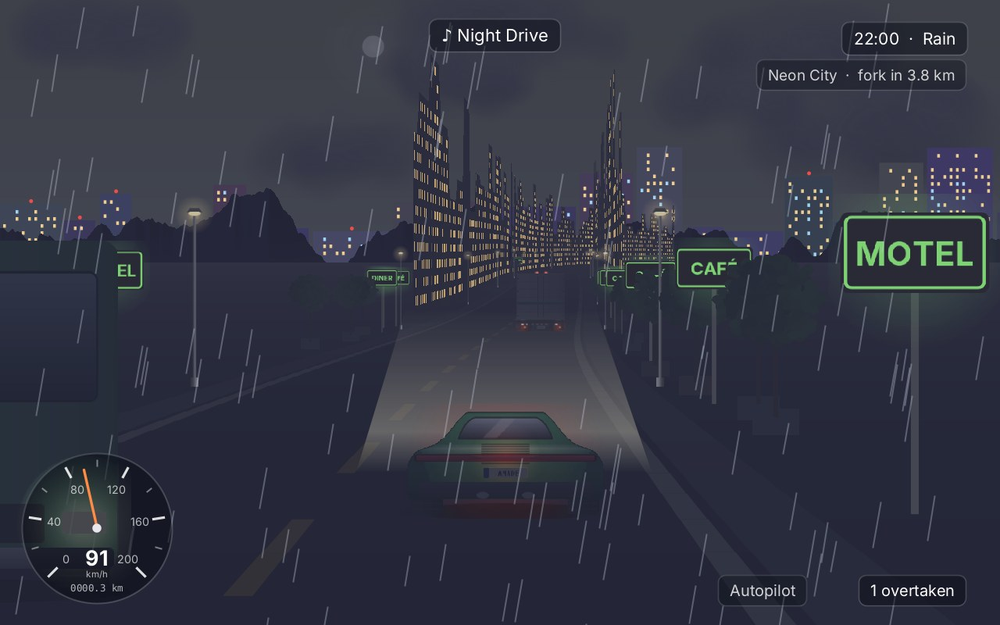{ width="400" }
<figcaption>High Pass in fog (left): the fog colour is close and the far road fades early. Neon City at ten in the evening, in the rain (right): the headlights light a pool on the road, the signs and lamps keep their colours, and rain streaks fall over everything.</figcaption>
</figure>

## Step 6: The sky and the landscape behind

The road is drawn over a background the game paints itself. Behind it is the sky, a gradient of three colours that follow the hour; the sun or the moon; clouds; two ranges of mountains; a line of trees; and, depending on the region, the sea, the towers of the city, or the aurora and floating islands of a dream. The engine's `Panorama` makes the pictures: ranges from a line of noise, lit by their slopes, with snow above a line and haze that grows towards the horizon; soft clouds; a line of trees. They wrap around, and they slide sideways as the road bends, the far ones slower than the near ones:

```java title="amade-game-engine · drive/Panorama.java"
--8<-- "amade-game-engine/src/main/java/eu/amadeos/gameengine/drive/Panorama.java:range"
```

```java title="amade-cruise-game · ui/game/Sky.java"
--8<-- "amade-cruise-game/src/main/java/eu/amadeos/games/cruise/ui/game/Sky.java:tint"
```

The pictures are 2400 pixels wide and made once per region. At night and in the golden hour they are tinted, in steps again, and the game keeps copies of them in the size they have on the screen, under a budget of pixels, the way `RoadSprite` keeps its copies. A new copy is made on a thread of its own; until it is finished, the layer is drawn with the copy it had before, a step of light off for a few frames ([Step 13](#full-screen-three-times-the-pixels) tells why).

## Step 7: The time of day and the weather

The `DayClock` runs an hour of the world in a minute, so a whole day takes 24 minutes; it can also stand still at the hour chosen in the settings. It gives the height of the sun, the light, from 0.12 at night to 1, and the golden hours around sunrise and sunset:

```java title="amade-cruise-game · domain/DayClock.java"
--8<-- "amade-cruise-game/src/main/java/eu/amadeos/games/cruise/domain/DayClock.java:clock"
```

The `Weather` changes every few kilometres: clear, clouds, rain (snow on the pass) or fog. Each change comes slowly, the clouds draw up before the rain sets in, and a dream has no weather:

```java title="amade-cruise-game · domain/Weather.java"
--8<-- "amade-cruise-game/src/main/java/eu/amadeos/games/cruise/domain/Weather.java:weather"
```

The renderer takes three numbers from them: the **light**, which darkens every colour towards the night's shade; the **sight**, which brings the fog closer in rain and fog; and the **mist**, which turns the fog's colour grey. The fog colour follows the same steps as the tinted copies of the sprites:

```java title="amade-game-engine · drive/RoadRenderer.java"
--8<-- "amade-game-engine/src/main/java/eu/amadeos/gameengine/drive/RoadRenderer.java:fog-colour"
```

That rounding looks like a detail; it was worth a factor of three. When the fog colour followed the light smoothly, it was a new colour in almost every frame, every tree needed a new tinted copy, and the cache threw away in each frame what it had made in the one before.

At night, the player's car lights the road ahead with its **headlights**: a pool of light, brighter near the car, painted over the road before the cars:

```java title="amade-game-engine · drive/RoadRenderer.java"
--8<-- "amade-game-engine/src/main/java/eu/amadeos/gameengine/drive/RoadRenderer.java:headlights"
```

The tail lights of the cars ahead glow through fog and night. A `RoadSprite` can **glow**: it keeps its colours in fog and dark, by the part given. The game draws each car twice, with lights off and on, and keeps the difference as a glowing picture of its own, drawn over the dark car:

```java title="amade-cruise-game · ui/game/Art.java"
--8<-- "amade-cruise-game/src/main/java/eu/amadeos/games/cruise/ui/game/Art.java:lights"
```

## Step 8: The trip

A `Trip` is one drive, without pictures or sounds: the world, the traffic and its plan, the creatures, the clock, the weather, the players' cars and, in a race, the computer's. The game calls `step` with the inputs; the views and the sounds read what they need:

```java title="amade-cruise-game · domain/Trip.java"
--8<-- "amade-cruise-game/src/main/java/eu/amadeos/games/cruise/domain/Trip.java:trip"
```

The game turns the keys and the gamepads into an `Input` for each player. Steering eases in and out the way a hand turns a wheel, so a short tap moves the car a little and a held key turns it steadily:

```java title="amade-cruise-game · ui/game/CruiseGame.java"
--8<-- "amade-cruise-game/src/main/java/eu/amadeos/games/cruise/ui/game/CruiseGame.java:input"
```

The `View` of a player puts it together: the camera behind and above the car, the light, sight and mist for the renderer, the sky, then the road with the cars of the traffic, the players, the rivals and the creatures, and the rain on top:

```java title="amade-cruise-game · ui/game/View.java"
--8<-- "amade-cruise-game/src/main/java/eu/amadeos/games/cruise/ui/game/View.java:view"
```

## Step 9: The autopilot and the race

The `Autopilot` drives a car the way a player would: it keeps right, looks ahead for the sharpest curve and slows down for it, steers against the pull of the bend, and pulls out to overtake a slower car when the other lane is clear for 90 metres ahead. It drives the title, the "just watch" mode (**C**), and the computer's cars in the race:

```java title="amade-cruise-game · domain/Autopilot.java"
--8<-- "amade-cruise-game/src/main/java/eu/amadeos/games/cruise/domain/Autopilot.java:autopilot"
```

A `Race` is a route (its regions and its length), five computer cars driven by autopilots at the pace of the difficulty, a countdown, a finish line and the places. The computer's cars neither run away nor fall hopelessly behind: they drive a little slower when they lead by much and a little faster when they are far behind. The traffic in a race only drives one way, and fewer of it:

```java title="amade-cruise-game · domain/Race.java"
--8<-- "amade-cruise-game/src/main/java/eu/amadeos/games/cruise/domain/Race.java:race"
```

Two players share the keyboard: arrows and **W A S D**. Each has a view of half the height, one above the other; the renderer does not care how big its view is. The world builds ahead of the leading car and keeps the road behind the last one:

```java title="amade-cruise-game · ui/game/CruiseGame.java"
--8<-- "amade-cruise-game/src/main/java/eu/amadeos/games/cruise/ui/game/CruiseGame.java:race"
```

<figure markdown>
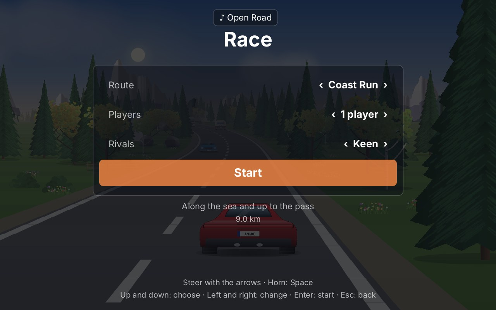{ width="400" }
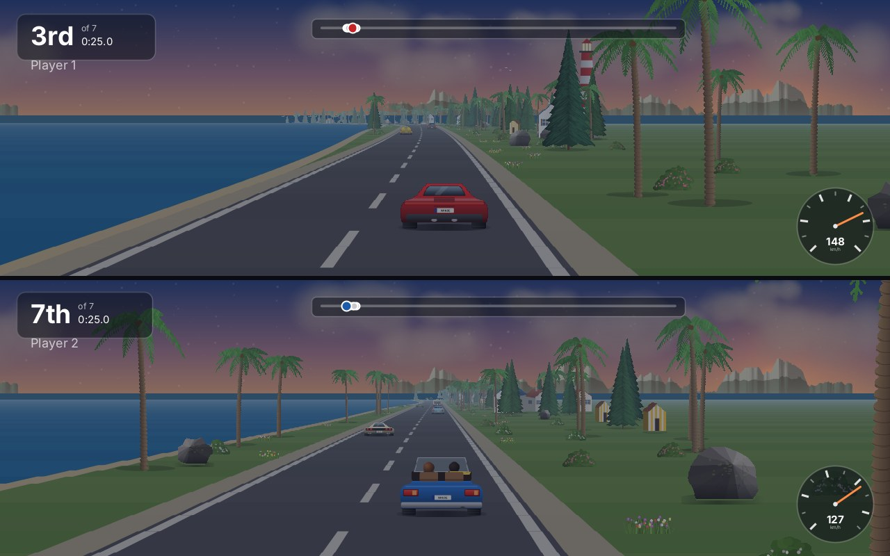{ width="400" }
<figcaption>The race setup (left) and a race of two players on the Coast Run (right): each half has its own place, time, progress bar and speedometer.</figcaption>
</figure>

## Step 10: Life at the roadside

`Wildlife` puts small life beside the road, each region its own: deer at the edge of the forest at dawn and dusk, which leap away when a car comes near; cows and sheep on the pastures; flocks of birds crossing the road; a hawk circling high; gulls and sailing boats at the coast; a balloon far off; a train running beside the road, faster or slower than the car; fireflies; paper lanterns rising in the dream; and, above the clouds, a whale swimming through the sky.

Every creature is a `Car` for the renderer, a sprite at a place beside the road, lifted if it flies, so the renderer draws it in the right order behind and before the trees without knowing what it is. The behaviour is the game's:

```java title="amade-cruise-game · domain/Wildlife.java"
--8<-- "amade-cruise-game/src/main/java/eu/amadeos/games/cruise/domain/Wildlife.java:spawn"
--8<-- "amade-cruise-game/src/main/java/eu/amadeos/games/cruise/domain/Wildlife.java:move"
```

When a creature comes near enough to be heard, it is called once: the sound plays its call.

<figure markdown>
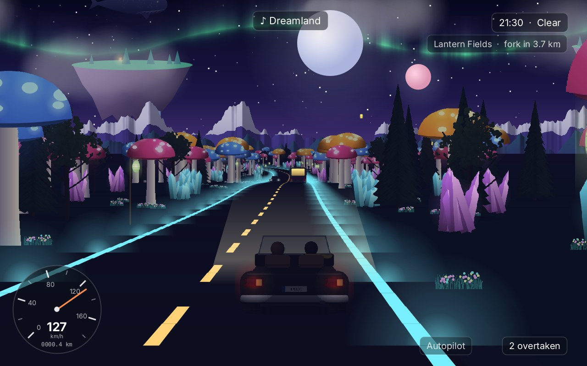{ width="400" }
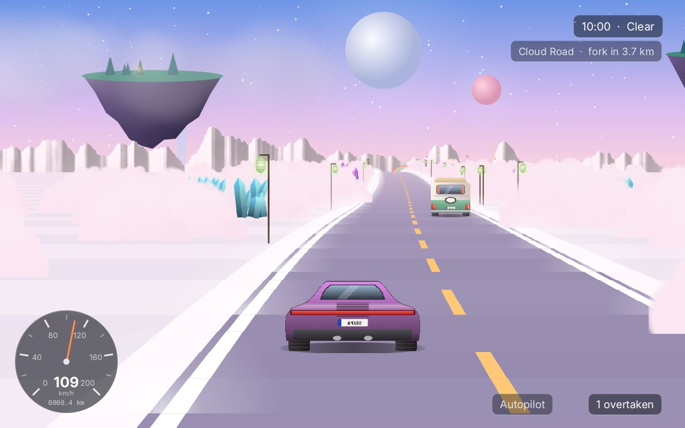{ width="400" }
<figcaption>The two dreams: Lantern Fields under the aurora, with a floating island and the sky whale (left), and Cloud Road (right). Their road lines glow, and their light never falls below twilight.</figcaption>
</figure>

## Step 11: Sounds made in code

Like every game of this book, Cruise has no recordings. Its sounds are made at the start, on a thread of their own, by a small workshop of noise, filters, sine tones, envelopes and seamless loops:

```java title="amade-cruise-game · ui/game/Synth.java"
--8<-- "amade-cruise-game/src/main/java/eu/amadeos/games/cruise/ui/game/Synth.java:synth"
```

An **engine** is a hum with its overtones, pulsing with the firing of the cylinders, in a loop of whole hertz so it ends where it began:

```java title="amade-cruise-game · ui/game/SoundBank.java"
--8<-- "amade-cruise-game/src/main/java/eu/amadeos/games/cruise/ui/game/SoundBank.java:engine"
```

The mixer plays it faster as the engine turns faster. That needs a new kind of sound in the mixer: a **bed**, a loop under the music and the effects whose sound, speed and loudness can change while it plays, gliding without a click:

```java title="amade-game-engine · audio/Mixer.java"
--8<-- "amade-game-engine/src/main/java/eu/amadeos/gameengine/audio/Mixer.java:bed"
```

Each **landscape** has a loop of its own: wind in the larches with a bird, crickets in the plains, the surf, wind in the rock, the hum of the city, a soft chord with bells in the dream:

```java title="amade-cruise-game · ui/game/SoundBank.java"
--8<-- "amade-cruise-game/src/main/java/eu/amadeos/games/cruise/ui/game/SoundBank.java:ambience"
```

`CarAudio` sets the beds in every frame: the engine climbing through five gears and dropping at each shift, the wind louder with the speed and louder still in the open Roadster, the rain, the gravel under the wheels on the shoulder, the echo of a tunnel, the landscape fading into the next one as the region changes, a thunder now and then in heavy rain, an owl at night and a woodpecker by day in the forest, and the calls of the creatures nearby:

```java title="amade-cruise-game · ui/game/CarAudio.java"
--8<-- "amade-cruise-game/src/main/java/eu/amadeos/games/cruise/ui/game/CarAudio.java:car-audio"
```

## Step 12: The radio

The game has four tunes of its own, written in MML like the tunes of the earlier games (chapter 24): one for the day on open land, one for the golden hours, one for the night and the city, one for the dreams. Which one plays follows the landscape and the hour:

```java title="amade-cruise-game · ui/game/Music.java"
--8<-- "amade-cruise-game/src/main/java/eu/amadeos/games/cruise/ui/game/Music.java:music"
```

The player can bring their own music: files and folders in the settings make a **playlist**. A playlist could be handed to the system's music player, but then the game would depend on it; instead the game decodes the files itself. Java Sound reads WAV and AIFF; the decoders for MP3, Ogg Vorbis and FLAC come along with the game as service providers, which Java Sound finds by itself. The decoded samples go to the mixer as a stream:

```java title="amade-cruise-game · ui/game/Playlist.java"
--8<-- "amade-cruise-game/src/main/java/eu/amadeos/games/cruise/ui/game/Playlist.java:playlist"
```

```java title="amade-game-engine · audio/SampleStream.java"
--8<-- "amade-game-engine/src/main/java/eu/amadeos/gameengine/audio/SampleStream.java:stream"
```

```java title="amade-game-engine · test/audio/MixerTest.java"
--8<-- "amade-game-engine/src/test/java/eu/amadeos/gameengine/audio/MixerTest.java:test-stream"
```

**Tracker modules** (MOD, XM, S3M, IT), the music of the demo scene and of many games of the 1990s, are not recordings but notes and instruments. There is no Java decoder for them as good as libopenmpt, the library of OpenMPT, so the game calls it through JNA when the system has it. Without it, modules are simply left out of the playlist:

```java title="amade-cruise-game · ui/game/Modules.java"
--8<-- "amade-cruise-game/src/main/java/eu/amadeos/games/cruise/ui/game/Modules.java:modules"
```

While driving, **R** switches the station (the game's tunes, the playlist, only the wind), **N** skips to the next track and **Ctrl+R** silences the music and brings it back; the car and the landscape go on:

```java title="amade-cruise-game · ui/game/CruiseGame.java"
--8<-- "amade-cruise-game/src/main/java/eu/amadeos/games/cruise/ui/game/CruiseGame.java:radio"
```

## Step 13: Measuring the frame

A frame of Cruise draws about 260 segments, five or six bands each, and over 500 pictures: trees, houses, cars, creatures. The first version took 45 to 60 milliseconds for a frame at 1280 × 800, with peaks of a quarter of a second. `./gradlew benchmark` drives through each region and measures; Java Flight Recorder (`-XX:StartFlightRecording`) showed where the time went. Four changes brought it to 20 to 33 milliseconds, on a four-core computer without a graphics card:

1. **Steady colours for the cache.** The fog colour changed a little in every frame, so every tree was tinted anew in every frame, and the cache, cleared when full, never kept anything (Step 7). Rounded to the steps of the copies, it changes a few times an hour of the game.
2. **A budget in pixels, not in copies.** The cache now forgets the copy used longest ago instead of everything at once, across all sprites.
3. **The nearest pixel.** A copy is already smooth and at most a fifth too wide; drawing it with bilinear interpolation cost four times as much as with the nearest pixel, and looked no better. The renderer sets the hint for its sprites. A small program of a few lines measured the blits of Java2D before deciding: a plain copy costs about 1.4 ns a pixel, a scaled one with the nearest pixel 2.9 ns, a bilinear one 11 ns.
4. **Pictures instead of paints.** A `LinearGradientPaint` over the sky and a `RadialGradientPaint` for the sun's glow are computed pixel by pixel in every frame. A gradient one pixel wide, drawn stretched, and the glow drawn once into a picture cost a fraction of that; the mountains, whose pictures are as big as they are drawn, are copied without any scaling.

Measured and changed one at a time, each step could be checked against the last.

### Full screen: three times the pixels

Then the game was played in full screen, at 1920 × 1200, and it crawled: a home computer of the 1980s drew such a road at 160 × 200 points, and here were seventy times as many, each with smooth edges. The benchmark, told to draw at three times the logical size (`./gradlew benchmark -Pscale=3`), measured 68 milliseconds a frame, and a second measurement in a real window nearly twice that. Leaving out one part at a time showed where the time went: 29 ms for the sky, 19 ms for the road, 25 ms for everything standing on it and beside it. The road ahead was never the problem; it is built long before the camera gets there and projected in under a millisecond. The time goes into painting pixels. Seven more changes:

5. **The sky in the size of the screen.** The sky's pictures were exactly as large as they are drawn at twice the logical size, and were copied; at three times they were enlarged in every frame, smoothly, at 11 ns a pixel over the whole upper half of the screen. Now each layer has a copy in just the size it has on the screen, and a frame only copies. The gradient behind them is no longer a stretched picture but rows of plain rectangles, one for each of its colours: 5 ms instead of 29.

    ```java title="amade-cruise-game · ui/game/Sky.java"
    --8<-- "amade-cruise-game/src/main/java/eu/amadeos/games/cruise/ui/game/Sky.java:wrap"
    ```

    ```java title="amade-cruise-game · ui/game/Sky.java"
    --8<-- "amade-cruise-game/src/main/java/eu/amadeos/games/cruise/ui/game/Sky.java:gradient"
    ```

6. **The ground once, the road once.** Each segment painted the grass across the whole view as a smoothed shape, and on it the shoulder, on that the kerb, on that the asphalt: every pixel of the road four times. The grass is now a rectangle of whole pixels, which needs no smoothing and costs a fraction, and the strips of the road lie side by side, each reaching one unit under its inner neighbour so that nothing shows through between them.

    ```java title="amade-game-engine · drive/RoadRenderer.java"
    --8<-- "amade-game-engine/src/main/java/eu/amadeos/gameengine/drive/RoadRenderer.java:ground"
    ```

7. **Walls without smoothing.** A canyon has fourteen bands of rock on each wall of each segment: seven thousand small shapes in a frame, and a smoothed shape costs several microseconds before its first pixel. They meet edge to edge, so nobody sees whether their edges are smooth; filled plainly, the walls take 7 ms instead of 22.
8. **One bit of transparency.** Java2D copies a picture to a new size about three times as fast when each of its pixels is either there or not than when each must be blended with what lies behind it, and five times as fast when the picture is small. So `RoadSprite` takes its picture apart: the tree gets copies with one bit of transparency, and its shadow on the ground, which must stay soft, a copy of its own that is only as large as the shadow. Drawing a copy mirrored turned out to be slow as well, so a sprite that stands mirrored gets mirrored copies.

    ```java title="amade-game-engine · drive/RoadSprite.java"
    --8<-- "amade-game-engine/src/main/java/eu/amadeos/gameengine/drive/RoadSprite.java:parts"
    ```

    ```java title="amade-game-engine · drive/RoadSprite.java"
    --8<-- "amade-game-engine/src/main/java/eu/amadeos/gameengine/drive/RoadSprite.java:paint"
    ```

9. **Glows as pictures.** The glowing lines of the dream roads have a hundred and thirty lights in a frame, each a `RadialGradientPaint`. Painted once per size and colour and then copied, they cost about half.

    ```java title="amade-game-engine · drive/RoadRenderer.java"
    --8<-- "amade-game-engine/src/main/java/eu/amadeos/gameengine/drive/RoadRenderer.java:glow"
    ```

10. **A picture in main memory.** The canvas draws straight onto the screen's surface, which belongs to the window system. For a game with a few dozen sprites that is the fast way. A frame of Cruise paints every pixel several times over, and its copies change all the time, so nothing can stay in video memory; drawing the frame into a `BufferedImage` and copying that to the screen in one piece was nearly twice as fast in the first measurement, and after the other changes about four times.
11. **As sharp as the computer can.** Even so, a full screen of smooth pixels in software takes 17 to 32 ms on the test computer, and it may be slower on another. The new render mode `AUTO` measures its own frames: while they take longer than 20 ms it draws the world at half or a third of the screen's size and enlarges it, each pixel a square of 2 × 2 or 3 × 3, and when the road gets emptier it goes back. The overlay with the speedometer stays sharp.

    ```java title="amade-game-engine · swing/AutoResolution.java"
    --8<-- "amade-game-engine/src/main/java/eu/amadeos/gameengine/swing/AutoResolution.java:auto-resolution"
    ```

| 1920 × 1200, four cores, no graphics card | A frame |
|---|---|
| Before, drawn in memory | 68 ms |
| After changes 5 to 9, drawn in memory | 23 ms |
| At half the size, enlarged | 10 ms |
| The game in its window, *Direct* | 71 to 114 ms |
| The game in its window, *Automatic* (it settles at half the size) | 11 to 15 ms |

The pictures of the eight regions before and after, laid over each other, differ in the outlines of the trees and nowhere else. *Automatic* is the game's default; *Game → Graphics* still has *Direct* and *Pixels*.

Memory needed the same care. All pictures of the props and cars take about 180 megabytes; the game draws them once, for all its windows and tests, and keeps the soft glow of the lights at half the size.

## The scenes

The scenes are the familiar ones: the title with the car driving by itself, the journey, the pause, the garage, the journal, the race setup, the race and its results. In the garage each player chooses a car and its colour; the side picture and three ratings show what it is. Until then the first player drives the Kestrel and the second the Roadster:

```java title="amade-cruise-game · ui/game/CruiseGame.java"
--8<-- "amade-cruise-game/src/main/java/eu/amadeos/games/cruise/ui/game/CruiseGame.java:garage"
```

<figure markdown>
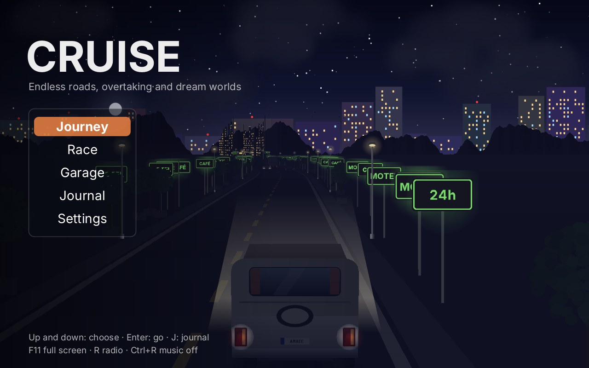{ width="400" }
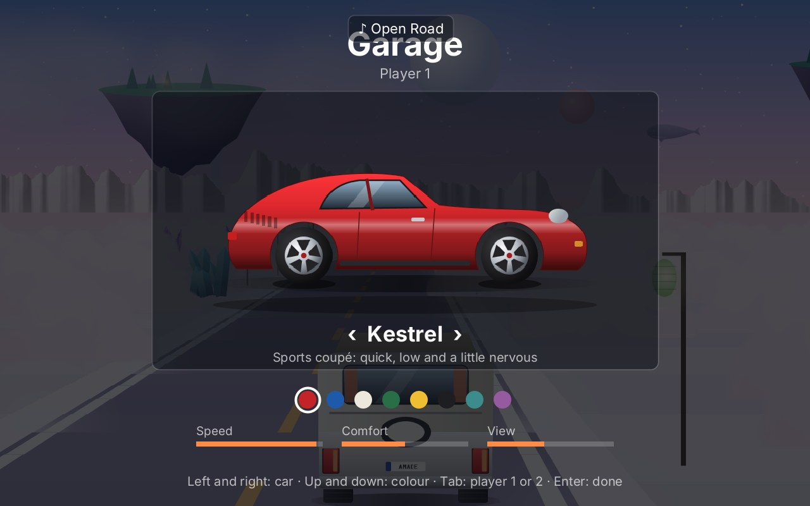{ width="400" }
<figcaption>The title (left) and the garage (right).</figcaption>
</figure>

A photo (**P**) is the frame without the panels, drawn again at twice the size and saved in the pictures folder of the XDG directories:

```java title="amade-cruise-game · ui/game/CruiseGame.java"
--8<-- "amade-cruise-game/src/main/java/eu/amadeos/games/cruise/ui/game/CruiseGame.java:photo"
```

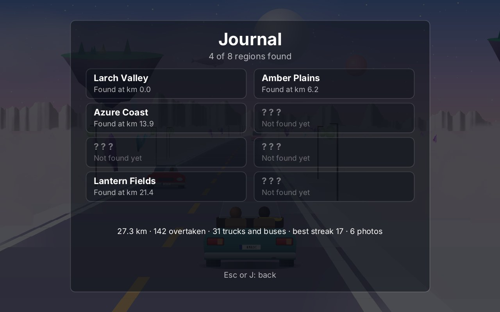{ width="560" }

## What moved into the engine

| From Cruise | Engine package | Why |
|---|---|---|
| An endless road of segments, built in sections that ease in and out | `eu.amadeos.gameengine.drive` (`Road`, `Segment`, `RoadBuilder`) | Every road game: racing, driving, flying low over a track |
| The pseudo-3D view: projection, curves, hills, walls, tunnels, water, scenery, cars, fog, night, headlights | `drive` (`RoadRenderer`, `RoadCamera`, `RoadLook`, `Wall`, `Scenery`) | The same |
| Sprites at every size, tinted in steps, under one budget | `drive` (`RoadSprite`) | Any game that draws many scaled pictures |
| A frame drawn in memory, as sharp as the computer manages | `swing` (`RenderMode.AUTO`, `AutoResolution`) | Any game that is too slow in full screen |
| Driving with the pull of curves; traffic that follows, overtakes and comes the other way | `drive` (`Car`, `Driving`, `Traffic`) | Road games with cars, bikes or anything on lanes |
| Mountains, clouds and tree lines made in code, wrapping around | `drive` (`Panorama`, `Noise`) | Backgrounds for any game with a horizon |
| Loops whose sound, speed and loudness change while they play; music streamed while it is decoded; a music volume of its own | `audio` (`Mixer.Bed`, `SampleStream`, `Mixer.setMusicVolume`) | Engines, wind, rain; the player's own music in any game |

What stays in the game: the regions and their rules, the world of stints and forks, the props and cars and their pictures, the creatures, the clock and the weather, the trip, the autopilot and the race, the sky, the sounds and tunes, the playlist and the modules, the journal and the scenes.

## Exercises

1. **A region of your own.** Add a ninth region: a birch forest in autumn, a salt desert, or a road through vineyards. What does `Region` need: colours, props, features, traffic, creatures, a landscape sound? Where does it appear at the forks?
2. **Lane changes in the traffic.** Today only some cars overtake. Let every car change lanes now and then on a road of four lanes. What has to change in `Traffic`, and what in the renderer?
3. **Snow.** On the pass, rain turns into snow. Draw falling flakes instead of streaks, and make the road white at the edges. Which numbers of `RoadLook` change, and how do you blend into snow over a kilometre?
4. **A ghost.** Record the player's best race on a route (position and speed every tenth of a second) and let a pale car drive it in the next race.
5. **Bridges.** Let the road cross a river on a bridge: a segment with water on both sides and railings. Is the bridge a `Wall`, scenery, or something new?
6. **Faster still.** Run `./gradlew benchmark` and find the slowest region. Is it the trees, the walls, the sky? Try one change, measure again, and keep it only if the numbers say so.

---

Cruise is the second game of **Part VI**, *Three Dimensions*. Rivet looked at a grid from inside; Cruise looks down a road. Both are tricks from the time before 3D hardware, and both still make a world that feels deep. What they added to the engine is also in Part IV and the [glossary](appendix-glossary.md).
