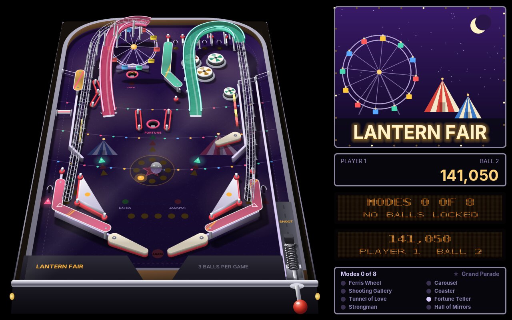
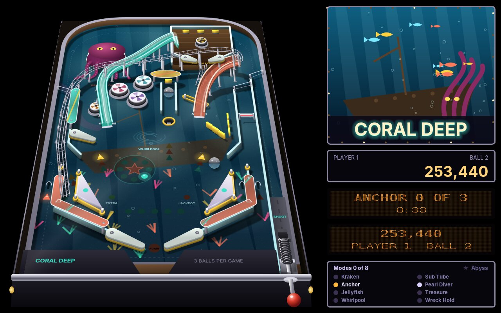
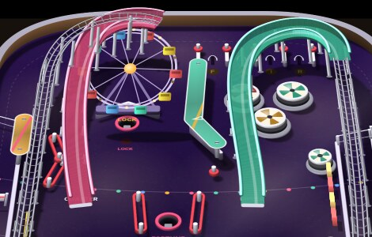
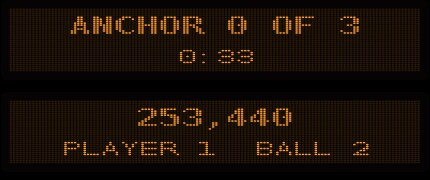
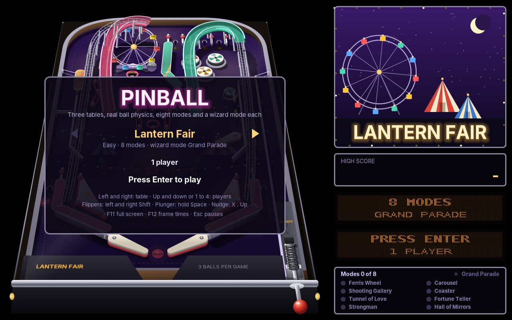
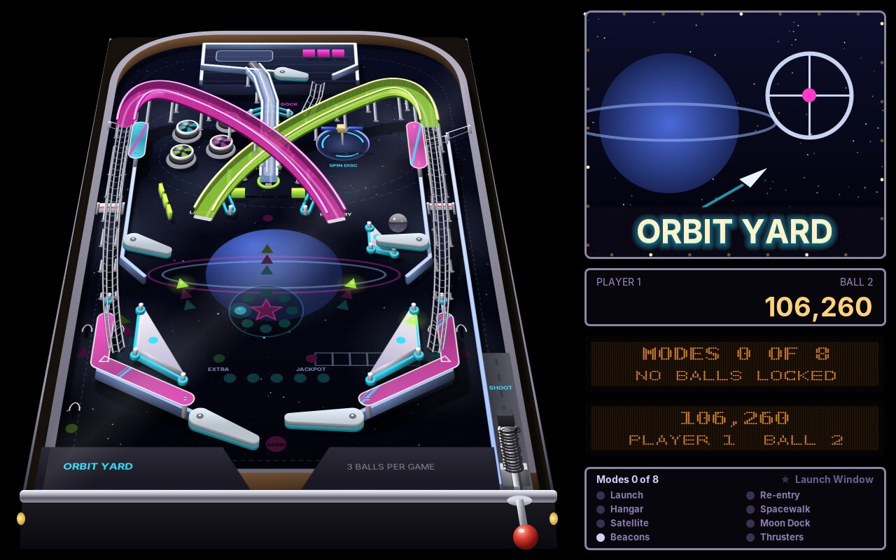
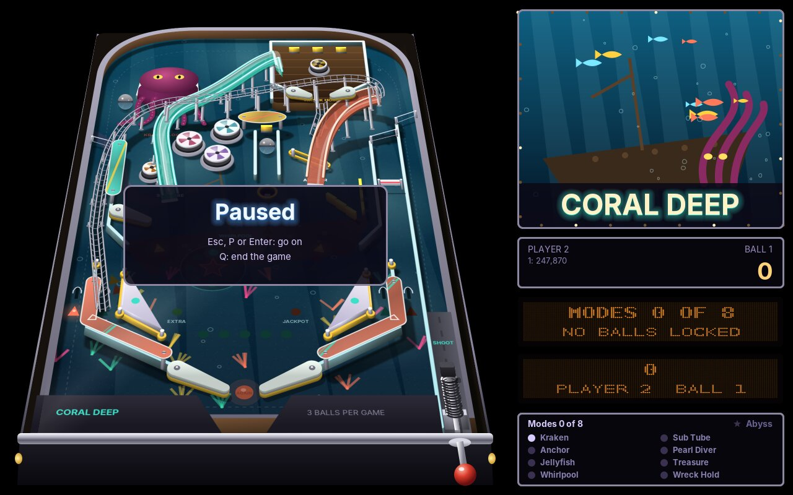
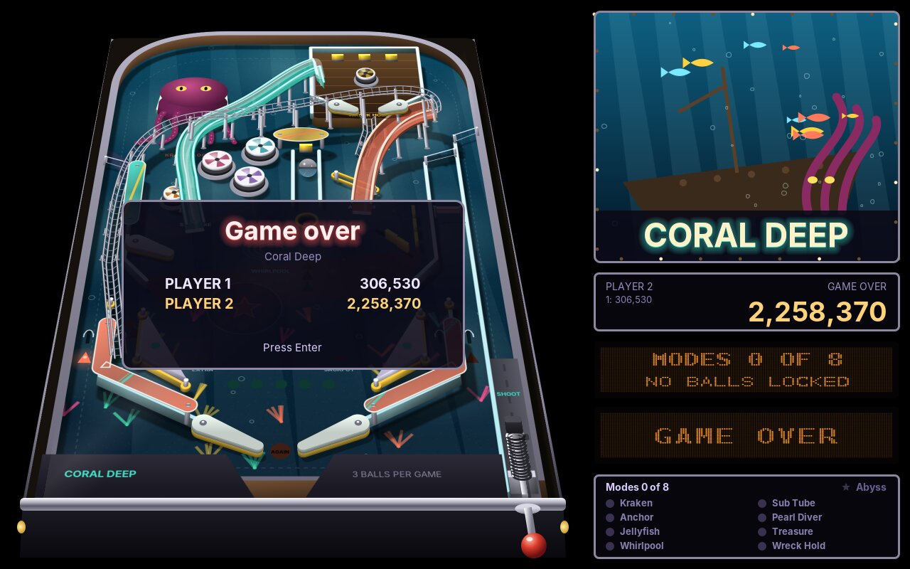

# 70. Pinball

**Pinball** is a machine in a box: three tables, each seen from the player's end of the cabinet, with ramps that climb over the playfield and wire forms that bring the ball back, pop bumpers, slingshots, drop targets, spinners, a ball lock and a multiball, eight modes and a wizard mode. Above the table, a backglass shows the score and two dot-matrix windows tell what is running.

<figure markdown>
{ width="400" }
{ width="400" }
<figcaption>Lantern Fair, the easy table (left), and Coral Deep, the medium one (right). The table is a flat picture tilted into the view; the chrome ball reflects the room.</figcaption>
</figure>

The tables are original: a fairground at night, a wreck on a reef, a dockyard in orbit. Their rules are the ones every modern machine shares: shots light lamps, lamps tell what is worth shooting next, and a game is three balls long.

Two things are new in this book. The first is **real physics**. The ball of Paddle (chapter 20) bounced off flat walls at fixed angles; this ball has a mass that rolls down a sloped table, it bounces harder off rubber than off wood, it is kicked by bumpers, it climbs ramps and loses speed doing it, and a flipper hits it with the speed of the flipper's surface at the point where they meet. The second is **a flat world seen in perspective**: the table is drawn once from straight above, every part standing up with its height and its shadow, and that picture is tilted into a trapezoid by a real perspective projection. Both live in the engine's new `pinball` package. They open **Part VII**, *Tables and Real Physics*.

!!! abstract "What you will learn"
    - **A table as a text file**: parts in lines, a shared cabinet file, layers for raised floors
    - **Physics in small steps**: gravity along the table, materials that bounce, grip and kick, the closest point of a part
    - **Flippers** that hit with the speed of their surface, and a **plunger** with a spring
    - **Ramps and wire forms** as tracks in three dimensions, where the ball climbs against gravity and can roll back
    - **Holes, spinners, magnets and captive balls** as zones on the table
    - **A perspective projection** (a homography) from the flat table to the screen and back
    - **Relief drawing**: parts lifted slice by slice, with soft shadows, baked once into a picture
    - **A chrome ball** that reflects the room, rendered once
    - **Lamps** that blink, chase and fade, and **dot-matrix displays**
    - **Rules**: modes, a ball lock and multiball, combos, the skill shot, a wizard mode
    - **A robot player** that plays whole games, in the title and in the tests
    - **Left and right Shift** told apart

The complete game is in [amade-pinball-game](https://github.com/amadeos-eu/amade-pinball-game).

## The rules

1. The title shows the chosen table while a robot plays it. **Left** and **right** choose another table, **up**, **down** or **1** to **4** the number of players, **Enter** starts.
2. Hold **Space** to pull the plunger and let go to shoot: the longer, the harder. The right strength is the **skill shot**: into the lit top lane, onto a standup, or into the satellite, depending on the table.
3. **Left Shift** and **right Shift** work the flippers of their side. **X**, **.** and **up** nudge the table; after three warnings the ball **tilts**, and the flippers go dead until the next ball.
4. The **start hole** starts the mode its lamp shows. Each mode wants a few shots within a time; the lamps of those shots blink fast. A mode done pays its value; a mode that runs out of time ends without it.
5. The ramps **light the lock**. Three locked balls start the **multiball**: the ramps and orbits light jackpots, and all of them lit the **super jackpot** at the lock.
6. Ramps and orbits shot within three seconds of each other are **combos**. The top lanes, all lit, raise the **bonus multiplier**. A ball lost within eight seconds of the launch comes back once.
7. All eight modes played light the **wizard mode** at the start hole: a multiball of four or five balls in which every main shot counts.
8. After the third ball the game is over. Each table has its own high score list, and each player who reached it enters a name.

## Step 1: The table as a file

A table is a text file, one part per line: its kind, an id, numbers in table units and options. The table is 232 units wide and 392 long; x goes to the right, y down the table towards the player. Every table starts with the same cabinet: the rim, the shooter lane, the lower flippers, the slingshots and the four lanes at the bottom. They are in `common.table`, which is read before the table's own file:

```text title="amade-pinball-game · tables/common.table"
--8<-- "amade-pinball-game/src/main/resources/eu/amadeos/games/pinball/tables/common.table"
```

The table's own file adds its name, its palette of eight colours, its parts and its rules. Here is the top half of Lantern Fair, with the lanes, the pop bumpers, the Ferris wheel and the two ramps:

```text title="amade-pinball-game · tables/lantern-fair.table (beginning)"
--8<-- "amade-pinball-game/src/main/resources/eu/amadeos/games/pinball/tables/lantern-fair.table:top"
```

Colours are written `p3` (the fourth colour of the palette) or `xffd27a` (a colour of its own). A ramp is a path of Bézier curves (`C`), first its plastic part (`path`), then its wire form (`wire`). A kind with `@1` behind it, like `bumper@1`, stands on the raised floor of layer 1; that is how Coral Deep's Wreck Hold and Orbit Yard's Moon Dock get their upper playfields.

`TableFile` reads the lines. Each line becomes a `Part`, which splits its words into numbers, names and options; the few lines that are not parts (the name, the palette, the rules, the modes) go into the `TableSpec`:

```java title="amade-pinball-game · domain/TableFile.java"
--8<-- "amade-pinball-game/src/main/java/eu/amadeos/games/pinball/domain/TableFile.java:parse"
```

The rules are the same for every table, so the file only names the parts they use: which hole starts the modes, which ramps light the lock, which shots pay jackpots, what the skill shot is:

```text title="amade-pinball-game · tables/lantern-fair.table (rules)"
--8<-- "amade-pinball-game/src/main/resources/eu/amadeos/games/pinball/tables/lantern-fair.table:rules"
```

## Step 2: Physics in small steps

The engine's `Playfield` holds what the ball can meet: **segments** (walls, rubber bands, targets, the kicking side of a slingshot), **discs** (posts and pop bumpers), **flippers**, **zones** and **tracks**. `Table.build` turns each part of the file into those pieces:

```java title="amade-pinball-game · domain/Table.java"
--8<-- "amade-pinball-game/src/main/java/eu/amadeos/games/pinball/domain/Table.java:build"
```

A slingshot, for example, is three rubber segments in a triangle and three posts at its corners, but only the long side facing the flippers kicks. A drop target is a short segment that the rules take away when it is hit (`down`) and put back when the bank is reset.

The game loop runs 120 times a second, as in every game of this book. That is not fine enough for a ball that moves 1,000 units a second past posts of 2.6 units: in one step it would jump through them. So `Playfield.step` cuts every step into eight smaller ones, about a thousandth of a second each. In each, the flippers turn, every ball moves, and every ball is tested against every part on its layer:

```java title="amade-game-engine · pinball/Playfield.java"
--8<-- "amade-game-engine/src/main/java/eu/amadeos/gameengine/pinball/Playfield.java:step"
```

Gravity only pulls down the table, along +y. A real table is tilted by about six and a half degrees, so the ball feels about a ninth of the Earth's gravity. `STANDARD_GRAVITY` is 900 units per second squared, chosen by playing: with it, a ball takes about a second to roll from the top to the flippers.

### The closest point

Every test of the ball against a part asks the same question: **which point of the part is closest to the ball's centre?** For a disc it is the point on its edge towards the ball. For a segment it is found by projecting the ball's centre onto the line and keeping the result between the two ends:

```java title="amade-game-engine · pinball/Segment.java"
--8<-- "amade-game-engine/src/main/java/eu/amadeos/gameengine/pinball/Segment.java:closest"
```

If that point is nearer than the ball's radius plus the part's own thickness, they touch. A segment with thickness is a capsule, a rectangle with round ends, so a ball that hits the end of a wall bounces off its round cap, not off a sharp corner.

### Materials

What happens next depends on what the part is made of. A `Material` has four numbers: how much of the speed towards the part comes back (**bounce**), how much of the speed along it is lost (**grip**), and a **kick** that throws the ball away when it hits harder than **kickAbove**:

```java title="amade-game-engine · pinball/Material.java"
--8<-- "amade-game-engine/src/main/java/eu/amadeos/gameengine/pinball/Material.java:material"
```

A pop bumper has a kick of 520 and kicks at a touch of 25; a slingshot has 430 but only kicks when the ball arrives with more than 60, so a ball that only rolls past it is not thrown. `contact` does the bounce: it pushes the ball out of the part, splits its speed into the part towards the surface and the part along it, reflects the first, takes some of the second, and adds the kick:

```java title="amade-game-engine · pinball/Playfield.java"
--8<-- "amade-game-engine/src/main/java/eu/amadeos/gameengine/pinball/Playfield.java:bounce"
```

The bounce is measured **relative to the surface's own velocity** (`sx`, `sy`). For walls that is zero. For a flipper it is the whole point.

## Step 3: Flippers and the plunger

A flipper is a capsule that turns around its pivot. Held, it swings up at its full speed; let go, it falls back a little slower:

```java title="amade-game-engine · pinball/Flipper.java"
--8<-- "amade-game-engine/src/main/java/eu/amadeos/gameengine/pinball/Flipper.java:turn"
```

How fast its surface moves depends on where along it the ball is: the angular velocity times the distance from the pivot, at right angles to the arm. Near the tip the surface moves several times faster than near the pivot:

```java title="amade-game-engine · pinball/Flipper.java"
--8<-- "amade-game-engine/src/main/java/eu/amadeos/gameengine/pinball/Flipper.java:surface"
```

That velocity goes into `contact`, and the rest is the same rule as for any wall. A ball reflected off a surface moving towards it leaves faster than it came, and faster the further out it was hit. Nothing in the code says "a flipper shoots the ball"; it follows from the rule. So does everything a player learns at a real machine: the **cradle** (a held flipper stops a ball rolling down it), the **post pass**, the **dead flipper** (a ball dropped onto a resting flipper loses its speed), and that the shot's direction depends on how early or late the button is pressed.

The plunger is a spring. Holding the button pulls the rod back, all the way in `fullPull` seconds; letting go fires the ball with a speed that grows with the square of the pull, as the energy of a spring does:

```java title="amade-game-engine · pinball/Plunger.java"
--8<-- "amade-game-engine/src/main/java/eu/amadeos/gameengine/pinball/Plunger.java:plunger"
```

## Step 4: Ramps and wire forms

A ball on a ramp leaves the flat table. It needs a third coordinate, the height, and it no longer moves freely: it follows the ramp. The engine's `Track` is a path of points, each with its height. A ball on a track only knows how far along it is (`along`) and how fast it goes (`speed`); its x and y come from the path.

`Table.ramp` builds a ramp's track from the file: the plastic part climbs from the mouth to 30 units, the wire form brings the ball back down to the table. At the mouth it puts an **entry zone**: a ball that rolls into it in the ramp's direction, faster than `min`, goes up the track. Two short walls beside the mouth make a ball that misses it bounce off, as the side walls of a real ramp do:

```java title="amade-pinball-game · domain/Table.java"
--8<-- "amade-pinball-game/src/main/java/eu/amadeos/games/pinball/domain/Table.java:ramp"
```

On the track, two forces act. The table's slope pulls along the table, as before. The ramp's own slope works against the whole of gravity, not a ninth of it, so climbing costs six times more (`CLIMB`) than rolling down the table gives:

```java title="amade-game-engine · pinball/Playfield.java"
--8<-- "amade-game-engine/src/main/java/eu/amadeos/gameengine/pinball/Playfield.java:ride"
```

A ball that reaches the end leaves the track with its speed, on the layer the track ends on: the playfield, or a raised floor. A ball too slow to reach the top stops, rolls back, and drops out of the mouth: the **failed ramp shot**, which the game greets with a sad sound and no points.

### Layers

A raised floor is a second table above the first. Each ball, part and zone has a **layer**, and the ball is only tested against parts on its own. The raised floor itself is a box on the playfield: balls below bounce off its sides, balls above roll on its top. A track that ends on layer 1 puts the ball there; a hole on layer 1 with an `exit` drops it back down.

### Zones

Everything the ball rolls over or into is a `Zone`:

- a **switch** reports each entry: rollovers, lane switches, the orbits;
- a **spinner** reports each entry with the ball's speed, from which the game counts how often the plate turns;
- a **hole** catches a ball slower than its limit and holds it until the game ejects it: the start hole, the lock, the Kraken;
- a **magnet** pulls balls towards its centre while it is on: Coral Deep's whirlpool;
- an **entry** sends the ball up a track.

A **captive ball** is a ball of its own, kept inside a fence; the free ball knocks it against a target at the end of the fence. Coral Deep has one with a pearl.

The table tells the rules what happened through `Playfield.Events`: a part was **hit** with some speed, the ball **entered** a zone, a hole **caught** it, it **climbed** a ramp, **rode** it to the end or **rolled back**, or it **drained**.

## Step 5: The game and its rules

`Game` holds the players, the balls and the phases of a ball: the plunge, play, the bonus count after a ball is lost, and the end. Each step, it hands the buttons to the table, moves the physics on, and lets the rules look at what happened:

```java title="amade-pinball-game · domain/Game.java"
--8<-- "amade-pinball-game/src/main/java/eu/amadeos/games/pinball/domain/Game.java:step"
```

`Rules` does the rest: points for every part, the modes, the lock and multiball, combos, the bonus multiplier, the extra ball and the wizard mode. All three tables share the one class; the table file names the shots.

What the rules know, the player learns from the **lamps**. Every insert on the table has a lamp with a name, and at the end of each step the rules set every lamp from their state: off, on, blinking slowly (it can be lit) or fast (shoot it now):

```java title="amade-pinball-game · domain/Rules.java"
--8<-- "amade-pinball-game/src/main/java/eu/amadeos/games/pinball/domain/Rules.java:lamps"
```

Each shot has three lamps in an arrow: the first for a mode that wants it, the second for a jackpot, the third for a combo or to light the lock. A player who has never read the rules can still play well by shooting what blinks.

The engine's `Lamps` turns those states into brightness. A lamp does not switch; it **fades**, quickly up and slower down, as the bulb of a real machine does. Lamps can also **chase** in a row, and all of them flash together for the big moments:

```java title="amade-game-engine · pinball/Lamps.java"
--8<-- "amade-game-engine/src/main/java/eu/amadeos/gameengine/pinball/Lamps.java:update"
```

### The skill shot

The skill shot rewards the plunge: when the ball is plunged with just the right strength, its first touch is the skill target. That is the rule, quite literally: the first part or zone the ball touches after the launch decides. On Lantern Fair the target is the lit top lane, which the flipper buttons move before the plunge; on Coral Deep any of the treasure standups (`treasure*`); on Orbit Yard the satellite's spin disc:

```java title="amade-pinball-game · domain/Rules.java"
--8<-- "amade-pinball-game/src/main/java/eu/amadeos/games/pinball/domain/Rules.java:skill"
```

With the plunger's spring, the window for each is a few hundredths of a second of holding: between 0.67 and 0.68 seconds on Lantern Fair, for example. That is hard but fair, and it is the same every time, because the physics has no chance in it.

### Nudging and the tilt

A nudge pushes every free ball a little: sideways for **X** and **.**, up the table for **up**. Done carefully, it saves a ball from the outlane. The engine's `Tilt` is the bob of a real machine: each nudge makes it swing, and it calms down by itself. A nudge while it still swings is a warning, and more warnings than allowed tilt the ball:

```java title="amade-game-engine · pinball/Tilt.java"
--8<-- "amade-game-engine/src/main/java/eu/amadeos/gameengine/pinball/Tilt.java:nudge"
```

## Step 6: The robot

A pinball game cannot be tested by looking at it: a ball that sticks behind a post once in a thousand games, or rests on a ledge where no flipper reaches, is found by playing many games. So the game has a **robot**. It holds a flipper briefly when a ball comes over it from above, and plunges with a random strength:

```java title="amade-pinball-game · domain/Robot.java"
--8<-- "amade-pinball-game/src/main/java/eu/amadeos/games/pinball/domain/Robot.java:robot"
```

It plays badly but endlessly. On the title, it plays the chosen table without sound, which makes the **attract mode** of the machine. In the tests, it plays three whole games on each table and checks that no ball ever leaves the cabinet and that every game ends:

```java title="amade-pinball-game · TablesTest.java"
--8<-- "amade-pinball-game/src/test/java/eu/amadeos/games/pinball/domain/TablesTest.java:robot"
```

That test found most of the bugs in the tables. A ball rested on top of the Moon Dock's box, wedged between it and the rim, for fifteen minutes; the box got a shallow roof with cut corners. Balls came to rest on the flat top of the lane gate; the gate was slanted. Other tests in the same class check that every ramp can be made with some shot, and that some strength of the plunger makes the skill shot on each table.

## Step 7: The table in perspective

Now to the picture. The tables are seen from the player's end of the cabinet: the far end is narrower than the near end, and things further up look smaller. That is a **perspective projection**, and for a flat table it is a simple one. A flat rectangle seen from any point becomes a four-sided shape on the screen, and the mapping from one to the other is a **homography**: a three-by-three matrix that works on points written with a third coordinate of 1, followed by a division by the third coordinate of the result.

The engine's `Perspective` is made from the table's size and the four corners of the trapezoid it should fill. It works out the matrix once, and its inverse; `view` maps a table point to the screen, and `table` maps a screen point back:

```java title="amade-game-engine · pinball/Perspective.java"
--8<-- "amade-game-engine/src/main/java/eu/amadeos/gameengine/pinball/Perspective.java:view"
```

The division by `w` is what makes equal steps up the table shorter towards the far end. Without it, the table would be squeezed, not seen: lines would stay straight, but the far end would look as deep as the near one.

Pinball has heights too: a ramp 30 units high, a bumper's cap, the ball itself. Looking down at a slant, height and depth both move a point up the screen, so the engine uses a simple rule: a point `h` units high at `(x, y)` appears where the table point `(x, y − h)` does. It is not exact, but it keeps the flat pictures of the parts and the projection in step, and the eye does not notice.

### Warping the picture

Java2D can draw shapes through an `AffineTransform`, which keeps parallel lines parallel. A homography does not, so Java2D cannot draw through it. The engine therefore does the opposite: it draws the table flat, into a picture, and then **warps** the picture. For each pixel of the trapezoid on the screen, `warp` asks which table point it shows (with `table`, backwards), and takes the colour of the flat picture there, blended from four samples:

```java title="amade-game-engine · pinball/Perspective.java"
--8<-- "amade-game-engine/src/main/java/eu/amadeos/gameengine/pinball/Perspective.java:warp"
```

That costs time: a good part of a second for a large window. So the warped picture is made once for each window size and kept, and only the parts that move are drawn per frame. They are small, and over their few units the perspective hardly changes, so they can use an affine transform after all: `local` straightens the perspective near one point into one:

```java title="amade-game-engine · pinball/Perspective.java"
--8<-- "amade-game-engine/src/main/java/eu/amadeos/gameengine/pinball/Perspective.java:local"
```

A flipper is drawn through `local` at its pivot, in its own flat table coordinates, exactly as the baked parts were. It sits on the table in the right size and slant.

## Step 8: Relief

The flat picture must already look three-dimensional when it is warped: the ramps above the table, the bumpers standing up, every part with its shadow. The engine's `Relief` draws a table seen from straight above with heights. It has three layers: the **floor** for the printed artwork of the playfield, the **shadows**, and the **parts**.

A part stands up by being drawn again and again, a quarter unit higher each time, from its foot to its top. Each slice is shaded from dark at the foot to light at the top, and lit from the left; the top is filled last:

```java title="amade-game-engine · pinball/Relief.java"
--8<-- "amade-game-engine/src/main/java/eu/amadeos/gameengine/pinball/Relief.java:extrude"
```

Its shadow is the same footprint, moved away from the light by its height. The light comes from above the player's left shoulder, so shadows fall to the right and up the table:

```java title="amade-game-engine · pinball/Relief.java"
--8<-- "amade-game-engine/src/main/java/eu/amadeos/gameengine/pinball/Relief.java:shadow"
```

When all parts are drawn, `bake` blurs the shadows, lays them over the floor (only where there is floor), and puts the parts on top:

```java title="amade-game-engine · pinball/Relief.java"
--8<-- "amade-game-engine/src/main/java/eu/amadeos/gameengine/pinball/Relief.java:bake"
```

The game's `TableArt` makes two of them, a lower one and an upper one (`low.above()`), so that a ball can roll under a ramp: the lower picture, then the balls and moving parts on the playfield, then the upper picture with the ramps and plastics, then the balls on the ramps. For each part of the file it draws the matching picture; the parts that move, and the lamps, are left out and drawn every frame:

```java title="amade-pinball-game · ui/game/TableArt.java"
--8<-- "amade-pinball-game/src/main/java/eu/amadeos/games/pinball/ui/game/TableArt.java:draw"
```

### Ramps of plastic and wire

A ramp is the hardest part to draw, because it climbs. The engine's `RampArt` walks along the ramp's track and builds the ramp from strips between its points: the far side wall first, then the bed the ball rolls on, then the near wall with its edge, lit by how much it faces the light. Clear plastic is drawn with a little transparency, so the floor shows through it, and three lines of light along the top edges make it shine. The supports that carry the ramp go down to its shadow:

```java title="amade-game-engine · pinball/RampArt.java"
--8<-- "amade-game-engine/src/main/java/eu/amadeos/gameengine/pinball/RampArt.java:plastic"
```

`RampArt.wire` draws the wire form the same way, as two rails on little hoops. The game puts the two together, adds a metal flap at the mouth, and draws Coral Deep's Sub Tube as a clear ramp with a roof:

```java title="amade-pinball-game · ui/game/TableArt.java"
--8<-- "amade-pinball-game/src/main/java/eu/amadeos/games/pinball/ui/game/TableArt.java:ramps"
```

{ width="560" }

The whole picture is baked at four pixels per unit, about 1,000 × 1,800 pixels, on a thread of its own while the title shows. It takes about 0.7 seconds per table.

## Step 9: The view, frame by frame

`TableView.paint` puts it all together, once a frame: the cabinet, the warped lower picture, the glow of the lamps on the floor, then everything that moves on the playfield sorted by its distance (so a part nearer the player covers one behind it), the warped upper picture, the lamps on the raised floors, the things above the ramps, and the cabinet's front:

```java title="amade-pinball-game · ui/game/TableView.java"
--8<-- "amade-pinball-game/src/main/java/eu/amadeos/games/pinball/ui/game/TableView.java:paint"
```

The warped pictures, and the cabinet's front, which is the same in every frame but for the plunger's knob, are kept for the window's size:

```java title="amade-pinball-game · ui/game/TableView.java"
--8<-- "amade-pinball-game/src/main/java/eu/amadeos/games/pinball/ui/game/TableView.java:warp"
```

### The chrome ball

A pinball is a mirror. It shows the room above the table, the lamps of the playfield below it, and two bright highlights from the lights in the cabinet. The engine's `ChromeBall` renders that once, for each size the ball is drawn at: for every pixel of the disc it works out the sphere's normal, reflects the view ray about it, and looks up what the reflected ray would see: the bright room if it goes up, the table's floor colour with its lamps if it goes down, darkness in between. A Fresnel term darkens the edge, and nine samples per pixel give a smooth rim:

```java title="amade-game-engine · pinball/ChromeBall.java"
--8<-- "amade-game-engine/src/main/java/eu/amadeos/gameengine/pinball/ChromeBall.java:render"
```

The ball is drawn smaller the further up the table it is (`view.scale`), with a soft shadow on the floor below it. When it is on a ramp, the shadow stays on the floor and the ball rises above it, which is what makes a ball on a ramp look high:

```java title="amade-pinball-game · ui/game/TableView.java"
--8<-- "amade-pinball-game/src/main/java/eu/amadeos/games/pinball/ui/game/TableView.java:ball"
```

`./gradlew benchmark` bakes each table and draws its frames with the robot playing: a frame takes about 6 to 7 ms at 1280 × 800 and about 10 ms at 1920 × 1200 on a four-core computer without a graphics card.

## Step 10: The backglass and its displays

Right of the table stands the backglass: the table's picture and name, the score, two dot-matrix displays and the list of modes.

<figure markdown>
{ width="430" }
<figcaption>The upper display tells what is running, the lower one the game's messages and, between them, the score.</figcaption>
</figure>

The engine's `DotMatrix` is a grid of 128 × 32 dots. Text is written into it with Java2D, in a font as big as fits; each dot is on or off. When the display is painted, every dot becomes a round light with a dark shade around it, the way the plasma displays of real machines look. That picture is made again only when the text or the size changes:

```java title="amade-game-engine · pinball/DotMatrix.java"
--8<-- "amade-game-engine/src/main/java/eu/amadeos/gameengine/pinball/DotMatrix.java:paint"
```

The game's `Displays` decides what they show. The rules send **messages** ("JACKPOT", "MODE COMPLETE", the bonus count), each with how long it should stay. They queue for the lower display; a newer message of the same kind replaces the waiting one, and while others wait, each gets a shorter turn, so the display never lags behind the game:

```java title="amade-pinball-game · ui/game/Displays.java"
--8<-- "amade-pinball-game/src/main/java/eu/amadeos/games/pinball/ui/game/Displays.java:update"
```

The backglass itself is drawn with Java2D, like every picture in the game:

```java title="amade-pinball-game · ui/game/Backglass.java"
--8<-- "amade-pinball-game/src/main/java/eu/amadeos/games/pinball/ui/game/Backglass.java:paint"
```

## Step 11: Sound

Every event of the rules has its sound (`Sfx`), and every sound is made from tones when the game starts, with the engine's `Sound`: a knock of noise and a falling triangle for a bumper, a rising sweep for a ramp, short bell notes for the chimes. The big moments get a voice too, with the speech synthesizer of chapter 28: "Jackpot!", "Multiball!", "Shoot again!":

```java title="amade-pinball-game · ui/game/SoundBank.java"
--8<-- "amade-pinball-game/src/main/java/eu/amadeos/games/pinball/ui/game/SoundBank.java:sounds"
```

Each table has a quiet tune that loops while a ball is in play, written in MML as in chapter 24: a fairground waltz, a slow tune under water, a driving one in orbit.

## Step 12: Two Shift keys

The flippers of a real machine are two buttons on the sides of the cabinet. On a keyboard, the two Shift keys are where the hands are anyway. But Java gives both the same key code, `VK_SHIFT`; only the event's **key location** tells them apart. The engine's `Keyboard` now keeps the side too: the codes `LEFT_SHIFT` and `RIGHT_SHIFT` (and the same for Control) are the plain code with the side added, and a game binds them like any other key. The plain `VK_SHIFT` is still down when either is:

```java title="amade-game-engine · input/Keyboard.java"
--8<-- "amade-game-engine/src/main/java/eu/amadeos/gameengine/input/Keyboard.java:sides"
```

The game binds the flippers to both Shift keys and a letter each, so a keyboard without a right Shift works too; gamepads use their shoulder buttons:

```java title="amade-pinball-game · ui/game/PinballGame.java"
--8<-- "amade-pinball-game/src/main/java/eu/amadeos/games/pinball/ui/game/PinballGame.java:controls"
```

The settings file names keys by their Java names; the four sided keys get names of their own:

```java title="amade-pinball-game · repository/PinballSettings.java"
--8<-- "amade-pinball-game/src/main/java/eu/amadeos/games/pinball/repository/PinballSettings.java:sides"
```

## Step 13: Scenes

The scenes are the familiar ones. The **title** shows the chosen table while the robot plays it, with a card that says how to start:

```java title="amade-pinball-game · ui/game/PinballGame.java"
--8<-- "amade-pinball-game/src/main/java/eu/amadeos/games/pinball/ui/game/PinballGame.java:attract"
```

<figure markdown>
{ width="400" }
{ width="400" }
<figcaption>The title card over Lantern Fair (left). Orbit Yard, the hard table (right): two ramps crossing over the middle, the lift to the Moon Dock, the satellite spin disc.</figcaption>
</figure>

```java title="amade-pinball-game · ui/game/Cards.java"
--8<-- "amade-pinball-game/src/main/java/eu/amadeos/games/pinball/ui/game/Cards.java:title"
```

The **game** reads the buttons, steps the game, plays its sounds and feeds the displays; when the game is over it plays the end tune and, a moment later, tells the window:

```java title="amade-pinball-game · ui/game/PinballGame.java"
--8<-- "amade-pinball-game/src/main/java/eu/amadeos/games/pinball/ui/game/PinballGame.java:play"
```

The window's presenter then asks each player whose score is good enough for the table's list for a name, one after another:

```java title="amade-pinball-game · ui/main/PinballPresenter.java"
--8<-- "amade-pinball-game/src/main/java/eu/amadeos/games/pinball/ui/main/PinballPresenter.java:over"
```

<figure markdown>
{ width="400" }
{ width="400" }
<figcaption>The pause (left) and the end of a game (right).</figcaption>
</figure>

## What moved into the engine

| From Pinball | Engine package | Why |
|---|---|---|
| Balls, walls, posts, flippers, zones and tracks in small steps; materials with bounce, grip and kick; layers; events | `eu.amadeos.gameengine.pinball` (`Playfield`, `Ball`, `Segment`, `Disc`, `Flipper`, `Zone`, `Track`, `Material`) | Every game where a ball rolls and bounces: pinball, mini golf, marble runs, a better Paddle |
| The plunger's spring, the tilt bob | `pinball` (`Plunger`, `Tilt`) | The same |
| A flat world seen at a slant, and back; warping a flat picture into the view | `pinball` (`Perspective`) | Any game whose world is a flat board seen from its edge: table games, board games, a racing track |
| Parts standing up with heights and soft shadows, baked once; plastic ramps and wire forms | `pinball` (`Relief`, `RampArt`) | Model-like boards and tables drawn with Java2D |
| A chrome ball that reflects the room | `pinball` (`ChromeBall`) | Shiny balls and marbles |
| Lamps that blink, chase, flash and fade; dot-matrix displays | `pinball` (`Lamps`, `DotMatrix`) | Machines and their displays: pinball, slot machines, arcade cabinets |
| Left and right Shift and Control told apart | `input.Keyboard` (`LEFT_SHIFT`, `RIGHT_SHIFT`, `LEFT_CONTROL`, `RIGHT_CONTROL`) | Every game with two hands on two sides of the keyboard |

What stays in the game: the table files and their reader, the rules, the robot, the pictures of the parts and the three playfields, the backglass and what the displays say, the sounds and tunes, the scenes, the high score lists per table.

## Exercises

1. **A fourth table.** Write a table file of your own: a theme, a palette, two ramps, a hole for the modes and a lock. Does the robot test pass at once? Where did balls get stuck?
2. **A spinning ball.** The ball slides but does not spin. Give it an angular velocity that the floor's grip brings in line with its speed, and let the spin change the bounce off a wall. Can you see the difference while playing?
3. **A ball-to-ball bump.** Two balls in a multiball bounce off each other with equal mass (`collideBalls`). Make the captive ball heavier. What changes when the free ball hits it?
4. **A moving toy.** Coral Deep's Kraken swallows balls. Make it move: a part whose position changes over time, like a flipper, but driven by the rules. Which parts of `Playfield` need to know its velocity?
5. **Match.** Real machines end a game with a match: if the last two digits of the score match a random number, the player gets a free game. Add it to the end card.
6. **A table seen higher up.** Change the trapezoid of `Perspective`: wider at the top, as if the player stood further back. Which pictures still look right, and why do the heights start to look wrong?

---

Pinball opens **Part VII**, *Tables and Real Physics*. The engine can now let a ball roll and bounce by the laws of motion, and show a flat world at a slant with its heights. What the next games in this part add to it will be told in their chapters, and, as always, in Part IV and the [glossary](appendix-glossary.md).
